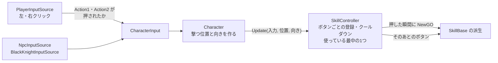
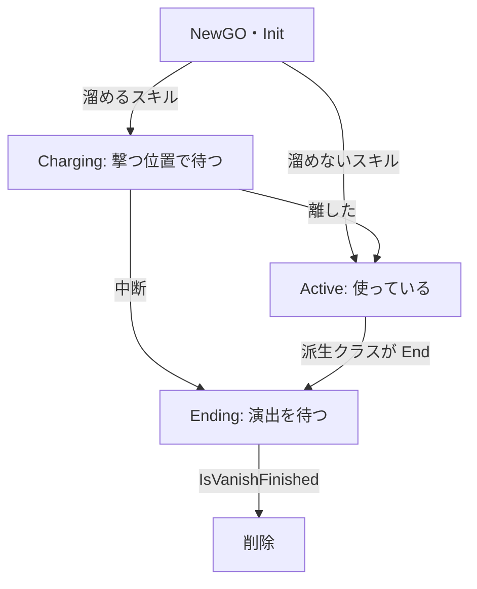

# スキルの設計

作成日: 2026-11-14
対象: `Game/Source/Skill/SkillBase.*`、`SkillController.*`、`CharacterInput` の `ActionButton`・`actions`、`Character` のスキルを使うところ
経緯: [スキルの経緯](スキルの経緯.md)

キャラクターが使う技（スキル）の共通の仕組みのページです。スキルの基底クラス `SkillBase` と、スキルをボタンに登録して使う部品 `SkillController` を説明します。
魔法（`MagicBase`）は `SkillBase` の派生で、[魔法の設計](../魔法/魔法の設計.md) にあります。剣の攻撃（`AttackBase`）も同じ派生にする予定です（まだない）。

- **入力は「どのボタンが押されたか」だけ。** キーを読むのは入力元（`PlayerInputSource`・AI）で、スキルのことは知らない。
- **どのボタンで何を使うかは `SkillController` が持つ。** `Register<IceMagic>(ActionButton::Action1)` の1行で決まる。
- **スキル = 1回使うごとの1つ。** 使うたびに `NewGO` し、終わったら自分で消える。
- **入力を受け取ったあとの判断は `SkillBase` に書く。** 押している間・離した・中断の扱いは、派生クラスごとに書かない。

---

## 1. 全体像



```
SkillBase（基底。使うたびに1つ NewGO する）
├─ MagicBase   … 飛んでいく1発
│   ├─ IceMagic・FireMagic・SlashMagic
└─ AttackBase  … 剣の1振り（あとで作る）
```

| もの | 知っていること | 知らないこと |
|---|---|---|
| `PlayerInputSource` | キー・マウス・パッド → `Action1`・`Action2` | スキル |
| `CharacterInput` | ボタンが押されたか（`actions`） | 何に使うか |
| `SkillController` | どのボタンでどのスキルを使うか、クールダウン、使っている最中の1つ | キー・マウス |
| `SkillBase` | 押している間・離した・中断したらどうするか | どのボタンか |

`CharacterInput` を間に置くので、AI も「`Action1` を押す」と入れるだけで同じスキルを使えます。入力元を差し替えても、溜めやクールダウンは `SkillController` に残ります。

---

## 2. ボタンの割り当て

| ボタン | Player（マウス・キーボード / パッド） | Player が登録しているスキル | 黒騎士 |
|---|---|---|---|
| `Action1` | 左クリック（I）/ Y | 氷魔法 | AI が剣の攻撃に使う（`attackIndex` で種類） |
| `Action2` | 右クリック（8）/ RB2 | 炎魔法 | 使わない |

キーの割り当ては [PlayerInputSource.cpp](../../../Game/Source/Character/Input/PlayerInputSource.cpp)、スキルの登録は [Player.cpp](../../../Game/Source/Player/Player.cpp) の `OnStart()` にあります。
黒騎士の剣は、まだスキルではなく、攻撃のステートが `Action1` を見ています（7章）。

---

## 3. 1フレームの流れ

| # | どこで | 何をする |
|---|---|---|
| 1 | 入力元 | ボタンの状態を `CharacterInput::actions` に入れる |
| 2 | `Character::UpdateSkill()` | 動けなければ `SkillController::CancelAll()`。動ければ撃つ位置と向きを作り、入力の写しを `FilterSkillInput()` で派生クラスに書き換えさせてから、`SkillController::Update()` へ渡す |
| 3 | `SkillController::Update()` | 使っている最中のスキルがあれば、そのボタンの状態だけを渡す（ほかのボタンは受け付けない）。なければ、登録したボタンが押された瞬間に、クールダウンを見て `NewGO` する |
| 4 | `SkillBase::ReceiveInput()` | 押している間は位置と向きを合わせる。離したら、次の `Update()` で使い始める |
| 5 | `SkillController` | スキルが手を離したら（`IsOwnerBusy()` が false）、その時刻からクールダウンを数え、次のボタンを受け付ける |

- 同時に使えるスキルは1つです。溜めている間は、ほかのボタンを押しても何も起きません。
- 中断（凍ったとき）したスキルは、クールダウンを始めません。
- Player は 3段攻撃の間、`FilterSkillInput()` で「手を突き出したコマでだけ `Action1` を押した」ことにしています（[3段攻撃の設計](../プレイヤー/3段攻撃の設計.md)）。

---

## 4. SkillBase の流れ

コード: [SkillBase.h](../../../Game/Source/Skill/SkillBase.h)、[SkillBase.cpp](../../../Game/Source/Skill/SkillBase.cpp)



派生クラスが書くもの:

| 関数・定数 | 呼ばれるとき | 書くこと |
|---|---|---|
| `COOLDOWN` | （`SkillController` が読む） | 手を離してから、次に使えるまでの秒数。既定は 0 |
| `IsChargeType()` | 作った直後 | 溜めるなら true |
| `OnStart()` | 最初のフレーム | エフェクトやモデルの読み込み。失敗なら false |
| `OnCharge(秒)` | 溜めている間、毎フレーム | 溜めの見た目 |
| `OnRelease()` | 使い始める瞬間 | 溜め具合で性能を変える、など |
| `OnCancel()` | 溜めている途中で中断された | 溜めの見た目を片付ける |
| `OnSkillUpdate()` | 使っている間、毎フレーム | 動き（魔法なら飛ぶ）。終わったら `End()` |
| `IsVanishFinished()` | 終わったあと、毎フレーム | 演出が終わったか |

---

## 5. 実装方法

### 入力を受け取ったあとは基底クラスで決める

```cpp
void SkillBase::ReceiveInput(const ButtonState& button, const Vector3& position, const Vector3& direction)
{
    if (!IsOwnerBusy()) { return; }       // 溜めていなければ、あとの入力は関係ない
    if (button.isPress) {
        SetPose(position, direction);     // 押している間: 手元に合わせる
    }
    else {
        m_isReleased = true;              // 離した: 次の Update で使い始める
    }
}

bool SkillBase::IsOwnerBusy() const
{
    return m_state == EnState::Charging && !m_isReleased && !m_isCanceled;
}
```

溜めないスキルは、`Init()` の時点で「離した」ことにするので、作った直後から `IsOwnerBusy()` が false です。離した・中断は合図だけ立てて、次の `Update()` で扱います。作った直後（`Start()` より前）に離されても、読み込む前に使ってしまうことがありません。読み込みに失敗したスキルも、`IsOwnerBusy()` が true の間は消えません（`SkillController` が指しているため）。

### SkillController はボタンごとに「作る関数」とクールダウンを持つ

```cpp
template <class T>
void Register(ActionButton button)
{
    Entry& entry = m_entries[static_cast<int>(button)];
    entry.create = [] { return NewGO<T>(1, SkillBase::OBJECT_NAME); };
    entry.cooldown = T::COOLDOWN;
}
```

```cpp
void SkillController::Update(const CharacterInput& input, const Vector3& origin, const Vector3& direction)
{
    if (m_active != nullptr) {                         // 使っている最中は、そのボタンだけを見る
        m_active->ReceiveInput(input.actions[m_activeButton], origin, direction);
        if (!m_active->IsOwnerBusy()) { FinishActive(); }   // 手を離した → クールダウンを始める
        return;
    }
    for (int button = 0; button < Num; button++) {    // 押された瞬間のボタンのスキルを作る
        if (!entry.create || !input.actions[button].isTrigger || !IsReady(entry)) { continue; }
        m_active = entry.create();
        m_active->Init(origin, direction, m_owner, m_faction);
        if (!m_active->IsOwnerBusy()) { FinishActive(); }   // 溜めないスキルは、すぐ手を離す
        return;
    }
}
```

クールダウンは「手を離した時刻」と `GameClock::Now()` の差で測ります。溜めた秒数も、溜め始めた時刻との差です。`GameClock` はゲームが始まってからの秒数で、`Game`（優先度0）が毎フレーム、キャラクター（優先度1）より先に進めます。

### 名前をそろえて、ゲームの終わりにまとめて消す

どのスキルも `SkillBase::OBJECT_NAME`（`"skill"`）で作ります。[Game.cpp](../../../Game/Source/Core/Game.cpp) のデストラクタで、その名前のものを種類を問わずまとめて消します。

---

## 6. 使い方

### スキルを持たせる

```cpp
void Player::OnStart()
{
    m_skillController.Register<IceMagic>(ActionButton::Action1);
    m_skillController.Register<FireMagic>(ActionButton::Action2);
}
```

### キーの割り当てを変える・ボタンを増やす

- 割り当てを変えるときは、`PlayerInputSource` の `input.Action(ActionButton::Action1).Update(...)` の行だけを直す。
- ボタンを増やすときは、[CharacterInput.h](../../../Game/Source/Character/Input/CharacterInput.h) の `ActionButton` に `Action3` を足し、`PlayerInputSource` でキーを読み、`Register<...>(ActionButton::Action3)` する。

### AI に使わせる

入力元で `input.Action(ActionButton::Action1).Update(押すか);` とする。溜めるスキルなら、押し続けてから離す（`NpcInputSource` は `fireHoldSeconds` の間押し続ける）。

---

## 7. 決めたこと

| 決めたこと | 理由 |
|---|---|
| 魔法と攻撃の上に `SkillBase` を置いた | 入力の受け取り・溜め・クールダウン・同時に1つ、の決まりを、魔法と剣の攻撃で1か所にまとめるため |
| 入力は何に使うかを知らないボタン（`ActionButton`）にした | 入力元にスキルのことを書かないため。キーの割り当ては入力元、スキルの割り当ては `SkillController` |
| `SkillController` が `PlayerInputSource` を直接読まない | AI も同じ道でスキルを使え、入力元を差し替えてもスキルの状態が残る。押した瞬間の判定もキーの事情（窓が前にあるか、ImGui を開いているか）も入力元の1か所で済む |
| 同時に使えるのは1つ | 溜めている間・振っている間の扱いを、`SkillController` の1か所で決められる |
| ボタンの名前は `Action1`・`Action2` | 増やすときに番号を足せる（仮の名前。変えるなら `ActionButton` だけを直す） |

---

## 8. 既知の課題

- 黒騎士の剣の攻撃は、まだ `SkillBase` の派生ではない。AI が `Action1` を押すと、攻撃のステート（`EnemyAttackState`）に入る。
- 斬撃（`SlashMagic`）は、攻撃のステートが直接 `NewGO` する。`SkillController` を通らないので、クールダウンなどはない。

---

## 9. 関連するページ

- [魔法の設計](../魔法/魔法の設計.md)（`MagicBase`。飛ぶ・当たる・消える）
- [入力の設計](../キャラクター/入力の設計.md)（`CharacterInput`・`PlayerInputSource`）
- [3段攻撃の設計](../プレイヤー/3段攻撃の設計.md)（攻撃のコマに合わせて `Action1` を書き換える）
- [状態異常の設計](../キャラクター/状態異常の設計.md)（凍ったらスキルを中断する）
