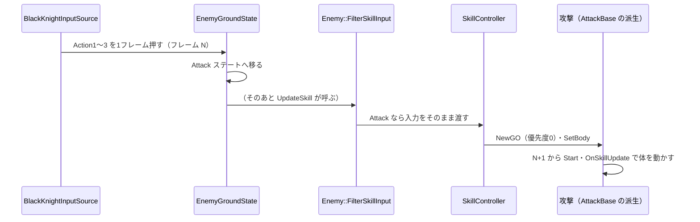

# 剣の攻撃の設計

作成日: 2026-11-15
対象: `Game/Source/Attack/`（`AttackBase` と黒騎士の攻撃1〜3）、`SkillBase`・`SkillController` の体を動かすスキルのための部分、`EnemyAttackState`、`Enemy`、`BlackKnightInputSource`
経緯: [剣の攻撃の経緯](剣の攻撃の経緯.md)

剣で斬る攻撃を、スキル（[スキルの設計](../スキルの設計.md)）の派生 `AttackBase` にしたページです。黒騎士の攻撃1〜3は `AttackBase` の派生です。

- **攻撃1回 = `AttackBase` の派生1つ。** 魔法と同じく、使うたびに `NewGO` し、振り終えたら消える。
- **体の動きは攻撃が全部受け持つ。** アニメーション・踏み込み・溜め・斬撃を出すのは攻撃で、`EnemyAttackState` は「攻撃が終わるまで待つ」だけ。
- **攻撃の種類はボタンで分ける。** 攻撃1〜3 を `Action1`〜`Action3` に登録する。

| 用語 | 何のことか |
|---|---|
| `UpdateAction()` | `Character` の仮想関数。キャラクターの動き（ステートの更新と移動）を派生クラスが書く。毎フレーム `UpdateSkill()` より先に呼ばれる |
| `UpdateSkill()` | `Character` の関数。撃つ位置と向きを作り、入力の写しを `FilterSkillInput()` で書き換えさせてから `SkillController` に渡す（[スキルの設計](../スキルの設計.md)） |
| ステート | [用語集の「キャラクター」](../../../用語集.md#キャラクター) |

---

## 1. 全体像

```
SkillBase
├─ MagicBase   … 飛んでいく1発（撃ったら持ち主から離れる）
└─ AttackBase  … 剣の1振り（振り終わるまで持ち主の体を使う）
    ├─ DashSlashAttack   攻撃1  溜めてから踏み込んで横に斬り抜ける
    ├─ HeavyComboAttack  攻撃2  その場で重い連続斬り
    └─ SlashWaveAttack   攻撃3  連続斬りで、斬撃（SlashMagic）を5つ飛ばす
```

| | MagicBase | AttackBase |
|---|---|---|
| 動くもの | 魔法が持ち主を離れて飛ぶ | 持ち主の体（アニメーション・踏み込み） |
| 作るもの | 魔法のモデルやエフェクト | 作らない（持ち主のモデルと移動の部品を借りる） |
| 当たり判定 | 魔法が自分で持つ | 剣の当たりはまだない。斬撃は `SlashMagic`（MagicBase）を作る |
| 終わるとき | 当たった・射程を飛び終えた | アニメーションを流し終えた |
| 持ち主との関係 | 撃ったら離れる | 振り終わるまで手が離せない |
| 中断されたとき | 溜めの途中だけ止まる | 振っている途中でも止まる |

| ボタン | 黒騎士が登録している攻撃 | AI が押すとき |
|---|---|---|
| `Action1` | `DashSlashAttack`（攻撃1） | 中くらいの距離 |
| `Action2` | `HeavyComboAttack`（攻撃2） | 近い |
| `Action3` | `SlashWaveAttack`（攻撃3） | 遠い |

Player は `Action3` を読まないので、押されることはありません。

---

## 2. 1回の攻撃の流れ



N は AI がボタンを押したフレームです。

| フレーム | どこで | 何をする |
|---|---|---|
| N | `BlackKnightInputSource` | 距離に合わせて `Action1`〜`Action3` のどれかを1フレーム押す |
| N | `EnemyGroundState` | どれかのボタンが押された瞬間に `Attack` へ移る |
| N | `Enemy::FilterSkillInput()` | `Attack` に入っていなければボタンを消す（ひるんだ・倒れている、など） |
| N | `SkillController` | そのボタンの攻撃を優先度0で `NewGO` し、`SetBody()` で体を渡す |
| N+1 | 攻撃の `Start` | 相手の方を向き、アニメーションを流す |
| N+1〜 | 攻撃の `OnSkillUpdate`（キャラクターより先） | 溜め・踏み込み・斬撃。アニメーションが終わったら `End()` |
| 終わり | `SkillController` | `IsOwnerBusy()` が false になったので手を離す |
| 終わり | `EnemyAttackState` | `SkillController` が空いたので、入力に合わせて Idle / Move / Run へ |

- 死んだとき・凍ったときは、`EnemyAttackState::Exit()` が `SkillController::CancelAll()` を呼び、振っている途中の攻撃を止める（凍ったときは `Character::UpdateSkill()` も呼ぶ）。
- 攻撃中に当たっても、ひるまない（`EnemyAttackState` は Hit へ移らない）。

---

## 3. 実装方法

### 体を渡す: SkillBody

コード: [SkillBase.h](../../../../Game/Source/Skill/SkillBase.h)、[Enemy.cpp](../../../../Game/Source/Enemy/Enemy.cpp) の `OnStart()`

```cpp
struct SkillBody
{
    CharacterModel* model = nullptr;
    CharacterMover* mover = nullptr;
    float timeScale = 1.0f;        // 動き全体の速さ（黒騎士の PLAY_SPEED）。
    float rootMoveScale = 100.0f;  // アニメーションの中で進む距離（モデルの m）をゲームの距離にする倍率。
    float blendSeconds = 0.2f;     // アニメーションを切り替えるときの補間時間。
};
```

**名前:**

| ジャンル | 名前 | 何のためのもの | 何をするためのもの | どこから来たもの |
|---|---|---|---|---|
| 型 | `SkillBody` | 持ち主の体を、体を動かすスキルに渡すため | `model`・`mover` と、動きの速さ・距離の倍率・補間時間をまとめた構造体 | ゲームの [SkillBase.h](../../../../Game/Source/Skill/SkillBase.h) |
| 型 | `CharacterModel` | キャラクターのモデルとアニメーションを持つため | `PlayAnimation()` でアニメーションを流し、`GetModelRender()` で `ModelRender` を取り出せる | ゲームの [CharacterModel.h](../../../../Game/Source/Character/Components/CharacterModel.h) |
| 型 | `CharacterMover` | キャラクターの移動（歩く・重力・向き）を持つため | `Move()` で動かし、`FaceTo()` で向きを変える | ゲームの [CharacterMover.h](../../../../Game/Source/Character/Components/CharacterMover.h) |
| メンバー変数 | `model`・`mover` | 攻撃が、体のアニメーションと移動を動かせるようにするため | `CharacterModel` と `CharacterMover` へのポインター。体を渡していなければ `nullptr` | ゲームの `SkillBase.h` の `SkillBody` |
| メンバー変数 | `timeScale` | 動き全体の速さを変えるため | アニメーションと移動の両方に掛ける倍率。1.0 で等倍（黒騎士は `PLAY_SPEED`） | ゲームの `SkillBase.h` の `SkillBody` |
| メンバー変数 | `rootMoveScale` | アニメーションの中の距離を、ゲームの距離にするため | モデルの 1m をゲームの何単位にするかの倍率。既定は 100 | ゲームの `SkillBase.h` の `SkillBody` |
| メンバー変数 | `blendSeconds` | 攻撃のアニメーションへ切り替えるとき、急に変わらないようにするため | 補間する秒数。既定は 0.2 秒 | ゲームの `SkillBase.h` の `SkillBody` |

`Enemy::OnStart()` が `m_skillController.SetBody(body)` で渡し、`SkillController` は作ったスキルに毎回 `SetBody()` します。魔法は使いません。体を渡していないキャラクター（Player）が攻撃を登録しても、`AttackBase::OnStart()` が false を返し、何もせずに消えます。

### 振り終わるまで手を離さない（SkillBase）

コード: [SkillBase.cpp](../../../../Game/Source/Skill/SkillBase.cpp)

「手を離せないか」の判断は `SkillBase` に置き、派生は「体を使うスキルか」（`UsesOwnerBody()`）だけを答えます。

```cpp
bool SkillBase::IsOwnerBusy() const
{
    if (m_isCanceled) { return false; }
    if (UsesOwnerBody()) {
        return m_state != EnState::Ending && !m_isFailed;   // 使い終わるまで
    }
    return m_state == EnState::Charging && !m_isReleased;    // 溜めている間だけ
}
```

**名前:**

| ジャンル | 名前 | 何のためのもの | 何をするためのもの | どこから来たもの |
|---|---|---|---|---|
| メンバー変数 | `m_isCanceled` | 中断されたことを覚えておくため | 中断されたら true | ゲームの `SkillBase.h` の `SkillBase` |
| メンバー変数 | `m_state` | スキルが今どの段階かを覚えるため | `EnState` の値（`Charging`・`Active`・`Ending`）のどれかが入る | ゲームの `SkillBase.h` の `SkillBase` |
| 値 | `EnState::Ending` | 「使い終わった（または中断した）」段階を表すため | 演出が終わるのを待って消える段階。体を動かすスキルは、この段階になるまで手を離せない | ゲームの `SkillBase.h` の `SkillBase`（private の `enum class EnState`） |
| メンバー変数 | `m_isFailed` | `OnStart()` に失敗したことを覚えるため | 失敗したら true。体を動かすスキルは、すぐ手を離す | ゲームの `SkillBase.h` の `SkillBase` |
| 値 | `EnState::Charging` | 「撃つ位置で待っている」段階を表すため | 溜めている間の値。使い始めるまでは、溜めないスキルもこの値 | ゲームの `SkillBase.h` の `SkillBase` |
| メンバー変数 | `m_isReleased` | 離されたことを覚えておくため | 離されたら true。溜めないスキルは、作った時点で true | ゲームの `SkillBase.h` の `SkillBase` |

- `ReceiveInput()`: 使っている間（Active）は、ボタンを見ずに撃つ位置と向きだけを合わせる。攻撃3の斬撃が、振るたびにそのときの相手の方へ飛ぶ。
- `Update()`: 使っている間（Active）も中断を見て、`OnCancel()` → `End()` する。

### 攻撃をキャラクターより先に動かす

`SkillBase::PRIORITY` は 1、`AttackBase::PRIORITY` は 0 で、`SkillController::Register<T>()` は `NewGO<T>(T::PRIORITY, ...)` で作ります。エンジンは、全部の `Start` → 優先度の順に `Update` と進めるので、攻撃（優先度0）が体を動かしたあとに、キャラクター（優先度1）がモデルの位置を合わせます。

### AttackBase

コード: [AttackBase.h](../../../../Game/Source/Attack/AttackBase.h)、[AttackBase.cpp](../../../../Game/Source/Attack/AttackBase.cpp)

派生は、攻撃ごとの数値（`AttackData`）を返し、要るなら `OnSwing()` を書きます。

```cpp
struct AttackData
{
    int clip = 0;                  // 流すアニメーション。
    float chargeAt = -1.0f;        // この時間のコマで止めて溜める。負なら溜めない。
    float chargeSeconds = 0.0f;    // 溜める秒数。
    const float* root = nullptr;   // コマごとに前へ進んだ距離（モデルの m）。
    int rootNum = 0;
};
```

**名前:**

| ジャンル | 名前 | 何のためのもの | 何をするためのもの | どこから来たもの |
|---|---|---|---|---|
| 型 | `AttackData` | 攻撃ごとの数値を、1つにまとめるため | 流すアニメーション・溜め・進む距離の表を持つ構造体。派生クラスの `GetData()` が返す | ゲームの [AttackBase.h](../../../../Game/Source/Attack/AttackBase.h) |
| メンバー変数 | `clip` | 流すアニメーションを選ぶため | アニメーションクリップの番号。黒騎士は `enEnemyAnimClip_Attack1` など | ゲームの `AttackBase.h` の `AttackData`（番号は [EnemyState.h](../../../../Game/Source/Enemy/State/EnemyState.h) の `EnEnemyAnimClip`） |
| メンバー変数 | `chargeAt` | アニメーションを止めて溜める場所を決めるため | アニメーションの始まりからの秒数。攻撃1は Attack1 の 5.5コマ目（左腰に剣を構えてかがむ。5.5 ÷ 30 秒）。負なら溜めない | ゲームの `AttackBase.h` の `AttackData` |
| メンバー変数 | `chargeSeconds` | 溜める長さを決めるため | 止めて待つ秒数。攻撃1は `DashSlashAttack::CHARGE_SECONDS`（0.6秒） | ゲームの `AttackBase.h` の `AttackData` |
| メンバー変数 | `root` | アニメーションの中で体が前へ進む分を、ゲームの動きにするため | コマごとに、始まりからどれだけ前へ進んだか（モデルの m）を並べた配列。`nullptr` なら進まない | ゲームの `AttackBase.h` の `AttackData`（表は [DashSlashAttack.cpp](../../../../Game/Source/Attack/DashSlashAttack.cpp) の `ROOT`） |
| メンバー変数 | `rootNum` | `root` の長さを持つため | `root` の要素の数 | ゲームの `AttackBase.h` の `AttackData` |

| 関数 | 何をするか |
|---|---|
| `UsesOwnerBody()` | true（`final`） |
| `OnStart()` | 体がなければ false |
| `OnActivate()` | 撃つ向きへ `FaceTo`、`PlayAnimation`、アニメーションの速さを `timeScale` に戻す（歩きでゆっくりにした分） |
| `OnSkillUpdate()` | アニメーションが終わっていたら `End()`。溜めのコマならアニメーションの速さを 0 にして待つ。そのあと、表の距離の差だけ `Move()` し、`OnSwing(時間)` を呼ぶ |

時間は `g_gameTime->GetFrameDeltaTime() * timeScale` で進め、溜めている間は進めません。`Move()` は毎フレーム1回呼ぶので、重力もここでかかります。

`OnCancel()` は書いていません。溜めで止めたアニメーションの速さは、そのあとに入るステートや状態異常が決めるからです（Dead は `Enter` で速さを戻し、凍結は `StatusEffects` が 0 にする）。ここで速さを戻すと、凍ったアニメーションが動いてしまいます。

### EnemyAttackState は待つだけ

コード: [EnemyAttackState.cpp](../../../../Game/Source/Enemy/State/EnemyAttackState.cpp)

```cpp
EnemyStateId EnemyAttackState::CheckTransition(...) const
{
    if (EnemyGroundState::CheckDamage(context, false) == EnemyStateId::Dead) { return EnemyStateId::Dead; }
    if (context.skills != nullptr && context.skills->IsBusy()) { return EnemyStateId::Attack; }
    return EnemyGroundState::SelectByInput(context, input);
}
void EnemyAttackState::Exit(EnemyStateContext& context)
{
    if (context.skills != nullptr) { context.skills->CancelAll(); }   // 途中で出るなら止める
}
```

**名前:**

| ジャンル | 名前 | 何のためのもの | 何をするためのもの | どこから来たもの |
|---|---|---|---|---|
| 関数 | `EnemyAttackState::CheckTransition()` | 毎フレーム、次にどのステートへ移るかを決めるため | 移る先の `EnemyStateId` を返す。移らないなら今のステートの ID を返す | ゲームの [EnemyAttackState.cpp](../../../../Game/Source/Enemy/State/EnemyAttackState.cpp)（[State.h](../../../../Game/Source/Character/StateMachine/State.h) の `CheckTransition()` を上書きしている） |
| 型 | `EnemyStateId` | 敵のステートの種類を表すため | `Idle`・`Move`・`Run`・`Attack`・`Hit`・`Dead`・`Frozen` を持つ `enum class` | ゲームの [EnemyState.h](../../../../Game/Source/Enemy/State/EnemyState.h) |
| 型 | `EnemyStateContext` | ステートが触ってよいものを、まとめて渡すため | 移動・モデル・`SkillController` へのポインターや調整値を持つ構造体 | ゲームの `EnemyState.h` |
| 引数 | `context`・`input` | ステートが、触ってよいものと、このフレームの入力を受け取るため | `context` は `EnemyStateContext`、`input` は `CharacterInput` | ゲームの `State.h` の `CheckTransition()` の引数 |
| 関数 | `EnemyGroundState::CheckDamage()` | 死んだか・当たったかを調べるため | 死んでいれば `Dead` を返す。`canFlinch` が true のときは、当たっていれば `Hit` を返す。どちらでもなければ `Num` を返す | ゲームの [EnemyGroundState.h](../../../../Game/Source/Enemy/State/EnemyGroundState.h) |
| 値 | `EnemyStateId::Dead`・`Attack` | 倒れた・攻撃中のステートを指すため | 倒れたステート・剣で攻撃しているステート | ゲームの `EnemyState.h` の `EnemyStateId` |
| 関数 | `IsBusy()` | スキルを使っている最中かを調べるため | 溜めている・攻撃を振っている最中なら true を返す | ゲームの [SkillController.h](../../../../Game/Source/Skill/SkillController.h) の `SkillController` |
| 関数 | `EnemyGroundState::SelectByInput()` | 入力から、行き先のステートを決めるため | 移動の入力が小さければ `Idle`、走る入力があれば `Run`、なければ `Move` を返す | ゲームの `EnemyGroundState.h` |
| 関数 | `Exit()` | ステートから出るときの後始末を書くため | ほかのステートへ移るとき、StateMachine が1回呼ぶ | ゲームの `State.h` の `State`（`EnemyAttackState` が上書きしている） |
| 関数 | `CancelAll()` | 溜めているスキル・振っている攻撃を止めるため | 使っている最中のスキルを中断する。中断したスキルは、クールダウンを始めない | ゲームの `SkillController.h` の `SkillController` |

`Update()` は何もしません。`EnemyStateContext` は `SkillController* skills` を持ちます。

### 攻撃のステートに入ったフレームだけ攻撃を作る

ステート（`UpdateAction`）は `SkillController`（`UpdateSkill`）より先に更新されます。`Enemy::FilterSkillInput()` は、ステートが `Attack` でなければボタンを全部消すので、ひるんだフレームや倒れている間に AI がボタンを押しても、攻撃は作られません。

---

## 4. 使い方

### 攻撃を足す

1. `AttackBase` を継承し、`GetData()` で clip・溜め・進む距離の表を返す。
2. 斬撃などを出すなら `OnSwing(time)` を書く。使える関数は、`GetBodyPosition()`（持ち主の今の位置）・`GetBodyForward()`（持ち主の前向き。高さは無視）・`GetDirection()`（`SkillBase` が持つ、撃つ向き）。
3. 持ち主の `OnStart()` で `SetBody()` してから `m_skillController.Register<新しい攻撃>(ActionButton::...)`。

### AI に使わせる

入力元で、その攻撃のボタンを1フレーム押す。黒騎士は [BlackKnightInputSource.h](../../../../Game/Source/Enemy/BlackKnightInputSource.h) の `ATTACK_DASH_SLASH`・`ATTACK_COMBO`・`ATTACK_SLASH_WAVE` でボタンを決めている。

---

## 5. 調整用の数値

| 数値 | 場所 | 今の値 |
|---|---|---|
| 攻撃1で溜める秒数 | `DashSlashAttack::CHARGE_SECONDS` | 0.6秒 |
| 攻撃1の溜めのコマ | [DashSlashAttack.cpp](../../../../Game/Source/Attack/DashSlashAttack.cpp) の `DATA` | Attack1 の 5.5コマ目（左腰に剣を構えてかがむ） |
| 攻撃3の斬撃を出すコマ | [SlashWaveAttack.cpp](../../../../Game/Source/Attack/SlashWaveAttack.cpp) の `SLASH_TIMES` | Attack3 の 12・49.5・62・78・90コマ目 |
| 攻撃3の斬撃の傾き | 同 `SLASH_ROLL_DEG` | 45・-45・45・0・90度 |
| 斬撃を出す高さ・前へ出す距離 | 同 `SLASH_HEIGHT`・`SLASH_FORWARD` | 110・80 |
| 斬撃の速さ・射程・当たり判定の半径 | [magic.json](../../../../Game/Assets/data/magic.json) の `slash.speed`・`range`・`radius`（[魔法の調整値の設計](../../魔法/魔法の調整値/魔法の調整値の設計.md)） | 1100・1500・45 |

コマは 30fps で、クリップの先頭を 0コマ目と数えます。

---

## 6. 決めたこと

| 決めたこと | 理由 |
|---|---|
| 体の動きは攻撃が全部受け持つ | 1つの攻撃の中身が1クラスにまとまる。ほかのキャラクターにも同じ攻撃を登録できる |
| 攻撃の種類はボタンで分け、`attackIndex` をなくした | `SkillController` の「1つのボタンに1つのスキル」のままで済む |
| `IsOwnerBusy()` を派生で上書きせず、`UsesOwnerBody()` を答えさせる | 入力を受け取ったあとの判断を `SkillBase` の1か所に残すため |
| 攻撃は優先度0で作る | キャラクターより先に体を動かし、モデルが1フレーム遅れないようにする |
| 斬撃は振るコマで1つずつ作る | 先に5つ作ると、待たせる仕組み・飛べと言う口・途中で止まったときの片付けが要り、重さも変わらない |
| 攻撃1の溜めの秒数を `EnemyTuning` から攻撃の定数へ移し、`EnemyTuning` をなくした | `EnemyTuning` を読んでいたのは攻撃1だけで、変える画面もなかった |

---

## 7. 既知の課題

- 剣が当たったときのダメージはまだない。
- ボタンを押したフレーム（N）は、攻撃もステートも体を動かさないので、1フレームだけ重力がかからない。
- 攻撃を作ったフレームと最初に動くフレームの間に、歩きのアニメーションが1フレーム進む。

---

## 8. 関連するページ

- [スキルの設計](../スキルの設計.md)（`SkillBase`・`SkillController`・`ActionButton`）
- [ステートマシンの設計](../../キャラクター/ステートマシン/ステートマシンの設計.md)（`EnemyAttackState` が使うステートの仕組み）
- [魔法の設計](../../魔法/魔法の設計.md)（`MagicBase`。斬撃 `SlashMagic` もこちら）
- [敵のステートの設計](../../敵/敵のステート/敵のステートの設計.md)
