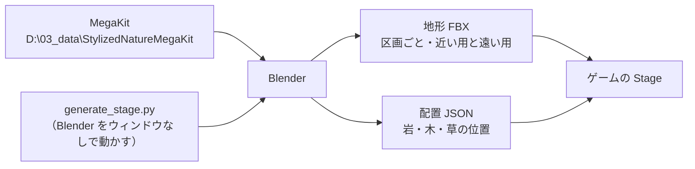

# ステージの設計

作成日: 2026-11-08
対象: 原神のような見渡せる草原のステージ（地形・岩・木・草）。まだ実装していない。今の仮の足場は [Stage.cpp](../../../Game/Source/Objects/Stage.cpp)
経緯: [ステージの経緯](ステージの経緯.md)

岩と草原の広いステージを、ポリゴン少なめ・軽い描画で作るためのページです。光の当て方（アニメ調の影など）はこのページでは扱わず、別のページで決めます。

- **地形は Blender のスクリプトで作る。** 手で作らず、ノイズ（自然な凹凸を作る乱数の模様）と決まりから作るので、何度でも作り直せる。
- **岩・木・草は Quaternius の Stylized Nature MegaKit（無料版・CC0）の部品を置く。** 置き場所は JSON に書き出し、ゲームで読む。
- **広さに負けないように、区画に分けて「見えないもの・遠いものは描かない」。**

---

## 1. 全体像



| 作るもの | 置き場所 | 中身 |
|---|---|---|
| ステージを作るスクリプト | `Action/tools/StageGenerator/generate_stage.py` | 地形を作り、部品を置き、書き出す |
| 作り方の設定 | `Action/tools/StageGenerator/field_settings.json` | 広さ・丘の高さ・乱数の種・部品の密度 |
| 地形のモデル | `Game/Assets/modelData/stage/field/chunk_X_Y.fbx`（近い用）、`chunk_X_Y_far.fbx`（遠い用） | 区画ごとの地面。テクスチャも区画ごとに1枚 |
| 部品のモデル | `Game/Assets/modelData/stage/nature/` | MegaKit から使う分だけコピーした FBX とテクスチャ |
| 配置 | `Game/Assets/data/stage/field_props.json` | どの部品を、どこに、どの向き・大きさで置くか |

MegaKit の元の一式はリポジトリに入れない。使う部品だけをコピーして git で管理する。

## 2. 詳細

### 2.1 広さと区画

| 項目 | 値 |
|---|---|
| 1区画の広さ | 64m 四方（ゲームの単位で 6400。1単位 = 1cm） |
| 最初に作る広さ | 2×2 区画（128m 四方） |
| 目標の広さ | 8×8 区画（512m 四方）。カメラの見える距離（400m）とほぼ同じ |

### 2.2 地形

- 丘・くぼ地はノイズの重ね合わせで作る。坂の急なところは崖にする。
- 地面の色は、坂の角度と高さで「草・土・岩肌」を塗り分け、区画ごとに 1024×1024 のテクスチャ1枚に焼き込む。シェーダーを変えずに描ける。
- 無料版には崖ほど大きな岩がないので、崖は地形の岩肌と、`Rock_Medium` を拡大・回転させて重ねたもので作る。
- 遠い用の地形は、ポリゴンを 1/8 くらいに減らしたもの。

### 2.3 部品の置き方

| 部品 | 置く場所 | 当たり判定 | 影を落とすか |
|---|---|---|---|
| 岩（Rock_Medium、Pebble） | 坂の急なところ・崖の下に多く | あり（モデルの形） | 落とす |
| 木（CommonTree、Pine など） | 平らなところにまばらに。まとまって林にもする | 幹だけ（円柱） | 落とす |
| 草・花・茂み・シダ | 平らなところに密に | なし | 落とさない |
| 石畳（RockPath） | 道として、決めた線の上に | なし | 落とさない |

部品どうしが重ならないように、置くたびに近くに置いたものとの距離を見る。

## 3. 実装方法

### 3.1 Blender のスクリプト

`blender.exe --background --python generate_stage.py` で、ウィンドウを出さずに動かす。

1. `field_settings.json` を読む。乱数の種を固定するので、同じ設定なら同じステージができる。
2. 区画ごとに格子状のメッシュを作り、ノイズで頂点の高さを決める。区画の境目は、隣と同じ高さになるように、ノイズを世界の座標で計算する。
3. 坂の角度・高さから地面の色を決め、テクスチャに焼き込む。
4. 決まりに従って部品の位置を決め、地面の高さに合わせる。
5. 地形を FBX（1m = ゲームの 100、Z を上）で、配置を JSON で書き出す。
6. 確かめ用に、上からと斜めからの画像を描き出す（画面は撮らない）。

### 3.2 配置 JSON

```json
{
  "chunkSize": 6400,
  "chunks": [
    { "x": 0, "y": 0, "model": "field/chunk_0_0.fbx", "far": "field/chunk_0_0_far.fbx" }
  ],
  "props": [
    { "model": "nature/Rock_Medium_1.fbx", "chunk": [0, 0],
      "pos": [120.0, 35.5, -80.0], "rotY": 47.0, "scale": 2.4 }
  ]
}
```

読むのは [JSON読み込みの設計](../システム/JSON読み込みの設計.md) の `JsonFile` を使う。

### 3.3 ゲーム側

今の `Stage` を入口にし、中を次のように分ける。

| クラス | 役割 |
|---|---|
| `Stage` | 配置 JSON を読み、下の2つを作る |
| `StageChunk` | 1区画の地形。近い用・遠い用の2つの `ModelRender` と、当たり判定（`PhysicsStaticObject`）を持つ |
| `StageProps` | 部品の種類ごとに1つの `ModelRender` を作り、インスタンス描画（同じモデルをまとめて1回で描く）する |

- **地形**: 普通の `ModelRender` は画面の外にあると描かない仕組みをエンジンが持っているので、それに任せる。カメラからの距離で、近い用と遠い用のどちらかだけを `Draw` する。
- **部品**: エンジンのインスタンス描画は、画面の外の物も描いてしまう。そこで毎フレーム、描く区画（カメラに近く、画面に入る区画）の部品だけを、0番から詰めて `UpdateInstancingData` に渡す。渡した数だけ描かれる。
- **草**: 部品と同じ仕組みで、描く距離だけを短くする。
- **葉・草の透明な部分**: G バッファに書くシェーダーが、アルファ 0.2 未満のピクセルを捨てているので、そのまま切り抜かれる。

## 4. 使い方

1. `field_settings.json` の値を変える。
2. `Action/tools/StageGenerator/generate.cmd` を実行する（Blender の場所は `D:\01_software\17_Blender\blender-5.2.3-windows-x64\blender.exe`）。
3. 描き出された確かめ用の画像を見て、よければゲームを起動する。FBX は起動したときに tkm へ変換される。
4. 地形を手で直したいときは、書き出された `.blend` を Blender で開いて直し、FBX を書き出し直す（スクリプトを動かすと上書きされるので注意）。

## 5. 調整用の数値

| 値 | 最初の値 | 効くこと |
|---|---|---|
| 地形の格子の間隔 | 1m（1区画 64×64 マス、約8,000 ポリゴン） | 地形の細かさと重さ |
| 遠い用に切り替える距離 | 150m | 遠くの地形の荒さが見えるか |
| 岩・木を描く距離 | 300m | 遠くの景色の密度 |
| 草を描く距離 | 35m | いちばん重さに効く。霧で消える境目を隠す前提 |
| 草の密度 | 1区画あたり 4,000 本 | 草原の見た目と重さ |
| テクスチャの大きさ | 1区画 1024×1024 | 地面の細かさとメモリ |

## 6. 決めたこと

- 光の当て方はこのページで扱わない。
- 地形は Blender で作り、部品の配置もスクリプトで決める。配置を FBX に入れないのは、1つの大きなモデルになってしまい、インスタンス描画も「見えない物を描かない」ことも使えなくなるため。
- 有料の素材は使わない。

## 7. 既知の課題

- MegaKit の FBX が今の FBX インポーターでそのまま読めるか（テクスチャの参照・軸・大きさ）は、まだ確かめていない。
- 部品の数が多くなると、毎フレーム `UpdateInstancingData` で行列を計算する CPU の時間が増える。遅ければ、区画ごとに行列を前もって計算しておく形に変える。
- 区画の境目で、遠い用と近い用の地形の高さが少しずれて隙間が見えることがある。見えたら、遠い用の区画の縁を少し下に伸ばして隠す。

## 8. 関連するページ

- [JSON読み込みの設計](../システム/JSON読み込みの設計.md)
- [モデル読み込みの設計](../../エンジン/モデル読み込みの設計.md)（FBX→tkm 変換）
