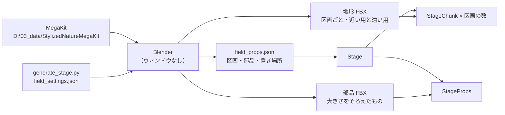

# ステージの設計

作成日: 2026-11-08
対象: 草原のステージ（地形・岩・木・草）。[Stage.cpp](../../../Game/Source/Objects/Stage.cpp)、[StageChunk.cpp](../../../Game/Source/Objects/StageChunk.cpp)、[StageProps.cpp](../../../Game/Source/Objects/StageProps.cpp)、[generate_stage.py](../../../tools/StageGenerator/generate_stage.py)
経緯: [ステージの経緯](ステージの経緯.md)

岩と草原の広いステージを、ポリゴン少なめ・軽い描画で作るためのページです。光の当て方（アニメ調の影など）はこのページでは扱いません。

- **地形は Blender のスクリプトで作る。** ノイズ（自然な凹凸を作る乱数の模様）と決まりから作るので、設定を変えれば何度でも作り直せる。
- **岩・木・草は Quaternius の Stylized Nature MegaKit（無料版・CC0）の部品を置く。** 置き場所は JSON に書き出し、ゲームで読む。
- **区画に分けて、見えないもの・遠いものは描かない。** 部品は種類ごとに GPU インスタンシング（同じモデルをまとめて1回で描く）で描く。

---

## 1. 全体像



| 作るもの | 置き場所 |
|---|---|
| ステージを作るスクリプトと設定 | `tools/StageGenerator/`（`generate_stage.py`、`field_settings.json`、`generate.cmd`） |
| 地形のモデル | `Game/Assets/modelData/stage/field/chunk_X_Y.fbx`（近い用）、`chunk_X_Y_far.fbx`（遠い用）、`chunk_X_Y.png`（地面の色） |
| 部品のモデル | `Game/Assets/modelData/stage/nature/〇〇.fbx`、テクスチャは `nature/Textures/` |
| 配置 | `Game/Assets/data/stage/field_props.json` |
| 確かめ用の画像と .blend | `tools/StageGenerator/preview/`（git に入れない） |

MegaKit の元の一式はリポジトリに入れない。スクリプトが使う部品だけを書き出す。

## 2. 詳細

### 2.1 広さと区画

| 項目 | 値 |
|---|---|
| 1区画 | 64m 四方（ゲームの単位で 6400。1単位 = 1cm） |
| 今の広さ | 2×2 区画（128m 四方）。真ん中（原点）がプレイヤーの出てくるところ |
| 地形のポリゴン | 近い用 1区画 8,192 三角形（1m 間隔）、遠い用 128 三角形（8m 間隔） |

### 2.2 地形と地面の色

- 丘はノイズの重ね合わせ。北側（ゲームの -Z 側）に高さ 9m の崖があり、その上が高台になる。
- 原点のまわり（半径 10m）は高さ 0 で平らにする。道は少しへこませる。
- 地面の色は、坂の角度・高さ・道からの距離で「草（明るい・普通・暗い）・土・岩肌」を塗り分け、区画ごとに 1024×1024 の画像1枚にする。シェーダーは変えていない。

### 2.3 部品と置き方

| 種類 | 部品 | 当たり判定 | 影を落とす | 描く距離 |
|---|---|---|---|---|
| tree | CommonTree_1〜3（崖の下）、Pine_1〜2（崖の上） | 幹だけ（カプセル） | 落とす | 300m |
| rock | Rock_Medium_1〜3（崖の下に大きく並べる・平地にまばら） | モデルの形 | 落とす | 300m |
| detail | 茂み、シダ、小石、石畳（道の上） | なし | 落とさない | 80m |
| grass | 草2種、花2種 | なし | 落とさない | 35m |

置き方の決まり（場所・数・大きさ・間隔・固まり具合）は `field_settings.json` の `rules` に書く。

## 3. 実装方法

### 3.1 座標と大きさ

Blender は X が東・Y が北・Z が上で、単位は m。FBX は Z が上のまま書き出し、ゲームでは `enModelUpAxisZ` で読む。エンジンはそのとき X 軸まわりに -90 度回すので、Blender の (x, y, z) はゲームの (100x, 100z, -100y) になる。配置 JSON にはこの換算をしたゲームの座標を書く。

エンジンの FBX インポーターは単位の設定を見ず、ノードの変形まで含めた座標をそのまま使う。`apply_unit_scale=False`・`apply_scale_options='FBX_SCALE_NONE'` で書き出すと、1m がファイルの中で 100 になる。

### 3.2 部品の書き出し（generate_stage.py）

- `baseScale` で大きさをそろえる（草は元が 1.3m あるので 0.4 倍、シダは 0.22 倍など）。
- **葉・草は面が1枚で、エンジンは裏の面を描かない。** そこで `foliage` に書いたマテリアルの面を複製して裏返し、裏からも見えるようにする。エンジンは法線を読み込み時に計算し直すが、向きの逆な法線どうしは平均しないので、裏返した面の明るさは崩れない。
- 茂みの葉は有料版のシェーダーで色を付ける前提の白い画像なので、`tint` で緑を掛けた画像を作る。テクスチャのないマテリアルは、エンジンがフォルダーの別の画像を拾わないように、1色の小さな画像を作って貼る。

### 3.3 配置 JSON

```json
{
  "chunkSize": 6400.0,
  "chunks": [ { "x": 0, "y": 0, "model": "Assets/.../chunk_0_0.fbx", "far": "Assets/.../chunk_0_0_far.fbx", "center": [-3200.0, 47.2, 3200.0], "tris": 8192 } ],
  "models": [ { "name": "Rock_Medium_1", "path": "Assets/.../Rock_Medium_1.fbx", "kind": "rock", "collision": "mesh", "shadow": true, "drawDistance": 30000.0, "tris": 342 } ],
  "props": [ { "chunk": [0, 0], "model": 5, "items": [ [x, y, z, 向き, 大きさ, 傾きX, 傾きZ], ... ] } ]
}
```

1つの置き方を1行にして、ファイルを小さく・差分を見やすくしている。

### 3.4 ゲーム側

| クラス | 役割 |
|---|---|
| `Stage` | JSON を読み、`StageChunk` と `StageProps` を作る。毎フレーム `StageProps::Update()` を呼ぶ |
| `StageChunk` | 1区画の地形。近い用・遠い用の `ModelRender` と当たり判定（`PhysicsStaticObject`）。カメラから水平に 150m より遠ければ遠い用を描く |
| `StageProps` | 部品の種類ごとに1つの `ModelRender` を、最大数＝全区画のその部品の数でインスタンス描画にする。当たり判定は最初に全部作る |

- 地形は普通の `ModelRender` なので、画面に入らない区画はエンジンが描かない。
- 部品はインスタンス描画なので、画面の外の物も描いてしまう。そこで `StageProps::Update()` で、カメラの後ろにまるごとある区画と、描く距離の外の物を飛ばし、残りだけを 0 番から詰めて `UpdateInstancingData()` に渡す。渡した数だけが描かれる。
- 岩の当たり判定は、インスタンス描画のモデルに置き場所の行列がないので、`Model::CalcWorldMatrix()` で1つずつ計算して `PhysicsStaticObject::CreateFromModel()` に渡す。
- エンジンのインスタンス描画は、もとは全インスタンス分の頂点を毎フレーム事前計算していた。草のように数が多いと重いので、アニメーションのないモデルは GPU インスタンシングで描くようにエンジンを直した（`ModelRender` の `m_isGpuInstancing`）。

## 4. 使い方

1. `tools/StageGenerator/field_settings.json` を変える（広さ・丘・崖・道・色・部品・置き方）。
2. `tools/StageGenerator/generate.cmd` を実行する。Blender の場所が違う PC では、環境変数 `BLENDER_EXE` に `blender.exe` のパスを入れる。MegaKit の場所はスクリプトの `MEGAKIT_DIR`。
3. `tools/StageGenerator/preview/` の画像（地面から・斜め上から・真上から）を見る。
4. ゲームを起動すると、FBX が tkm に、PNG が DDS に変換される。変換されたものもコミットする。

- 部品を足すときは、`models` に1行（名前・種類・`baseScale`・葉のマテリアル名）、`rules` に置き方を1行足す。
- スクリプトは `field/` と `nature/` を消してから作り直すので、そこに手で置いたファイルは消える。

## 5. 調整用の数値

| 値 | 場所 | 今の値 | 効くこと |
|---|---|---|---|
| 地形の格子の間隔 | `gridStep` / `farGridStep` | 1m / 8m | 地形の細かさと重さ |
| 遠い用に切り替える距離 | `StageChunk.cpp` の `FAR_MODEL_DISTANCE` | 15000（150m） | 遠くの地形の荒さが見えるか |
| 描く距離 | `kinds` の `drawDistance` | 木・岩 300m、細かい物 80m、草 35m | 重さに一番効くのは草 |
| 草の数 | `rules` の `count` | 1区画に 1,500＋300 本 | 草原の見た目と重さ |
| 地面の画像の大きさ | `textureSize` | 1024 | 地面の細かさとメモリ |

## 6. 決めたこと

- 光の当て方はこのページで扱わない。草や岩の明るさ・色味はライティングの作業で合わせる。
- 配置を FBX に入れず JSON にした。1つの大きなモデルにすると、インスタンス描画も見えない物を描かないことも使えなくなるため。
- 有料の素材は使わない。崖ほど大きな岩がないので、崖は地形の岩肌と、拡大した `Rock_Medium` を並べて作る。

## 7. 既知の課題

- 草・木・岩が暗く、岩が白く光って見える。光の当て方の作業で直す。
- 2×2 区画で確かめただけ。8×8 区画に広げたときの重さは、まだ測っていない。
- 遠い用と近い用の地形の境目に隙間が見えることがある。見えたら、遠い用の区画の縁を下に伸ばして隠す。

## 8. 関連するページ

- [JSON読み込みの設計](../システム/JSON読み込みの設計.md)
- [モデル読み込みの設計](../../エンジン/モデル読み込みの設計.md)（FBX→tkm 変換）
