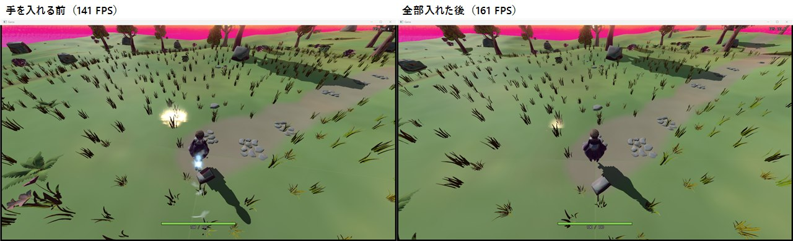
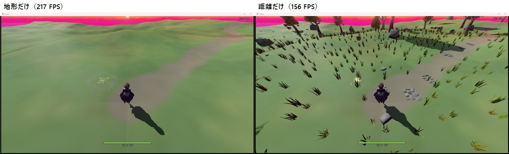
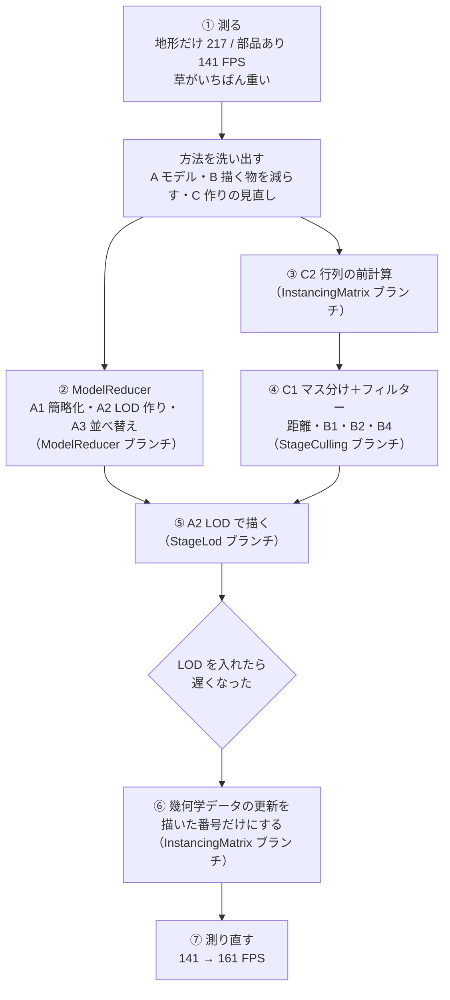
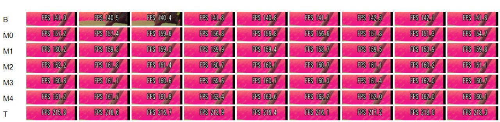

# ステージの軽量化の経緯

作成日: 2026-11-10
対象: StageLod ブランチ（ModelReducer・InstancingMatrix・StageCulling を取り込んだもの）
設計: [ステージの部品の描き方の設計](ステージの部品の描き方の設計.md)、[モデルの軽量化の設計](../../エンジン/モデルの軽量化の設計.md)、[インスタンス描画の設計](../../エンジン/インスタンス描画の設計.md)

ステージの岩・木・草などの部品を描くのが重かったので、軽くするためにしたことを、した順に書きます。

---

## まとめ（した順と効果）

1. **何が重いかを測った。** 地形だけなら 217 FPS、部品を置くと 141 FPS。部品で 1 フレームに 2.5ms 使っていて、いちばん多いのは草だった。
2. **モデルを軽くする仕組み（ModelReducer）を作った。** meshoptimizer で三角形を減らし（A1）、細かさの違うモデル（LOD）を作り（A2）、頂点を GPU が速く読める順に並べる（A3）。起動のたびには作らない。
3. **行列を最初に1回だけ計算するようにした（C2）。** 毎フレームは、計算済みの行列を渡すだけにした。
4. **描く物を選ぶ部品を作った。** 地面を 8m のマスに分けて、マスごと飛ばす（C1）。そのあとフィルターを順に通す: 距離 → 視錐台（B1） → 遠くの草の間引き（B2） → 画面で小さく見える物（B4）。
5. **LOD を使った（A2）。** 遠くの部品は三角形の少ないモデルで描く。
6. **LOD を入れたら遅くなった原因を直した。** エンジンが、描かない番号のぶんまで毎フレーム「幾何学データ」を更新していた。影を落とす物の、描いた番号のぶんだけ更新するようにした。
7. **測り直した。** 141 FPS → **161 FPS**（1 フレーム 7.08ms → 6.21ms）。部品にかかる時間は 2.46ms → 1.59ms で、**35% 減った**。

| 順 | した状態 | FPS（9回の平均） | 1フレーム | 部品にかかる時間 ※ | 手を入れる前と比べて |
|---|---|---|---|---|---|
| ― | 地形だけ（部品なし） | 216.6 | 4.62ms | 0 | ― |
| 0 | **手を入れる前** | **141.3** | **7.08ms** | **2.46ms** | ― |
| 1 | C2 行列の前計算 ＋ C1 マス ＋ 距離 ＋ 幾何学データの直し | 155.8 | 6.42ms | 1.80ms | −0.66ms |
| 2 | ＋ B1 視錐台 | 158.9 | 6.29ms | 1.67ms | −0.79ms |
| 3 | ＋ B2 遠くの草の間引き | 161.0 | 6.21ms | 1.59ms | −0.87ms |
| 4 | ＋ B4 画面で小さく見える物 | 160.8 | 6.22ms | 1.60ms | −0.86ms |
| 5 | **＋ A2 LOD（全部入れた今の形）** | **161.0** | **6.21ms** | **1.59ms** | **−0.87ms（−35%）** |

※ 部品にかかる時間 = その状態の 1 フレーム − 地形だけの 1 フレーム。

- いちばん効いたのは 1（行列の前計算・マス分け・幾何学データの直し）。この3つは同じ状態に入っているので、別々には測れていない。
- 4 と 5 は、この場所・この向きでは差が出なかった（9回のばらつきの中）。画面の外や遠くの物がもともと少ない向きのためで、遠くまで見渡す場所では効くはず。そういう場所ではまだ測っていない。

左が手を入れる前、右が全部入れた後。同じ起動から 18 秒の画面。遠くの草が少し減っているのが B2 の間引き。プレイヤーの近くで光っているのは魔法のエフェクトで、比べる対象ではない。

---

## 作業の流れ

---

## 2026-11-09: 何が重いかを測った

### 何をしたか

- 部品の種類を1つずつ外した `field_props.json` を作り、Release で同じ場所の FPS を比べた。
- このときは敵の氷の魔法でプレイヤーが凍って画面が変わっていたため、数字は今の表と合わない（「測るときに気をつけたこと」）。並びだけを見た。

| 状態 | FPS |
|---|---|
| 地形だけ | 214 |
| 草なし | 163 |
| 草を 5m までしか描かない | 152 |
| 全部 | 62 |

- 草の数が多く、草をなくすだけで大きく変わる。三角形の数より、描く物の数（インスタンスの数）と、その準備（CPU）が重いと考えた。

### 方法を洗い出した

| 記号 | 方法 | した？ |
|---|---|---|
| A1 | 三角形を減らす（簡略化） | した |
| A2 | 距離で細かさを変える（LOD） | した |
| A3 | 頂点の並べ替え | した |
| A4 | 葉・草の両面描きをやめる | まだ |
| A5 | 遠くの木を板（ビルボード）にする | まだ |
| B1 | 画面に入らない物を描かない（視錐台） | した |
| B2 | 遠くの草を間引く | した |
| B3 | 影に描く物を近くに絞る | まだ |
| B4 | 画面で小さく見える物を描かない | した |
| B5 | 丘に隠れた物を描かない | まだ |
| C1 | 地面をマスに分ける | した |
| C2 | 行列を最初に計算しておく | した |
| D1・D2 | GPU で描く物を選ぶ・まとめて描く | まだ |

- どれも、1つの方法 = 1つのクラスにして、入り切りできるようにした（[ステージの部品の描き方の設計](ステージの部品の描き方の設計.md)）。

## 2026-11-09: ModelReducer を作った（A1・A2・A3）

- モデルを渡すと、三角形を減らしたモデルを tkm で返す `ModelReducer` を作った（[モデルの軽量化の設計](../../エンジン/モデルの軽量化の設計.md)）。
- 簡略化は自分で書かず、meshoptimizer 1.3（MIT ライセンス）を使った。
- 「LOD を起動のたびに作らない」ため、LOD の tkm と減らし方（`xxx_lod.txt`）を保存し、もとのモデルが新しいときと減らし方が変わったときだけ作り直す。

減らせた三角形の数（0段目 / 1段目 / 2段目）:

| 部品 | 三角形 |
|---|---|
| CommonTree_1 | 8185 / 5026 / 969 |
| CommonTree_2 | 6986 / 3941 / 834 |
| CommonTree_3 | 5305 / 2457 / 634 |
| Pine_1 | 4717 / 2120 / 1172 |
| Pine_2 | 4418 / 2055 / 1240 |
| Rock_Medium_1 | 342 / 206 |
| Rock_Medium_3 | 522 / 294 |
| Grass_Common_Short | 310 / 124 |
| Grass_Wispy_Short | 988 / 550 |
| Flower_4 | 3380 / 2046 |
| Fern | 576 / 334 |
| Bush_Common | 1800 / 1800（減らない） |
| RockPath_1 | 998 / 954（ほとんど減らない） |

- 茂み・石畳・小石は、形のずれの上限（`maxError`）で止まってほとんど減らない。

## 2026-11-09: 行列の前計算・マス分け・フィルターを作った（C2・C1・B1・B2・B4）

- C2: これまでは毎フレーム、部品ごとに「位置・回転・大きさ」から行列を作っていた。部品は動かないので、`Init` で1回だけ作り、`ModelRender::UpdateInstancingData(番号, 行列)` で渡すだけにした。
- C1: 地面を 8m のマスに分け、描く距離より遠いマス・画面の外のマスを、中を見ずに飛ばす。
- B1・B2・B4: フィルターを `IPropFilter` の形でそろえ、`render_settings.json` の順に通す。

## 2026-11-09: LOD を入れたら遅くなったので直した

### 1. 現状の問題

- LOD を入れると、入れる前より遅くなった（このときの計測で 160 → 106 FPS）。描く三角形は減っているのに遅い。

### 2. ソースコードの問題箇所

- LOD の段ごとに `ModelRender` を作るので、どの段も「その部品を置いた数」ぶんの番号を持つ。段が3つなら3倍になる。
- エンジンの `SceneGeometryData::Update` は、`ModelRender` が持つ全部の番号の「幾何学データ」（影や視錐台に使う箱）を、描いていない番号も含めて毎フレーム更新していた。LOD で番号が増えたぶん、CPU の仕事が増えた。

### 3. 直し方

- GPU インスタンシングのモデルでは、幾何学データを使うのは影を落とす物だけ。影を落とさない物と、そのフレームで描いた数より後ろの番号は、更新しない。

### 4. ソースコードの直し

- `ModelRender::IsGeometryDataActive(番号)` を足し、`GeometryData::Update` の頭で見て、要らない番号ならすぐ戻る（[インスタンス描画の設計](../../エンジン/インスタンス描画の設計.md)）。
- 直したあとは、LOD を入れても遅くならなくなった（上のまとめの表の 4 → 5）。

## 2026-11-10: 測り直した

### 測り方

- Release ビルド、1920×1080 の窓。起動から 14・16・18 秒の FPS の表示を撮る。
- 「手を入れる前（Stage ブランチ 6203d8ae）→ 状態 1〜5 → 地形だけ」を1周として3周まわし、状態ごとに 9 回の平均を取った。周を分けたのは、GPU の温まり方などの順番の偏りを減らすため。
- 状態 1〜5 は、ビルドし直さずに `render_settings.json` の入り切りだけを変えた。地形だけは `field_props.json` の部品を空にした。

行は状態（B = 手を入れる前、M0〜M4 = 状態 1〜5、T = 地形だけ）、列は 1周目の 14・16・18 秒、2周目…の順。

### 測るときに気をつけたこと

- **敵を遠くに置いた。** 敵の氷の魔法でプレイヤーが凍ると、カメラの向きが変わり、描く物の数が変わる。測るときだけ `Game.cpp` の敵の位置を遠くに書き換え、終わったら戻した。
- **ほかのゲームが動いていないときに測った。** ほかの作業用フォルダーのゲームが GPU を使っていると、FPS が半分ほどまで下がる。測るたびに `Game.exe` がほかにないかを見て、あれば止めた。
- 画面に出ないように起動した（前に出さない・フォーカスを取らない・画面の外に置く）。撮ったのはゲームの窓だけ。

## 次にやること

- 遠くまで見渡す場所でも測る（B1・B4・A2 の効果は、場所で変わるため）。
- 残っている方法: B3（影に描く物を絞る）、A4（両面描き）、D2、D1、B5、A5。
