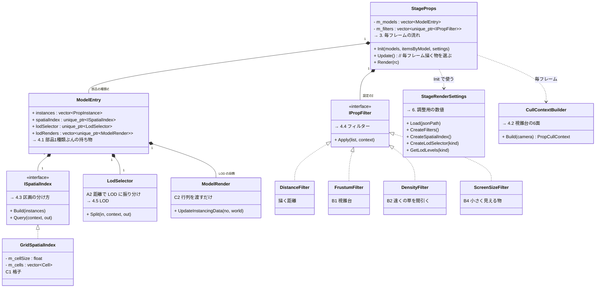
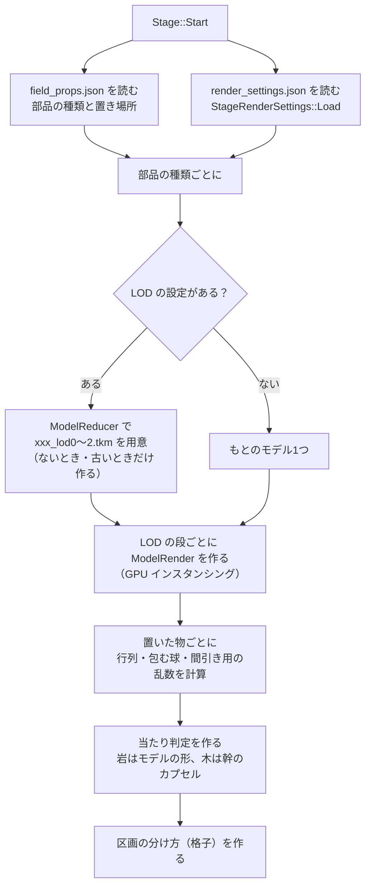
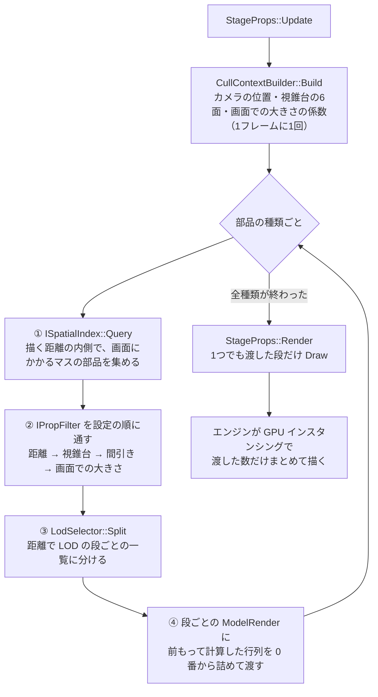

# ステージの部品の描き方の設計

作成日: 2026-11-10
対象: [StageProps.cpp](../../../Game/Source/Objects/StageProps.cpp)、[StageRender/](../../../Game/Source/Objects/StageRender/)（区画の分け方・フィルター・LOD の振り分け・設定）、[render_settings.json](../../../Game/Assets/data/stage/render_settings.json)
経緯: [ステージの軽量化の経緯](ステージの軽量化の経緯.md)

ステージに置いた岩・木・草などの部品を、毎フレーム「何を・どの細かさで」描くかを決める仕組みのページです。ステージ全体の作りは [ステージの設計](ステージの設計.md)、軽くしたモデル（LOD）の作り方は [モデルの軽量化の設計](../../エンジン/モデルの軽量化の設計.md) にあります。

- **軽くする方法は、1つの方法 = 1つのクラスにする。** `StageProps` は、それを決まった順に呼ぶだけ。
- **どの方法を使うか・その数値は `render_settings.json` に書く。** ビルドし直さずに入り切りして、効果を比べられる。
- **動かない物の計算（行列・包む球）は最初に1回だけ。** 毎フレームは選んで渡すだけにする。

---

## 1. 全体像（クラス図）

| 記号 | 方法 | クラス | 置き場所 |
|---|---|---|---|
| C1 | 地面をマスに分け、マスごと飛ばす | `GridSpatialIndex`（形は `ISpatialIndex`） | `StageRender/GridSpatialIndex` |
| ― | 描く距離より遠い物を消す | `DistanceFilter` | `StageRender/DistanceFilter` |
| B1 | 画面（視錐台）に入らない物を消す | `FrustumFilter` | `StageRender/FrustumFilter` |
| B2 | 遠くの草を間引く | `DensityFilter` | `StageRender/DensityFilter` |
| B4 | 画面で小さくしか見えない物を消す | `ScreenSizeFilter` | `StageRender/ScreenSizeFilter` |
| A2 | 距離で細かさの違うモデルに振り分ける | `LodSelector` | `StageRender/LodSelector` |
| C2 | 行列を最初に計算しておき、渡すだけにする | `ModelRender::UpdateInstancingData(番号, 行列)` | エンジン |

## 2. 初めの流れ（Init）

## 3. 毎フレームの流れ（Update → Render）

## 4. 実装方法

### 4.1 データの持ち方

`StageProps` は部品の種類ごとに `ModelEntry` を1つ持つ。置いた物は `PropInstance`（[PropTypes.h](../../../Game/Source/Objects/StageRender/PropTypes.h)）にして、`Init` で全部作る。

| `PropInstance` | 中身 | いつ作るか |
|---|---|---|
| `position` | 足もとの位置 | Init |
| `radius` | 足もとを中心に、部品がまるごと入る球の半径（もとのモデルの頂点のいちばん遠い距離 × 大きさ） | Init |
| `world` | ワールド行列（`ModelRender::CalcWorldMatrix`） | Init |
| `keepValue` | 0〜1 の決まった乱数（番号から作る）。間引きで毎フレーム同じ物を残すため | Init |

区画の分け方やフィルターは `PropInstance` へのポインターの一覧（`PropList`）だけを受け渡す。`instances` は Init のあとに増やさない（ポインターが変わらないように）。

### 4.2 視錐台の6面（CullContextBuilder）

ビュー×プロジェクション行列の列を足し引きして、左・右・下・上・手前・奥の6面を取り出す。行ベクトル × 行列の書き方なので、`W + X`（左）は「3列目 + 0列目」になる。面は `(a, b, c, d)` で、`a*x + b*y + c*z + d >= 0` が内側。1フレームに1回作り、部品の種類ごとに `context.model` だけ差し替えて使い回す。

### 4.3 区画の分け方（GridSpatialIndex）

XZ 平面を `cellSize`（8m）のマスに分け、マスごとに「中の部品がまるごと入る箱」を覚えておく。`Query` では、箱がカメラから描く距離より遠いか、視錐台の6面のどれかの外にまるごとあれば、マスごと飛ばす。1つずつ調べるのは、合格したマスの中の物だけになる。

### 4.4 フィルター（IPropFilter）

どのフィルターも `Apply(PropList&, const PropCullContext&)` だけを持ち、要らない物を `erase(remove_if(...))` で消す。ほかのフィルターのことは知らない。並び順は `render_settings.json` の `filters` の順で、`StageRenderSettings::CreateFilters` が上から作る。

| フィルター | 消す物 |
|---|---|
| `DistanceFilter` | 足もとがカメラから `drawDistance` より遠い物 |
| `FrustumFilter` | 包む球が6面のどれかの外にまるごとある物 |
| `DensityFilter` | `kinds` の部品で、`startDistance` から描く距離に向けて残す割合を `minKeepRatio` まで下げ、`keepValue` がその割合以上の物 |
| `ScreenSizeFilter` | 半径 ÷ 距離 × (1 / tan(縦の画角 / 2)) が `minScreenRatio` より小さい物 |

### 4.5 LOD（LodSelector）

`render_settings.json` の `lod.kinds` に、部品の種類ごとに「減らし方」と「切り替わる距離」を近い順に書く。Init で `ModelReducer::ResolveLodTkmFilePaths` に減らし方を渡して LOD の tkm を受け取り、段ごとに `ModelRender` を作る。毎フレーム、`LodSelector::Split` が候補を距離で段に分け、段ごとの `ModelRender` に行列を渡す。どの物がどの段になるかはフレームごとに変わるので、どの段の `ModelRender` も最大数は「その部品を置いた数」にしている。

## 5. 使い方

1. 方法の入り切りや数値は `Game/Assets/data/stage/render_settings.json` を書き換え、ゲームを起動し直す（ビルドは要らない）。
2. **フィルターを足す**: `IPropFilter` を継承したクラスを `StageRender/` に作り、`StageRenderSettings::CreateFilters` に `type` の名前で1行足し、`render_settings.json` の `filters` に1行足す。`StageProps` は変えない。
3. **区画の分け方を差し替える**（四分木など）: `ISpatialIndex` を継承したクラスを作り、`StageRenderSettings::CreateSpatialIndex` で返す物を変える。
4. **LOD の段を変える**: `lod.kinds` の段を足す・消す。減らし方（`ratio` など）を変えると、次の起動で LOD の tkm が作り直される。

## 6. 調整用の数値（render_settings.json）

| 値 | 今の値 | 効くこと |
|---|---|---|
| `spatialIndex.cellSize` | 800（8m） | マスごと飛ばす細かさ。小さいほど細かく飛ばせるが、マスの数が増える |
| `density.startDistance` | 1200（12m） | ここから先の草を間引く |
| `density.minKeepRatio` | 0.35 | 描く距離のところで残す草の割合 |
| `screenSize.minScreenRatio` | 0.004 | 画面の高さの 0.4% より小さく見える物を消す |
| `lod.kinds.tree` | 1.0 / 0.35（25m〜）/ 0.12（80m〜） | 木の LOD の段 |
| `lod.kinds.rock` | 1.0 / 0.4（30m〜） | 岩 |
| `lod.kinds.detail` | 1.0 / 0.4（15m〜） | 茂み・シダ・小石・石畳 |
| `lod.kinds.grass` | 1.0 / 0.4（8m〜） | 草・花 |

## 7. 決めたこと

- フィルターは仮想関数で呼ぶ。1フレームに呼ぶ回数は「部品の種類の数 × フィルターの数」（約 80 回）なので、速さには効かない。読みやすさと差し替えやすさを取った。
- 区画は `field_props.json` の区画（64m）を使わず、描く用に 8m のマスで分け直す。64m では1マスが大きすぎて、ほとんど飛ばせないため。
- 包む球は足もとを中心にした大きめの球にした。真ん中を求めるより簡単で、大きめなので見えている物を消してしまうことがない。

## 8. 既知の課題

- 影に描く物は、まだ見た目と同じ一覧を使っている（B3）。影だけ近くの物に絞ると、影のパスがもっと軽くなる。
- 丘や崖に隠れた物も描いている（B5）。
- 葉と草は、裏から見えるように面を2倍にしている（A4）。

## 9. 関連するページ

- [ステージの設計](ステージの設計.md)
- [モデルの軽量化の設計](../../エンジン/モデルの軽量化の設計.md)（ModelReducer）
- [インスタンス描画の設計](../../エンジン/インスタンス描画の設計.md)
