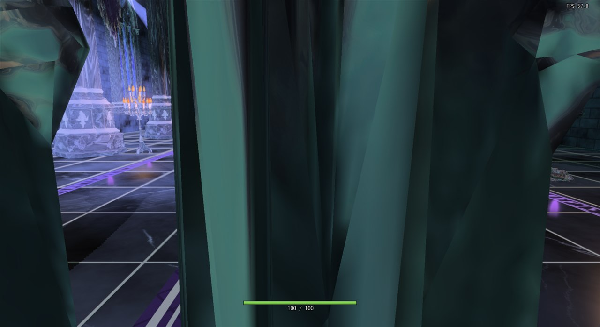
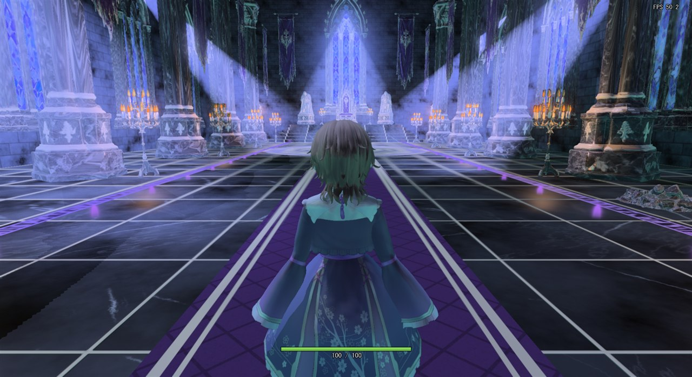

# ボス戦の広間の経緯

設計: [ボス戦の広間の設計](ボス戦の広間の設計.md)

ボス戦の広間を作ったときに、何をしたかの記録です。日付ごとに書き足します。このページは 2026-11-15 に、コミットの記録から書き起こしました（そのときの画面の画像はありません）。軽くしたことは [ボス戦の広間の軽量化の経緯](../../../最適化/ステージ/ボス戦の広間の軽量化/ボス戦の広間の軽量化の経緯.md)・[ボス戦の広間のテクスチャの経緯](../../../最適化/ステージ/ボス戦の広間のテクスチャ/ボス戦の広間のテクスチャの経緯.md) にあります。

---

## 2026-11-12〜11-13 Meshy の部品で広間を組み立てた（#122）

| 以前 | 今 |
|---|---|
| 草原のステージ（`Stage`）で戦っていた | 月明かりの玉座の間（`BossStage`）を足し、`Game.cpp` の `USE_BOSS_STAGE` で切り替えて、広間を使う |

**名前:**

| ジャンル | 名前 | 何のためのもの | 何をするためのもの | どこから来たもの |
|---|---|---|---|---|
| 型 | `Stage` | 草原のステージを作るため | 草原の地形と、岩・木・草などの部品を置くクラス | ゲームの Stage.h（今はない。このページの 2026-11-15 で消した） |
| 型 | `BossStage` | ボス戦の広間を作るため | 広間のモデル・当たり判定・明かりを作って置くクラス | ゲームの [BossStage.h](../../../../Game/Source/Objects/BossStage.h) |
| 変数 | `USE_BOSS_STAGE` | 草原と広間を、1か所の書き換えで切り替えるため | `true` なら広間、`false` なら草原のステージを作った。`constexpr bool` の定数 | ゲームの Game.cpp の `USE_BOSS_STAGE`（今はない。このページの 2026-11-15 で消した） |

見本の画像（太い柱が通り道の両側に迫り、柱の上の方に垂れ幕、柱の前に燭台、奥に大きな窓と玉座）に近づけるように、次の順に足した。

1. **床のテクスチャ。** 黒大理石のタイルに金の目地の模様を、Blender で作るスクリプト（`make_floor_texture.py`）を作った。
2. **試し。** Meshy の玉座・扉・柱・窓を、大きさをそろえて置き、床・壁・台座の箱と1つの FBX（`BossHall.fbx`、約24万三角形）にまとめた。当たり判定は単純な箱だけの別の FBX にした。Meshy の元データはリポジトリに入れず、`D:\03_data\BossStageMeshy` から読む。床と部品のつやは、空の映り込みで水色に光りすぎたので下げた。
3. **部品を足した。** 柱をつなぐアーチ・燭台・騎士の石像・床の紋章、柱と玉座の後ろの壁の垂れ幕、隅と柱の足元のがれき。
4. **壁。** 1色から、暗い切り石を互い違いに積んだテクスチャ（`make_wall_texture.py`）にした。
5. **見本に合わせ直した。** 柱を太く高くして通り道に寄せ、柱ごとに燭台と灯りを置き、玉座の後ろに大きな窓を足した。入口の壁と玉座の後ろの壁の両端に、Meshy で作った壁の灯りを付けた。
6. **天井・当たり判定・月の光。**
   - 床の当たり判定が 30m × 50m の三角形2枚で、真ん中の継ぎ目でぶつかったりすり抜けたりしていたので、2m のマスに分けた。
   - 壁の上（18m）から、てっぺんがとがった丸天井を足した。天井は影を落とさない別のモデルにした。
   - 燭台のライトの、カメラから見た位置を毎フレーム計算し直すようにした（していなかったので、照らす場所が正しく選ばれていなかった）。
   - 月の光を玉座の後ろの方から入れ、窓の前に青いライトと、窓から差し込む光の筋（`VolumeSpotLight`）を足した。
   - 通り道の両側に紫の文字の帯を敷き、すぐ上に紫のライトを並べて光って見せた。
7. **光を弱めた。** 横の窓の青いライト・紫の帯のライト・月の光を弱め、帯のライトを低く細かく並べて、床に丸い光の点が映りにくくした。
8. **絨毯と炎。**
   - 絨毯は、深い紫に金の縁と飾りの模様をプログラムで作り、紋章の円を空けて、台座の段に沿わせた。
   - 炎は、Meshy のテクスチャで白いろうのいちばん高い点をろうそくの先として見つけ、3枚の板を組んで立てた。エンジンに自分で光る仕組みがないので、炎の板の法線を真下に向け、炎の段ごとに根元のすぐ下へ明るいライトを置いて光って見せた。
   - 法線マップは sRGB として読まれるので、炎の法線マップの値は 0.735 にして傾きをなくした。
   - ろうそくのライトの明るさを、2つの速さの波で少し揺らした。
   - 天井と炎を、影を落とさないモデル `BossHallNoShadow.fbx` にまとめた（それまでの `BossHallCeiling.fbx` を置き換えた。`BossStage.h` のコメントには `BossHallCeiling.fbx` の名前が残っている）。

**用語:**

| 用語 | 何のことか |
|---|---|
| 映り込み | 物の表面に、まわりの景色（ここでは空の画像）が映って見えること。つやが強いほど強く映る |
| 法線マップ | 表面のでこぼこを、色の値（法線の向き）で表した画像。色が (0.5, 0.5, 1) のときは、でこぼこがない（まっすぐ）ことを表す |
| sRGB | 画面に出す色の標準の保存方式。sRGB の画像は、読み込むときに暗い方へ変換される。0.735 は、変換すると約 0.5 になる |
| `VolumeSpotLight` | k2Engine（エンジン）の [VolumeSpotLight.h](../../../../k2Engine/graphics/light/VolumeSpotLight.h) にある、スポットライトの光の通り道を、霧の中の筋のように見せる部品 |

## 2026-11-15 草原のステージを消し、広間だけにした（#145）

`USE_BOSS_STAGE` の切り替えと草原のステージを消し、`Game` はいつも広間を作るようにした（[ステージの経緯](../ステージの経緯.md) の最後）。

---

## 2026-11-17 入口の扉に当たり判定の箱を足した

### 1. 現状の問題

[カメラの壁よけ](../../カメラ/カメラの壁よけ/カメラの壁よけの設計.md) を入れたあとも、入口の扉を背にすると、カメラが扉の模型の中に入り、扉が透けて見えた（下の「直す前」）。プレイヤーの始めの位置を一時的に (0, 100, −2100)（扉の 1.6m 手前、扉を背にする）にしたビルドで撮った。

### 2. ソースコードの問題箇所

[make_boss_stage.py](../../../../tools/BossStage/make_boss_stage.py) の `build()` は、扉を見た目（`visual`）にだけ置き、当たり判定（`col`）の箱を作っていなかった。柱・玉座・燭台・石像・がれきは、置いたあとに `box("〇〇Col", ..., col)` で箱を作っている。

```python
# 扉（入口の壁の内側）
d_obj, d_size = parts["Door"]
place(d_obj, 0, 0, -L + d_size[1] / 2, 0, visual)
```

扉は入口の壁（z = −24m）から広間の方へ約 1.24m 出ている。当たり判定は壁しかないので、カメラは壁の手前（扉の奥）まで下がり、扉の中に入る。扉の内側の面は描かれないので、扉が透けて見える。

### 3. 直し方

扉の大きさ（`d_size`）に合わせた箱 `DoorCol` を、ほかの部品と同じ形で当たり判定に足す。プレイヤーも扉の中に入れなくなるが、扉は通れないものなので、そのほうが自然。

Meshy の部品の元のファイル（`BOSS_MESHY_DIR`）がこのPCにないので、広間全体を書き出し直せない。そこで、スクリプトに箱を足すのと別に、今の `BossHallCollision.fbx` を Blender で読み、`make_boss_stage.py` の `box()` と同じ作り方で `DoorCol` だけを足して、同じ書き出しの設定で書き出し直した。扉の大きさは、見た目の `BossHall.fbx` の扉（幅 5.20m・奥行き 1.24m・高さ 8.00m）から測った。`.tkm` は、ゲームを起動したときにエンジンが FBX から変換し直した。

### 4. ソースコードの直し

```diff
     place(d_obj, 0, 0, -L + d_size[1] / 2, 0, visual)
+    # 扉は入口の壁から広間の方へ出ているので、当たり判定の箱も置く（カメラやプレイヤーが扉の中に入らないように）
+    box("DoorCol", (-d_size[0] / 2, 0, -L), (d_size[0] / 2, d_size[2], -L + d_size[1]), wall_mat, 4.0, col)
```

| 直す前（カメラが扉の中に入り、扉が透ける） | 直した後（扉の手前で止まる） |
|---|---|
|  |  |

### 5. どう確かめたか

- 書き出し直す前と後の `BossHallCollision.fbx` を Blender で読み、もとの42個の箱の大きさと面の数が1つも変わらず、`DoorCol`（x ±2.60m、z −24.0〜−22.76m、高さ 8.00m）だけが増えたことを確かめた。
- 作業用フォルダ（git worktree）で Game.sln を Debug / x64 でビルドし、ゲームを最小化・非アクティブで起動して、窓を透明・いちばん奥にしてから `PrintWindow` で窓だけを撮った。撮ったらすぐに終了させ、始めの位置は元に戻した。
- プレイヤーが扉に入れなくなったか、扉の前で足が引っかからないかは、窓をアクティブにして動かさないと試せないので、画面では確かめていない（ユーザーに確かめてもらう）。
