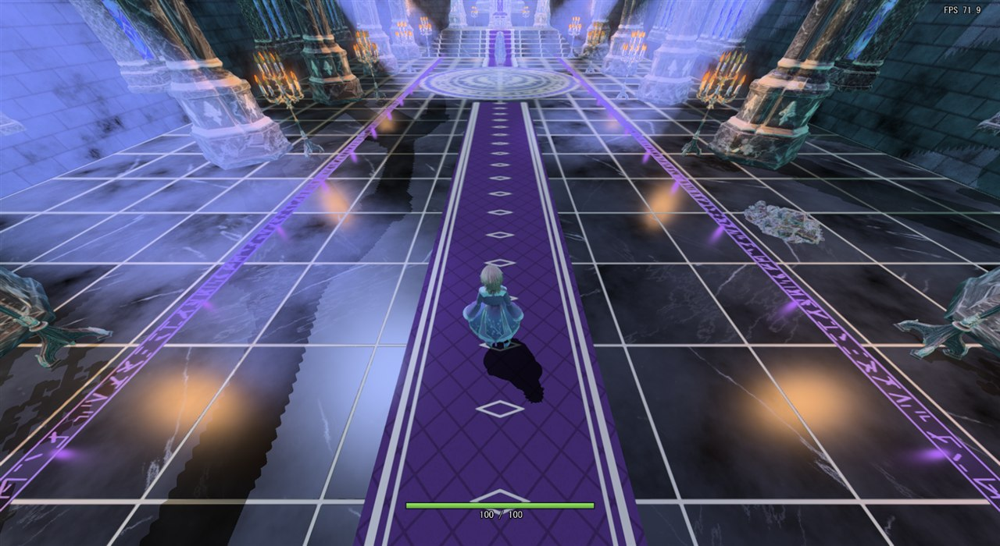

# ボス戦の広間の設計

作成日: 2026-11-15
対象: [BossStage.cpp](../../../../Game/Source/Objects/BossStage.cpp)、モデルを作るスクリプト [make_boss_stage.py](../../../../tools/BossStage/make_boss_stage.py)・[make_floor_texture.py](../../../../tools/BossStage/make_floor_texture.py)・[make_wall_texture.py](../../../../tools/BossStage/make_wall_texture.py)
経緯: [ボス戦の広間の経緯](ボス戦の広間の経緯.md)、[ボス戦の広間の軽量化の経緯](../../../最適化/ステージ/ボス戦の広間の軽量化/ボス戦の広間の軽量化の経緯.md)、[ボス戦の広間のテクスチャの経緯](../../../最適化/ステージ/ボス戦の広間のテクスチャ/ボス戦の広間のテクスチャの経緯.md)

黒騎士と戦う、月明かりの玉座の間です。ゲームのステージはこれだけです（草原のステージは 2026-11-15 に消しました）。

- **モデルは Blender のスクリプトで組み立てて書き出す。** Meshy で作った部品（柱・玉座・燭台など）と、スクリプトで作る単純な形（床・壁・台座・天井）を1つの FBX にまとめる。ゲームは書き出したものを読むだけ。
- **見た目と当たり判定は別のモデル。** 当たり判定は床・壁・台座だけの単純な形にする。
- **明かりはゲームのコードで置く。** ろうそく・窓の月の光・光の筋・紫の帯の光は、`BossStage.cpp` の点の光とスポットライト。置き場所はスクリプトの置き場所の数値に合わせる。

**用語:**

| 用語 | 何のことか |
|---|---|
| 点の光・スポットライト | 点の光は、1点から全方向へ広がる光（ろうそくなど）。スポットライトは、1点から一定の向きへ円錐の形に広がる光 |



---

## 1. 全体像

```
        +Z（玉座の方）
   ┌────── 窓（大）・玉座・石像 ──────┐  Z = +2400
   │        台座（6段）・燭台2本       │
   │ 柱  燭台   紫の帯 絨毯 紫の帯  燭台  柱 │  柱は左右 × 5列（X = ±900）
   │ 窓                  紋章          窓 │  横の窓は柱の間から見える
   │ 柱  燭台                      燭台  柱 │
   │        プレイヤーの最初の位置      │  Z = -1800
   └──────── 扉・壁の灯り4つ ────────┘  Z = -2400
        X = -1400                  X = +1400
```

| ファイル（`Assets/modelData/stage/boss/`） | 中身 | ゲームでの扱い |
|---|---|---|
| `BossHall.fbx` | 部品・床・壁・台座・絨毯・紋章・紫の帯 | 影を落とし、影を受ける |
| `BossHallNoShadow.fbx` | 天井と、ろうそくの炎 | 影を落とさない（天井が落とすと月の光が広間に入らない） |
| `collision/BossHallCollision.fbx` | 床（2m のマスに分けたもの）・壁・台座の段 | 描かない。物理の当たりにだけ使う |

| 置くもの | 場所 |
|---|---|
| プレイヤー | (0, 100, -1800)。入口の扉の前 |
| 黒騎士 | (0, 100, 1000)。紋章の奥 |

---

## 2. 実装方法

### モデル（make_boss_stage.py）

Blender をウィンドウなしで動かして作る（`blender -b --factory-startup -P make_boss_stage.py`）。座標はゲームの (x, y, z) メートルで考え、Blender には (x, -z, y) で置く。Z が上の FBX として書き出し、ゲームで `enModelUpAxisZ` で読むと、元のゲームの座標（cm）に戻る。

| 段 | 何をするか |
|---|---|
| 部品を読む | Meshy の FBX と、色・金属度・粗さ・法線の画像を読む（`BOSS_MESHY_DIR`、リポジトリには入れない）。`PARTS` の大きさ・向きに合わせ、テクスチャを 1024（小物は 512）に縮め、三角形を決めた割合に減らす |
| 置く | `PILLAR_ZS`・`WINDOW_ZS`・`ARCH_ZS`・`RUBBLE`・`SCONCES` などの表のとおりに、部品を写して置く |
| 単純な形 | 床・壁・台座の段を箱で作り、床と壁のテクスチャ（`make_floor_texture.py`・`make_wall_texture.py` で作る黒大理石のタイルと切り石）を貼る。天井はとがったアーチの形の丸天井にリブを渡す |
| 炎 | 燭台と壁の灯りのテクスチャで白い（ろうの）所のいちばん高い点を、ろうそくの先として探し、炎の板を立てる。炎を照らすライトの高さを書き出すときに出す |
| 書き出す | 上の3つの FBX と、部品のテクスチャ（`_albedo`・`_spec`・`_normal`）。テクスチャは起動したときに DDS に変換される |

**用語:**

| 用語 | 何のことか |
|---|---|
| 金属度・粗さ | 質感を表す2つの数値。金属度は金属らしさ、粗さは表面のざらざら（小さいほどつやつや）。エンジンでは金属度とつやを spec の画像にまとめる |
| 法線の画像 | 表面のでこぼこを、色の値（法線の向き）で表した画像。面を細かく作らずに、でこぼこに見せる |
| DDS | DirectX のテクスチャのファイル（`.dds`）。圧縮して小さくでき、GPU がそのまま読める |
| リブ | 丸天井を支える、骨組みの細い梁 |

### 明かり（BossStage.cpp）

`Start` で点の光とスポットライトを作り、`m_lights`・`m_spotLights`・`m_volumeSpotLights` に持つ。

| 光 | 数 | 色 | 役割 |
|---|---|---|---|
| 柱の前の燭台 | 10 | 暖かい橙 | 柱の足元と通り道を照らす。少し揺らす |
| 台座の燭台・壁の灯り | 2・6 | 暖かい橙 | 玉座の手前と、入口・奥の壁 |
| 炎を照らす光 | 炎の段ごと | 明るい橙・届く距離 160 | 炎の板は法線を真下に向けてあるので、根元のすぐ下の光で光って見せる。大きく揺らす |
| 玉座の後ろの窓・横の窓 | 1・10 | 青 | 玉座と石像を後ろから青く照らす（影絵のように見せる） |
| 紫の帯 | 帯に沿って 250 ごと | 紫 | 床の明るい紫の模様を照らして、帯が光って見えるようにする（エンジンに自分で光る仕組みがない） |
| 光の筋 | 5 | 強い青 | 窓から斜めに差し込む月の光。スポットライトに `VolumeSpotLight` を付けて筋を見せる |

**用語:**

| 用語 | 何のことか |
|---|---|
| `VolumeSpotLight` | k2Engine（エンジン）の [VolumeSpotLight.h](../../../../k2Engine/graphics/light/VolumeSpotLight.h) にある、スポットライトの光の通り道を、霧の中の筋のように見せる部品。スポットライトを渡して作る |

ろうそくの揺らめきは、2つの速さの波を重ねて明るさを変える。揺れの始まりを位置からずらして、どのろうそくも同じ拍子で揺れないようにする。

```cpp
// BossStage::UpdateLights
const float wave = FLICKER_AMOUNT_1 * sinf(m_time * FLICKER_SPEED_1 + flicker.phase)
    + FLICKER_AMOUNT_2 * sinf(m_time * FLICKER_SPEED_2 + flicker.phase * 2.3f);
flicker.light->SetColor(flicker.baseColor * (1.0f + flicker.amount * wave));
```

**名前:**

| ジャンル | 名前 | 何のためのもの | 何をするためのもの | どこから来たもの |
|---|---|---|---|---|
| 関数 | `UpdateLights()` | ろうそくの明るさを、毎フレーム揺らすため | 揺らめきの時間を進めて、揺らす光の色を変える。そのあと、全部のライトの、カメラから見た位置を計算し直す | ゲームの [BossStage.cpp](../../../../Game/Source/Objects/BossStage.cpp)（`BossStage` クラス） |
| 変数 | `wave` | 明るさの変わり方を、1つの数にするため | 2つの `sinf()` の波を、割合をかけて足した値。0 を中心に -1〜1 で揺れ、`amount` をかけて `1.0` に足すと、明るさにかける倍率になる | ゲームの `BossStage.cpp` の `UpdateLights()` |
| 値 | `FLICKER_AMOUNT_1`・`FLICKER_AMOUNT_2` | 2つの波の混ぜ方を決めるため | ゆっくりした波と速い波の割合。0.6 と 0.4 | ゲームの `BossStage.cpp`（無名の `namespace` の定数） |
| 関数 | `sinf()` | 揺れを、なめらかに行き来する値にするため | 角度（ラジアン）を渡すと、-1〜1 の値を返す（`float` 版の sin） | C++ の標準ライブラリ（`<math.h>`） |
| メンバー変数 | `m_time` | 揺らめきの進み具合を持つため | 揺らめきの時間（秒）。毎フレーム、前のフレームからの経過時間を足す | ゲームの [BossStage.h](../../../../Game/Source/Objects/BossStage.h)（`BossStage` クラス） |
| 値 | `FLICKER_SPEED_1`・`FLICKER_SPEED_2` | 波の速さを決めるため | 1秒に何ラジアン進むか。9.0 と 23.0 で、速さの違う2つの波になる | ゲームの `BossStage.cpp`（無名の `namespace` の定数） |
| 変数 | `flicker` | 揺らす光1個ぶんのデータを取り出すため | `m_flickers` の1つ。光へのポインター・元の色・ずれ・揺れ幅を持つ `Flicker` | ゲームの [BossStage.h](../../../../Game/Source/Objects/BossStage.h) の `Flicker` 構造体 |
| メンバー変数 | `phase` | どの光も同じ拍子で揺れないようにするため | 揺れの始まりのずれ（ラジアン）。光の位置（`x * 0.013 + z * 0.007`）から決める。2つ目の波では 2.3 倍して使い、2つの波の組み合わせが光ごとに違うようにする | ゲームの `BossStage.h` の `Flicker` |
| メンバー変数 | `light` | 色を変える光を覚えるため | 揺らす点の光（`PointLight`）へのポインター | ゲームの `BossStage.h` の `Flicker` |
| 関数 | `SetColor()` | 光の色を変えるため | 点の光の色を、渡した `Vector3`（R・G・B）にする。明るさも色の大きさで決まる | k2Engine（エンジン）の [PointLight.h](../../../../k2Engine/graphics/light/PointLight.h)（`PointLight` の関数） |
| メンバー変数 | `baseColor` | 揺らす前の色を覚えておくため | 揺れの中心になる色。この色に `(1 + 揺れ幅 × wave)` をかけて、毎フレームの色にする | ゲームの `BossStage.h` の `Flicker` |
| メンバー変数 | `amount` | 光ごとに揺れの大きさを変えるため | 揺れ幅（明るさの割合）。炎の光は 0.15、ろうそくの光は 0.06 | ゲームの `BossStage.h` の `Flicker` |

ライトの、カメラから見た位置は、カメラが動くたびに計算し直す必要がある（エンジンが画面のどこを照らすかをこれで選ぶ）ので、揺らさない光も毎フレーム `Update` を呼ぶ。`VolumeSpotLight` はスポットライトを参照するので、メンバーの宣言をあとにして先に消す。

広間全体の明かり（青白い月の光の向き・空・露出）は `Game::Start` で決める（[ゲームの土台の設計](../../土台/ゲームの土台/ゲームの土台の設計.md)）。

### 当たり判定

当たり判定用のモデルを描かずに読み、`PhysicsStaticObject::CreateFromModel` に渡す。床を大きな三角形1枚で作ると、物理エンジンの計算がずれて継ぎ目でぶつかったりすり抜けたりするので、2m のマスに分けてある（`FLOOR_COLLISION_CELL`）。摩擦は 1。

---

## 3. 使い方

| やりたいこと | 書き方 |
|---|---|
| 部品の置き場所・数を変える | `make_boss_stage.py` の置き方の表（`PILLAR_ZS` など）を変えて、Blender で書き出し直す。燭台・壁の灯り・窓・紫の帯を動かしたら、`BossStage.cpp` の同じ名前の数値も合わせる |
| 新しい部品を足す | Meshy の zip を `BOSS_MESHY_DIR/<部品>/` に展開し、ファイル名の頭を部品名にする。`PARTS` に大きさ・テクスチャの1辺・三角形を減らす割合を足し、`build()` で置く |
| 明かりを足す・変える | `BossStage.cpp` の色・届く距離の数値を変えるか、`Start` で `AddPointLight` を呼ぶ。揺らすなら最後の引数に揺れ幅を渡す |
| プレイヤー・黒騎士の最初の位置を変える | `PLAYER_START_POSITION`・`ENEMY_START_POSITION` |

---

## 4. 調整用の数値

| 名前 | 値 | 意味 |
|---|---|---|
| 広間の大きさ（スクリプト） | X ±14m・Z ±24m・壁の高さ 18m | 壁の内側まで |
| `PILLAR_CANDLE_COLOR` / `RANGE` | (2.6, 1.3, 0.5) / 700 | 柱の前の燭台の光 |
| `FLAME_LIGHT_COLOR` / `RANGE` | (14, 7, 2) / 160 | 炎を照らす光 |
| `BACK_WINDOW_LIGHT_COLOR` / `RANGE` | (0.6, 0.8, 2.6) / 2000 | 玉座の後ろの窓の光 |
| `SIDE_WINDOW_LIGHT_COLOR` / `RANGE` | (0.2, 0.3, 0.9) / 900 | 横の窓の光 |
| `RUNE_LIGHT_COLOR` / `RANGE` / `HEIGHT` | (0.6, 0.18, 1.3) / 180 / 15 | 紫の帯の光。低くして、床に丸い光の点が映りにくくする |
| `SHAFTS` | 広がり 0.15〜0.18 ラジアン | 光の筋。筋の明るさは筋の向こうの物の色に比例するので、暗い広間では強めの色にする |
| `FLAME_FLICKER` / `CANDLE_FLICKER` | 0.15 / 0.06 | 炎の光・ろうそくの光の揺れ幅 |
| `LIGHT_AFFECT_POW` | 2 | 光の、距離による弱まり方 |

---

## 5. 決めたこと

| 決めたこと | 理由 |
|---|---|
| 部品を Meshy で作り、置き方はスクリプトに書く | 部品だけを差し替えても、置き方の数値から同じ広間を作り直せる |
| 見た目と当たり判定のモデルを分ける | 部品のこまかいメッシュを当たりにすると重く、足が引っかかる |
| 天井と炎は影を落とさない | 天井が影を落とすと、月の光が広間に入らない。炎の板が影を落とすのはおかしい |
| 光る帯をライトで照らして見せる | エンジンに、自分で光る（エミッシブ）仕組みがない |
| テクスチャを 1024（小物は 512）にし、三角形を減らす | 起動の読み込みと描く重さを抑える（[軽量化の経緯](../../../最適化/ステージ/ボス戦の広間の軽量化/ボス戦の広間の軽量化の経緯.md)・[テクスチャの経緯](../../../最適化/ステージ/ボス戦の広間のテクスチャ/ボス戦の広間のテクスチャの経緯.md)）。がれきは減らすと石のでこぼこが崩れるので減らさない |

**用語:**

| 用語 | 何のことか |
|---|---|
| エミッシブ | 物が、ほかの光に関係なく、自分で光って見えること。光る帯や炎に使いたいが、エンジンにはない |

---

## 6. 既知の課題

- **明かりの置き場所を、スクリプトとゲームの両方に書いている。** 燭台・窓・帯を動かしたら、2か所を合わせる必要がある。
- **点の光が多い**（89 個。燭台・灯り 18、炎を照らす光 30、窓 11、紫の帯 30）。重いときは [最適化の方法の設計](../../../最適化/最適化の方法/最適化の方法の設計.md) を見る。
- Meshy の部品の元のファイル（`BOSS_MESHY_DIR`）はリポジトリに入れていないので、別のPCではモデルを書き出し直せない。

---

## 7. 関連するページ

- [ゲームの土台の設計](../../土台/ゲームの土台/ゲームの土台の設計.md)（広間を作る順番と、広間全体の明かり）
- [ステージの経緯](../ステージの経緯.md)（消した草原のステージ）
