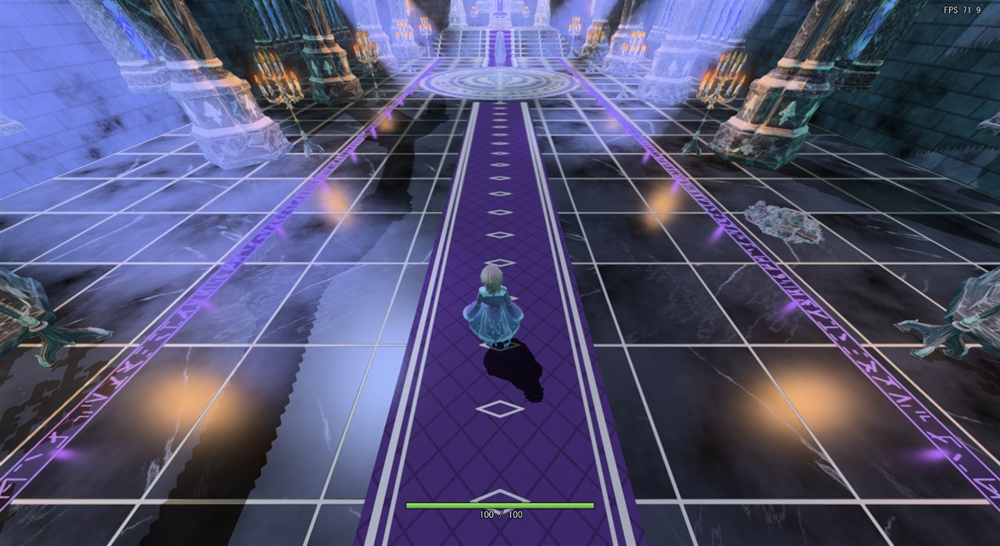
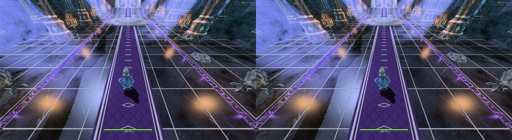
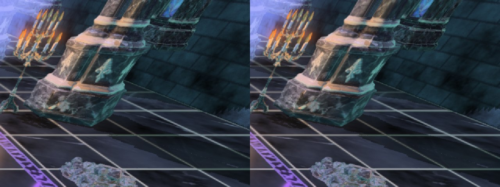

# ボス戦の広間のテクスチャの経緯

作成日: 2026-11-15
対象: ボス戦の広間（`BossStage`）のテクスチャ。作っているのは [make_boss_stage.py](../../../tools/BossStage/make_boss_stage.py)・[make_floor_texture.py](../../../tools/BossStage/make_floor_texture.py)・[make_wall_texture.py](../../../tools/BossStage/make_wall_texture.py)
設計: ボス戦の広間の設計書はまだない。テクスチャを DDS に変える仕組みは [モデル読み込みの設計](../../エンジン/モデル読み込みの設計.md) の2章。

---

## 2026-11-15 テクスチャを 2048 から 1024（小物は 512）に縮めた

### 1. 現状の問題

起動に時間がかかる。調べると、ボス戦の広間のテクスチャ（DDS）は合わせて **163MB** あった。どれも起動のときに読み込む。

- 玉座・扉・柱・窓・アーチ・像・旗・床・壁は 1辺 2048（1枚 5.6MB）。
- 燭台・がれき・壁の灯りは 1辺 1024（1枚 1.4MB）。
- 部品ごとに albedo・normal・spec の3枚がある。



カメラから見える大きさに比べて、解像度が高すぎる。半分にしても画面はほとんど変わらないと考えた。

### 2. ソースコードの問題箇所

部品のテクスチャの大きさは、[make_boss_stage.py](../../../tools/BossStage/make_boss_stage.py) の `PARTS` の3つ目の数で決めている。Meshy の画像をこの大きさにしてから PNG に書き出す。

```python
PARTS = {
    "Throne":      (5.0, "height", 2048, 1.0),
    ...
    "Candelabrum": (3.0, "height", 1024, 0.27),
    ...
}
```

床と壁は、`make_floor_texture.py`・`make_wall_texture.py` の `SIZE = 2048` の大きさで模様を作り、その大きさのまま書き出していた。

### 3. 直し方

- 部品: `PARTS` の大きさを、2048 のものは 1024、1024 のものは 512 にする。
- 床と壁: 模様は今までどおり 2048 で作り、保存するときに 1024 に縮める（`OUT_SIZE`）。
  - `SIZE` を直接 1024 にしないのは、目地の幅（`GOLD_WIDTH`・`MORTAR_WIDTH`）や乱数の模様がピクセルで決まっていて、模様が変わってしまうため。
- 紋章・絨毯・紫の帯・炎は、もともと小さい（1024 以下）ので変えない。

### 4. ソースコードの直し

```diff
 PARTS = {
-    "Throne":      (5.0, "height", 2048, 1.0),
+    "Throne":      (5.0, "height", 1024, 1.0),
     （玉座・扉・柱・窓・アーチ・像・旗も 2048 → 1024）
-    "Candelabrum": (3.0, "height", 1024, 0.27),
+    "Candelabrum": (3.0, "height",  512, 0.27),
     （燭台・がれき・壁の灯りも 1024 → 512）
 }
```

```diff
 SIZE = 2048                 # 模様を作るときの1辺（ピクセル）
+OUT_SIZE = 1024             # 書き出すテクスチャの1辺。模様は SIZE で作り、保存するときに縮める

 def save(name, rgb_or_rgba, colorspace, outdir, size=None):
     ...
     img.pixels.foreach_set(arr[::-1].astype(np.float32).ravel())   # Blender は下の行から
+    if size and (wid, hgt) != (size, size):
+        img.scale(size, size)
     ...
-save("BossFloor_albedo", albedo, "sRGB", outdir)
+save("BossFloor_albedo", albedo, "sRGB", outdir, OUT_SIZE)
```

（`make_wall_texture.py` も同じ。）

これで DDS は合わせて **46MB** になった。

縮める前（左）と縮めた後（右）。窓が出てから3秒後の画面。



右の柱の根元・燭台・がれきの所を拡大したもの（左が縮める前）。細かい石の筋が少しぼけるが、ふつうの大きさの画面では見分けにくい。



### 5. どう確かめたか

- PNG の作り直し:
  - 部品は、`make_boss_stage.py` の最後の `build()` だけを呼ばずに読み込み、`part_textures()` を全部の部品について呼んだ。広間の FBX は書き出していないので、モデル（BossHall.fbx・BossHall.tkm）は変わっていない。
  - 床と壁は、2つのスクリプトをそのまま動かした。
- DDS は、エンジンが起動時に使うのと同じ `texconv.exe -vflip -f BC7_UNORM -srgb -y` で作った。PNG より新しくなるので、起動しても作り直されない。
- 作業用フォルダ（git worktree）で Game.sln を Debug x64 でビルドし、縮める前と後のテクスチャで1回ずつ起動して、窓が出てから3秒後の画面を撮って比べた（上の画像）。
  - 撮り方: ゲームを最小化・非アクティブで起動し、窓を透明（不透明度 1/255）・クリックを素通り・いちばん奥にしてから、アクティブにしないで元の大きさに戻し、`PrintWindow` で窓だけを撮る。撮ったらすぐに終了させた。

### 起動の時間（わかったこと）

起動してから窓が出るまでの時間は、**縮める前 29.2秒、縮めた後 31.5秒**で、ほとんど変わらなかった（1回ずつしか測っていないので、差は誤差の範囲）。

起動が遅い一番の原因は、テクスチャではなく別の所にある。候補は、広間のモデル `BossHall.tkm`（63MB。プレイヤーの約30倍）の読み込みと、そのときの BSP 作りと法線のスムージング（[法線スムージングとBSPの設計](../../エンジン/法線スムージングとBSPの設計.md)）。まだ測っていないので、次に、項目ごとに時間を測る。
