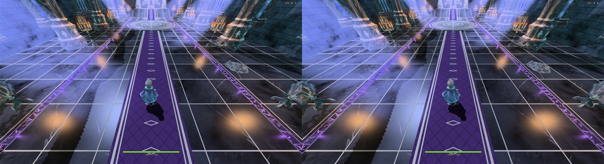
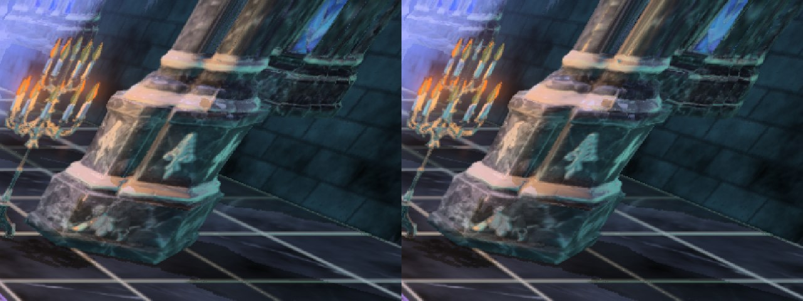
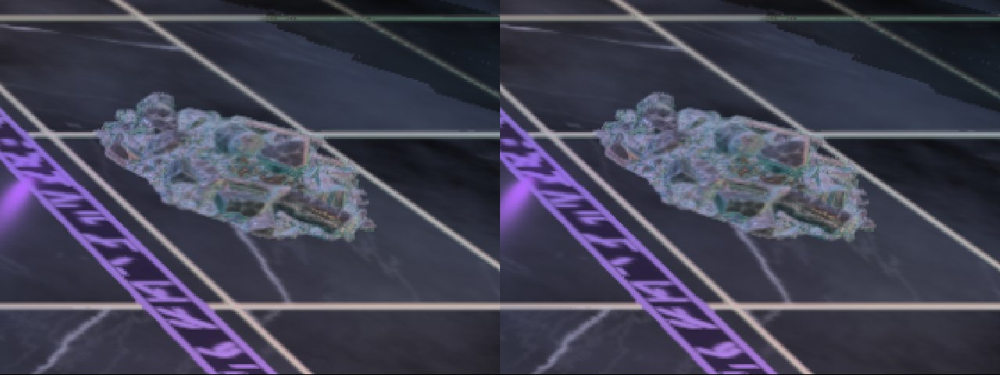
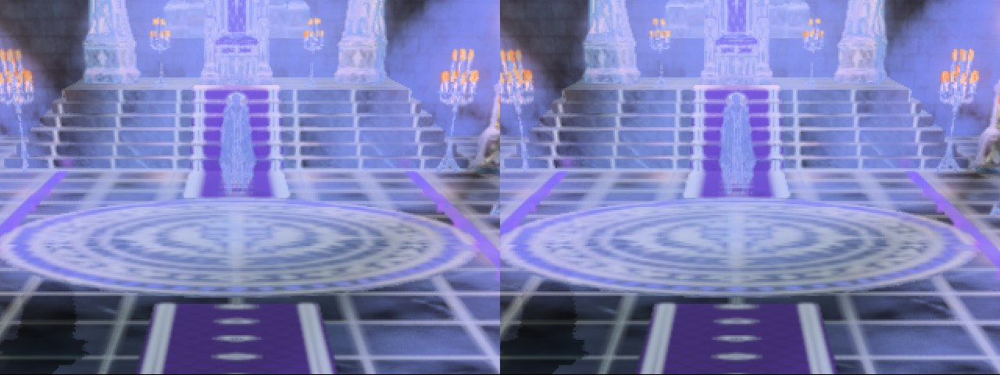
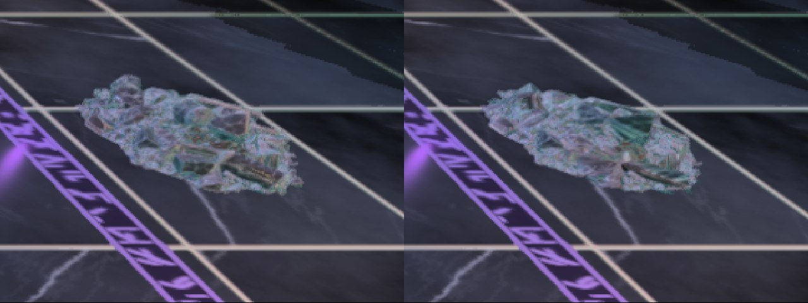

# ボス戦の広間の軽量化の経緯

作成日: 2026-11-15
対象: ボス戦の広間（`BossStage`）のモデル `BossHall`。作っているのは [make_boss_stage.py](../../../tools/BossStage/make_boss_stage.py)
設計: ボス戦の広間の設計書はまだない。テクスチャを縮めたことは [ボス戦の広間のテクスチャの経緯](ボス戦の広間のテクスチャの経緯.md)、エンジンの側で起動を速くしたことは [起動時のモデルロード高速化の経緯](../../エンジン/起動時のモデルロード高速化の経緯.md) にある。

---

## 2026-11-15 部品の三角形を減らし、BossHall の頂点を 99万から 57万にした

### 1. 現状の問題

Debug ビルドの起動を測ると、ボス戦の広間のモデル `BossHall.tkm` の読み込みにいちばん時間がかかっていた（[起動時のモデルロード高速化の経緯](../../エンジン/起動時のモデルロード高速化の経緯.md)）。頂点は **997,185個** で、プレイヤー（28,493個）の35倍ある。tkm のファイルは 63MB だった。

部品ごとの三角形の数（Blender で数えた）は次のとおり。部品の数（柱は10本など）を全部足した数。

| 部品 | 三角形 | 置いている数 |
|---|---|---|
| 窓 | 104,852 | 11 |
| 柱 | 101,190 | 10 |
| 燭台 | 100,008 | 12 |
| アーチ | 80,248 | 8 |
| 垂れ幕 | 58,620 | 12 |
| 壁の灯り | 47,760 | 6 |
| 像 | 43,438 | 2 |
| がれき | 33,978 | 6 |
| 玉座 | 28,924 | 1 |
| 扉 | 17,264 | 1 |
| 床・壁・絨毯など | 166 | |

窓・柱・燭台・アーチの4つで、全体の約6割になる。どれもカメラから遠く、細かいでこぼこは画面ではほとんど見えない。

### 2. ソースコードの問題箇所

部品の三角形を減らす割合は、[make_boss_stage.py](../../../tools/BossStage/make_boss_stage.py) の `PARTS` の4つ目の数で決めている（1.0 なら減らさない）。Blender の Decimate モディファイアで減らす。

```python
PARTS = {
    "Throne":      (5.0, "height", 1024, 1.0),
    "Door":        (8.0, "height", 1024, 0.6),
    "Pillar":      (13.0, "height", 1024, 0.35),
    "Window":      (11.0, "height", 1024, 0.35),
    "Arch":        (10.0, "width",  1024, 1.0),
    "Candelabrum": (3.0, "height",  512, 0.27),
    "Statue":      (3.8, "height", 1024, 0.7),
    "Banner":      (6.5, "height", 1024, 1.0),
    "Rubble":      (2.5, "width",   512, 1.0),
    "Sconce":      (1.8, "height",  512, 1.0),
}
```

### 3. 直し方

広間全体で、三角形をおよそ半分にする。遠くからしか見ない柱・窓・燭台は大きく減らし、玉座・アーチ・像のように形を見せたいものは半分くらいにする。

はじめは、がれきも 0.4 に減らした。しかし、拡大して比べると、石のでこぼこがはっきり減っていた（下の「試したこと」）。がれきは全体の5%ほどしかなく、減らしても速さはほとんど変わらないので、減らさない（1.0 のまま）ことにした。

### 4. ソースコードの直し

```diff
+# 三角形を減らす割合: 広間全体で約60万あった三角形を約半分にする（頂点が多いと起動時の読み込みが重い）。遠くからしか見ない柱・窓・燭台は大きく減らす。がれきは減らすと石のでこぼこが目立って消えるので減らさない。
 PARTS = {
-    "Throne":      (5.0, "height", 1024, 1.0),
-    "Door":        (8.0, "height", 1024, 0.6),
-    "Pillar":      (13.0, "height", 1024, 0.35),
-    "Window":      (11.0, "height", 1024, 0.35),
-    "Arch":        (10.0, "width",  1024, 1.0),
-    "Candelabrum": (3.0, "height",  512, 0.27),
-    "Statue":      (3.8, "height", 1024, 0.7),
-    "Banner":      (6.5, "height", 1024, 1.0),
+    "Throne":      (5.0, "height", 1024, 0.5),
+    "Door":        (8.0, "height", 1024, 0.4),
+    "Pillar":      (13.0, "height", 1024, 0.2),
+    "Window":      (11.0, "height", 1024, 0.2),
+    "Arch":        (10.0, "width",  1024, 0.5),
+    "Candelabrum": (3.0, "height",  512, 0.15),
+    "Statue":      (3.8, "height", 1024, 0.35),
+    "Banner":      (6.5, "height", 1024, 0.4),
     "Rubble":      (2.5, "width",   512, 1.0),
-    "Sconce":      (1.8, "height",  512, 1.0),
+    "Sconce":      (1.8, "height",  512, 0.4),
 }
```

| | 減らす前 | 減らした後 |
|---|---|---|
| BossHall の三角形（天井と炎は別のモデル） | 616,448 | **337,695** |
| BossHall.tkm の頂点 | 997,185 | **573,594** |
| BossHall.tkm の大きさ | 63MB | 36MB |
| 窓が出るまで（法線のキャッシュを使う2回目から） | 約10秒 | **約9秒** |
| 窓が出るまで（キャッシュを作る1回目） | 約19秒 | 約14秒 |

起動の時間は、同じ tkm の2回読み込みを直し、法線のキャッシュを入れた版で測った（[起動時のモデルロード高速化の経緯](../../エンジン/起動時のモデルロード高速化の経緯.md)）。

減らす前（左）と減らした後（右）。窓が出てから3秒後の画面。



右の柱の根元と燭台を拡大したもの（左が減らす前）。見分けはつかない。



右のがれきを拡大したもの。がれきは減らしていないので同じ。



奥の玉座・像・窓を拡大したもの。見分けはつかない。



### 5. どう確かめたか

- 割合を変えて `make_boss_stage.py` を Blender で動かし、広間を作り直した。部品のテクスチャ（PNG）は前と全く同じものが出たので、変わったのは FBX と tkm だけ。
- 起動すると、FBX の方が新しいので tkm が作り直される。その tkm をコミットした。
- 画面は、ゲームを最小化・非アクティブで起動し、窓を透明（不透明度 1/255）・クリックを素通り・いちばん奥にしてから、アクティブにしないで元の大きさに戻し、`PrintWindow` で窓だけを撮った。撮ったらすぐに終了させた。
- カメラから遠い玉座・像・壁の灯りは、`make_boss_stage.py` が書き出す確かめ用の画像（`tools/BossStage/preview/`）でも見て、形が崩れていないことを確かめた。

### 試したこと: がれきも減らしたとき

がれきを 0.4 にしたときの拡大（左が減らす前、右が 0.4）。石の細かいでこぼこがなくなり、のっぺりした。これを見て、がれきは減らさないことにした。


