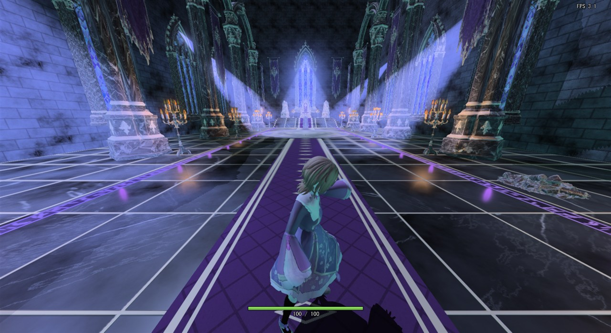
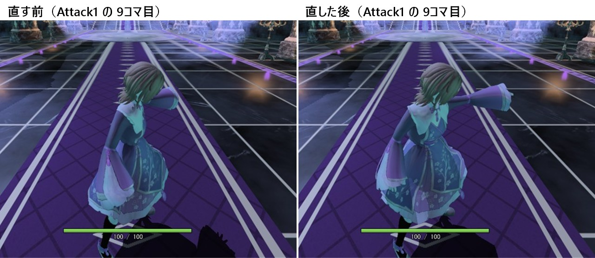
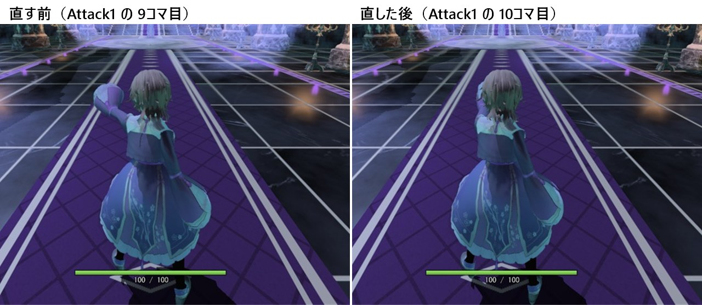
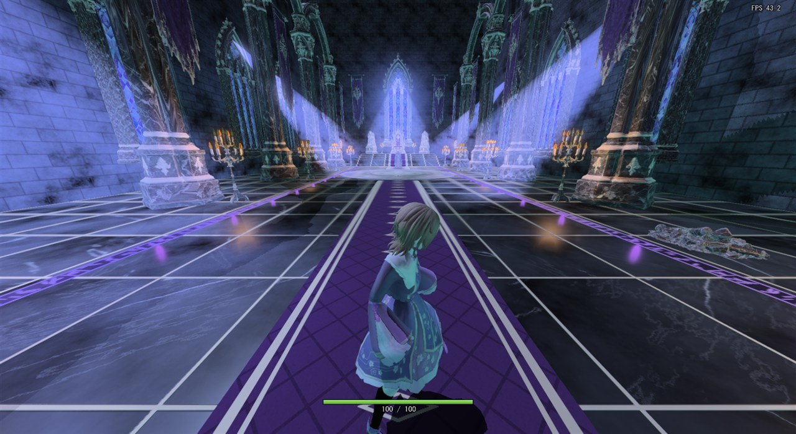
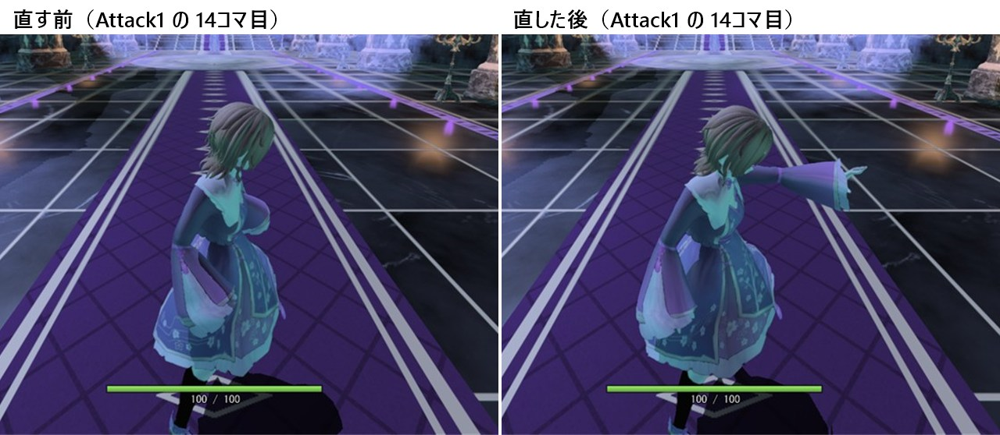
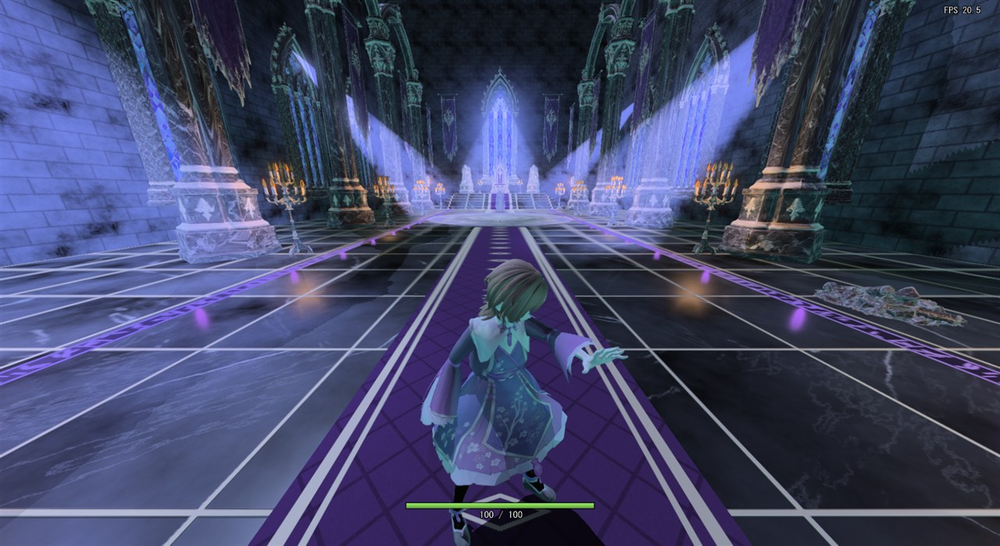
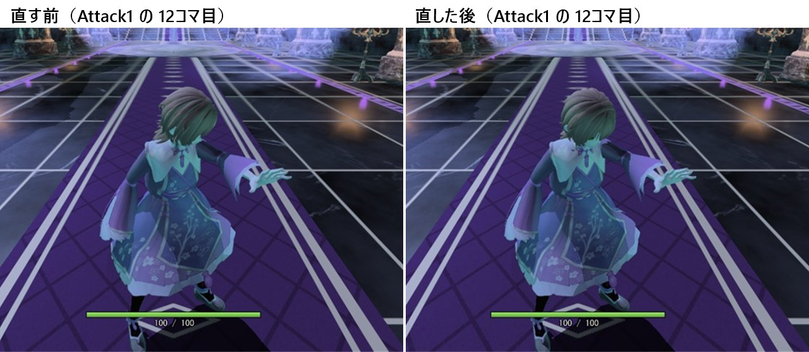
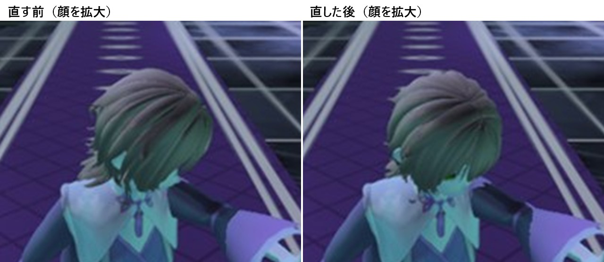

# 3段攻撃の経緯

設計: [3段攻撃の設計](3段攻撃の設計.md)

3段攻撃を作ったときに、何をしたか・どう調べたかの記録です。日付ごとに書き足します。

---

## 2026-11-14 作った

### 何をしたか

[やりたいこと](../../やりたいこと.md) の 7（攻撃した瞬間にカメラの方を向く）と 8（右手 → 左手 → 両手の3段の攻撃アニメーション）を、まとめて作った。

1. **決めたこと。** 氷（左クリック）だけで出す、立ち止まって撃つ、弾は手を突き出したコマで出す、1回撃つごとの撃ち終わりで次の入力を受け付ける、の4つをユーザーに決めてもらった。
2. **モーション。** 一人称の腕のブランチ（`FirstPersonArms`、main には入っていない）に、KinemIQ の Spell から作った腕だけのモーション（`FpCastRight` など）があった。元の FBX はこのPCになかったので、ユーザーにダウンロードし直してもらった。
   - このPCには UE がないので、[リターゲットの設計](../アニメーション制作/リターゲットの設計.md) の UE のやり方ではなく、`FirstPersonArms` にある Blender のスクリプト（`retarget_black_knight.py`、プレイヤーの骨格へ移せる版）を持ってきて使った。
   - Spell の3本は、どれも足がほとんど動かず、**左手**を前へ上げて突き出す（start）・止める（cast）・下ろす（end）動きだった。
   - 最初は start → end を 1.5倍でつないだ 18コマにした。1段目は左右を反転して右手、3段目は左手の動きを右手にも写して両手にし、上腕を内へ 20° 回して両手を寄せた。
3. **ゲームへの組み込み。** 攻撃のステート `PlayerAttackState`、撃つコマでだけ魔法の発射ボタンを押したことにする `Player::FilterCastInput`、撃つ瞬間にカメラの方を向くための `CharacterInput::attackDirection` を足した。
4. ユーザーに遊んでもらい、出てきた4つを直した（下の項）。

### 撃つ手が外へ開く

**1. 現状の問題**

「外側に手が出ている」との指摘。1段目で前へ突き出すはずの右腕が、体の横へ大きく開いていた。



**2. ソースコードの問題箇所**

「元のファイル → 書き出し → ゲームでの読み込み → 再生とゲーム側で後から足す動き」の順に、Attack1 の 9コマ目（手がいちばん前に出る）の右上腕の向きを数値で比べた。横は体の外へ、前は体の前へ、上は真上への向きの割合。

| 段階 | 横 | 前 | 上 |
|---|---|---|---|
| Blender で書き出した FBX | 0.54 | 0.83 | -0.13 |
| ゲームで再生した直後（BodyLink の前） | 0.54 | 0.83 | -0.13 |
| BodyLink のあと | **0.95** | **0.20** | -0.22 |
| BodyLink のあと（`levelTorso` だけ切った） | 0.51 | 0.70 | **-0.50** |

読み込みまでは合っていて、ずれていたのは体の連動（[BodyLink.cpp](../../../Game/Source/Character/Components/BodyLink.cpp)）だった。撃たない方の腕も同じ向きに回っていたので、胴ごと回されていた。

```cpp
// 走り用に、肩の線をキャラクターの左右の向きにそろえる（いつも効いていた）
if (m_settings.levelTorso) {
    ...
    if (MakeLevelRotation(skeleton, enBone_UpperArmL, enBone_UpperArmR, forward, chestAxis, chestAngle)) {
        RotateAround(skeleton, enBone_Spine, chestAxis, chestAngle * SPINE_SHARE);
        ...
// 走り用に、上腕を前へ出せるのを真下から 60° までに抑える（ジャンプ中以外は効いていた）
const float armWeight = 1.0f - m_jumpWeight;
LimitArmSwing(skeleton, enBone_UpperArmL, enBone_LowerArmL, forward, armWeight);
```

- `levelTorso` は、片手で撃つモーションの「肩をひねって腕を前へ出す」ひねりを戻すので、腕が真横近くまで開いた。
- `LimitArmSwing` は、前へ突き出した腕を約 30° 下げていた（4行目の「上 -0.50」）。両手の 3段目も、これで同じように下がっていた。

**3. 直し方**

どちらも走り・歩きのための処理なので、ジャンプ中の度合い（`jumpWeight`）と同じ形で「攻撃中の度合い」を足し、攻撃の間は外す。急に姿勢が変わらないよう、Player が 0.2秒かけて 0 ↔ 1 にして渡す（あとで顔の項で 0.1秒にした）。

**4. ソースコードの直し**

```diff
+	const float levelWeight = 1.0f - m_attackWeight;
-	if (m_settings.levelTorso) {
+	if (m_settings.levelTorso && levelWeight > 0.0f) {
 		...
 		if (MakeLevelRotation(skeleton, enBone_UpperLegL, enBone_UpperLegR, forward, pelvisAxis, pelvisAngle)) {
+			pelvisAngle *= levelWeight;
 		...
 		if (MakeLevelRotation(skeleton, enBone_UpperArmL, enBone_UpperArmR, forward, chestAxis, chestAngle)) {
+			chestAngle *= levelWeight;
 ...
-	const float armWeight = 1.0f - m_jumpWeight;
+	const float armWeight = (1.0f - m_jumpWeight) * (1.0f - m_attackWeight);
```

あわせて `BodyLink::SetAttackWeight`・`Character::SetAttackWeight`・`Player::UpdateAttackWeight` を足した。



**5. どう確かめたか**

同じ 9コマ目で、BodyLink の前と後の上腕の向きを測った。

| 9コマ目の上腕の向き | 横 | 前 | 上 |
|---|---|---|---|
| 1段目・右腕（直す前） | 0.95 | 0.20 | -0.22 |
| 1段目・右腕（直した後） | 0.60 | 0.79 | -0.07 |
| 3段目・両腕（直した後） | 0.24 | 0.97 | -0.07 |

直した後は、BodyLink の前とほぼ同じ向き（1段目に残る横 0.04 の差は、脚に合わせた腰のひねりの分）。

### 正面へ突き出していない

**1. 現状の問題**

「もっと正面に腕を突き出してほしい」との指摘。真後ろから見ると、撃つ腕が体の外へ開いて見えた。


**2. ソースコードの問題箇所**

上の表のとおり、BodyLink を外しても、書き出した FBX の時点で上腕が前から外へ約 33° 開いていた（横 0.54・前 0.83）。もとの Spell が、腕を斜め前へ伸ばす動きだったため。モーションの設定（[player_attack_anims.json](../../../tools/BlenderScripts/player_attack_anims.json)）で上腕を回していなかった。

**3. 直し方**

Blender で移したあとに、上腕を内へ回す（`adjust`）。突き出したまま止める区間（次の項で足す cast）では腕が少しずつ外へ流れていた（横 0.14 → 0.40）ので、突き出すまでは 25°、止める・下ろす間は 40° にした。

**4. ソースコードの直し**

```diff
   "segments": [
     { "source": ".../Spell_-_start.fbx", "mirror": true, "speed": 1.5,
+      "adjust": [{ "bone": "J_Bip_R_UpperArm", "axis": [0, 0, 1], "deg": 25 }] },
+    { "source": ".../Spell_-_cast.fbx", "mirror": true, "frames": [0, 8], "speed": 1.0,
+      "adjust": [{ "bone": "J_Bip_R_UpperArm", "axis": [0, 0, 1], "deg": 40 }] },
     { "source": ".../Spell_-_end.fbx", "mirror": true, "speed": 1.2,
+      "adjust": [{ "bone": "J_Bip_R_UpperArm", "axis": [0, 0, 1], "deg": 40 }] }
   ]
```

（Attack1 の分。Attack2 は `J_Bip_L_UpperArm` を -25°・-40°、Attack3 は両方。）



**5. どう確かめたか**

書き出した Attack1 の上腕の向きを Blender で測った。手がいちばん前に出る 10〜16コマ目は、横 0.04〜0.14（外へ 2〜8°）・上 -0.01〜+0.02 で、ほぼ正面の水平になった。

### すぐ腕を下ろしてしまう

**1. 現状の問題**

「すぐ腕を振り下ろしすぎ」との指摘。手を突き出しきった次のコマから下ろし始め、14コマ目にはほとんど下りていた。



**2. ソースコードの問題箇所**

モーションを `Spell - start`（突き出す）→ `Spell - end`（下ろす）の2本だけでつなぎ、どちらも 1.5倍で流していた。突き出したまま止まる区間がなかった。

**3. 直し方**

間に `Spell - cast`（突き出したまま止まる）の 0〜8コマ目を挟み、下ろす速さを 1.5倍から 1.2倍にした。1段は 18コマから 25コマになったので、`player.json` の区切りも合わせた。

**4. ソースコードの直し**

```diff
 	"attack": {
-		"fireFrame": 9,
-		"cancelFrame": 10,
-		"endFrame": 17,
+		"fireFrame": 10,        // 腕が正面へ真っすぐ出きったところで弾を撃つ。
+		"cancelFrame": 17,      // 撃ち終わり（下ろし始め）。
+		"endFrame": 24,
```



**5. どう確かめたか**

Blender で、上腕が水平（上 -0.01〜+0.02）のままなのが 10〜16コマ目、下ろし始めが 17コマ目であることを測った。撃ち終わりを下ろし始めにしたので、次の段へ進むのは構えを見せてからになる（3段続けて約 1.2秒 → 約 1.7秒）。

### 顔が横を向く

**1. 現状の問題**

「顔をずっと前を向くようにしてください」との指摘。手を突き出したまま止めている間、顔が撃つ向きから横へそれていた。



**2. ソースコードの問題箇所**

モーションの頭の向きがそのまま出ていた。ゲームの中で、頭の骨の向き（BodyLink が「顔の前」とみなす Z 軸）を、キャラクターの前から何度ずれているかで測った。

| コマ | 0 | 4 | 10 | 12 | 14 | 16 |
|---|---|---|---|---|---|---|
| 1段目（直す前） | -31.5° | -1.6° | -12.4° | -28.8° | -28.8° | -27.1° |
| 2段目（直す前） | -26.9° | +1.4° | +15.1° | +27.3° | +29.0° | +26.8° |
| 3段目（直す前） | +27.0° | 0° | 0° | 0° | 0° | 0° |

片手で撃つ 1・2段目は、手を突き出したまま止めている **10〜16コマ目**で約 28° 横を向く。段の 0コマ目のずれは、前の動き（前の段の終わりや Idle）の顔の向きが残っている分。

- 最初は Blender で測って「構えの 0〜9コマ目で約 28°」としていたが、ゲームの中の値とは合っていなかった（コミット `ca2debb4` の本文の値はこの間違ったもの。コードのコメントは `a26b1b69` で直した）。

**3. 直し方**

走っているときに顔を前へ向けている `LevelHeadYaw` を、攻撃中の度合いで効かせる。攻撃に入ってすぐのコマにも効くよう、攻撃中の度合いを切り替える時間を 0.2秒から 0.1秒（段に入るときの補間と同じ）にした。

**4. ソースコードの直し**

```diff
-void BodyLink::LevelHeadYaw(Skeleton& skeleton, const Vector3& forward) const
+void BodyLink::LevelHeadYaw(Skeleton& skeleton, const Vector3& forward, float weight) const
 ...
-	RotateAround(skeleton, enBone_Head, axis, atan2f(sinAngle, face.Dot(forward)) * m_runWeight);
+	RotateAround(skeleton, enBone_Head, axis, atan2f(sinAngle, face.Dot(forward)) * weight);
 ...
+	// ── 攻撃中は、顔をずっと前（撃つ向き）へ向ける ──
+	if (m_attackWeight > 0.0f) {
+		LevelHeadYaw(skeleton, forward, m_attackWeight);
+	}
```

```diff
-	constexpr float ATTACK_WEIGHT_FADE_SECONDS = 0.2f;
+	constexpr float ATTACK_WEIGHT_FADE_SECONDS = 0.1f;
```





**5. どう確かめたか**

同じ測り方で、BodyLink のあとは 3段とも全部のコマで 0° になった。例外は 1段目に入った瞬間の 0コマ目（-25.4°）だけで、攻撃中の度合いが 0 から上がり始めるところ。

### main との合わせ

作っている間に main へ「#126 右手の小さい剣を消す」が入り、`Player.h`・`Player.cpp` がぶつかった。`Player` の `OnLateUpdate`・`OnRender` は剣を動かす・描くだけだったので、main に合わせて消した（`f51e7489`）。

### どう確かめたか

- 数値は、作業用フォルダで確かめ用のコードを入れた版を作り、画面に出さずに起動して、骨の向きをファイルに書き出して測った。確かめ用のコードはコミットしていない。
- 画像は、作業用フォルダ（git worktree）で、直す前と直した後のそれぞれのコミットに、撮影用の変更だけを入れてビルドして撮った。撮影用の変更は次のとおり（コミットしていない）。
  - 左クリックを自動で押し、決めた段・コマでアニメーションを止める。
  - 体の向きをカメラから決まった角度だけ回す（斜め後ろ 110°・真後ろ 0°・前寄り 150°）。
  - カメラを近づける。ほかのアプリのキー入力で移動・カメラの回転・視点の切り替えをしない。
- 撮り方: ユーザーの画面を邪魔しないように、ゲームを最小化・非アクティブで起動する。窓を透明・クリックを素通り・いちばん奥にしてから、アクティブにしないで元の大きさに戻し、`PrintWindow` で窓だけを撮る。撮ったらすぐに終了させる。
- 比較画像は、同じ段・同じコマ・同じ向きで撮った2枚から、プレイヤーのまわりを切り出して並べた。正面へ突き出す項だけは、直す前（18コマ）と直した後（25コマ）で手がいちばん前に出るコマが違うので、9コマ目と 10コマ目を並べた。

### 手順書を確かめた

[3段攻撃の手順](3段攻撃の手順.md) は、main（機能がない形）から PlayerAttack（今の形）までの差分を、6つの手順に分けて書いた。

1. 手順書の枠（足す・書き換えの前と後・新しく作る）は、作業用の道具（スクラッチの Python）で、差分を上から順に当てながら行番号を付けて書き出した。最後まで当てた形が、触る20ファイルとも今のコードと一字一句同じになることを確かめた。
2. 作業用フォルダ（git worktree）に #131 の main を取り出し、手順ごとの終わりの形を置いて、Game.vcxproj を Debug x64 でビルドした。手順1〜6の6回とも通った。手順3からは、Visual Studio が自動で足す分として、`Game.vcxproj`・`Game.vcxproj.filters` を今のものに差し替えた。
3. 各手順の「確かめ方」に書いた画面の見え方は、出来上がりの形（手順6）のほかは、まだ画面で見ていない。
