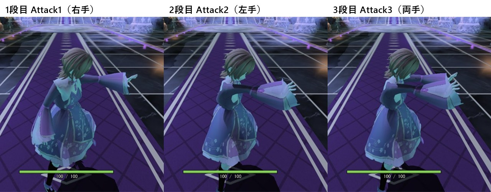
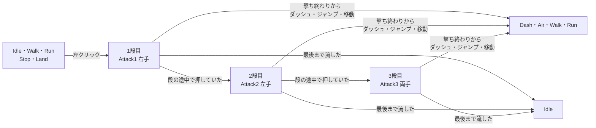

# 3段攻撃の設計

作成日: 2026-11-14
対象: [PlayerAttackState.cpp](../../../Game/Source/Player/State/PlayerAttackState.cpp)、[Player.cpp](../../../Game/Source/Player/Player.cpp) の `FilterCastInput`・`UpdateAttackWeight`、[BodyLink.cpp](../../../Game/Source/Character/Components/BodyLink.cpp) の攻撃中の扱い
経緯: [3段攻撃の経緯](3段攻撃の経緯.md)
手順: [3段攻撃の手順](3段攻撃の手順.md)（何もない状態から、どのファイルに何を足すか）

左クリック（氷魔法）で、立ち止まって **右手 → 左手 → 両手** の順に魔法を撃つ攻撃です。

- **弾はクリックした瞬間ではなく、手を突き出したコマで撃つ。** モーションと弾の出る時がずれないように。
- **1回撃つごとの撃ち終わりで、次の入力を受け付ける。** 次の段へ進むのも、ダッシュ・ジャンプ・移動で打ち切るのも、そこから。
- **撃つ瞬間に、カメラが向いている方を向く。** 体の連動（BodyLink）の走り用の調整は、攻撃の間は外す。



---

## 1. 全体像



1つの段は 25コマ（0.80秒、30fps、クリップの先頭を 0コマ目と数える）で、3本とも同じ区切りにしてある。

| コマ | 動き | ゲームでの扱い |
|---|---|---|
| Attack1 の 0〜9コマ目 | 手を上げて前へ突き出す | 何も受け付けない（足場がなくなったときだけ Air） |
| Attack1 の 10コマ目（腕が正面へ出きる） | | 弾を撃つ |
| Attack1 の 10〜16コマ目 | 正面へ突き出したまま止める | |
| Attack1 の 17コマ目（下ろし始め） | | 撃ち終わり。次の段・ダッシュ・ジャンプ・移動を受け付ける |
| Attack1 の 17〜24コマ目 | 下ろす | 24コマ目まで流したら Idle |

- 空中・ダッシュ中・一人称のときは、攻撃のモーションを出さず、今までどおりクリックした瞬間に撃つ。
- 右クリックの炎魔法（溜め撃ち）は、この攻撃とは関係なく今までどおり。

---

## 2. 実装方法

**攻撃は1つのステート（`PlayerAttackState`）にし、段は中で数える。** 段が変わるたびにステートを出入りさせると、`Exit` → `Enter` で補間や向きの扱いが増えるため。段を進めるときは `StartStage` でクリップを流し直し、カメラの方を向く。

```cpp
void PlayerAttackState::StartStage(PlayerStateContext& context, const CharacterInput& input, int stage)
{
    m_stage = stage;
    m_clipTime = 0.0f;  m_hasFired = false;  m_isNextQueued = false;
    context.mover->FaceTo(input.attackDirection);   // カメラの方を、見た目もすぐに向く
    context.animator->SetNextBlend(context.settings.attackBlendSeconds);
    context.animator->Play(enPlayerAnimClip_Attack1 + stage, context.settings.attackAnimSpeed);
}
```

**クリックは「予約」にする。** 段の途中で押したら `m_isNextQueued` を立て、撃ち終わり（`attackCancelTime`）を過ぎたところで次の段へ進む。段に入ったフレームのクリックは、その段を始めた入力なので数えない（`m_isFirstFrame`）。

**弾を撃つ時は、魔法に渡す入力を書き換えて決める。** 魔法を撃つ部品（`MagicCaster`）は、キャラクターに共通の流れの中で `fire` ボタンを見て撃つ。そこで、`Character` に「魔法に渡す入力を書き換える」仮想関数を足し、Player は攻撃の間だけ、手を突き出したコマでだけ `fire` を押したことにする。

```cpp
// Character::UpdateMagic（④ 魔法）
CharacterInput castInput = m_input;     // m_input そのものは変えない
FilterCastInput(castInput);
m_magicCaster.Fire(0, castInput.fire, origin, direction);

// Player::FilterCastInput
if (m_stateMachine.GetCurrentId() != PlayerStateId::Attack) { return; }
const bool isFire = m_stateMachine.IsAttackFire();   // Attack が撃つコマで立てる
input.fire.isTrigger = isFire;  input.fire.isPress = isFire;  input.fire.isRelease = false;
```

`m_input` を直接書き換えないのは、`ButtonState::Update` が前のフレームの `isPress` を見て「押した瞬間」を決めるため。書き換えると、押しっぱなしのときに次のフレームで押した瞬間と判定されてしまう。

撃つ合図（`attackFire`）は `PlayerStateContext` に置き、`PlayerStateMachine::OnBeforeUpdate` で毎フレームの最初に下ろす。Player は `IsAttackFire()`（`StateMachine::GetContext()` を読む）で見る。

**攻撃中は、BodyLink の走り用の調整を外す。** ジャンプ中の度合い（`jumpWeight`）と同じ形で、Player が「攻撃中の度合い」を 0.1秒かけて 0 ↔ 1 にして `Character::SetAttackWeight()` で渡す。

| BodyLink の処理 | 攻撃中 | 理由 |
|---|---|---|
| 胴のひねりを戻す（`levelTorso`） | 外す | 片手で撃つモーションは肩をひねって腕を前へ出すので、ひねりを戻すと腕が真横近くまで開く |
| 腕の前後の振りを抑える（`armFrontMaxDeg`） | 外す | 前へ突き出した腕が約 30° 下がる |
| 顔の左右の向きを前へそろえる（`LevelHeadYaw`） | 効かせる | 手を突き出したまま止めている間（10〜16コマ目）、モーションの顔が横へ約 28° 向く |

---

## 3. 使い方

- **モーションを替える:** [player_attack_anims.json](../../../tools/BlenderScripts/player_attack_anims.json) を直して Blender のスクリプトで書き出す（下の「モーションの作り方」）。長さや区切りが変わったら、`player.json` の `attack` のコマも合わせる。
- **段を増やす:** `EnPlayerAnimClip` に `Attack4` を足し、`PlayerAttackState.cpp` の `STAGE_COUNT` を 4 にする。クリップは `Attack1` からの続き番号にする。

### モーションの作り方

KinemIQ の Spell（`Spell - start` 手を上げて突き出す・`Spell - cast` 突き出したまま・`Spell - end` 下ろす。元は左手）を、Blender で SK_Player の骨格へ移してつないでいる。

```bash
cd Action/tools/BlenderScripts
"C:/Program Files/Blender Foundation/Blender 5.1/blender.exe" -b --python retarget_black_knight.py -- player_attack_anims.json
```

| クリップ | 作り方 |
|---|---|
| Attack1 | start（1.5倍）→ cast の 0〜8コマ目 → end（1.2倍）。左右を反転して右手にし、上腕を内へ回す（start は 25°、cast・end は 40°） |
| Attack2 | Attack1 を反転しないもの（左手） |
| Attack3 | 左手の動きを右手にも写す（`arms: both`）。上腕を内へ回すのは Attack1 と同じ |

元の FBX の置き場所は `source` に書いてある（今は `C:/Users/r-hir/Downloads/kinemiq/`）。書き出したあと、ゲームを1回起動して `.tka` を作り、`.fbx` と一緒にコミットする。

---

## 4. 調整用の数値

[player.json](../../../Game/Assets/data/player.json) の `attack`。

| キー | 今の値 | 意味 |
|---|---|---|
| `fireFrame` | 10 | 弾を撃つコマ（腕が正面へ出きったところ） |
| `cancelFrame` | 17 | 撃ち終わり（下ろし始め）。ここから次の段・ダッシュ・ジャンプ・移動を受け付ける |
| `endFrame` | 24 | ここまで流したら Idle |
| `animSpeed` | 1.0 | 再生速度（倍） |
| `blendSeconds` | 0.1 | 段に入るときの補間時間 |
| `exitBlendSeconds` | 0.2 | 攻撃から次の動きへの補間時間 |

攻撃中の度合いを切り替える時間 `ATTACK_WEIGHT_FADE_SECONDS`（0.1秒）は [Player.cpp](../../../Game/Source/Player/Player.cpp) の定数。

---

## 5. 決めたこと

| 決めたこと | 理由 |
|---|---|
| 立ち止まって撃つ（全身が攻撃のモーションになる） | 上半身だけにモーションを重ねる仕組みがエンジンにない |
| 次の入力を受け付けるのは撃ち終わりから | 1回ずつ撃ち切ってから次へ進む手触りにする（ユーザーの指定） |
| 3段目のあとは続けない | 1段目からやり直しになる区切りをはっきりさせる |
| 一人称では攻撃のモーションを出さない | 一人称では体が見えず、弾が遅れて出るだけになる |
| モーションは KinemIQ の Spell から作る | 片手を前へ突き出す魔法の動きで、足がほとんど動かない |

---

## 6. 既知の課題

- **弾は胸の真ん中から出る。** 撃つ手の位置からは出ていない（`castHeight`・`castForward` のまま）。
- **3段続けると約 1.7秒かかる。** 速くしたいときは `cancelFrame` を小さくする（手を突き出した構えが見える時間は短くなる）。
- **元の KinemIQ の FBX はリポジトリにない。** 作り直すときは、ダウンロードし直して `source` のパスを合わせる。

---

## 7. 関連するページ

- [プレイヤーのステートの設計](プレイヤーのステートの設計.md)
- [ジャンプの設計](ジャンプの設計.md)（BodyLink に度合いを渡す、同じ形の仕組み）
- [魔法の設計](../魔法/魔法の設計.md)
- [氷魔法の設計](../魔法/氷魔法の設計.md)
- [プレイヤーのアニメーションの設計](../アニメーション制作/プレイヤーのアニメーションの設計.md)
