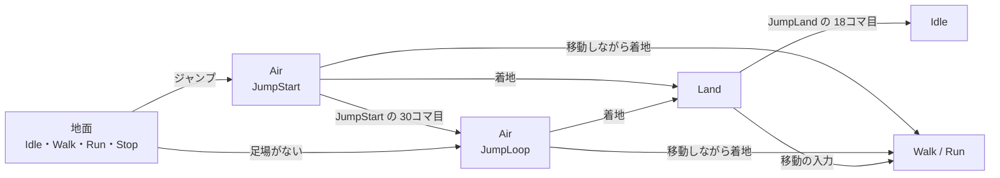

# ジャンプの設計

作成日: 2026-11-13
対象: `Game/Source/Player/State/PlayerAirState.*`・`PlayerLandState.*`、[player.json](../../../Game/Assets/data/player.json) の `jump`
経緯: [ジャンプの経緯](ジャンプの経緯.md)

ジャンプボタンで跳び、空中を動き、着地してしゃがんでから立つまでのしくみです。
モーションは3本（跳ぶ・空中・着地）に分かれていて、ステートと調整値でつなぎます。

- **跳ぶ・空中は Air、着地は Land の2つのステートにする。** 着地の間は止まり、ダッシュ・ジャンプ・移動で割り込める。
- **どのコマから流し、どこで次へ移るかは、全部 player.json で変える。** 見ながら決めるため、コードには既定値だけを置く。

---

## 1. 流れ



コマは 30fps で、クリップの先頭を 0コマ目と数える。

| クリップ | 長さ | 中身 |
|---|---|---|
| JumpStart | 41コマ | 0コマ目だけ腰が低い。1コマ目から足が離れ、9コマ目で足を引きつけ終わる。30コマ目からは JumpLoop の最初とほぼ同じポーズ |
| JumpLoop | 77コマ（ループ） | 空中で足を引きつけたまま、腕と足が少し揺れる。最後は最初と同じポーズ |
| JumpLand | 40コマ | 0コマ目で足が着き、JumpLand の 6コマ目（いちばん深くしゃがむ。腰が 88 → 42）、24コマ目でほぼ立つ |

モーションの元と作り方は [リターゲットの設計](../アニメーション制作/リターゲットの設計.md)（設定は `ual_jump.json`）。

---

## 2. 実装方法

**Air は、跳んだか落ちたかでクリップを変える。** `Enter` で `CharacterMover::Jump()` が成功したら JumpStart、地面がなく跳べなかったら（足場から落ちた）JumpLoop を流す。

```cpp
m_isJumpStart = input.jump.isTrigger && context.mover->Jump(context.mover->GetSettings().jumpSpeed);
```

**JumpStart から JumpLoop へは、クリップの中の位置で移る。** `m_clipTime` に「経過時間 × 再生速度」を足し、`jumpToLoopTime` を越えたら JumpLoop を最初から流す。経過時間ではなくクリップの位置で比べるので、再生速度を変えても、ポーズのどこで切り替えるかは変わらない。JumpStart の最後と JumpLoop の最初は同じポーズなので、JumpLoop は頭から流してよい。

**着地したときの行き先は `PlayerLandState::SelectOnLand()`（static）で決める。** Air の `CheckTransition` が、足場に着いたらこれを呼ぶ。

| 順 | 条件 | 行き先 |
|---|---|---|
| 1 | 足場がない | `Air` |
| 2 | 移動の入力がある（`landCancelByMove` のとき） | `Walk` / `Run`（しゃがまない） |
| 3 | `landEndTime` が `landStartTime` 以下 | `Idle` など（着地を飛ばす） |
| 4 | それ以外 | `Land` |

**Land は止まって JumpLand を流す。** `Move(Vector3::Zero)` で重力だけかけ、クリップの位置が `landEndTime` に届いたら、地面の共通ルール（`SelectByInput`）の行き先へ移る。ダッシュ・ジャンプは Stop と同じく、いつでも割り込める。`Exit` で `landExitBlendSeconds` を予約し、しゃがんだポーズから次の動きへゆっくりつなぐ。

**クリップを途中から流すのは `PlayerAnimator` の予約で行う。** `SetNextBlend()` と `SetNextStartTime()` を入れてから `Play()` する（ダッシュ・止まると同じ）。

**膝をそろえるのは BodyLink で行う（`bodyLink.jumpCloseLegs`）。** ジャンプのクリップは、もとのマネキンの脚の開き方のままで、膝が腰の真ん中から約 25 外へ開いている（Idle は約 11）。Player が Air・Land の間だけ「ジャンプ中の度合い」を 0.2秒かけて 0 → 1 にして渡し、BodyLink がアニメーションの上から脚を回す。

1. 股関節から太ももを内へ回し、膝を腰の真ん中から 7 のところへ寄せる（`CLOSED_KNEE_OFFSET`）。
2. 膝から下を回し返し、足先の横の位置を元に戻す。太ももと一緒に回すと、足先が体の真ん中を越えて左右が交差するため。

どちらも、回す軸を「骨の向き」と「体の横の向き」の両方に直角にしている（`BodyLink::MoveSideways`）。こうすると、太ももが前へ上がっていても、膝・足先は横へだけ動き、前後・上下の形は変わらない。

**ジャンプ中の度合いは、腕・足首・スカートにも使う。** Player が `Character::SetJumpWeight()` で BodyLink と SpringBones の両方に渡す。

| 部品 | ジャンプ中にすること | 理由 |
|---|---|---|
| BodyLink | 走り用の腕の調整（振りの大きさ・振りを抑える・肩とひじを前後に回す・上腕を開く・左右の腕をそろえる）を外す | 振りを抑える処理が、腕を横へ上げた姿勢を「後ろへ振りすぎ」とみなして真下へ引き寄せ、片方の脇が締まって見えた |
| BodyLink | 高く上がる方の腕（骨は `J_Bip_R`）の上腕を、真下から `jumpLeftArmMaxRaiseDeg` までに抑える（`LimitArmRaise`） | クリップではこの腕だけ約 105° まで上がる（反対の腕は約 77°） |
| BodyLink | 足首から先を縦の軸で回し、上から見たつま先の向きを変える（`TurnFoot`、`jumpFootYawDegL`・`R`） | 実機で見て、`J_Bip_L` の足を外へ 24° 向けた |
| SpringBones | `noLiftInJump` のまとまり（スカート・コートのすそ）を、揺れでモーションの形より上へ上げず、真下から `jumpMaxAngleFromDownDeg` より上へも上げない | スカートの骨はクリップの中で太もも＋約 13° の向きに動き、しゃがむと水平より上まで上がって中が見えた |

スカートの上限は、脚に押す処理のあとで抑えるので、太ももを大きく上げたときは太ももがスカートに少し入り込む。

---

## 3. 使い方（モーションを差し替える）

1. 新しい FBX を [リターゲットの設計](../アニメーション制作/リターゲットの設計.md) の手順で SK_Player に移し、`Animation/JumpStart.fbx` などに上書きする。
2. ゲームを1回起動して `.tka` を作る。
3. 新しいモーションで「足が離れる」「ポーズが落ち着く」「いちばんしゃがむ」「立つ」のコマを確かめ、`jump` の値を合わせる。

---

## 4. 調整用の数値（[player.json](../../../Game/Assets/data/player.json) の `jump`）

いまの値は仮で、実機で見て決める。`〇〇Frame` はコマ数で書き、コードで秒にする。

| キー | 内容 | 値 |
|---|---|---|
| `startFrame` | JumpStart を流し始めるコマ | 1（腰が低い 0コマ目を飛ばす） |
| `toLoopFrame` | JumpLoop へ移るコマ | 30 |
| `animSpeed` | JumpStart の再生速度 | 1.0 |
| `startBlendSeconds` / `loopBlendSeconds` | JumpStart / JumpLoop へ入る補間 | 0.1秒 / 0.2秒 |
| `landStartFrame` / `landEndFrame` | JumpLand を流す範囲 | 0 / 18（腰が 77 まで戻ったところ） |
| `landAnimSpeed` | JumpLand の再生速度 | 1.0 |
| `landBlendSeconds` / `landExitBlendSeconds` | JumpLand へ入る / 出る補間 | 0.1秒 / 0.3秒 |
| `landCancelByMove` | 移動しながら着地したら、しゃがまない | true |

膝をそろえるかは `bodyLink.jumpCloseLegs`（true）。寄せる距離 `CLOSED_KNEE_OFFSET`（7）は [BodyLink.cpp](../../../Game/Source/Character/Components/BodyLink.cpp) の定数。

| キー | 内容 | 値 |
|---|---|---|
| `bodyLink.jumpLeftArmMaxRaiseDeg` | 高く上がる方の腕（`J_Bip_R`）の上腕の上限（真下を 0°） | 68° |
| `bodyLink.jumpFootYawDegL` / `R` | つま先を外へ向ける角度（`J_Bip_L` / `J_Bip_R`） | 24° / 0° |
| `springBone.jumpMaxAngleFromDownDeg` | スカートを上げる上限（真下を 0°）。F1 の「プレイヤーの体」の窓でも変えられる | 50° |
| `springBone.groups.skirt`・`coatSkirt` の `noLiftInJump` | ジャンプ中にスカートを抑えるか | true |

ジャンプの初速（400）と重力（980）は `move` にある。この値では空中にいるのは約0.82秒で、JumpStart（30コマ目まで 1.0秒）が終わる前に着地する。JumpLoop が流れるのは、高いところから落ちたときだけ。

---

## 5. 決めたこと

| 決めたこと | 理由 |
|---|---|
| 着地を Air の中ではなく別のステートにする | 着地の間は止まる・割り込めるなど、動きと行き先が空中と違う。Stop と同じ形にそろえられる |
| 跳ぶのはボタンを押したフレームにする（しゃがんでから跳ばない） | 押してから跳ぶまでに間があると、操作が重く感じる。JumpStart も1コマ目から足が離れる |
| 移動しながらの着地は、しゃがまない | JumpLand は深くしゃがむ動きで、走っている途中に止まると重く見える |

---

## 6. 既知の課題

- **腕・足の左右の呼び方が、骨の名前と合っているかわからない。** 実機で「左腕」「左足首」と呼んだものは、どちらも骨の名前で書いている。
- **JumpLand は深くしゃがむ。** 低いジャンプでは大げさに見えるかもしれない。`landEndFrame`・`landAnimSpeed` で短くするか、落ちた高さで変えるかは、見てから決める。
- **手順書はまだない。**

---

## 7. 関連するページ

- [プレイヤーのステートの設計](プレイヤーのステートの設計.md)（ステート全体と地面の共通ルール）
- [走りから止まる設計](走りから止まる設計.md)（同じ形の「流して、終わったら Idle」のステート）
- [移動の設計](../キャラクター/移動の設計.md)（ジャンプの初速・重力）
