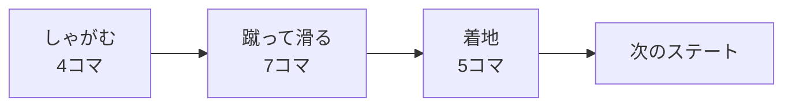

# ダッシュの設計

作成日: 2026-11-07（[プレイヤーのステートの設計](../プレイヤーのステート/プレイヤーのステートの設計.md) から分けた）
対象: [PlayerDashState.cpp](../../../../Game/Source/Player/State/PlayerDashState.cpp)
経緯: [ダッシュの経緯](ダッシュの経緯.md)
手順: [ダッシュの手順](ダッシュの手順.md)（何もない状態から、どのファイルに何を足すか）

ダッシュボタン（左Shift / パッド X）で、一蹴りして決まった距離を一気に進む動きです。

- **ボタン1つ。** 押すとダッシュ、そのあとは移動の入力を離すまで走る。
- **アニメーションは通しの1本。** しゃがむ → 蹴って低く滑る → 着地を切り替えずに流し、区間ごとに進み方だけ変える。
- **着地まで終わるまで入力を受け付けない。**

---

## 1. 流れ



| 区間 | 進み方 |
|---|---|
| しゃがむ | 200 から 0 まで遅くなる（連打で続けて出すときは飛ばす） |
| 蹴って滑る | 蹴った瞬間がいちばん速く、だんだん 480 まで遅くなる（ease-out） |
| 着地 | 480（走る速さ）で進む |

**用語:**

| 用語 | 何のことか |
|---|---|
| ease-out | 最初が速く、だんだん遅くなる動き方。ここでは速さが、蹴った瞬間の最大から 480 までまっすぐ下がる |

| 着地のあと | 行き先 |
|---|---|
| 移動の入力がある | Run（走るボタンを離していても、移動の入力を離すまで走る） |
| 移動の入力がない | Stop（勢いで滑って止まる） |
| 足場がない | Air |

---

## 2. 実装方法

**距離はフレームレートによらず決まった値にする。** 進んだ割合を ease-out の式で出し、前のフレームとの差だけ進む。割合は最後に1で止まる。

```cpp
const float before = CalcDashProgress(m_elapsed / m_duration);
m_elapsed = min(m_elapsed + deltaTime, m_duration);
const float after = CalcDashProgress(m_elapsed / m_duration);
velocity = m_direction * ((after - before) * dashDistance / deltaTime);
context.mover->Move(velocity, deltaTime);   // Move なので重力もかかる
```

**名前:**

| ジャンル | 名前 | 何のためのもの | 何をするためのもの | どこから来たもの |
|---|---|---|---|---|
| 関数 | `CalcDashProgress()` | 時間の割合から、進んだ割合を出すため | 時間の割合（0〜1）を受け取り、ease-out の式で進んだ割合（0〜1）を返す | ゲームの [PlayerDashState.cpp](../../../../Game/Source/Player/State/PlayerDashState.cpp)（名前のない `namespace` の中） |
| メンバー変数 | `m_elapsed` | 1回分のダッシュを始めてからの時間を覚えるため | 経過時間（秒）。`min` で `m_duration` を超えないようにする | ゲームの [PlayerDashState.h](../../../../Game/Source/Player/State/PlayerDashState.h) の `PlayerDashState` クラス |
| メンバー変数 | `m_duration` | 進む時間を覚えるため | 1回分のダッシュにかかる時間（秒）。距離 ÷ 平均の速さ | ゲームの `PlayerDashState.h` の `PlayerDashState` クラス |
| 関数 | `min` | 経過時間が `m_duration` を超えないようにするため | 2つのうち小さい方を返す。`std::` が付かないので、`std::min` ではなくマクロ | Windows の API（`<windows.h>`。[k2EngineLowPreCompile.h](../../../../k2EngineLow/k2EngineLowPreCompile.h) で読み込み済み）のマクロ |
| 引数 | `deltaTime` | 前のフレームからの時間で、進む量を決めるため | 前のフレームからの経過秒。例: 60FPS なら約 0.0167 | ゲームの `PlayerDashState.cpp` の `PlayerDashState::Update()` の引数 |
| 変数 | `velocity` | 今フレームの水平の速さを持つため | 進む方向 × 速さの `Vector3`。`Move()` に渡す | ゲームの `PlayerDashState.cpp` の `PlayerDashState::Update()` の中 |
| メンバー変数 | `m_direction` | 進む方向を覚えるため | 水平で、長さ 1 の `Vector3`。入力の方向（なければ正面） | ゲームの `PlayerDashState.h` の `PlayerDashState` クラス |
| メンバー変数 | `dashDistance` | 1回のダッシュで進む距離を持つため | 総移動距離（390）。`player.json` の `dash.distance` から入る | ゲームの [PlayerState.h](../../../../Game/Source/Player/State/PlayerState.h) の `PlayerStateSettings` |
| 引数 | `context` | ステートが触ってよい部品を受け取るため | `PlayerStateContext`。`mover`・`animator` などを持つ | ゲームの `PlayerState.h` の `PlayerStateContext`（ステートマシンが渡す） |
| メンバー変数 | `mover` | キャラクターを動かすため | `CharacterMover` へのポインター | ゲームの `PlayerState.h` の `PlayerStateContext` |
| 関数 | `Move()` | 水平の速さを渡して動かすため | 水平の速さと経過秒を受け取り、重力もかけて動かす。1フレームに1回だけ呼ぶ | ゲームの [CharacterMover.h](../../../../Game/Source/Character/Components/CharacterMover.h) の `CharacterMover` クラス |

**蹴る足はいつも左**（クリップは `Dash` の1本）。

**次の動きへつなぐ。** ダッシュの最後と走り・歩きの最初で足が入れ替わり、つまずいたように見えないよう、`Exit` で次のアニメーションの始め方を Context に入れる。

| Context に入れるもの | 中身 |
|---|---|
| `nextBlendSeconds` | 0.15秒（ふだんの 0.2秒の代わりに1回だけ使う） |
| `nextStartTimes` | 走り・歩きを始めるコマ（下の表） |
| `runAnimTime` | 走りの位置。Stop が踏ん張る足を決めるのに使う |

| 走りの始め | 歩きの始め |
|---|---|
| Run の 5コマ目 | Walk の 0コマ目（先頭） |

コマは 30fps で、クリップの先頭を 0コマ目と数える。どれもダッシュの最後と同じ足の形のところ。

**走るなら、着地の間に走りへ補間しておく**（`dashLandIntoRun`）。着地に入った時点で走りを流し始め、着地が終わるのと同時に補間を終える。見た目だけで、ステートは着地が終わってから移る。

---

## 3. 調整用の数値（[player.json](../../../../Game/Assets/data/player.json) の `dash`）

| 内容 | 値 |
|---|---|
| 距離 / 平均の速さ / 終わりの速さ | 390 / 約1671（7コマ） / 480 |
| しゃがむ長さ / 進む速さ / 蹴り始めるコマ | 4コマ / 200 → 0 / Dash の 4コマ目 |
| 着地の長さ | 5コマ |
| 補間（しゃがんで入る / しゃがまずに入る / 出る） | 0.1秒 / 0.05秒 / 0.15秒 |
| 連打で続けて出すか（`dashCanChain`） | しない（true で連打できる） |

---

## 4. 決めたこと

| 決めたこと | 理由 |
|---|---|
| 一定の速さでなく ease-out で進む | 一定だと滑っているように見え、蹴った勢いが出ない |
| 長さは原神の動画のコマに合わせる | アニメーションと進み方をずらさないため |
| ダッシュのあとは移動の入力を離すまで走る | 歩きに戻ると、急に遅くなってちょこちょこ歩いて見えたため |
| 蹴る足はいつも左（クリップ1本） | 原神と同じく、毎回同じ形で出るので「ダッシュした」とすぐわかる。走り・歩きへのつなぎも1通りで済む |
