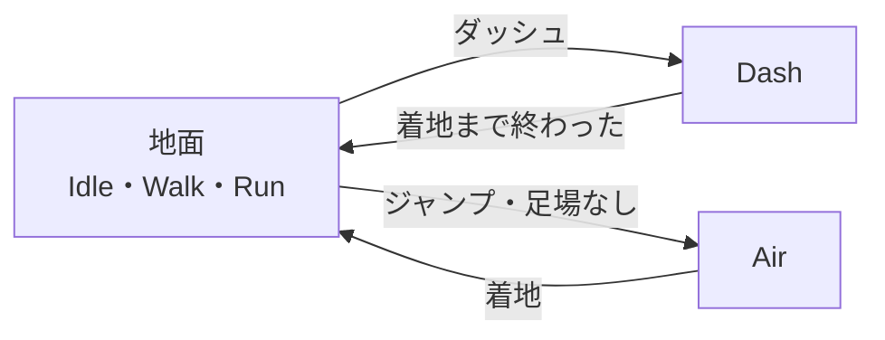
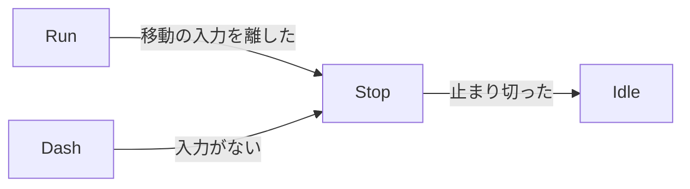
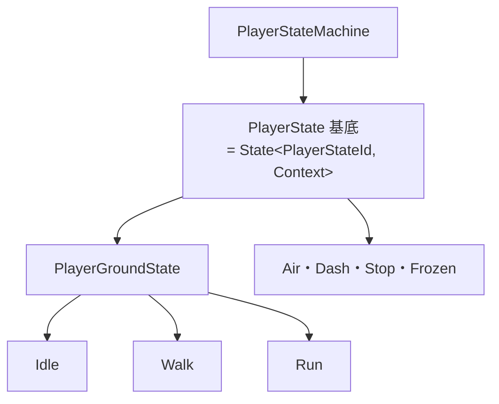

# プレイヤーのステートの設計

作成日: 2026-11-05（2026-11-07 に設計と経緯を分けた）
対象: `Game/Source/Player/State/`
経緯: [プレイヤーのステートの経緯](プレイヤーのステートの経緯.md)
手順: [プレイヤーのステートの手順](プレイヤーのステートの手順.md)（何もない状態から、どのファイルに何を足すか）

立ち止まる・歩く・走る・止まる・空中・ダッシュ・凍結を、ステートパターンで切り替える仕組みです。切り替えの手順は Enemy と共通で、[ステートマシンの設計](../キャラクター/ステートマシンの設計.md) にあります。

- **1つのステートが、自分の動き方と次の行き先を決める。** ほかのステートの中身は知らない。
- **ステートは Player を知らない。** 触ってよいもの（`CharacterMover`・`PlayerAnimator`・`StatusEffects`・数値）だけを `PlayerStateContext` で受け取る。アニメーションは `PlayerAnimator` を通して流す。
- **入力は `CharacterInput`。** AI で動かしても同じステートで動く。

---

## 1. ステートと遷移

- どのステートからでも、行動できなくなったら（凍結）`Frozen` へ移る。
- **空中ではダッシュできない。** 地面のステート・Stop・ダッシュの連打は、足場があるときだけ `Dash` へ移る。
- ダッシュの中身は [ダッシュの設計](ダッシュの設計.md)、止まる中身は [走りから止まる設計](走りから止まる設計.md)。

| ステート | 動き | アニメーション |
|---|---|---|
| `Idle` | 動かない。向きたい方向には向く | Idle |
| `Walk` | `walkSpeed` で進む | Walk |
| `Run` | 走る速さ（480）で進む | Run |
| `Stop` | 走る速さから滑って止まる | StopL / StopR |
| `Air` | 跳ぶ・落ちる。空中でも入力の方向へ動ける | Jump |
| `Dash` | 一蹴りで決まった距離を進む | Dash |
| `Frozen` | 入力を無視して重力で落ちるだけ | 触らない |

### 地面の共通ルール（Idle・Walk・Run）

上から順に調べ、最初に当てはまったものへ移る。

| 順 | 条件 | 行き先 |
|---|---|---|
| 1 | ダッシュボタンを押した（足場があるときだけ） | `Dash` |
| 2 | ジャンプボタンを押した | `Air`（跳ぶ） |
| 3 | 足場がない | `Air`（落ちる） |
| 4 | 移動入力が `moveThreshold` 未満 | `Idle`（Run からなら `Stop`） |
| 5 | 走る入力（`isRun`）がある | `Run` |
| 6 | それ以外 | `Walk` |

---

## 2. クラス

| 関数 | 呼ばれるとき | 書くこと |
|---|---|---|
| `Enter` | 入ったとき | アニメーションの切り替え |
| `CheckTransition` | 毎フレーム、動く前 | 次のステート。移らないなら自分の `GetId()` |
| `Update` | 毎フレーム | `CharacterMover` の `Move` 系を**1回だけ**呼ぶ |
| `Exit` | 出るとき | 後片付け |

ファイル: [PlayerState.h](../../../Game/Source/Player/State/PlayerState.h)（種類・調整値・Context・基底の `using`）、[PlayerStateMachine.cpp](../../../Game/Source/Player/State/PlayerStateMachine.cpp)、[PlayerGroundState.cpp](../../../Game/Source/Player/State/PlayerGroundState.cpp)

---

## 3. 実装方法

**1フレームの流れ・登録・凍結の扱いは共通。** 遷移を決めてから動く、ステートは最初に全部作って使い回す、など（[ステートマシンの設計](../キャラクター/ステートマシンの設計.md) の3章）。

**Player だけの前処理は `PlayerStateMachine::OnBeforeUpdate`。** 移動の入力を離したら、ダッシュのあとの「走り続ける」（`keepRunAfterDash`）を下ろす。

**地面の3つは基底にまとめる。** `PlayerGroundState` が移動・遷移・アニメーションの流し方を持ち、派生はクリップ・速さ・再生速度を返すだけ（ヘッダーだけで書ける）。

**行き先の判定は `PlayerGroundState::SelectByInput()`（static）。** 共通ルールの 3〜6。Air・Dash・Stop・Frozen が終わったあとの行き先にも使う。

---

## 4. 使い方（ステートを足す）

1. `PlayerStateId` に種類を足す（`Num` より前）。
2. `PlayerState` を継承したクラスを作る（`GetId`・`GetName`・`CheckTransition`・`Update` は必須）。
3. `PlayerStateMachine` のコンストラクタで `Register<クラス>()` する。
4. 入口を決める。地面から入るなら `PlayerGroundState::CheckTransition` に条件を足す。
5. `Game.vcxproj` と `.filters` に足す。

ボタンは [入力の設計](../キャラクター/入力の設計.md)、アニメーションは [キャラクターモデルの設計](../キャラクター/キャラクターモデルの設計.md) で足す。

---

## 5. 調整用の数値（[player.json](../../../Game/Assets/data/player.json) の `move`・`animation`）

| 内容 | 値 |
|---|---|
| 歩く速さ / 走る速さ / ジャンプの初速 | 170 / 480 / 400 |
| 歩くアニメーションの、足が地面を送る速さ | 130（Walk を約1.3倍で再生） |
| 立ち止まっているとみなす移動入力 | 0.1 |
| アニメーションの切り替えの補間 | 0.2秒 |

---

## 6. 決めたこと

| 決めたこと | 理由 |
|---|---|
| ステートごとのクラスにする（関数テーブルにしない） | ステートだけが使うデータを閉じ込められる。攻撃・回避など、データを持つ動きを足す予定 |
| アニメーションの速さは `Enter` で決め、`Exit` で戻さない | 凍結で止めたアニメーションが、`Exit` で動き出してしまうため |

---

## 7. 既知の課題

- **空中は走るモーションのまま。** Jump の枠に run を入れている。`player.json` の `animation.clips.Jump` を直すだけで差し替えられる。
- **今のステートの表示はまだない。** `Player::GetStateName()` で名前は取れる。
