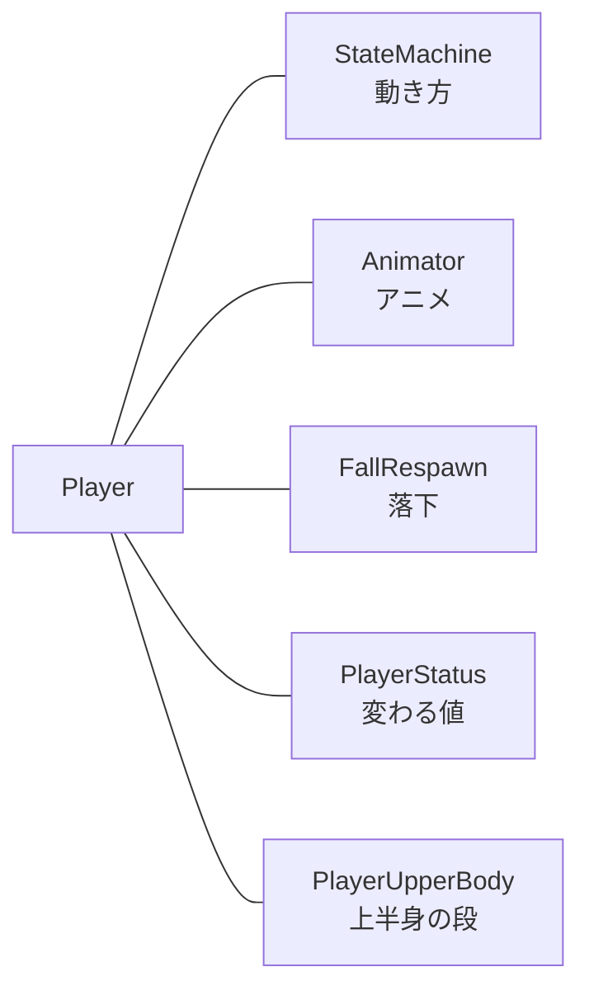

# プレイヤーの構成の設計

作成日: 2026-11-07
対象: `Game/Source/Player/`
経緯: [キャラクターの構成の経緯](../../キャラクター/キャラクターの構成/キャラクターの構成の経緯.md) の「2026-11-07 基底クラスを作る方針にした」「2026-11-07 Actor・Character を作り、Player を組み立てだけにした」（このページ専用の経緯はなく、そこに書いてある）
手順: [プレイヤーの構成の手順](プレイヤーの構成の手順.md)（何もない状態から、どのファイルに何を足すか）

Player がどの部品でできているかのページです。全キャラクターに共通の部品と順番は [キャラクターの構成](../../キャラクター/キャラクターの構成/キャラクターの構成.md) にあります。

- **Player には部品の組み立てと「動く」部分だけを書く。** [Player.cpp](../../../../Game/Source/Player/Player.cpp) は 293行（三人称の溜め撃ちの処理を含む。5章の4）。
- **調整値は PlayerConfig に分ける。** 数値とパスは [player.json](../../../../Game/Assets/data/player.json) に書き、PlayerConfig がそれを読んで構造体に詰める（[プレイヤーの調整値の設計](../プレイヤーの調整値/プレイヤーの調整値の設計.md)）。Player は JSON を知らない。
- **1部品1ファイル。** 200行を超えたら、責務が2つ混ざっていないか見直す。

**用語:**（[BodyLink（体の連動）](../../../用語集.md#キャラクター)・[`Action1`・`Action2`](../../../用語集.md#キャラクター)は用語集）

| 用語 | 何のことか |
|---|---|
| 揺れ物（`SpringBones`） | 髪やスカートの骨を、体の動きから遅れて付いてくるように揺らす部品。アニメーションの形へ、ばねで引き戻す（[SpringBones.h](../../../../Game/Source/Character/Components/SpringBones.h)） |
| コマ | アニメーションの1枚。30fps で、クリップの先頭を 0コマ目と数える |

---

## 1. Player が足す部品



| 部品 | 役割 | ファイル |
|---|---|---|
| `PlayerStateMachine` | 立ち止まる・歩く・走る・止まる・空中・着地・ダッシュ・攻撃・凍結の切り替え。仕組みは Enemy と共通（[ステートマシンの設計](../../キャラクター/ステートマシン/ステートマシンの設計.md)） | `Player/State/`（[プレイヤーのステートの設計](../プレイヤーのステート/プレイヤーのステートの設計.md)） |
| `PlayerAnimator` | アニメーションの切り替えと、ステート同士の受け渡し（次の補間・始める位置・走りの位置） | [PlayerAnimator.h](../../../../Game/Source/Player/PlayerAnimator.h) |
| `FallRespawn` | 落ちたかを判定し、戻る位置を覚える | [FallRespawn.h](../../../../Game/Source/Character/Components/FallRespawn.h) |
| `PlayerStatus` | Player だけの変わる値（今は HP だけ） | [PlayerStatus.h](../../../../Game/Source/Player/PlayerStatus.h) |
| `PlayerUpperBody` | 上半身の段。三人称で右クリックを溜めている間、上半身だけ「両手を前へ伸ばして溜める → 撃つ → 下の動きへ戻す」にする（[三人称の溜め撃ちの設計](../三人称の溜め撃ち/三人称の溜め撃ちの設計.md)） | [PlayerUpperBody.h](../../../../Game/Source/Player/PlayerUpperBody.h) |
| `PlayerConfig` | 調整値（移動・モデル・ステート）を `player.json` から読む | [PlayerConfig.cpp](../../../../Game/Source/Player/PlayerConfig.cpp) |

---

## 2. Player が書くこと

| 関数 | 中身 |
|---|---|
| `MakeConfig` | `PlayerConfig::MakeCharacterConfig()` を返す |
| `OnStart` | 落下・アニメーション・ステートマシンの Init、スキル（`Action1`（左クリック）に氷魔法、`Action2`（右クリック）に炎魔法）を登録する。上半身の[層](../../../用語集.md#アニメーション制作)と `PlayerUpperBody`（上半身の層を使う部品）も作る |
| `FillInputContext` | 一人称か（体を描いていないか）と、`Action1` のスキルを撃った回数を入力元に伝える |
| `UpdateAction` | ステートマシンを動かし、ジャンプ中・攻撃中の度合いを少しずつ変えて体の連動・揺れ物に渡し、落ちていたら最初の位置へ戻す |
| `OnLateUpdate` | モデルを更新したあとに、`PlayerUpperBody` を動かし、溜めている火の玉の位置を決める |
| `FilterSkillInput` | 攻撃のステートの間は、手を突き出したコマでだけ `Action1` を押したことにする（[3段攻撃の設計](../3段攻撃/3段攻撃の設計.md)） |

---

## 3. フォルダ

```
Game/Source/
├── Actor/              Actor（Transform）
├── Character/          Character・Status・Faction
│   ├── Input/          CharacterInput・入力元（Player 用・NPC 用）
│   ├── StateMachine/   ステートマシンとステートの基底（テンプレート）
│   └── Components/     Mover・Model・StatusEffects・HitTarget・FallRespawn・BodyLean・BodyLink・SpringBones
├── Player/             Player・PlayerStatus・PlayerConfig・PlayerAnimator・PlayerUpperBody・FirstPersonArms（一人称の腕。GameCamera が持つ。[一人称の腕の設計](../一人称の腕/一人称の腕の設計.md)）
│   └── State/          ステートマシンと各ステート
├── Enemy/              Enemy・BlackKnightInputSource（黒騎士の AI）
│   └── State/          ステートマシンと各ステート
├── Skill/              スキルの基底（SkillBase）・SkillController
├── Magic/              魔法
└── Objects/            BossStage・GameCamera など
```

---

## 4. 決めたこと

| 決めたこと | 理由 |
|---|---|
| `MagicCaster`（今の `SkillController`）は Character に置く | Enemy も魔法を撃つため（はじめは Player の部品にする案だった） |
| アニメーションの受け渡しを `PlayerAnimator` に切り出す | ステートの Context から、アニメーションのための値（補間・始める位置）を外し、ステートが ModelRender を直接触らないようにする |
| 落下は部品にする | Player の処理を組み立てだけにする |
| 剣は持たせない | 右手に付けていた小さい剣は使っていなかったので、コード（`WeaponAttachment`）ごと消した（2026-11-14） |

---

## 5. あとで決めること

1. CharacterSound（出来事を受けて音を鳴らす部品）と SoundPlayer → `SEの設計.md` を別に作る。
2. .fbx から変換したクリップにアニメーションイベントが入るか未確認。入らなければ、PlayerAnimator に「クリップ名と秒数」の表を持たせる。
3. `GameCamera.cpp`（325行）は 200行を超えている。カメラを触るときに分ける。
4. `Player.cpp`（293行）も 200行を超えている。三人称の溜め撃ちの処理（`FilterAimingInput`・`UpdateChargePosition`・`TwistUpperBodyToAim` など）を、`PlayerUpperBody` へ移せるか見直す。
