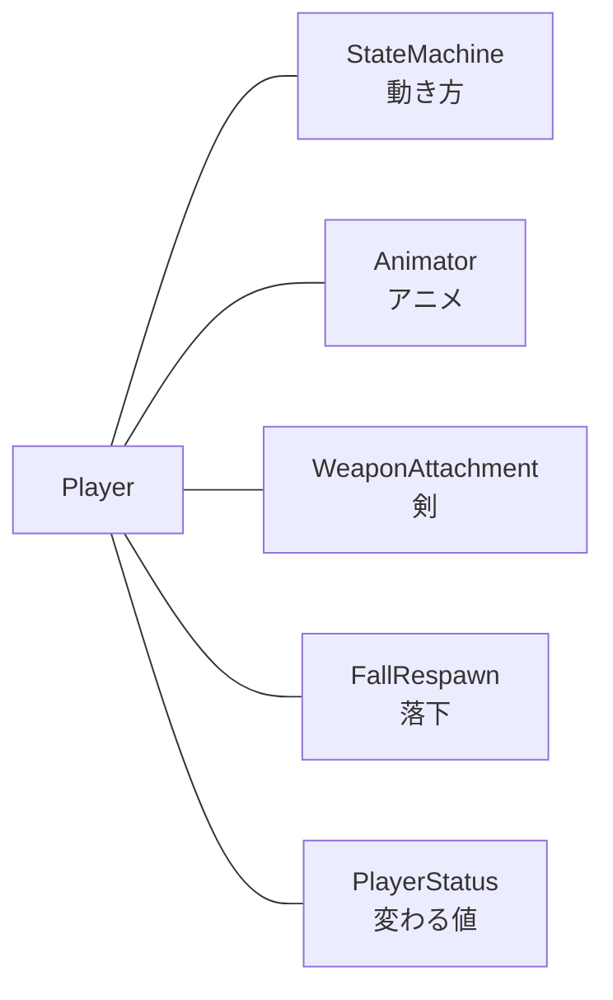

# プレイヤーの構成の設計

作成日: 2026-11-07
対象: `Game/Source/Player/`
経緯: [キャラクターの構成の経緯](../キャラクター/キャラクターの構成の経緯.md)

Player がどの部品でできているかのページです。全キャラクターに共通の部品と順番は [キャラクターの構成](../キャラクター/キャラクターの構成.md) にあります。

- **Player には部品の組み立てと「動く」部分だけを書く。** [Player.cpp](../../../Game/Source/Player/Player.cpp) は約60行。
- **調整値は PlayerConfig に分ける。** 数値とパスだけで、処理は書かない。
- **1部品1ファイル。** 200行を超えたら、責務が2つ混ざっていないか見直す。

---

## 1. Player が足す部品



| 部品 | 役割 | ファイル |
|---|---|---|
| `PlayerStateMachine` | 立ち止まる・歩く・走る・止まる・空中・ダッシュ・凍結の切り替え | `Player/State/`（[プレイヤーのステートの設計](プレイヤーのステートの設計.md)） |
| `PlayerAnimator` | アニメーションの切り替えと、ステート同士の受け渡し（次の補間・始める位置・走りの位置） | [PlayerAnimator.h](../../../Game/Source/Player/PlayerAnimator.h) |
| `WeaponAttachment` | 剣を右手のボーンに追従させる（Enemy にも使える） | [WeaponAttachment.h](../../../Game/Source/Character/Components/WeaponAttachment.h) |
| `FallRespawn` | 落ちたかを判定し、戻る位置を覚える | [FallRespawn.h](../../../Game/Source/Character/Components/FallRespawn.h) |
| `PlayerStatus` | Player だけの変わる値（今は HP だけ） | [PlayerStatus.h](../../../Game/Source/Player/PlayerStatus.h) |
| `PlayerConfig` | 調整値（移動・モデル・ステート・剣） | [PlayerConfig.cpp](../../../Game/Source/Player/PlayerConfig.cpp) |

---

## 2. Player が書くこと

| 関数 | 中身 |
|---|---|
| `MakeConfig` | `PlayerConfig::MakeCharacterConfig()` を返す |
| `OnStart` | 落下・剣・アニメーション・ステートマシンの Init、魔法（氷・炎）を持たせる |
| `FillInputContext` | 一人称か（体を描いていないか）を入力元に伝える |
| `UpdateAction` | ステートマシンを動かし、落ちていたら最初の位置へ戻す |
| `OnLateUpdate` / `OnRender` | 剣を動かす / 描く |

---

## 3. フォルダ

```
Game/Source/
├── Actor/              Actor（Transform）
├── Character/          Character・Status・Faction
│   ├── Input/          CharacterInput・入力元（Player 用・NPC 用）
│   └── Components/     Mover・Model・StatusEffects・HitTarget・WeaponAttachment・FallRespawn
├── Player/             Player・PlayerStatus・PlayerConfig・PlayerAnimator
│   └── State/          ステートマシンと各ステート
├── Enemy/              Enemy
├── Magic/              魔法と弾
└── Objects/            Stage・GameCamera など
```

---

## 4. 決めたこと

| 決めたこと | 理由 |
|---|---|
| `MagicCaster` は Character に置く | Enemy も魔法を撃つため（はじめは Player の部品にする案だった） |
| アニメーションの受け渡しを `PlayerAnimator` に切り出す | ステートの Context から、アニメーションのための値（補間・始める位置）を外し、ステートが ModelRender を直接触らないようにする |
| 剣と落下は部品にする | Player の処理を組み立てだけにする。剣は Enemy にも付けられる |

---

## 5. あとで決めること

1. CharacterSound（出来事を受けて音を鳴らす部品）と SoundPlayer → `SEの設計.md` を別に作る。
2. .fbx から変換したクリップにアニメーションイベントが入るか未確認。入らなければ、PlayerAnimator に「クリップ名と秒数」の表を持たせる。
3. Enemy にもステートを入れるなら、StateMachine をテンプレートにする。
4. `GameCamera.cpp`（325行）は 200行を超えている。カメラを触るときに分ける。
