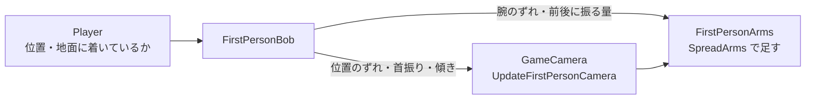

# 一人称の揺れの設計

作成日: 2026-11-16
対象: [FirstPersonBob.cpp](../../../../Game/Source/Objects/FirstPersonBob.cpp)、[GameCamera.cpp](../../../../Game/Source/Objects/GameCamera.cpp) の `UpdateFirstPersonCamera`、[FirstPersonArms.cpp](../../../../Game/Source/Player/FirstPersonArms.cpp) の腕の揺れ
経緯: [一人称の揺れの経緯](一人称の揺れの経緯.md)
手順: [一人称の揺れの手順](一人称の揺れの手順.md)

一人称のカメラで歩く・走るときに、視点をわずかに揺らし、一人称の腕を歩きのように左右交互に振る仕組みです。走ると揺れと振りが大きく速くなり、ジャンプから着地すると視点と腕がぐっと沈みます。

- **視点の揺れは Apex Legends くらいに小さく、動きの大半は腕に任せる。** 歩きは視点がほとんど揺れず、走りでも小さく揺れる。
- **揺れは、時間ではなく進んだ距離で進める。** 歩き出し・止まるときの滑り・ダッシュでも、足の運びと揺れがずれない。
- **撃つ形の腕は揺らさない。** 氷を突き出している腕と、炎を溜める・放つ両腕は、手が魔法の出る位置からずれないよう揺れを止める。揺れは見た目にだけ足すので、画面の真ん中と撃つ向きもずれない。

---

## 1. 全体像



足の運びを「歩数」の位相 `m_phase`（0〜2）で表します。0 で右足、1 で左足が着きます。1歩の中の進み具合（0 で足が着いた瞬間）を「1歩の割合」と呼びます。

| 揺れ | 歩き | 走り | 人体の根拠 |
|---|---|---|---|
| 上下 | 足が着いた瞬間がいちばん低い | 着いたあと 1歩の 0.2 でいちばん低い | 歩きは脚を棒にした振り子で、体は脚の真上で高くなる。走りはばねのように脚が縮み、踏ん張る真ん中で低くなる |
| 左右 | 片足で立つ真ん中で、立っている足の側へいちばん寄る（2歩で1往復） | 同じ | 重心は支えている足の上へ寄る |
| 傾き | なし | 左右に寄る向きへ、わずかに傾く | 小さく抑える（酔わないように） |
| 首振り | なし | 足が着いた瞬間にわずかに下を向き、半歩で戻る | 着地の衝撃 |
| 腕全体 | カメラより 1歩の 0.1 遅れて、8の字に動く | 大きい | 腕の重さで遅れる |
| 腕の振り | 肩を中心に、足と逆の腕を前へ軽く振る（右足が着くとき左腕が前）。後ろへは小さく振り、両手をずっと画面に映す | 歩きの2倍 | 人は手足を逆に振って体のねじれを打ち消す |
| 着地 | 落ちていた速さに合わせて沈み、0.3秒くらいで戻る。腕はさらに遅れて沈む | 同じ | 膝で衝撃を受けて伸び戻る |

宙にいる間は、揺れの強さを 0 へ落とし、位相も止めます。

---

## 2. 実装方法

**速さは進んだ距離から測る。** `FirstPersonBob::Update` で、前のフレームの位置からの水平の移動量を経過時間で割る。キャラコンの速度ではなく本当に進んだ距離なので、壁に向かって歩いても揺れない。`MAX_TRACK_SPEED`（5000）を超えたらワープ（落ちて戻ったときなど）とみなして 0 にする。地面に着いているかは、`Character::IsOnGround()`（`CharacterMover::IsOnGround` をそのまま返す）で見る。

**位相と強さ。** 揺れの強さ `m_moveWeight` は「速さ ÷ 歩きの速さ」（1 で止める）、走りの混ぜ具合 `m_runWeight` は歩き 170 から走り 960 の間の割合。どちらも毎フレーム目標へ少しずつ近づけ、急に揺れ始めないようにする。ダッシュ（蹴った瞬間 2860）では、足の回転を走りより速くしないよう、速さを走りで止める。

```cpp
// FirstPersonBob::Update
const float stepLength = Lerp(WALK_STEP_LENGTH, RUN_STEP_LENGTH, m_runWeight);
m_phase += min(speed, RUN_SPEED) * deltaTime / stepLength;
m_phase = fmodf(m_phase, 2.0f);
```

**形は三角関数で作る。** 歩きと走りで「いちばん低い所」と「片足で立つ真ん中」がずれるので、走りの混ぜ具合で混ぜてから波を作る。腕は、位相を `ARMS_LAG_STEP_RATE` だけ遅らせて同じ波を作る。

```cpp
// FirstPersonBob::UpdateOffsets
const float lowest = RUN_LOWEST_STEP_RATE * run;                    // 歩き 0、走り 0.2
const float midStance = Lerp(0.5f, RUN_LOWEST_STEP_RATE, run);      // 歩き 0.5、走り 0.2
const float vertical = -cosf(Math::PI2 * (step - lowest));                // 1歩に1回
const float horizontal = sinf(Math::PI * (m_phase - midStance + 0.5f));   // 2歩で1往復
const float nod = 0.5f + 0.5f * cosf(Math::PI2 * step);                   // 着いた瞬間に 1
```

**カメラは、位置・注視点・上の向きで揺らす。** `GameCamera::UpdateFirstPersonCamera` で、マウスの向きに直交する上と右の向きを作り、位置を右と上へずらし、向きを首振りの分だけ下へ回し、上の向きを傾きの分だけ右へ倒して `SetUp` する。マウスで向けた向き（`m_firstPersonForward`）は変えない。三人称へ戻すときは `SetUp(Vector3::AxisY)` で戻す。

```cpp
// GameCamera::UpdateFirstPersonCamera
eyePosition += right * offset.x + up * offset.y;
const Vector3 forward = m_firstPersonForward * cosf(pitchRad) - up * sinf(pitchRad);
const Vector3 cameraUp = up * cosf(rollRad) + right * sinf(rollRad);
```

**腕の振りは、肩を中心に回して作る。** `FirstPersonBob` は腕ごとに「前後に振る量」（`GetArmSwing`。+ で前、走りで -1〜1）を返す。`FirstPersonArms::SpreadArms` で、構え・撃つ形を混ぜた置き方（`ArmPose`）に、前なら `SWING_FORWARD_POSE`、後ろなら `SWING_BACK_POSE` を、振る量の大きさだけ足す。後ろの形を前より小さくして、手が画面の下へ外れないようにした。

```cpp
// FirstPersonArms::SpreadArms
const float swing = m_bobSwing[side];
const ArmPose& swingPose = swing >= 0.0f ? SWING_FORWARD_POSE : SWING_BACK_POSE;
pose.raiseDeg += swingPose.raiseDeg * fabsf(swing);
pose.push += swingPose.push * fabsf(swing);
```

**撃つ形の腕は、混ぜ具合で弱める。** `FirstPersonArms::Update` に `FirstPersonBob` を渡し、腕ごとに `1 - max(m_castWeight, m_chargeWeight, m_releaseWeight)` を掛けて、8の字のずれを `m_bobOffset`、振る量を `m_bobSwing` に入れる。8の字のずれは `SpreadArms` の、腕ごとずらす `toSide` に足す。混ぜ具合はもとから少しずつ変わるので、揺れの止まり方・戻り方もなめらかになる。カメラの揺れは止めない。撃つ位置（`aimOrigin`・`aimOffsets`）はカメラから決まるので、カメラと一緒に動き、手とずれない。

**着地はばねで沈める。** 宙にいる間の落ちる速さを覚えておき、着地したフレームに沈む量を決めて、行き過ぎずに戻るばね `x'' = -k²x - 2kx'` に最初の速さとして渡す。このばねは `1/k` 秒後にいちばん沈むので、沈む量 `dip` にするための最初の速さは `dip × k × e`。重いフレームでも暴れないよう、1/120 秒ずつ進める。腕は、遅いばね（`ARMS_LAND_SPRING`）で、カメラの沈みにさらに足して沈ませる。

---

## 3. 使い方

| やりたいこと | 書き方 |
|---|---|
| 視点の揺れを大きく・小さくする | `FirstPersonBob.cpp` の `WALK_*`・`RUN_*` の振れ幅 |
| 腕の振りを大きく・小さくする | `FirstPersonArms.cpp` の `SWING_FORWARD_POSE`・`SWING_BACK_POSE`（振り切った形）。歩きと走りの比は `FirstPersonBob.cpp` の `WALK_ARMS_SWING`・`RUN_ARMS_SWING` |
| 傾きをなくす | `RUN_ROLL_DEG` を 0 にする |
| 足の回転を速く・遅くする | `WALK_STEP_LENGTH`・`RUN_STEP_LENGTH`（短いほど速い） |
| 歩き・走りの速さを変えた | `WALK_SPEED`・`RUN_SPEED` を `player.json` の `walkSpeed`・`runSpeed` と同じにする |
| 新しい魔法の腕も揺らさない | `FirstPersonArms::Update` の `castWeight` に、その魔法の混ぜ具合を足す |

---

## 4. 調整用の数値

[FirstPersonBob.cpp](../../../../Game/Source/Objects/FirstPersonBob.cpp) の定数です。振れ幅は片側の値（cm・度）です。

| 名前 | 歩き | 走り | 意味 |
|---|---|---|---|
| `WALK_SPEED` / `RUN_SPEED` | 170 | 960 | この速さで、歩き・走りの揺れになる（cm/秒） |
| `WALK_STEP_LENGTH` / `RUN_STEP_LENGTH` | 90 | 320 | 1歩の長さ。1秒に約1.9歩・約3歩 |
| `RUN_LOWEST_STEP_RATE` | — | 0.2 | 走りでいちばん低くなる所（1歩の割合） |
| `*_VERTICAL` | 0.6 | 1.5 | 上下 |
| `*_HORIZONTAL` | 0.4 | 0.8 | 左右 |
| `*_ROLL_DEG` | 0° | 0.4° | 傾き |
| `RUN_PITCH_DEG` | — | 0.3° | 足が着いた瞬間に下を向く角度 |
| `*_ARMS_HORIZONTAL` / `*_ARMS_VERTICAL` | 0.8 / 0.5 | 2.0 / 1.5 | 腕全体の8の字 |
| `*_ARMS_SWING` | 0.5 | 1.0 | 腕を前後に振る量（1 で振り切った形） |
| `ARMS_LAG_STEP_RATE` | 0.1 | ← | 腕がカメラより遅れる量（1歩の割合） |
| `MOVE_WEIGHT_SPEED` / `RUN_WEIGHT_SPEED` | 8 / 6 | ← | 強さ・走りの混ぜ具合を近づける速さ（1秒あたり） |

[FirstPersonArms.cpp](../../../../Game/Source/Player/FirstPersonArms.cpp) の、振り切ったときに構えに足す形（`ArmPose`）です。

| 名前 | 上げる角度 | 前へ押す量 | 意味 |
|---|---|---|---|
| `SWING_FORWARD_POSE` | +3.3° | +2.7 | 前に振り切ったとき |
| `SWING_BACK_POSE` | -1.3° | -1.3 | 後ろに振り切ったとき（手が画面の下へ外れないよう小さく） |

| 名前 | 値 | 意味 |
|---|---|---|
| `LAND_MIN_FALL_SPEED` | 100 | これより遅く落ちて着いたら沈まない（cm/秒） |
| `LAND_DIP_PER_SPEED` | 0.012 | 超えた速さ 1 あたりの沈む量。ジャンプ（400）で約3.6cm |
| `LAND_DIP_MAX` | 8 | 沈む量の上限（cm） |
| `LAND_SPRING` | 14 | 戻るばねの速さ。約0.07秒でいちばん沈む |
| `LAND_PITCH_DEG_PER_CM` | 0.2° | 沈んだ 1cm ごとに下を向く角度 |
| `ARMS_LAND_DIP_RATE` / `ARMS_LAND_SPRING` | 0.6 / 9 | 腕がカメラよりさらに沈む割合と、そのばねの速さ |

---

## 5. 決めたこと

| 決めたこと | 理由 |
|---|---|
| 視点の揺れは Apex Legends くらいにする | 大きく揺らすと酔いやすく、狙いにくい。動きは腕で見せる |
| 腕は、歩きのように左右交互に、肩から軽く振る | 前後に数cm動かすだけでは、歩いている感じが出なかった |
| 後ろへの振りを前より小さくする | 構えの手は画面の下 1/3 にあり、後ろへ大きく振ると画面の外へ出る |
| 走りで首振り（下を向く）を入れる | 迫力が出る。撃つ向きはカメラの向きなので、画面の真ん中と撃つ向きはずれない |
| 傾きは歩きでは入れず、走りだけわずかに入れる | 歩きで傾くと酔いやすい |
| 炎を溜めている間・放つときは、両腕の揺れを止める | 火の玉は画面の下の決まった位置に出るので、手が振れると火の玉からずれる |
| 着地の沈みを入れる | ジャンプの重さが出る |
| 調整値は `.cpp` の定数にする | 一人称の腕と同じ置き方にそろえる |
| 揺れを切る設定は付けない | 今は要らない |
| 歩き・走りの速さを `player.json` から読まず、定数に同じ値を書く | 移動の設定はキャラコンの中にあり、揺れのためだけに外へ出さない。速さを変えたら合わせ直す |

---

## 6. 既知の課題

- `WALK_SPEED`・`RUN_SPEED` は `player.json` の値を写したもので、`player.json` を変えたら合わせ直しが要る。
- `m_bobOffset` の前（z）は、腕の振りを `ArmPose` で足す形にしてから使っていない（いつも 0）。

---

## 7. 関連するページ

- [一人称の腕の設計](../一人称の腕/一人称の腕の設計.md)
- [移動の設計](../../キャラクター/移動/移動の設計.md)（歩き・走りの速さ）
- [入力の設計](../../キャラクター/入力/入力の設計.md)（撃つ位置 `aimOffsets`）
