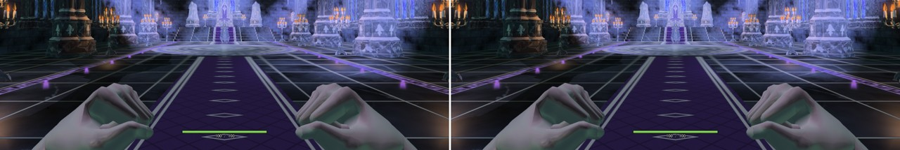
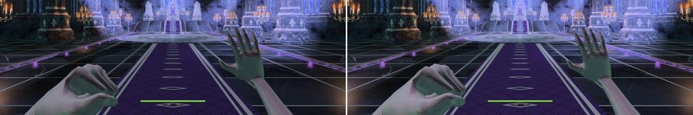
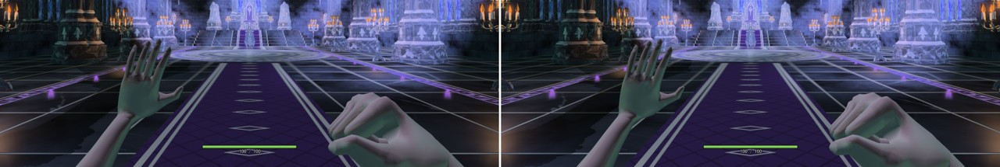
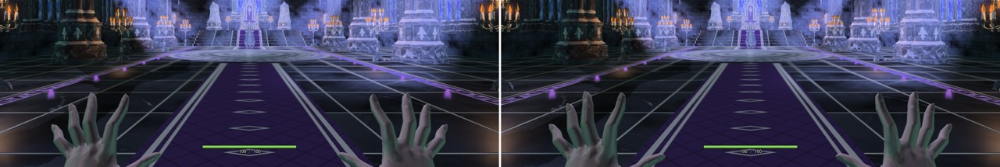
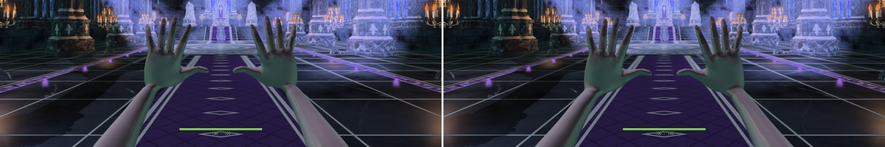

# 一人称の腕の経緯

設計: [一人称の腕の設計](一人称の腕の設計.md)

一人称の腕を作ったときに、何をしたかの記録です。日付ごとに書き足します。このページは 2026-11-15 に、コミットの記録から書き起こしました（そのときの画面の画像はありません）。

---

## 2026-11-14 銃の代わりにプレイヤーの腕を映した（#134）

| 以前 | 今 |
|---|---|
| 一人称のとき、手元に銃のモデルを出していた（#128 で消した） | プレイヤーの腕と手を、画面の下の左右に映す |
| 画面の真ん中に照準がなかった | 十字のレティクルを出す（`PlayerHud`） |

**用語:**

| 用語 | 何のことか |
|---|---|
| レティクル | 画面の真ん中に出す、狙いを示す印。ここでは白い十字 |

1. **腕のモデル。** 最初は Blender で腕だけのモデルを書き出したが、ゲームでモーションを付けると映らなかった（原因は分かっていない）。プレイヤーのモデル（`SK_Player.tkm`）の三角形の並びだけを減らすツール（`tools/FirstPerson/make_first_person_arms_tkm.py`）を作り、袖の肘から先を消した `SK_PlayerFp.tkm` を作った。骨はプレイヤーと同じなので `SK_Player.tks` をコピーして使い、腕以外の骨はゲームで大きさ 0 にする。
2. **モーション。** KinemIQ の Spell（start）から、腕だけのクリップ `FpIdle`・`FpCastRight`・`FpChargeStart`・`FpCharge`・`FpRelease` を作った（`tools/BlenderScripts/first_person_arms_anims.json`）。`FpCastRight` は、左右を反転せずに左の骨（画面の右に映る）の動きで作り直した。
3. **腕の置き方。** 両腕を肩を中心に外へ開いて上げ、腕ごと外へずらして、肘を画面の端の外に出し、前腕が端から真ん中へ斜めに伸びる形にした（`SpreadArms`）。
4. **手。** 構えは握りこぶし、氷を撃つときは手を開いて突き出し、撃ったら構えに戻す。指は、曲がる向きの軸で関節ごとに曲げ、親指は人差し指・中指の外側へ IK で合わせた。
5. 一人称の目の高さを上げ、画角を狭めた。
6. 魔法を1つにまとめた変更（#132）を取り込み、撃つたびに作る魔法の形に合わせた。

**用語:**

| 用語 | 何のことか |
|---|---|
| KinemIQ | Web で手に入れた既存のアニメーションの素材の名前。Spell は、その中の魔法を撃つ動き |

## 2026-11-15 手の形を直し、氷を左右の手で交互に撃つようにした（#150）

ユーザーに一人称で遊んでもらい、出た指摘を順に直した。

| 直したこと | どうしたか |
|---|---|
| 炎を溜める火の玉が目の前の真ん中にあり、前が見えない | 炎にも撃つ位置のずらし（`aimOffsets` の `Action2`）を足し、画面の下で溜める。溜めきった火の玉の上 1/3 だけが見える。一人称のときは、画面を覆うものを抑えた溜めのエフェクトにした |
| 溜める手が握りこぶしになり、指があちこちへ曲がる | 溜めのクリップの指はもとから曲がっているので、溜めている間は握りこぶしの曲げを足さない。腕の置き方を `CHARGE_POSE` に分け、手を火の玉の左右に添える |
| 炎を放つとき、手のひらがカメラの方を向く | 両腕を画面の左右の外から中央へ斜めに伸ばし、手のひらを前へ、指先を上に向け、両手の間を握りこぶし半分くらいあける（`RELEASE_POSE`・`RELEASE_HAND_GAP`） |
| 炎を放つときの指が反り返る・開きすぎる | `ShapeReleaseFingers` で、関節ごとに少し曲げ、指の開きを中指の向きへ半分寄せる。親指は手のひらの面の上で横へ 45° 開き、小指は外へ 10° 開き、薬指と小指は付け根で多めに曲げて指先の高さがそろって見えないようにした |
| 腕が、ボス戦の青い月の光で青白く見える | 腕だけ乗算の色で青と緑を減らす（`ARMS_MUL_COLOR`） |
| 氷を撃つのがいつも右手 | 撃った回数で右手と左手を交互にする。撃つ位置も同じ決まりで分けた（`InputSourceContext::action1UseCount`） |
| 構えの拳がカメラに向いていない | 手のひらを内側へ、親指の側をカメラへ向け、上を HP バーの方へ 45° 倒した（ファイティングポーズ） |
| 握りこぶしが、指先だけ曲がった形に見える。親指の側から拳の穴が見える | 付け根の関節から丸まるよう、関節ごとの目標の角度（88°・100°・45°）に合わせて握る。親指は、第一関節を人差し指の中節、先を中指の中節に合わせ、指を横切るように重ねた |

氷を撃つ手はコードで突き出す形にしたので、`FpRelease`・`FpCastRight` のクリップは読まなくなった。`FpRelease` は #144 で消した。`FpCastRight` は残っている（設計の既知の課題）。

---

## 2026-11-19 腕と手の形をクリップに焼き込み、ゲームの中ではクリップを流すだけにした

| 以前 | 今 |
|---|---|
| 構え・氷・炎の溜め・放つの腕の置き方と手の形を、`FirstPersonArms` が毎フレーム骨を動かして作っていた | 作った形を6本のクリップ（`Animation/FirstPerson/Baked/`）に焼き込み、ゲームの中ではクリップを流す |
| 氷を撃つ腕は、置き方の数値を混ぜて突き出していた | 腕ごとのアニメーションの層（2枚）で、撃つ腕だけ `FpCastL`・`FpCastR` を重ねる |
| 形を作るコードは `FirstPersonArms` の中 | `FirstPersonArmsPoser` に移し、Debug ビルドを `-bakeFirstPersonArms` で起動したときだけ動かす |

ユーザーと、ゲームのコードで足しているアニメーションの調整のうち、焼き込めるものを相談した。一人称の腕の形は、カメラから見ると毎回同じなので焼き込める、と決めた。仕組み（層・焼き込み・JSON から FBX）は [骨の調整の層の経緯](../../キャラクター/骨の調整の層/骨の調整の層の経緯.md) にある（別のPC で作ったものを、このPC で作り直した記録もそこにある）。

1. **形を作るコードを移した。** `CurlFingers`・`SpreadArms`・`AimHands` と、そこから呼ぶ関数・調整値を、中身を変えずに `FirstPersonArmsPoser` へ移した。変えたのは、`SpreadArms` から歩き・走りの揺れを外したことだけ（揺れはゲームの中で足す）。
2. **焼き込んだ。** もとのクリップに、混ぜ具合を 0 か 1 に決めた形を重ねて、6本を JSON に書き、Blender で FBX にした。
3. **ゲームの中を書き直した。** クリップを流し、氷を撃つ腕は層の重みを変える。骨の調整の層は「腕以外を見せない」「歩き・走りの腕の揺れ」の2つだけにした。炎を放つときは、前は溜めのクリップのまま置き方を混ぜていたので、`FpRelease` に切り替える形にした。
4. **補間の時間を合わせた。** 前は置き方の数値を毎フレーム目標へ近づけていた（溜めは速さ 10、放つ・氷は 30）。クリップの切り替えでは、溜めに入る・構えに戻るを 0.2秒、放つを 0.05秒にした。
5. **形はコードを正とした。** FBX を Blender で直しても、焼き直すと消える。直すときは `FirstPersonArmsPoser` の調整値を直して焼き直す。

### どう確かめたか

- ゲームで FBX を読み、焼き込んだ姿勢と比べた（`-verifyFirstPersonArms`）。6本とも、骨の位置のずれは最大 0.0005（モデルの単位、cm）。
- ゲームを動かし、前の版（コードで形を作る、#198 の時点）と同じ状態で並べて撮った。左が前の版、右が今の版。
  - 撮影用の変更（コミットしていない）: キーボードを読まない。起動して少したったら一人称にする。環境変数で、腕を構え・氷（画面の右の手・左の手）・炎の溜め・炎を放つのどれかに止めたままにする（撃つ間の時間を進めない）。
  - 撮り方: ゲームを最小化・非アクティブで起動し、窓を透明（不透明度 1/255）・クリックを素通り・いちばん奥にしてから、アクティブにしないで元の大きさに戻し、`PrintWindow` で窓だけを撮る。撮ったらすぐに終了させた。画像は、窓の下の方（腕のあたり）を切り出したもの。
- 構えと氷を撃つ形は、腕のあたりで違う画素が 0.02%・0.15%・0.06% で、見分けがつかない。

- 炎の溜めと放つは、腕の高さが少し違って見える（違う画素は 3.5%）。溜めのクリップ（`FpCharge`）は繰り返し動いていて、撮ったときの再生位置が2つの版でずれていたため。同じ再生位置では、上のとおり骨の位置のずれは 0.0005 以下。

- 撃つ瞬間・戻る途中の動き方（補間）は、静止画では比べていない。ユーザーに遊んで確かめてもらう。
