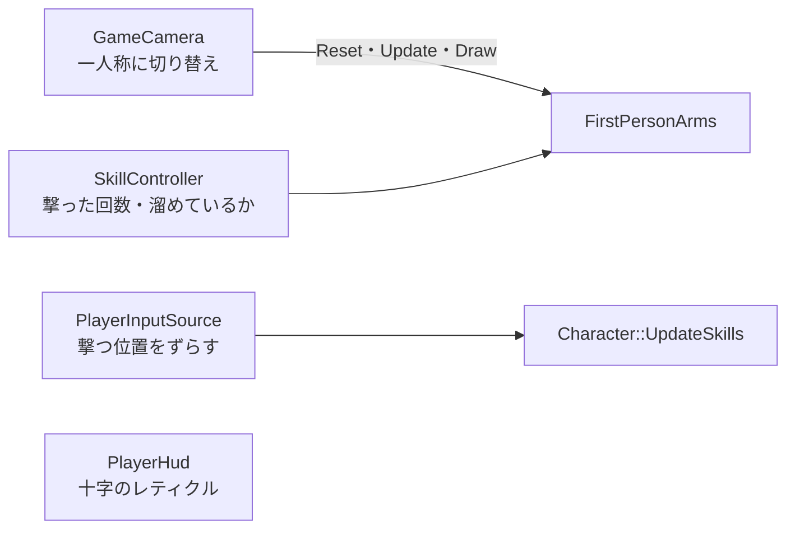

# 一人称の腕の設計

作成日: 2026-11-15
対象: [FirstPersonArms.cpp](../../../../Game/Source/Player/FirstPersonArms.cpp)、[GameCamera.cpp](../../../../Game/Source/Objects/GameCamera.cpp) の一人称の切り替え、[PlayerInputSource.cpp](../../../../Game/Source/Character/Input/PlayerInputSource.cpp) の撃つ位置のずらし、[PlayerHud.cpp](../../../../Game/Source/UI/Hud/PlayerHud.cpp) のレティクル
経緯: [一人称の腕の経緯](一人称の腕の経緯.md)

一人称のカメラ（K / パッドの B で切り替え）のときに、画面の下の左右にプレイヤーの腕と手を映し、魔法に合わせて動かす仕組みです。画面の真ん中には十字のレティクルを出します。

- **腕のモデルはプレイヤーの体と同じ骨。** 袖の肘から先を消したモデルを使い、腕以外の骨を大きさ 0 につぶして腕だけを映す。プレイヤーのモーションの変換がそのまま使える。
- **腕の動きの大半は、モーションではなくコードで置く。** クリップは構えと炎の溜めの3本だけで、氷を撃つ・炎を放つ・拳を握るは、骨のワールド行列を直接動かして作る。
- **撃つ位置は手に合わせる。** 氷は右手と左手で交互に、炎は画面の下で溜める。入力元が撃つ位置をずらし、腕も同じ決まりで手を出す。

---

## 1. 全体像



| 動き | 腕 | 手 |
|---|---|---|
| 構え | 両腕を画面の左右の外から内へ向け、手を画面の下 1/3 の左右に置く（`IDLE_POSE`） | 握りこぶし。手のひらを内側、親指の側をカメラへ向け、上を HP バーの方へ 45° 倒す（ファイティングポーズ） |
| 氷を撃つ | 撃つ腕だけ前へ突き出す（`CAST_POSE`）。1回ごとに右手と左手を替える | 開いて手のひらを前へ。0.2秒見せて構えに戻る |
| 炎を溜める | `FpChargeStart` → `FpCharge` を流し、両手を画面の下の火の玉の左右に添える（`CHARGE_POSE`） | 握らない（クリップの手の形のまま） |
| 炎を放つ | 両腕を前へ伸ばし、両手を照準のそばへ寄せる（`RELEASE_POSE`） | 開いて手のひらを前へ。両手の間を `RELEASE_HAND_GAP` にそろえる。0.3秒見せて構えに戻る |

このゲームのモデルでは、**左の骨（`J_Bip_L_*`、コードの side 0）が画面の右に映る**。

---

## 2. 実装方法

**腕だけを映す。** `Init` で、自分か親をたどって `J_Bip_L_UpperArm`・`J_Bip_R_UpperArm` に行き着かない骨を `m_hiddenBones` に集める。骨のワールド行列を計算したあと（`Skeleton::SetOnPostUpdateWorldMatrix` の中）で、その骨の回転と大きさの成分を 0 にする。体・頭・髪の頂点は骨の位置の1点に集まって見えなくなる。腕だけの影が床に落ちないよう、影は落とさない（`isShadowCaster = false`）。

**骨を動かす順番。** 同じコールバックの中で、次の順に骨のワールド行列を書き換える。

1. `CurlFingers` — 握り具合（`m_grip`）に合わせて指を握る。人差し指〜小指は、関節ごとに曲がりが `FIST_JOINT_DEGS`（付け根 88°・第二関節 100°・第一関節 45°）になるよう、その関節より先をまとめて回す。軸は、その関節で今曲がっている面の軸（手前の骨と先の骨の向きの外積）。親指は `PlaceThumb` で、第一関節を人差し指の中節の上、先を中指の中節の上へ合わせる（6回くり返す IK）。
2. `SpreadArms` — 肩（上腕の付け根）を中心に、カメラの上の軸まわりに開き、右の軸まわりに上げる。最後に腕ごと外へずらし、前へ押し出す。置き方は `ArmPose`（開く角度・上げる角度・外へずらす・下げる・前へ押す）で持ち、構え → 氷 → 炎を溜める → 炎を放つ の順に、腕ごとの混ぜ具合で `BlendPose` する。
3. `AimHands` — 手首を中心に手を回し、構えでは手のひらを内側・親指の側をカメラへ、撃つときは手のひらを前へ向ける。炎を放つときは `ShapeReleaseFingers` で、指を反らさず開きすぎない形にする。

```cpp
// FirstPersonArms::InitHiddenBones
skeleton.SetOnPostUpdateWorldMatrix([this](Skeleton& sk) {
    // 腕以外の骨を、その位置で大きさ 0 にする（省略）
    CurlFingers(sk);
    SpreadArms(sk);
    AimHands(sk);
});
```

**いつ撃ったかは `SkillController` の撃った回数で見る。** `IsFiredThisFrame` で、前のフレームから回数が増えたかを見る。氷は「何回目か（0 から数える）」が偶数なら画面の右の手、奇数なら左の手を出す。`PlayerInputSource` も `InputSourceContext::action1UseCount` から同じ決まりで撃つ位置を右と左に分けるので、手と氷の出る所がそろう。炎は `IsHolding(Action2)` で溜めているかを見る。一人称に切り替えたとき（`Reset`）は、三人称の間に撃った分を数えないよう、今の回数を覚え直す。

**混ぜ具合は毎フレーム目標へ近づける。** 突き出す・放つは `RELEASE_PUSH_SPEED`（30）で撃った瞬間に伸びきり、それ以外の切り替えは `POSE_BLEND_SPEED`（10）。手は、開くのは速く（40）、握り直すのはゆっくり（8）。

**カメラに付けて置く。** `GameCamera::UpdateFirstPersonCamera` がカメラを動かしたあとで `Update` を呼び、腕のモデルをカメラと同じ向きにして、カメラから見て `ARMS_OFFSET` の位置に置く。上下を向いても手は画面の同じ所に映る。歩き・走りの腕の揺れは、`Update` に渡された `FirstPersonBob` から腕ごとのずれを受け取り、撃つ形の混ぜ具合（`m_castWeight`・`m_chargeWeight`・`m_releaseWeight` のいちばん大きいもの）で弱めて、8の字のずれを `m_bobOffset`、前後に振る量を `m_bobSwing` に入れる。`SpreadArms` で、ずれは `toSide` に足し、振る量は `SWING_FORWARD_POSE`・`SWING_BACK_POSE` として置き方（`ArmPose`）に足す（[一人称の揺れの設計](../一人称の揺れ/一人称の揺れの設計.md)）。

**撃つ位置のずらし。** `PlayerInputSource` が `aimOffsets` に、氷は `FIRST_PERSON_HAND_OFFSET`（右手か左手の前）、炎は `FIRST_PERSON_CHARGE_OFFSET`（画面の下）を入れる。`Character::ApplyAimOffset` は撃つ位置だけずらし、向きは照準の 3000 先の点へ向け直す（画面の真ん中へ飛ぶ）。炎は一人称のとき、画面を覆うものを抑えた溜めのエフェクト（`fire_charge_fp.efk`・`fire_charged_fp.efk`）を使う。

**腕の色。** ボス戦の月の光が強い青で、目の前に大きく映る腕が青白く見えるので、腕だけ乗算の色 `ARMS_MUL_COLOR`（1.0, 0.62, 0.48）で青と緑を減らす。

**レティクル。** `PlayerHud` が白い線4本（上・下・左・右）と、その下に少し大きい黒い縁を敷き、一人称のときだけ出す。

---

## 3. 使い方

| やりたいこと | 書き方 |
|---|---|
| 構え・撃つときの腕の位置を変える | `FirstPersonArms.cpp` の `IDLE_POSE`・`CAST_POSE`・`CHARGE_POSE`・`RELEASE_POSE` を変える |
| 新しい魔法に腕の動きを付ける | `ArmPose` を1つ足し、混ぜ具合（`m_castWeight` と同じ形）を持たせて `SpreadArms` で混ぜる。いつ動かすかは `UpdateClip` で、`SkillController` の撃った回数か `IsHolding` を見て決める |
| 撃つ位置を手に合わせ直す | `PlayerInputSource.cpp` の `FIRST_PERSON_HAND_OFFSET`・`FIRST_PERSON_CHARGE_OFFSET` |
| 腕のモデルを作り直す（プレイヤーの服を変えた） | `tools/FirstPerson/make_first_person_arms_tkm.py <SK_Player.tkm> <出力の .tkm>` で作り、`SK_Player.tks` を同じ名前でコピーする |

---

## 4. 調整用の数値

| 名前 | 値 | 意味 |
|---|---|---|
| `ARMS_OFFSET` | (0, -183, -18) | カメラから見た、腕のモデルの足元の位置 |
| `IDLE_POSE` | 開く -25°・上げる 55°・外へ 12 | 構え |
| `CAST_POSE` | -10°・46°・外へ 12・前へ 30 | 氷を撃つ腕 |
| `CHARGE_POSE` | 2°・18°・前へ 10 | 炎を溜める両腕 |
| `RELEASE_POSE` | -30°・32°・外へ 12・前へ 32 | 炎を放つ両腕 |
| `CAST_OPEN_SECONDS` / `RELEASE_OPEN_SECONDS` | 0.2 / 0.3 秒 | 撃ったあと手を開いて見せる時間 |
| `FIST_TOWARD_CAMERA_DEG` / `FIST_ROLL_DEG` | 15° / 45° | 構えの拳をカメラへ傾ける・HP バーの方へ倒す角度 |
| `FIST_JOINT_DEGS` | 88°・100°・45° | 握りこぶしの関節ごとの曲がり |
| `RELEASE_HAND_GAP` | 10 | 炎を放つときの両手の間 |
| `FIRST_PERSON_EYE_HEIGHT`（GameCamera） | 168 | 目の高さ |
| `FIRST_PERSON_VIEW_ANGLE_DEG`（GameCamera） | 50° | 一人称の画角（三人称は 90°） |
| `FIRST_PERSON_NEAR`（GameCamera） | 5 | 手元の腕が見切れないよう、近くを切る距離を小さくする |
| `RETICLE_GAP` / `RETICLE_LENGTH` / `RETICLE_THICKNESS`（PlayerHud） | 6 / 12 / 2 | レティクルの中央のすき間・線の長さ・太さ |

---

## 5. 決めたこと

| 決めたこと | 理由 |
|---|---|
| 腕だけのモデルを Blender で作らず、tkm の三角形を減らすツールで作る | Blender から書き出した腕だけのモデルは、ゲームでモーションを付けると映らなかった（原因は分かっていない）。tkm の三角形の並びだけを減らせば、骨の番号が変わらず、プレイヤーのモーションがそのまま使える |
| 袖の肘から先を消す | 広がった袖口が手より大きく、目の位置から見ると手が隠れる |
| 氷を撃つ・炎を放つ・拳はコードで骨を動かす | 腕だけのクリップでは、画面のどこに手が映るかを決めにくい。カメラの軸で置けば、上下を向いても手が画面の同じ所に映る |
| 炎を溜めている間は握りこぶしの曲げを足さない | 溜めのクリップの指はもとから曲がっていて、足すと指があちこちへ曲がった |
| 炎の火の玉を画面の下で溜める | 目の前の真ん中で溜めると前が見えない。溜めきった火の玉の上 1/3 だけが見える高さにした |

---

## 6. 既知の課題

- **`FpCastRight.fbx`・`.tka` は使っていない。** 氷を撃つ手はコード（`CAST_POSE`）で突き出すようにしたので、クリップを読んでいない。書き出す設定（`tools/BlenderScripts/first_person_arms_anims.json`）にも残っている。
- 腕の置き方の数値は、ゲームの画面を見て決めた値で、画角（50°）や目の高さを変えると合わせ直しが要る。

---

## 7. 関連するページ

- [一人称の揺れの設計](../一人称の揺れ/一人称の揺れの設計.md)（歩き・走りの腕の揺れと着地の沈み）
- [入力の設計](../../キャラクター/入力/入力の設計.md)（`aimOffsets`・撃つ位置のずらし）
- [スキルの設計](../../スキル/スキルの設計.md)（撃った回数・`IsHolding`）
- [HUDの設計](../../UI/HUD/HUDの設計.md)
- [3段攻撃の設計](../3段攻撃/3段攻撃の設計.md)（三人称で右手 → 左手 → 両手と撃つ攻撃）
