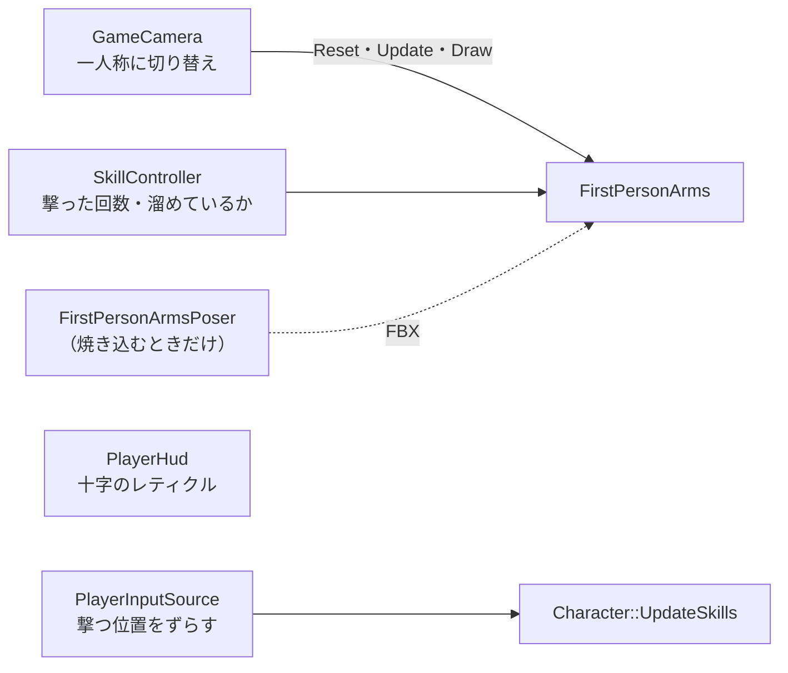

# 一人称の腕の設計

作成日: 2026-11-15（2026-11-19 に、腕の形をクリップに焼き込む形に変えた）
対象: [FirstPersonArms.cpp](../../../../Game/Source/Player/FirstPersonArms.cpp)、腕の形を作る [FirstPersonArmsPoser.cpp](../../../../Game/Source/Player/FirstPersonArmsPoser.cpp)、[GameCamera.cpp](../../../../Game/Source/Objects/GameCamera.cpp) の一人称の切り替え、[PlayerInputSource.cpp](../../../../Game/Source/Character/Input/PlayerInputSource.cpp) の撃つ位置のずらし、[PlayerHud.cpp](../../../../Game/Source/UI/Hud/PlayerHud.cpp) のレティクル
経緯: [一人称の腕の経緯](一人称の腕の経緯.md)

一人称のカメラ（K / パッドの B で切り替え）のときに、画面の下の左右にプレイヤーの腕と手を映し、魔法に合わせて動かす仕組みです。画面の真ん中には十字のレティクルを出します。

**用語:**

| 用語 | 何のことか |
|---|---|
| レティクル | 画面の真ん中に出す、狙いを示す印。ここでは白い十字 |
| 焼き込み | コードで作った姿勢を、コマごとに記録してクリップにすること（[骨の調整の層の設計](../../キャラクター/骨の調整の層/骨の調整の層の設計.md)） |

- **腕のモデルはプレイヤーの体と同じ骨。** 袖の肘から先を消したモデルを使い、腕以外の骨を大きさ 0 につぶして腕だけを映す。プレイヤーのモーションの変換がそのまま使える。
- **腕と手の形は、コードで作ってクリップに焼き込んである。** ゲームの中ではクリップを流すだけ。形を作るコード（`FirstPersonArmsPoser`）は、焼き直すときだけ動かす（Debug ビルドだけ）。形はこのコードを正とする。
- **撃つ位置は手に合わせる。** 氷は右手と左手で交互に、炎は画面の下で溜める。入力元が撃つ位置をずらし、腕も同じ決まりで手を出す。

---

## 1. 全体像



| 動き | クリップ（`Animation/FirstPerson/Baked/`） | 腕 | 手 |
|---|---|---|---|
| 構え | `FpIdle` | 両腕を画面の左右の外から内へ向け、手を画面の下 1/3 の左右に置く（`IDLE_POSE`） | 握りこぶし。手のひらを内側、親指の側をカメラへ向け、上を HP バーの方へ 45° 倒す（ファイティングポーズ） |
| 氷を撃つ | `FpCastL`（画面の右の手）・`FpCastR`（左の手）。撃つ腕だけ層で重ねる | 撃つ腕だけ前へ突き出す（`CAST_POSE`）。1回ごとに右手と左手を替える | 開いて手のひらを前へ。0.2秒見せて構えに戻る |
| 炎を溜める | `FpChargeStart` → `FpCharge` | 両手を画面の下の火の玉の左右に添える（`CHARGE_POSE`） | 握らない（もとのクリップの手の形のまま） |
| 炎を放つ | `FpRelease` | 両腕を前へ伸ばし、両手を照準のそばへ寄せる（`RELEASE_POSE`） | 開いて手のひらを前へ。両手の間を `RELEASE_HAND_GAP` にそろえる。0.3秒見せる |
| 炎を放ったあと構えに戻る | `FpReleaseToIdle`（繰り返さない） | 前へ伸ばした両腕を、構えの位置へ下ろす | 開いた手を、少しずつ握り直す |

このゲームのモデルでは、**左の骨（`J_Bip_L_*`、コードの side 0）が画面の右に映る**。

---

## 2. 実装方法

### ゲームの中（FirstPersonArms）

**クリップを流し、氷は層で重ねる。** 構え・溜め・放つは、ふつうのクリップとして切り替える。氷を撃つ腕は、エンジンのアニメーションの層（[アニメーションの上半身の層の設計](../../../エンジン/アニメーションの上半身の層/アニメーションの上半身の層の設計.md)）を2枚使い、層0 に `J_Bip_L_UpperArm` から先だけ重みを付けて `FpCastL`、層1 に `J_Bip_R_UpperArm` から先で `FpCastR` を流す。撃ったら、その腕の層の重みを `CAST_PUSH_SPEED`（30）で 1 へ近づけ、0.2秒たったら 0 へ戻す。右手と左手を続けて撃っても、腕ごとに別の層なので混ざらない。

```cpp
// FirstPersonArms::Init（抜き出し）
for (int side = 0; side < 2; side++) {
    modelRender.InitAnimationLayer({ { ARM_ROOT_BONES[side], 1.0f } }, side);
    modelRender.PlayLayerAnimationFromTime(side == 0 ? enClip_CastL : enClip_CastR, 0.0f, 0.0f, side);
    modelRender.SetLayerWeight(0.0f, side);
}
```

| ジャンル | 名前 | 何のためのもの | 何をするためのもの | どこから来たもの |
|---|---|---|---|---|
| 関数 | `InitAnimationLayer()` | 腕の骨だけに重みを付けた層を作るため | 骨の名前と重みの組から、骨ごとの重みを決めて層を作る。最後の引数が層の番号 | k2Engine（エンジン）の [ModelRender.h](../../../../k2Engine/graphics/ModelRender.h) |
| 関数 | `PlayLayerAnimationFromTime()` | 層でクリップを流し始めるため | 層の番号のクリップを、決めた時間の位置から流す | 同上 |
| 関数 | `SetLayerWeight()` | 撃つ腕だけ突き出すため | 層の全体の重み（0〜1）。0 の間は層を進めない | 同上 |

**炎を放ったあとは、戻りのクリップを間に流す。** 放つ形から構えへ直に切り替えると、エンジンの補間は骨ごとに回転をまっすぐ混ぜる。手首（115°）や指（75〜88°）のように大きく回る骨では、途中で指が平たく折れた形に見える。そこで、腕を下ろしながら少しずつ握り直す途中の形を `FpReleaseToIdle` に焼いておき、`RELEASE_OPEN_SECONDS` たったら `FpReleaseToIdle` へ（`TO_RELEASE_TO_IDLE_SECONDS`）、流し終えたら `FpIdle` へ（`RETURN_TO_IDLE_SECONDS`）切り替える。`FpReleaseToIdle` の最初のコマは `FpRelease` の 0.3秒の姿勢と同じ、最後のコマはほぼ `FpIdle` と同じに焼いてあるので、切り替えの補間は小さなずれを埋めるだけ。

```cpp
// FirstPersonArms::UpdateClip（抜き出し）
if (m_releaseTimer > 0.0f) {
    m_releaseTimer -= deltaTime;
    if (m_releaseTimer <= 0.0f) {
        m_releaseTimer = 0.0f;
        Play(enClip_ReleaseToIdle, TO_RELEASE_TO_IDLE_SECONDS);
    }
    return;
}
if (m_clip == enClip_ReleaseToIdle && !m_model.IsPlayingAnimation()) {
    Play(enClip_Idle, RETURN_TO_IDLE_SECONDS);
}
```

| ジャンル | 名前 | 何のためのもの | 何をするためのもの | どこから来たもの |
|---|---|---|---|---|
| 関数 | `IsPlayingAnimation()` | 戻りのクリップを流し終えたかを見るため | 繰り返さないクリップが最後まで進んだら false を返す | このゲームの [CharacterModel.h](../../../../Game/Source/Character/Components/CharacterModel.h) |

戻っている途中に右クリックで溜め始めたり、氷を撃ったりしたときは、ふだんの構えのときと同じに扱う（溜め始めのクリップへ切り替える・撃つ腕の層を重ねる）。

**骨の調整の層は2つだけ。** `PoseLayers`（[骨の調整の層の設計](../../キャラクター/骨の調整の層/骨の調整の層の設計.md)）に、「腕以外を見せない」（腕以外の骨の回転と大きさの成分を 0 にする）と、「歩き・走りの腕の揺れ」を足す。どちらもゲームの中の動きで変わるので、焼き込まない。

**揺れ。** `Update` に渡された `FirstPersonBob` から腕ごとのずれを受け取り、撃つ形にしている度合い（`m_holdWeight`。氷の層の重みか、溜め・放つの間は 1）で弱める。8の字のずれ（`m_bobOffset`）は腕ごと動かし、前後に振る量（`m_bobSwing`）は、肩を中心にカメラの右の軸まわりに上げる角度と前へ押す量（`SWING_FORWARD`・`SWING_BACK`）にする（[一人称の揺れの設計](../一人称の揺れ/一人称の揺れの設計.md)）。

**いつ撃ったかは `SkillController` の撃った回数で見る。** `IsFiredThisFrame` で、前のフレームから回数が増えたかを見る。氷は「何回目か（0 から数える）」が偶数なら画面の右の手、奇数なら左の手を出す。`PlayerInputSource` も `InputSourceContext::action1UseCount` から同じ決まりで撃つ位置を右と左に分けるので、手と氷の出る所がそろう。炎は `IsHolding(Action2)` で溜めているかを見る。一人称に切り替えたとき（`Reset`）は、三人称の間に撃った分を数えないよう、今の回数を覚え直す。

**カメラに付けて置く。** `GameCamera::UpdateFirstPersonCamera` がカメラを動かしたあとで `Update` を呼び、腕のモデルをカメラと同じ向きにして、カメラから見て `ARMS_OFFSET` の位置に置く。上下を向いても手は画面の同じ所に映る。

### 焼き込むとき（FirstPersonArmsPoser。Debug ビルドだけ）

形を作るコードは、前に `FirstPersonArms` がゲームの中で毎フレーム動かしていたものを、そのまま移した。もとのクリップ（`Animation/FirstPerson/` の `FpIdle`・`FpChargeStart`・`FpCharge`）に、次の順に骨のワールド行列を書き換えて形を重ねる。

1. `CurlFingers` — 握り具合（`m_grip`）に合わせて指を握る。人差し指〜小指は、関節ごとに曲がりが `FIST_JOINT_DEGS`（付け根 88°・第二関節 100°・第一関節 45°）になるよう、その関節より先をまとめて回す。親指は `PlaceThumb` で、第一関節を人差し指の中節の上、先を中指の中節の上へ合わせる（6回くり返す IK）。
2. `SpreadArms` — 肩を中心に、カメラの上の軸まわりに開き、右の軸まわりに上げる。最後に腕ごと外へずらし、前へ押し出す。置き方は `ArmPose` で持ち、構え → 氷 → 炎を溜める → 炎を放つ の順に、腕ごとの混ぜ具合で混ぜる。
3. `AimHands` — 手首を中心に手を回し、構えでは手のひらを内側・親指の側をカメラへ、撃つときは手のひらを前へ向ける。炎を放つときは `ShapeReleaseFingers` で、指を反らさず開きすぎない形にする。

焼き込む7本のうち6本は、混ぜ具合（`Weights`）を 0 か 1 に決めて作る。`FpReleaseToIdle` だけは、時刻ごとに混ぜ具合を変える。

| クリップ | もとのクリップ | 混ぜ具合 |
|---|---|---|
| `FpIdle` | `FpIdle` | 握る 1 |
| `FpCastL`・`FpCastR` | `FpIdle` | 撃つ腕だけ 氷 1・握る 0 |
| `FpChargeStart`・`FpCharge` | `FpChargeStart`・`FpCharge` | 両腕 溜め 1・握る 0 |
| `FpRelease` | `FpCharge` | 両腕 溜め 1・放つ 1・握る 0 |
| `FpReleaseToIdle` | `FpCharge` の 0.3秒から `FpIdle` へ 0.15秒で切り替える | 放つ 1→0・溜め 1→0・握る 0→1（時刻ごとに変える） |

**`FpReleaseToIdle` は、前の版（形をゲームの中で毎フレーム作っていたとき）の戻り方をそのまま焼く。** 前の版は、放ったあと、もとのクリップを溜めから構えへ 0.15秒で切り替えながら、混ぜ具合を 1フレーム（1/60秒）ごとに目標へ近づけていた（残りの差に「速さ / 60」を掛けた分。放つ 30・溜め 10・握る 8）。焼き込みでは、この近づき方を時刻の式（`ReturnWeight`）にし、`PoseBaker::BakeTransition`（もとのクリップの切り替えを、ゲームの `PlayAnimation` と同じ補間でコマごとに進めて書く）で 0.6秒分を焼く。握り具合が 0.99 を超えるまでの長さ。

**`FpCharge` は、骨の動く速さをそろえて焼く。** もとの溜めのクリップは、出だしが速く終わりが止まりかけなので、繰り返すつなぎ目で速さが急に変わり、手が跳んで見えた。`PoseBaker::Bake` の `isEvenSpeed` で、どのコマでも骨の動いた道のりが同じになるよう、コマごとの再生位置を割り振り直す（最初と最後のコマは変えないので、つなぎ目はつながったまま）。

腕の置き方はカメラの軸で作るので、焼き込むときもモデルをカメラと同じ向きに置く。記録するのはモデルの根元から見た行列なので、カメラがどこを向いていても同じクリップになる。

| ジャンル | 名前 | 何のためのもの | 何をするためのもの | どこから来たもの |
|---|---|---|---|---|
| 型 | `FirstPersonArmsPoser::Weights` | 焼き込む形を決めるため | 左右の腕ごとの、氷・溜め・放つの置き方と握り具合（0〜1） | このゲームの [FirstPersonArmsPoser.h](../../../../Game/Source/Player/FirstPersonArmsPoser.h) |
| 関数 | `BakeAll()` | 7本をまとめて焼き込むため | もとのクリップを読み、形を重ねて `tools/FirstPerson/BakedPose/` に JSON を書く | 同上 |
| 関数 | `VerifyAll()` | 焼き込んだクリップを確かめるため | FBX を読み、JSON の姿勢との骨の位置のずれを、ログに書く | 同上 |

**腕の色。** ボス戦の月の光が強い青で、目の前に大きく映る腕が青白く見えるので、腕だけ乗算の色 `ARMS_MUL_COLOR`（1.0, 0.62, 0.48）で青と緑を減らす。

**撃つ位置のずらし。** `PlayerInputSource` が `aimOffsets` に、氷は `FIRST_PERSON_HAND_OFFSET`（右手か左手の前）、炎は `FIRST_PERSON_CHARGE_OFFSET`（画面の下）を入れる。`Character::ApplyAimOffset` は撃つ位置だけずらし、向きは照準の 3000 先の点へ向け直す（画面の真ん中へ飛ぶ）。炎は一人称のとき、画面を覆うものを抑えた溜めのエフェクト（`fire_charge_fp.efk`・`fire_charged_fp.efk`）を使う。

**レティクル。** `PlayerHud` が白い線4本（上・下・左・右）と、その下に少し大きい黒い縁を敷き、一人称のときだけ出す。

---

## 3. 使い方

| やりたいこと | 書き方 |
|---|---|
| 構え・撃つときの腕の位置や手の形を変える | `FirstPersonArmsPoser.cpp` の `IDLE_POSE`・`CAST_POSE`・`CHARGE_POSE`・`RELEASE_POSE`・`FIST_*`・`RELEASE_*` を変え、下の3つで焼き直す（FBX を Blender で直さない。焼き直すと消える） |
| 焼き直す ① JSON を書く | Debug ビルドにし、`Action/Game` で `x64/Debug/Game.exe -bakeFirstPersonArms` を起動する（窓は出てすぐ閉じる）。`tools/FirstPerson/BakedPose/*.json` と `bake_log.txt` ができる |
| 焼き直す ② FBX にする | `blender -b --python tools/BlenderScripts/pose_bake_to_fbx.py -- Game/Assets/modelData/player/Model/SK_Player.FBX Game/Assets/modelData/player/Animation/FirstPerson/Baked tools/FirstPerson/BakedPose/FpIdle.json …（7本。変えたものだけでもよい）` |
| 焼き直す ③ 確かめる | 焼き直したクリップの `.tka` を消してから、`Game.exe -verifyFirstPersonArms` を起動し、`verify_log.txt` のずれが 0.01 より小さいことを見る。ゲームは `.tka` がないときだけ FBX から作り直すので、消さないと古い `.tka` のまま比べてしまう。できた `.tka` は FBX と一緒にコミットする |
| 新しい魔法に腕の動きを付ける | `FirstPersonArmsPoser` に置き方（`ArmPose`）と混ぜ具合を足し、`MakeBakeJobs` に1本足して焼き込む。`FirstPersonArms` の `EnClip` と `Init` にクリップを足し、`UpdateClip` で流す |
| 撃つ位置を手に合わせ直す | `PlayerInputSource.cpp` の `FIRST_PERSON_HAND_OFFSET`・`FIRST_PERSON_CHARGE_OFFSET` |
| 腕のモデルを作り直す（プレイヤーの服を変えた） | `tools/FirstPerson/make_first_person_arms_tkm.py <SK_Player.tkm> <出力の .tkm>` で作り、`SK_Player.tks` を同じ名前でコピーする |

---

## 4. 調整用の数値

ゲームの中（`FirstPersonArms.cpp`）:

| 名前 | 値 | 意味 |
|---|---|---|
| `ARMS_OFFSET` | (0, -183, -18) | カメラから見た、腕のモデルの足元の位置 |
| `CAST_OPEN_SECONDS` / `RELEASE_OPEN_SECONDS` | 0.2 / 0.3 秒 | 撃ったあと手を開いて見せる時間 |
| `CAST_PUSH_SPEED` | 30 | 氷を撃つ腕の層の重みを変える速さ |
| `TO_IDLE_SECONDS` / `TO_CHARGE_START_SECONDS` / `TO_CHARGE_SECONDS` / `TO_RELEASE_SECONDS` | 0.2 / 0.2 / 0.1 / 0.05 秒 | クリップを切り替えるときの補間 |
| `TO_RELEASE_TO_IDLE_SECONDS` / `RETURN_TO_IDLE_SECONDS` | 0.05 / 0.1 秒 | 放つ → 戻り、戻り → 構え の補間（どちらも、つなぐ姿勢がほぼ同じなので短い） |
| `SWING_FORWARD` / `SWING_BACK` | 上げる 3.3°・前へ 2.7 / -1.3°・-1.3 | 歩き・走りで腕を振り切ったときに足す量 |

焼き込むとき（`FirstPersonArmsPoser.cpp`）:

| 名前 | 値 | 意味 |
|---|---|---|
| `IDLE_POSE` | 開く -25°・上げる 55°・外へ 12 | 構え |
| `CAST_POSE` | -10°・46°・外へ 12・前へ 30 | 氷を撃つ腕 |
| `CHARGE_POSE` | 2°・18°・前へ 10 | 炎を溜める両腕 |
| `RELEASE_POSE` | -30°・32°・外へ 12・前へ 32 | 炎を放つ両腕 |
| `FIST_TOWARD_CAMERA_DEG` / `FIST_ROLL_DEG` | 15° / 45° | 構えの拳をカメラへ傾ける・HP バーの方へ倒す角度 |
| `FIST_JOINT_DEGS` | 88°・100°・45° | 握りこぶしの関節ごとの曲がり |
| `RELEASE_HAND_GAP` | 10 | 炎を放つときの両手の間 |
| `RETURN_FROM_TIME` / `RETURN_BLEND_SECONDS` / `RETURN_LENGTH` | 0.3 / 0.15 / 0.6 秒 | `FpReleaseToIdle` の、もとのクリップの切り替え始めの位置・補間・焼く長さ |
| `RETURN_RELEASE_SPEED` / `RETURN_CHARGE_SPEED` / `RETURN_GRIP_SPEED` | 30 / 10 / 8 | `FpReleaseToIdle` で、放つ・溜めの置き方を 0 へ、握り具合を 1 へ近づける速さ（前の版と同じ） |

カメラ・レティクル:

| 名前 | 値 | 意味 |
|---|---|---|
| `FIRST_PERSON_EYE_HEIGHT`（GameCamera） | 168 | 目の高さ |
| `FIRST_PERSON_VIEW_ANGLE_DEG`（GameCamera） | 50° | 一人称の画角（三人称は 90°） |
| `FIRST_PERSON_NEAR`（GameCamera） | 5 | 手元の腕が見切れないよう、近くを切る距離を小さくする |
| `RETICLE_GAP` / `RETICLE_LENGTH` / `RETICLE_THICKNESS`（PlayerHud） | 6 / 12 / 2 | レティクルの中央のすき間・線の長さ・太さ |

---

## 5. 決めたこと

| 決めたこと | 理由 |
|---|---|
| 腕だけのモデルを Blender で作らず、tkm の三角形を減らすツールで作る | Blender から書き出した腕だけのモデルは、ゲームでモーションを付けると映らなかった（原因は分かっていない）。tkm の三角形の並びだけを減らせば、骨の番号が変わらず、プレイヤーのモーションがそのまま使える |
| 袖の肘から先を消す | 広がった袖口が手より大きく、目の位置から見ると手が隠れる |
| 腕と手の形はカメラの軸で、コードで作る | 腕だけのクリップでは、画面のどこに手が映るかを決めにくい。カメラの軸で置けば、上下を向いても手が画面の同じ所に映る |
| 作った形はクリップに焼き込み、ゲームの中ではクリップを流す | カメラから見ると毎回同じ形なので、毎フレーム計算しなくてよい。Blender で作り直すと、前にクリップで手の形が合わなかったのと同じ所でつまずくので、ゲームで作った形をそのまま焼き込んだ |
| 形は焼き込むコードを正とする | 直す所を1つにする。Blender で FBX を直しても、焼き直すと消える |
| 氷を撃つ腕は、腕ごとの層で重ねる | 右手と左手を続けて撃つと、片方が戻る途中でもう片方が突き出す。腕ごとに層を分ければ混ざらない（エンジンの層を2枚まで作れるようにした） |
| 炎を放ったあとの戻りも焼き込む | クリップを直に切り替えると、骨ごとの回転の補間で、途中の指が平たく折れて見えた。前の版の、腕を下ろしながら握り直す戻り方を、そのまま焼いた |
| 炎を溜めている間は握りこぶしの曲げを足さない | 溜めのクリップの指はもとから曲がっていて、足すと指があちこちへ曲がった |
| 炎の火の玉を画面の下で溜める | 目の前の真ん中で溜めると前が見えない。溜めきった火の玉の上 1/3 だけが見える高さにした |

---

## 6. 既知の課題

- **形と形の間の動き方が、コードで混ぜていたときと少し違う（炎を放ったあとの戻りは除く）。** 前は置き方の数値（角度・ずらす量）を混ぜていたが、今はクリップの切り替え（骨の回転の補間）で移る。炎を放ったあとの戻りは、途中で指が折れて見えたので、前の戻り方を焼き込んだ（`FpReleaseToIdle`）。氷を撃つときも、前は手を開く速さ（40）と腕を突き出す速さ（30）が別だったが、今は層の重み1つ（30）で両方が動く。行き着いた形は同じ。
- **`FpCastRight.fbx`・`.tka` は使っていない。** 書き出す設定（`tools/BlenderScripts/first_person_arms_anims.json`）にも残っている。
- 腕の置き方の数値は、ゲームの画面を見て決めた値で、画角（50°）や目の高さを変えると合わせ直し（と焼き直し）が要る。

---

## 7. 関連するページ

- [骨の調整の層の設計](../../キャラクター/骨の調整の層/骨の調整の層の設計.md)（焼き込みの仕組み）
- [一人称の揺れの設計](../一人称の揺れ/一人称の揺れの設計.md)（歩き・走りの腕の揺れと着地の沈み）
- [入力の設計](../../キャラクター/入力/入力の設計.md)（`aimOffsets`・撃つ位置のずらし）
- [スキルの設計](../../スキル/スキルの設計.md)（撃った回数・`IsHolding`）
- [HUDの設計](../../UI/HUD/HUDの設計.md)
- [3段攻撃の設計](../3段攻撃/3段攻撃の設計.md)（三人称で右手 → 左手 → 両手と撃つ攻撃）
