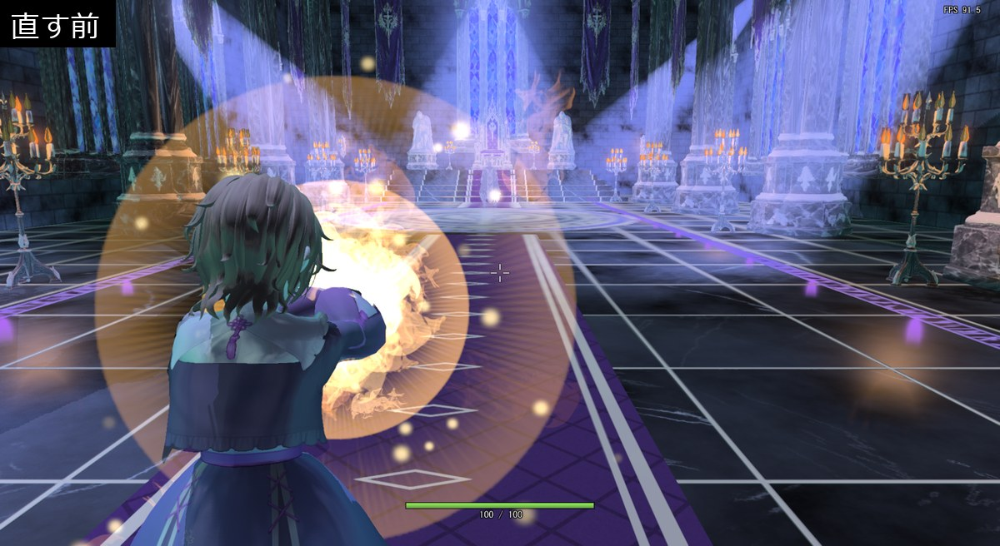
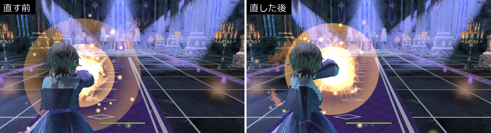
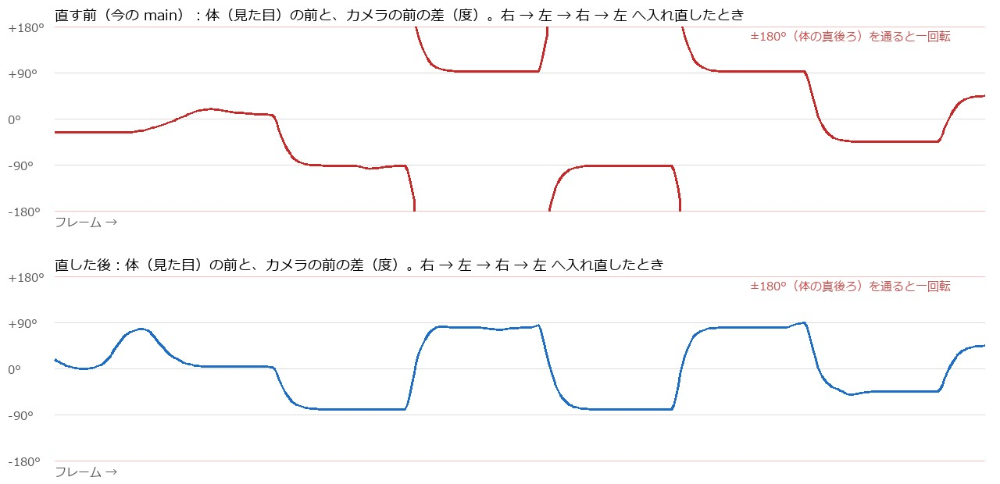

# 三人称の溜め撃ちの経緯

設計: [三人称の溜め撃ちの設計](三人称の溜め撃ちの設計.md)
手順: [三人称の溜め撃ちの手順](三人称の溜め撃ちの手順.md)

何をして、なぜ今の形になったかの記録です。日付ごとに書き足します。#193（`<ThirdPersonCharge>`）のマージに入っている4つのコミットと、そのコミットメッセージから拾いました。

アニメーションのコマは 30fps で、クリップの先頭を 0コマ目と数えます。

---

## 2026-11-17 三人称の溜め撃ちで、上半身だけ構えて撃ち、肩越しの視点にした

コミット `9baced62`。三人称で右クリック（炎魔法）を溜めている間も、今までは体の動きが変わらず、キャラクターの正面へ撃っていた。これを、上半身だけ構えて、狙った所へ撃てる形にした。

- エンジンに、上半身だけ別のアニメーションを重ねる層を足した（[アニメーションの上半身の層の経緯](../../../エンジン/アニメーションの上半身の層/アニメーションの上半身の層の経緯.md)）。
- `PlayerUpperBody` を作った。右クリックで溜める間は、上半身を Attack3（両手で撃つ）の 7コマ目（両手を前へ伸ばしかけたところ）で止め、離したら続きを流して撃つ。
- 溜めている間は、体をカメラの向きへ向け、歩きの 0.6倍で歩く。走る・跳ぶ・氷魔法はなし、ダッシュで溜めをやめる。三人称では地上でだけ溜め始められる。
- 三人称で溜めているときは、画面の真ん中へ、両手の真ん中の 15cm 前から撃つ。照準を出す。
- `GameCamera` に肩越しの視点を足した。このときは、注視点とカメラを右へ 55cm ずらし（`AIM_SIDE_OFFSET`）、距離 200 にした。構えている間（撃って下ろし始めるまで）は肩越しにし、0.3秒で戻した。

**用語:**

| 用語 | 何のことか |
|---|---|
| 肩越しの視点 | キャラクターを画面の左に寄せ、画面の真ん中がキャラクターの右前を指すカメラ |

## 2026-11-17 構えたまま、後ろ・左・右へ歩くアニメーションを足した

コミット `c30d1766`。構えている間は体がカメラの向きを向くので、後ろや横へ動くと、前歩きのクリップのまま後ろ・横へ滑っていた。

- KinemIQ の `Walk - backwards`・`Walk - side steps left` を Blender で SK_Player に移し、WalkBack・StrafeL・StrafeR を作った（StrafeR は StrafeL の左右反転。[player_charge_walk_anims.json](../../../../tools/BlenderScripts/player_charge_walk_anims.json)）。
- 構えている間の Walk は、動く向き（体から見て前・後ろ・左・右のいちばん近いもの）で歩きを選び、足の速さを動く速さに合わせるようにした。
- 歩きの再生の速さを変えると、上半身の層もつられて速さが変わっていたので、層の再生の速さを下と別にした（[アニメーションの上半身の層の経緯](../../../エンジン/アニメーションの上半身の層/アニメーションの上半身の層の経緯.md)）。

**用語:**

| 用語 | 何のことか |
|---|---|
| KinemIQ | Web で手に入れた既存のアニメーションの素材の名前（3段攻撃の Spell と同じ） |
| SK_Player | プレイヤーのモデル・骨格の名前 |

## 2026-11-18 脚を進む向きへ向けて上半身をひねり、肩越しの視点を画面の位置で決めるようにした

コミット `1c07560e`（作業の途中で保存したもの）。

- 前・横へ動くときは、脚を進む向きへ向けて前歩きにし、上半身をカメラの向きへひねるようにした（`TwistUpperBodyToAim()`。背骨・胸・上の胸に 3:3:4 で分け、100度まで）。後ろの方へ動くとき（進む向きとカメラの向きが約 100度より離れるとき）は、体はカメラの向きのまま、横歩き・後ろ歩きにする。
- ひねるのは、骨のワールド行列ができたあと、体の連動のあと・揺れ物の前にした。そのために `Character` に `OnPostBodyLink()` を足し、体の連動・揺れ物を使わないキャラクターでも呼ばれるように、登録の `if` を外した。
- 肩越しの視点の横のずらし方を、ずらす距離（55cm）から「キャラクターを画面のどこに映すか」（`AIM_SCREEN_X`。0 が中心、1 が左端）に替えた。距離と画角からずらす量を出すので、距離を変えても映る位置が変わらない。距離は 200 から 120（腰から上が映るくらい）にした。
- F1 に「肩越しの視点」の窓を足した。「構えた視点のままにする（確認用）」で、構えずに肩越しの視点を見られる。

## 2026-11-18 片手（右手）で構え、右肩を引いて右腕を外へ開くようにした

コミット `7c80f27e`。見た目と操作の手直しをまとめて行った。コミットメッセージには、何を変えたかだけが書かれていて、なぜ変えたか（どう見えていたか）は書かれていない。

### 1. 現状の問題

直す前は、次の形だった。

- 両手（Attack3）の 7コマ目で止めて構え、火の玉は両手の真ん中の 15cm 前にあった。
- 構えた腕は狙う向き（画面の奥）へ真っすぐ伸びていた。肩越しの視点では、キャラクターの後ろから見るので、腕が体の向こう側になる。
- 後ろ歩きも、前・横と同じ 0.6倍の速さだった。
- カメラは、撃って腕を下ろし始めるまで肩越しのままで、0.3秒かけて戻っていた。

肩越しの視点で後ろから見ると、両手と火の玉が体の向こう側に隠れ、腕がどう構えているかが見えない（下の画像。`1c07560e` の版）。



### 2. ソースコードの問題箇所

[PlayerUpperBody.cpp](../../../../Game/Source/Player/PlayerUpperBody.cpp) の上半身に流すクリップと、[GameCamera.cpp](../../../../Game/Source/Objects/GameCamera.cpp) の肩越しの視点の度合いを変える条件。

```cpp
// 上半身に流すクリップ。3段攻撃の3段目（両手で撃つ）を、途中で止めて溜めに使う。
constexpr int CHARGE_CLIP = enPlayerAnimClip_Attack3;
```

```cpp
constexpr float AIM_EXIT_SECONDS = 0.3f;          // 元の三人称へ戻る時間。
...
if (m_player->IsThirdPersonAiming() || m_isPreviewShoulderView) {
```

`IsThirdPersonAiming()` は、撃ったあとの段（`Cast`）でも `true` なので、撃って腕を下ろし始めるまでカメラが戻り始めなかった。

### 3. 直し方

- 片手（右手、Attack1）で構える。止めるのは Attack1 の 9コマ目（右手を前へ突き出しきる手前）。火の玉は、右手の 35cm 前（狙う向き）に置く。
- 右肩を後ろへ 25度引き（上の胸をひねる）、右腕は引いた分を戻したうえで外（画面の右）へ 25度開く。首は引いた分だけ戻して、顔を狙う向きのままにする。腕が体に隠れないようにするため（`armOutDeg` のコメント）。
- 後ろの方へ歩くときは、さらに 0.6倍にする（`backMoveSpeedRate`）。
- カメラは「溜めている間」（`IsThirdPersonCharging()`）だけ肩越しにし、0.15秒で戻す。離して撃ったら、撃つ動きの終わりを待たずに戻し始める。
- これらの数値を F1 の「溜め撃ちの構え」の窓で変えられるようにした。

### 4. ソースコードの直し

```diff
-	// 上半身に流すクリップ。3段攻撃の3段目（両手で撃つ）を、途中で止めて溜めに使う。
-	constexpr int CHARGE_CLIP = enPlayerAnimClip_Attack3;
+	// 上半身に流すクリップ。3段攻撃の1段目（右手で撃つ）を、途中で止めて溜めに使う。
+	constexpr int CHARGE_CLIP = enPlayerAnimClip_Attack1;
```

```diff
-	constexpr float AIM_EXIT_SECONDS = 0.3f;          // 元の三人称へ戻る時間。
+	constexpr float AIM_EXIT_SECONDS = 0.15f;          // 元の三人称へ戻る時間。
 ...
-	if (m_player->IsThirdPersonAiming() || m_isPreviewShoulderView) {
+	// 離して撃ったら、撃つ動きの終わりを待たずに戻し始める。
+	if (m_player->IsThirdPersonCharging() || m_isPreviewShoulderView) {
```

player.json の `"charge"` は、`holdFrame` を 7 → 9、`ballForward` を 15 → 35 にし、`backMoveSpeedRate`・`shoulderBackDeg`・`armOutDeg`（0.6・25・25）を足した。右肩・右腕・首を回すコードは [Player.cpp](../../../../Game/Source/Player/Player.cpp) の `TwistUpperBodyToAim()` の後半（[三人称の溜め撃ちの手順](三人称の溜め撃ちの手順.md) の手順9）。

直した後は、右腕が体の右へ出て、右手の前に火の玉がある。



### 5. どう確かめたか

コミットのときに確かめた記録は残っていない。数値は F1 の窓で見ながら決めたもの（`F1 に「溜め撃ちの構え」の調整窓を足す`）。

画像は、2026-11-19 に、作業用フォルダ（git worktree）で、直す前（`1c07560e`）と直した後（`7c80f27e`）をそれぞれ取り出して撮った。

- 撮影用の変更（コミットしていない）: キーボードを読まない（ほかのアプリの入力を拾わない）。起動から少したったら右クリックを押しっぱなしにしたことにする。プレイヤーは始めの位置で立ったまま溜める。
- 撮り方: ゲームを最小化・非アクティブで起動し、窓を透明・クリックを素通り・いちばん奥にしてから、アクティブにしないで元の大きさに戻し、`PrintWindow` で窓だけを撮る。撮ったらすぐに終了させる。
- どちらも、溜めきって火の玉が大きくなったあとの画面。後ろ歩きの速さとカメラの戻りの早さは、静止画では違いが出ないので撮っていない。

## 2026-11-19 設計・手順書を書いた

[三人称の溜め撃ちの設計](三人称の溜め撃ちの設計.md) と [三人称の溜め撃ちの手順](三人称の溜め撃ちの手順.md) を書いた。手順書は、#193 の差分を「数値 → 上半身の部品 → Player に組み込む → 撃つ位置と照準 → 構えている間の入力 → 肩越しの視点 → 後ろ・横歩き → 上半身をひねる → 右肩 → F1 の窓」の10手順に分けた。コミットの順（両手で作ってから片手に替えた、など）ではなく、今の形を最初から作る順にしている。

どう確かめたか:

- 作業用フォルダ（git worktree）に、#195 の main から #193 のソースの変更（エンジン・ゲーム・`player.json`・`Game.vcxproj`）を逆に当てた形を作り、Game.sln を Debug x64 でビルドして通ることを確かめた。構えて歩くクリップ（`WalkBack`・`StrafeL`・`StrafeR` の `.fbx`・`.tka`）と `player_charge_walk_anims.json` は、手順書の前提どおり、もとからある形にした。
- 先に [アニメーションの上半身の層の手順](../../../エンジン/アニメーションの上半身の層/アニメーションの上半身の層の手順.md) を当て、そのあと手順書の `<!-- add: … -->` などの印だけを読んでコードを当てるスクリプトで、手順1から1つずつ当てて、そのたびに Game.sln を Debug x64 でビルドした。10回とも、エラーなくビルドが通った。手順2で `PlayerUpperBody.cpp` を作ったところで、Visual Studio でファイルを足したのと同じになるよう、`Game.vcxproj`・`Game.vcxproj.filters` を main のものにした。
- 手順10まで当てた結果は、ゲームの18のソース・`player.json`・`Game.vcxproj`・`Game.vcxproj.filters` とエンジンの4つのファイルが、main と1行も違わなかった（`git diff` が空）。
- ゲームの画面での確かめ（各手順の「確かめ方」の、起動して見るところ）はしていない。

## 2026-11-19 ダッシュのあとに構えると走れてしまうのを直した

### 1. 現状の問題

三人称で溜め撃ちを構えている間は走れないはずだが、ダッシュしたあと移動の入力を離さずに右クリックで溜めると、走ったまま（走りのステート・走りの速さ）になった。

### 2. ソースコードの問題箇所

`Player::FilterAimingInput()` は走るボタン（`input.isRun`）を外していた。しかし地上のステートは、走るボタンのほかに、ダッシュのあとの「走り続ける」（`context.keepRunAfterDash`。移動の入力を離すまで残る）でも走りを選ぶ。こちらは構えても消えていなかった。

```cpp
// PlayerGroundState::SelectByInput
if ((input.isRun || context.keepRunAfterDash) && context.mover->GetSettings().runSpeedMultiplier != 1.0f) {
	return PlayerStateId::Run;
}
```

### 3. 直し方

`keepRunAfterDash` はステートマシンの中にあるので、移動の入力を離したときに消している `PlayerStateMachine::OnBeforeUpdate()` で、構えているとき（`m_isAiming`）にも消す。

### 4. ソースコードの直し

[PlayerStateMachine.cpp](../../../../Game/Source/Player/State/PlayerStateMachine.cpp):

```diff
 	// 移動の入力を離したら、ダッシュのあとの「走り続ける」を終える。
-	if (input.moveDirection.Length() < context.settings.moveThreshold) {
+	// 三人称の溜め撃ちで構えたときも終える（構えている間は走らない。走るボタンは Player::FilterAimingInput が外す）。
+	if (m_isAiming || input.moveDirection.Length() < context.settings.moveThreshold) {
```

手順書は手順7の 7-6 に、この書き換えを足した。

### 5. どう確かめたか

- 作業用フォルダ（git worktree）で Game.sln を Debug x64 でビルドし、通ることを確かめた。
- ゲームの画面での確かめと比較画像は、まだない（ダッシュしてから溜める操作を、ユーザーの操作を邪魔せずに再現する方法を用意していないため）。

---

## 2026-11-21 横歩きをやめて腰を回して歩き、右と左を入れ直しても一回転しないようにした

ユーザーが遊んで「溜め技中に右から左、左から右方向に入力すると、横に移動するのではなく一回転する」と見つけた。直し方は、ユーザーの決めで「横歩きのモーションは今後使わず、腰を回して歩く。今回のような回転はしない」。

### 1. 現状の問題

溜めて構えたまま右へ歩き、左へ入れ直すと、体が後ろを回って一回転する（毎回ではない）。

画面の画像では、火の玉と後ろからの視点のせいで脚の向きがほとんど見えなかったので、体（見た目）の前とカメラの前の差を毎フレーム記録した（下の「4」のグラフの上の段）。差が ±180°（体がカメラに背中ではなく正面を向けた向き）を通っている所が、一回転している所。

記録の取り方: 調べる用の変更（コミットしていない）で、キーボードを読まず、決まったフレームから炎の溜めを押したままにし、右 → 左 → 右 → 左 へ 60 フレームずつ歩かせた。`TwistUpperBodyToAim()` の中で、体の前とカメラの前の角度をログに書いた。窓を前に出さずに動かす方法は [一人称の腕の経緯](../一人称の腕/一人称の腕の経緯.md) の 2026-11-19 と同じ。

### 2. ソースコードの問題箇所

```cpp
// 直す前の Player::FilterAimingInput（抜き出し）
if (move.Dot(input.lookDirection) > AIM_TURN_LEGS_MIN_DOT) {
    input.lookDirection = move;  // 脚を進む向きそのものへ向ける（真横なら 90°）
}
```

```cpp
// CharacterMover::UpdateVisualRotation（もとからある。抜き出し）
float offset = currentAngle - targetAngle;  // 見た目の向きと本当の向きの差
while (offset > Math::PI) { offset -= Math::PI2; }   // -180°〜180° にそろえ、近い方へ回る
while (offset < -Math::PI) { offset += Math::PI2; }
```

真横どうし（+90° と -90°）を入れ直すと、脚の向きがちょうど 180° 変わる。見た目の向きは「近い方」へ回るが、180° ちょうどではどちらも同じ近さなので、入力やカメラがわずかに揺れるだけで後ろ回りになる。後ろを回ると、上半身のひねり（上限 100°）も追いつかず、体ごと一回転して見える。

真横の入力だけ（後ろ寄りの成分 0）で流したときは、4回とも前を回った。真横から 2° だけ後ろ寄りに入れると、4回のうち3回、後ろを回った。

### 3. 直し方

- 腰から下（脚）をカメラから回す角度に、上限 80°（`AIM_LEGS_MAX_DEG`）を付ける。右と左の差が 160° になり、近い方（体の前の側）を必ず回る。80〜約100° の向きへ動くときは、腰は 80° のまま前歩きで進む（足の向きと進む向きが最大 20° ずれる）。
- 横歩きのクリップ（`StrafeL`・`StrafeR`）は使わない。歩きのクリップは「体から見て後ろへ動けば後ろ歩き、それ以外は前歩き」にし、クリップの対応表・`player.json`・書き出しの設定（`player_charge_walk_anims.json`）・アセットからも消した。

### 4. ソースコードの直し

```diff
 // Player::FilterAimingInput
 if (move.Dot(input.lookDirection) > AIM_TURN_LEGS_MIN_DOT) {
-    input.lookDirection = move;
+    input.lookDirection = TurnLegsToward(input.lookDirection, move);
 }
```

```diff
 // PlayerWalkState::UpdateAimClip
-const float front = input.moveDirection.Dot(forward);
-const float side = input.moveDirection.Dot(right);
-if (fabsf(side) > fabsf(front)) {
-    clip = side > 0.0f ? enPlayerAnimClip_StrafeR : enPlayerAnimClip_StrafeL;
-    animMoveSpeed = context.settings.strafeAnimMoveSpeed;
-}
-else if (front < 0.0f) {
+const float front = input.moveDirection.Dot(forward);
+if (front < 0.0f) {
     clip = enPlayerAnimClip_WalkBack;
```

`TurnLegsToward()` の中身は [設計](三人称の溜め撃ちの設計.md) の「腰から下の向きは、カメラの向きから 80度までに抑える」にある。



上が直す前（今の main）、下が直した後。どちらも、真横から 2° 後ろ寄りに、右 → 左 → 右 → 左 と入れ直した。直す前は ±180° を3回通っている（一回転）。直した後は、どの入れ直しも 0°（カメラの向き）の側を通り、横へ歩いている間の差は ±80° でそろう。

### 5. どう確かめたか

- 上のとおり、同じ入力で直す前と直した後の記録を比べた。直した後は、記録した全フレームで差が 100° を超えなかった（直す前は 36 フレームで超えた）。
- Debug ビルドが通ることを確かめた。
- 横へ歩くときの足の滑り（腰の向きと進む向きのずれ）や、上半身のひねりの見た目は、画面では確かめていない。ユーザーに遊んで確かめてもらう。
- 手順書（[三人称の溜め撃ちの手順](三人称の溜め撃ちの手順.md)）は、まだ横歩きを足す形のまま（README の「注意事項」）。
