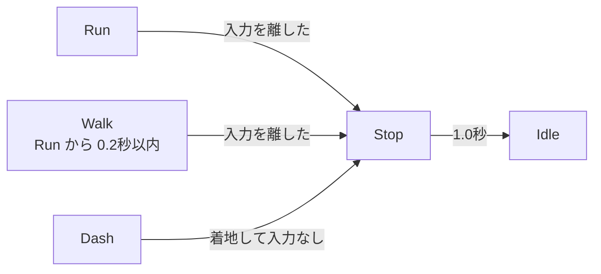

# 走りから止まる設計

作成日: 2026-11-07
対象: `Game/Source/Player/State/PlayerStopState.*`、`PlayerRunState.h`、`PlayerWalkState.h`
経緯: [走りから止まる経緯](走りから止まる経緯.md)
手順: [走りから止まる手順](走りから止まる手順.md)（何もない状態から、どのファイルに何を足すか）

走っているときに移動の入力を離すと、勢いで前へ滑りながら踏ん張って止まる（ザザっと止まる）しくみです。
モーション（StopL / StopR）は [止まるモーションの設計](../../アニメーション制作/止まるモーション/止まるモーションの設計.md) にあります。

- **走り・ダッシュのあとだけ止まる動きを挟む。** 歩きから離したときは、すぐ Idle。
- **踏ん張る足は、止まった瞬間の走りの足に合わせる。** 足が入れ替わって見えないように。

---

## 1. 流れ



止まっている途中でも、移動の入力で Walk / Run、ダッシュで Dash、ジャンプ・足場がないで Air へすぐ移る。

コマは 30fps で、クリップの先頭を 0コマ目と数える。

| 時間（秒） | StopL / StopR のコマ | 動き | 進む速さ |
|---|---|---|---|
| 0 〜 0.47 | 0〜14コマ目 | 前の足を突っ張り、腰を落として滑る | 960 から 0 へまっすぐ下がる（約224 進む） |
| 0.47 〜 1.0 | 14〜30コマ目 | 起き上がってまっすぐ立つ | 0 |
| 1.0 〜 | — | Idle へ 0.3秒の補間で移る | 0 |

---

## 2. 実装方法

**Run は、地面の共通ルールで `Idle` になるときだけ `Stop` を返す。** `stopSeconds` を 0 にすると、すぐ立ち止まる。

**走るボタンを先に離したときも止まる。** 左Shift と移動キーをほぼ同時に離すと、一瞬 Walk になる。Walk は Run から来たとき（`context.previousId`）に `stopAfterRunSeconds`（0.2秒）を数え、その間に Idle になるなら Stop を返す。

**踏ん張る足の選び方。** Run は毎フレーム、走りの位置を `context.runAnimTime` に足していく（ダッシュから来たときはダッシュが入れる）。Stop に入ったら、走りの1周期（14コマ）の中で、どちらの足が前に着くところに近いかで選ぶ。

| クリップ | 前へ突っ張る足 | 走りで近いところ |
|---|---|---|
| StopL | 左 | Run の 9コマ目（左足が前に着く） |
| StopR | 右 | Run の 2コマ目（右足が前に着く） |

走りとクリップの最初のコマは形が近いので、入るときの補間は 0.1秒と短い。

**滑る速さはフレームの真ん中の時間で測る。** フレームレートが変わっても滑る距離がほぼ同じになる。向きは変えない。

```cpp
const float mid = min(m_elapsed + deltaTime * 0.5f, slide);
speed = m_startSpeed * (1.0f - mid / slide);
```

**名前:**

| ジャンル | 名前 | 何のためのもの | 何をするためのもの | どこから来たもの |
|---|---|---|---|---|
| 変数 | `mid` | 滑る速さを測る時間を持つため | 今フレームの真ん中の時間（秒）。`slide` を超えない | ゲームの [PlayerStopState.cpp](../../../../Game/Source/Player/State/PlayerStopState.cpp) の `PlayerStopState::Update()` の中 |
| 関数 | `min` | 時間が `slide` を超えないようにするため | 2つのうち小さい方を返す。`std::` が付かないので、`std::min` ではなくマクロ | Windows の API（`<windows.h>`。[k2EngineLowPreCompile.h](../../../../k2EngineLow/k2EngineLowPreCompile.h) で読み込み済み）のマクロ |
| メンバー変数 | `m_elapsed` | `Stop` に入ってからの時間を覚えるため | 経過時間（秒） | ゲームの [PlayerStopState.h](../../../../Game/Source/Player/State/PlayerStopState.h) の `PlayerStopState` クラス |
| 引数 | `deltaTime` | 前のフレームからの時間で、時間を進めるため | 前のフレームからの経過秒。例: 60FPS なら約 0.0167 | ゲームの `PlayerStopState.cpp` の `PlayerStopState::Update()` の引数 |
| 変数 | `slide` | 滑る長さを短い名前で持つため | 滑る長さ（秒）。`stopSlideSeconds`（0.47）の値 | ゲームの `PlayerStopState.cpp` の `PlayerStopState::Update()` の中 |
| 変数 | `speed` | 今フレームの滑る速さを持つため | 960 から 0 へ、まっすぐ下がる速さ | ゲームの `PlayerStopState.cpp` の `PlayerStopState::Update()` の中 |
| メンバー変数 | `m_startSpeed` | 滑り始めの速さを覚えるため | 滑り始めの速さ。`Enter` で、走る速さ（960）にする | ゲームの `PlayerStopState.h` の `PlayerStopState` クラス |

---

## 3. 調整用の数値（[player.json](../../../../Game/Assets/data/player.json) の `stop`）

| 内容 | 値 |
|---|---|
| クリップを流す長さ（`stopSeconds`） | 1.0秒（StopL / StopR の 30コマ目。立ち上がったところ） |
| 滑る長さ（`stopSlideSeconds`） | 0.47秒（StopL / StopR の 14コマ目。滑り終わって起き上がり始める）。距離は「走る速さ × これ ÷ 2」 |
| 入る / 出るときの補間 | 0.1秒 / 0.3秒 |
| 走るボタンを先に離しても止まる時間 | 0.2秒 |
| 走りの1周期 / 左足・右足が前に着くところ | 14コマ / Run の 9コマ目 / 2コマ目 |

滑る長さを大きく変えると、StopL / StopR の起き上がり（14コマ目）とずれる。

---

## 4. 決めたこと

| 決めたこと | 理由 |
|---|---|
| 歩きのあとは止まる動きを挟まない | 速さ 170 では、滑って止まるほどの勢いがない |
| ダッシュのあとも挟む | 着地の終わりの速さ（960）が走る速さと同じで、滑り始めにそのままつながる |
