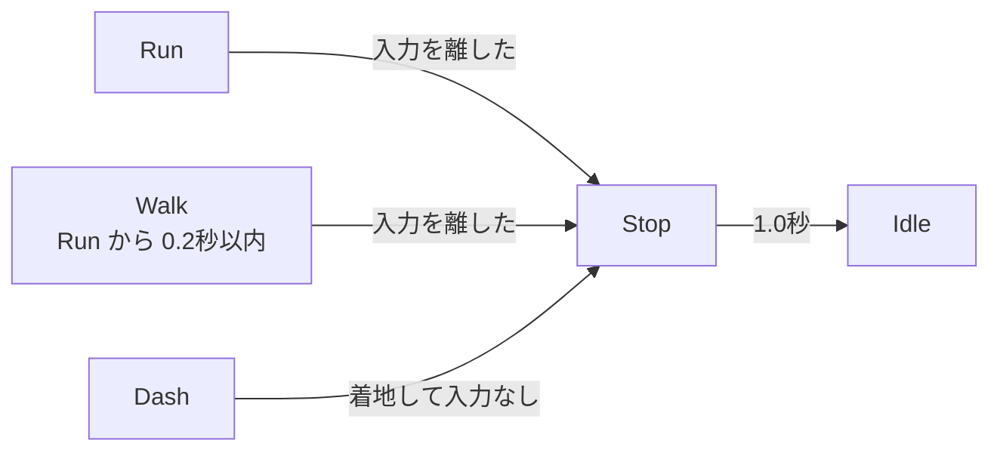

# 走りから止まる設計

作成日: 2026-11-07
対象: `Game/Source/Player/State/PlayerStopState.*`、`PlayerRunState.h`、`PlayerWalkState.h`
経緯: [走りから止まる経緯](走りから止まる経緯.md)

走っているときに移動の入力を離すと、勢いで前へ滑りながら踏ん張って止まる（ザザっと止まる）しくみです。
モーション（StopL / StopR）は [止まるモーションの設計](../アニメーション制作/止まるモーションの設計.md) にあります。

- **走り・ダッシュのあとだけ止まる動きを挟む。** 歩きから離したときは、すぐ Idle。
- **踏ん張る足は、止まった瞬間の走りの足に合わせる。** 足が入れ替わって見えないように。

---

## 1. 流れ



止まっている途中でも、移動の入力で Walk / Run、ダッシュで Dash、ジャンプ・足場がないで Air へすぐ移る。

| 時間（秒） | コマ | 動き | 進む速さ |
|---|---|---|---|
| 0 〜 0.47 | f00〜f14 | 前の足を突っ張り、腰を落として滑る | 480 から 0 へまっすぐ下がる（約112 進む） |
| 0.47 〜 1.0 | f14〜f30 | 起き上がってまっすぐ立つ | 0 |
| 1.0 〜 | — | Idle へ 0.3秒の補間で移る | 0 |

---

## 2. 実装方法

**Run は、地面の共通ルールで `Idle` になるときだけ `Stop` を返す。** `stopSeconds` を 0 にすると、すぐ立ち止まる。

**走るボタンを先に離したときも止まる。** 左Shift と移動キーをほぼ同時に離すと、一瞬 Walk になる。Walk は Run から来たとき（`context.previousId`）に `stopAfterRunSeconds`（0.2秒）を数え、その間に Idle になるなら Stop を返す。

**踏ん張る足の選び方。** Run は毎フレーム、走りの位置を `context.runAnimTime` に足していく（ダッシュから来たときはダッシュが入れる）。Stop に入ったら、走りの1周期（14コマ）の中で、どちらの足が前に着くところに近いかで選ぶ。

| クリップ | 前へ突っ張る足 | 走りで近いところ |
|---|---|---|
| StopL | 左 | f09 |
| StopR | 右 | f02 |

走りとクリップの最初のコマは形が近いので、入るときの補間は 0.1秒と短い。

**滑る速さはフレームの真ん中の時間で測る。** フレームレートが変わっても滑る距離がほぼ同じになる。向きは変えない。

```cpp
const float mid = min(m_elapsed + deltaTime * 0.5f, slide);
speed = m_startSpeed * (1.0f - mid / slide);
```

---

## 3. 調整用の数値（`PlayerConfig.cpp` の `MakeStateSettings`）

| 内容 | 値 |
|---|---|
| クリップを流す長さ（`stopSeconds`） | 1.0秒（f30） |
| 滑る長さ（`stopSlideSeconds`） | 0.47秒（f14）。距離は「走る速さ × これ ÷ 2」 |
| 入る / 出るときの補間 | 0.1秒 / 0.3秒 |
| 走るボタンを先に離しても止まる時間 | 0.2秒 |
| 走りの1周期 / 左足・右足が前に着くところ | 14コマ / f09 / f02 |

滑る長さを大きく変えると、クリップの起き上がり（f14）とずれる。

---

## 4. 決めたこと

| 決めたこと | 理由 |
|---|---|
| 歩きのあとは止まる動きを挟まない | 速さ 170 では、滑って止まるほどの勢いがない |
| ダッシュのあとも挟む | 着地の終わりの速さ（480）が走る速さと同じで、滑り始めにそのままつながる |
