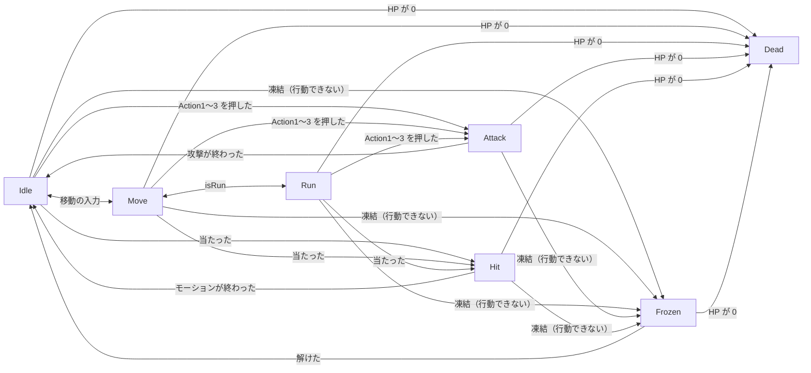
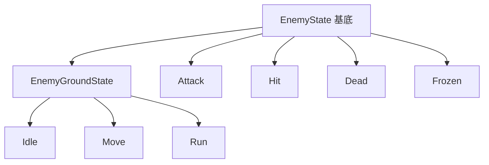

# 敵のステートの設計

作成日: 2026-11-07
対象: `Game/Source/Enemy/State/`、[Enemy.cpp](../../../../Game/Source/Enemy/Enemy.cpp)
経緯: [ステートマシンの経緯](../../キャラクター/ステートマシン/ステートマシンの経緯.md)、[黒騎士のモーションの経緯](../../アニメーション制作/黒騎士のモーション/黒騎士のモーションの経緯.md)
手順: [敵のステートの手順](敵のステートの手順.md)（Idle・Move・Frozen の3つを作るところまで）

敵（黒騎士）の体の動かし方を、7つのステートで切り替える仕組みです。切り替えの手順は共通の [ステートマシンの設計](../../キャラクター/ステートマシン/ステートマシンの設計.md) にあります。

- **何をするかは AI、体をどう動かすかはステートが決める。** AI（[黒騎士のAI](../黒騎士のAI/黒騎士のAIの設計.md)）は「近づく」「走る」「どの攻撃のボタンを押す」を入力として出す。ステートはその入力で体を動かす。
- **例外: 剣の攻撃。** 体を動かすのも攻撃（スキル `AttackBase`）で、ステートは終わるまで待つ（[剣の攻撃の設計](../../スキル/剣の攻撃/剣の攻撃の設計.md)）。
- **当たった・倒れたは、Enemy とステートの間で受け渡す。** Enemy が HP を減らして印を立て、ひるむか倒れるかはステートが決める。

| 用語 | 何のことか |
|---|---|
| ステートマシン | キャラクターが「今なにをしているか（ステート）」を1つ持ち、条件で切り替える仕組み（[ステート・遷移](../../../用語集.md#キャラクター)） |
| 陣営 | キャラクターが味方か敵かを表す分け方。敵対する陣営どうしだけ、攻撃が当たる・AI が狙う（[陣営と当たり判定の設計](../../キャラクター/陣営と当たり判定/陣営と当たり判定の設計.md)） |
| In Place | モーションの作り方の1つ。体の位置は動かさず、その場で動きだけをする。進む分は、ゲームが別に動かす |
| スキル | 攻撃や魔法など、ボタンで出す技。このゲームでは `SkillBase` の派生クラスで、使うたびに1つ作る（[スキルの設計](../../スキル/スキルの設計.md)） |

---

## 1. ステートと遷移



- どのステートからでも、行動できなくなったら（凍結）`Frozen` へ移る。解けたら、入力に合わせて Idle・Move・Run へ移る（図では Idle だけ書いた）。
- Attack・Hit が終わったあとも、入力に合わせて Idle・Move・Run へ移る（図では Idle だけ書いた）。
- 攻撃中・ひるみ中・凍結中に当たっても、ひるまない（HP は減る）。HP が 0 になったら、どこからでも Dead へ移る。

| ステート | 動き | アニメーション |
|---|---|---|
| `Idle` | 入力どおり（移動の入力がないので、その場にいる） | Idle |
| `Move` | 入力どおりに歩く（`walkSpeed`。[移動の設計](../../キャラクター/移動/移動の設計.md)） | Walk。`歩く速さ ÷ 足が地面を送る速さ` の倍率でゆっくり流し、足が滑らないようにする（足の速さは[黒騎士のモーションの設計](../../アニメーション制作/黒騎士のモーション/黒騎士のモーションの設計.md)の「ゲームに合わせる値」） |
| `Run` | 入力どおりに走る（歩く速さ × `runSpeedMultiplier` 2.75。[移動の設計](../../キャラクター/移動/移動の設計.md)） | Run（剣を右肩に乗せて走る） |
| `Attack` | 何もしない。押したボタンの攻撃（`AttackBase`）が、相手の方を向いてアニメーションを流し、体を動かす。攻撃が終わる（`SkillController` が空く）まで待つ | 攻撃が流す（Attack1〜3） |
| `Hit` | 止まる（重力だけ） | Hit |
| `Dead` | 止まる。倒れ終わって `vanishDelay`（2秒）たったら、消えた印を立てる | Dead |
| `Frozen` | 入力を無視し、重力で落ちるだけ | 触らない（StatusEffects が止める） |

| 攻撃（ボタン・クラス） | 動き |
|---|---|
| 攻撃1（`Action1`・`DashSlashAttack`） | 構えのコマ（Attack1 の 5.5コマ目）でアニメーションを止めて 0.6秒溜め（値は[剣の攻撃の設計](../../スキル/剣の攻撃/剣の攻撃の設計.md)の「調整用の数値」）、そのあと、アニメーションの中で腰が進む分（約3.7m）だけ黒騎士ごと前へ動かす（下の「3. 実装方法」） |
| 攻撃2（`Action2`・`HeavyComboAttack`） | その場で重い連続斬り（4.3秒） |
| 攻撃3（`Action3`・`SlashWaveAttack`） | 剣が体の前を通る5回の振り（12・49.5・62・78・90コマ目）で、斬撃（`SlashMagic`）を相手の胸のあたりへ飛ばす |

コマは 30fps で、クリップの先頭を 0コマ目と数えます。

---

## 2. クラス



| ファイル | 中身 |
|---|---|
| [EnemyState.h](../../../../Game/Source/Enemy/State/EnemyState.h) | ステートの種類（`EnemyStateId`）・アニメーションのクリップ・調整値（`EnemyStateSettings`）・受け渡し（`EnemyDamageState`）・Context・基底（`using`） |
| [EnemyGroundState.cpp](../../../../Game/Source/Enemy/State/EnemyGroundState.cpp) | Idle・Move・Run の共通部分（動き・遷移・アニメーションの流し方）と、当たった・倒れたの判定（`CheckDamage`） |
| [EnemyAttackState.cpp](../../../../Game/Source/Enemy/State/EnemyAttackState.cpp) | 攻撃が終わるまで待つ。死んだ・凍ったなどで途中で出るときは、攻撃を止める（`SkillController::CancelAll()`）。攻撃1〜3の中身は [Attack/](../../../../Game/Source/Attack/) |
| [EnemyHitState.cpp](../../../../Game/Source/Enemy/State/EnemyHitState.cpp) / [EnemyDeadState.cpp](../../../../Game/Source/Enemy/State/EnemyDeadState.cpp) | ひるむ・倒れる |
| [EnemyFrozenState.cpp](../../../../Game/Source/Enemy/State/EnemyFrozenState.cpp) | 凍結中 |
| [EnemyStateMachine.cpp](../../../../Game/Source/Enemy/State/EnemyStateMachine.cpp) | 7つのステートの登録 |

Context（`EnemyStateContext`）には、`mover`・`model`・`statusEffects`・自分（`owner`）・陣営・調整値・`damage`・`skills`（`SkillController`）・`previousId` を入れる。`skills` は、Attack が攻撃中かを見て、途中で出るときに止めるのに使う。アニメーションのステート同士の受け渡しがないので、Player の `PlayerAnimator` のようなものは使わず、`CharacterModel` を直接触る。

---

## 3. 実装方法

**Idle・Move・Run は基底にまとめる。** 動き方はどれも `CharacterMover::Update(input)`（入力どおりに動き、向きも変える。走る速さは Mover が `isRun` で決める）。違いはアニメーションと再生の速さだけなので、派生はクリップの番号（Move は速さも）を返すだけ（ヘッダーだけで書ける）。

**行き先は移動の入力の大きさと `isRun` で決める。**

```cpp
// EnemyGroundState::SelectByInput（static。ほかのステートが終わったあとの行き先にも使う）
if (input.moveDirection.Length() < context.settings.moveThreshold) {
    return EnemyStateId::Idle;
}
if (input.isRun) {
    return EnemyStateId::Run;
}
return EnemyStateId::Move;
```

**名前:**

| ジャンル | 名前 | 何のためのもの | 何をするためのもの | どこから来たもの |
|---|---|---|---|---|
| 関数 | `EnemyGroundState::SelectByInput()` | 入力から、地面のステートのどれになるかを決めるため | 移動の入力の大きさと `isRun` を見て、Idle・Run・Move のどれかの `EnemyStateId` を返す | ゲームの [EnemyGroundState.cpp](../../../../Game/Source/Enemy/State/EnemyGroundState.cpp) |
| 引数 | `input` | 入力元が作った入力を読むため | 移動方向・走るか・ボタンの状態をまとめた `CharacterInput`（`const` 参照） | ゲームの [CharacterInput.h](../../../../Game/Source/Character/Input/CharacterInput.h) |
| メンバー変数 | `moveDirection` | 移動したい方向を知るため | `Vector3`。長さ 0〜1 で、速さの割合を表す | ゲームの [CharacterInput.h](../../../../Game/Source/Character/Input/CharacterInput.h) の `CharacterInput` |
| 引数 | `context` | ステートが触ってよいものを受け取るため | 調整値（`settings`）などをまとめた `EnemyStateContext`（`const` 参照） | ゲームの [EnemyState.h](../../../../Game/Source/Enemy/State/EnemyState.h) |
| メンバー変数 | `settings.moveThreshold` | 立ち止まっているかの境目を決めるため | 0.1。移動の入力の長さがこれより小さければ立ち止まっているとみなす | ゲームの [EnemyState.h](../../../../Game/Source/Enemy/State/EnemyState.h) の `EnemyStateSettings` |
| メンバー変数 | `isRun` | 走りたいかを知るため | `true` なら走る入力。AI が立てる | ゲームの [CharacterInput.h](../../../../Game/Source/Character/Input/CharacterInput.h) の `CharacterInput` |
| 型 | `EnemyStateId` | ステートの種類を番号で表すため | `Idle`・`Move`・`Run`・`Attack`・`Hit`・`Dead`・`Frozen` を持つ `enum class` | ゲームの [EnemyState.h](../../../../Game/Source/Enemy/State/EnemyState.h) |

**地面のステートの遷移は、当たった → 攻撃 → 入力の順に見る。** `Action1`〜`Action3` のどれかを押した瞬間に Attack へ移る。どの攻撃かは、Enemy が `SkillController` に登録したボタンで決まる。

**当たった・倒れたは `EnemyDamageState` で受け渡す。** Enemy は `HitTarget::SetOnHit` で HP を `HIT_DAMAGE`（25）減らし、`isHitRequested` を立てる。ステートは `CheckDamage(context, ひるむか)` で見る。HP が 0 なら Dead、そうでなく当たっていてひるめるなら Hit。ひるめないときも印は下ろす（攻撃が終わったあとに遅れてひるまないように）。Dead は倒れ終わって2秒たったら `isVanished` を立て、Enemy は体を隠して当たり判定を外す。

| ジャンル | 名前 | 何のためのもの | 何をするためのもの | どこから来たもの |
|---|---|---|---|---|
| 型 | `EnemyDamageState` | Enemy とステートの間で、当たった・倒れたを受け渡すため | HP（`status`）・当たった印（`isHitRequested`）・消えた印（`isVanished`）を持つ | ゲームの [EnemyState.h](../../../../Game/Source/Enemy/State/EnemyState.h) |
| 関数 | `HitTarget::SetOnHit()` | 魔法などが当たったときの処理を登録するため | 当たったときに呼ばれる関数を持ち主が決める。ここでは HP を減らして印を立てる | ゲームの [HitTarget.h](../../../../Game/Source/Character/Components/HitTarget.h) |
| 値 | `HIT_DAMAGE` | 1回当たったときに減る HP を決めるため | 25 | ゲームの [Enemy.cpp](../../../../Game/Source/Enemy/Enemy.cpp) |
| メンバー変数 | `isHitRequested` | 当たったことをステートに知らせるため | Enemy が `true` にし、ステートが読んで下ろす | ゲームの `EnemyDamageState` |
| 関数 | `CheckDamage()` | 当たった・倒れたを見て、行き先を決めるため | 倒れていれば `Dead`、当たっていてひるめるなら `Hit`、どちらでもなければ `Num`（移らない）を返す。当たった印は下ろす | ゲームの [EnemyGroundState.cpp](../../../../Game/Source/Enemy/State/EnemyGroundState.cpp) |

**攻撃1の踏み込みは、モーションの腰の動きをゲームで足す。** モーションは In Place 版で、腰が前へ進む分は入っていない。そこで次の順で動かす（腰の距離の出し方は[黒騎士のモーションの設計](../../アニメーション制作/黒騎士のモーション/黒騎士のモーションの設計.md)の「ゲームに合わせる値」）。

1. 構えのコマまでアニメーションを流す。
2. 溜めるあいだは、アニメーションの速さを 0 にして時間を進めない。
3. 溜め終わったら、コマごとの距離（[DashSlashAttack.cpp](../../../../Game/Source/Attack/DashSlashAttack.cpp) の `ROOT`、モデルの m）の、前のフレームとの差だけ、黒騎士ごと前へ動かす。
4. 距離には `rootMoveScale`（100 × モデルの大きさ 1.4）を掛けて、ゲームの距離にする。

動かすのは攻撃（`AttackBase`）で、ステートではない。

| ジャンル | 名前 | 何のためのもの | 何をするためのもの | どこから来たもの |
|---|---|---|---|---|
| 型 | `SkillController` | キャラクターのスキルを、ボタンごとに登録して使うため | 登録したスキルを入力で作り、同時に1つだけ動かす。攻撃中かも分かる | ゲームの [SkillController.h](../../../../Game/Source/Skill/SkillController.h) |
| 型 | `AttackBase` | 体を動かす剣の攻撃の共通部分 | アニメーションを流し、溜め・踏み込みを進める。攻撃1〜3 が継ぐ | ゲームの [AttackBase.h](../../../../Game/Source/Attack/AttackBase.h) |
| 型 | `SkillBody` | 持ち主の体をスキルへ渡すため | `model`・`mover`・`timeScale`・`rootMoveScale`・`blendSeconds` を持つ | ゲームの [SkillBase.h](../../../../Game/Source/Skill/SkillBase.h) |
| メンバー変数 | `SkillBody::timeScale` | 動き全体の速さを変えるため | アニメーションと移動の両方に掛ける倍率（今は `PLAY_SPEED` の 1） | ゲームの [SkillBase.h](../../../../Game/Source/Skill/SkillBase.h) |
| メンバー変数 | `rootMoveScale` | アニメーションの中で進む距離を、ゲームの距離にするため | `ROOT`（モデルの m）に掛ける倍率 | ゲームの `SkillBody`（値は [Enemy.cpp](../../../../Game/Source/Enemy/Enemy.cpp) で決める） |
| 変数 | `ROOT` | 攻撃1でコマごとに前へ進んだ距離を持つため | モデルの m 単位の距離の配列 | ゲームの [DashSlashAttack.cpp](../../../../Game/Source/Attack/DashSlashAttack.cpp) |

**`PLAY_SPEED` で全体をゆっくりにできる。** Enemy は `deltaTime * PLAY_SPEED` でステートを動かし、ステートはアニメーションの速さにも掛ける。攻撃には `SkillBody::timeScale` として渡す。モーションが崩れていないかを確かめるときに下げる（今は 1）。

**Enemy 本体は組み立てるだけ。** `OnStart` で Context を作って `Init`、`UpdateAction` は消えたかを見て、`m_stateMachine.Update(m_input, deltaTime * PLAY_SPEED)` を呼ぶ。`OnStart` では、体（`SkillBody`）を `SkillController` に渡し、攻撃1〜3 を `Action1`〜`Action3` に登録する。`FilterSkillInput` で、ステートが Attack でないフレームはボタンを消す（ひるんだ・倒れている間に攻撃しないように）。

| ジャンル | 名前 | 何のためのもの | 何をするためのもの | どこから来たもの |
|---|---|---|---|---|
| 関数 | `FilterSkillInput()` | ステートが Attack でないときに、攻撃のボタンを消すため | Attack 以外のステートなら、入力のボタンを全部「押していない」にする | ゲームの [Enemy.cpp](../../../../Game/Source/Enemy/Enemy.cpp) |
| 値 | `PLAY_SPEED` | 黒騎士の動き全体の速さを変えるため | ステートの時間・アニメーション・攻撃（`SkillBody::timeScale`）に掛ける。今は 1 | ゲームの [Enemy.cpp](../../../../Game/Source/Enemy/Enemy.cpp) |

---

## 4. 使い方（ステートを足す）

1. `EnemyStateId` に種類を足す（`Num` より前）。
2. `EnemyState` を継承したクラスを作る（`GetId`・`CheckTransition`・`Update` は必須）。
3. `EnemyStateMachine` のコンストラクタで `Register<クラス>()` する。
4. 入口を決める。地面から入るなら `EnemyGroundState::CheckTransition` に条件を足す。新しい入力が要るなら [入力の設計](../../キャラクター/入力/入力の設計.md) と AI で出す。
5. 当たったときにひるむか・倒れるかは、`CheckTransition` の最初で `EnemyGroundState::CheckDamage` を呼んで決める。

攻撃を足すときは、[剣の攻撃の設計](../../スキル/剣の攻撃/剣の攻撃の設計.md) の「使い方」のとおりに `AttackBase` の派生を作り、クリップを [黒騎士のモーションの設計](../../アニメーション制作/黒騎士のモーション/黒騎士のモーションの設計.md) のとおりに作る。

---

## 5. 調整用の数値

| 内容 | 値 | 場所 |
|---|---|---|
| 立ち止まっているとみなす移動入力 | 0.1 | [EnemyState.h](../../../../Game/Source/Enemy/State/EnemyState.h) の `EnemyStateSettings::moveThreshold` |
| アニメーションの切り替えの補間 | 0.2秒 | [EnemyState.h](../../../../Game/Source/Enemy/State/EnemyState.h) の `EnemyStateSettings::animBlendSeconds` |
| ひるみの補間 | 0.1秒 | [EnemyHitState.cpp](../../../../Game/Source/Enemy/State/EnemyHitState.cpp) の `HIT_BLEND_SECONDS` |
| 倒れるときの補間 | 0.1秒 | [EnemyDeadState.cpp](../../../../Game/Source/Enemy/State/EnemyDeadState.cpp) の `DEAD_BLEND_SECONDS` |
| 攻撃1の溜め | 0.6秒 | [DashSlashAttack.h](../../../../Game/Source/Attack/DashSlashAttack.h) の `DashSlashAttack::CHARGE_SECONDS` |
| 1回当たったときに減る HP | 25 | [Enemy.cpp](../../../../Game/Source/Enemy/Enemy.cpp) の `HIT_DAMAGE` |
| 最大 HP | 100（仮） | [Enemy.cpp](../../../../Game/Source/Enemy/Enemy.cpp) の `MAX_HP` |
| 倒れ終わってから消えるまで | 2秒 | [Enemy.cpp](../../../../Game/Source/Enemy/Enemy.cpp) の `VANISH_DELAY` |
| 黒騎士の動き全体の速さ | 1 | [Enemy.cpp](../../../../Game/Source/Enemy/Enemy.cpp) の `PLAY_SPEED` |
| 斬撃を出す高さ・体の前へ出す距離 | 110・80 | [SlashWaveAttack.cpp](../../../../Game/Source/Attack/SlashWaveAttack.cpp) の `SLASH_HEIGHT`・`SLASH_FORWARD` |

歩く・走る速さは [Enemy.cpp](../../../../Game/Source/Enemy/Enemy.cpp) の `MakeMoveSettings`（[移動の設計](../../キャラクター/移動/移動の設計.md)）。

---

## 6. 既知の課題

- **剣が当たってもダメージはない。** 攻撃3の斬撃も、当たると消えるだけ。
- **当たったときに減る HP は、魔法の種類によらず 25。** 魔法ごとの威力ができたら、そちらを使う。
- **消えた黒騎士は残っている。** 体を隠して当たり判定を外すだけで、`DeleteGO` はしない。
