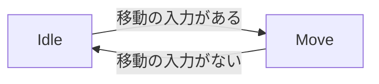
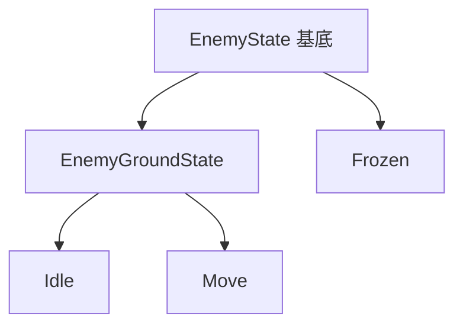

# 敵のステートの設計

作成日: 2026-11-07
対象: `Game/Source/Enemy/State/`
経緯: [ステートマシンの経緯](../キャラクター/ステートマシンの経緯.md)
手順: [敵のステートの手順](敵のステートの手順.md)（何もない状態から、どのファイルに何を足すか）

敵（Enemy）の体の動かし方を、立ち止まる・進む・凍結の3つのステートで切り替える仕組みです。切り替えの手順は共通の [ステートマシンの設計](../キャラクター/ステートマシンの設計.md) にあります。

- **何をするかは AI、体をどう動かすかはステートが決める。** AI（[NpcInputSource](../キャラクター/NPCのAIの設計.md)）は「近づく」「撃つ」を入力として出す。ステートはその入力で体を動かす。
- **今は3つだけ。** 攻撃・ひるみ・空中は、要るときに足す。

---

## 1. ステートと遷移



- どのステートからでも、行動できなくなったら（凍結）`Frozen` へ移る。解けたら、入力に合わせて Idle か Move へ移る。

| ステート | 動き | アニメーション |
|---|---|---|
| `Idle` | 入力どおり（移動の入力がないので、その場にいる） | Idle |
| `Move` | 入力どおりに進む（`walkSpeed` 140） | Run |
| `Frozen` | 入力を無視し、重力で落ちるだけ | 触らない（StatusEffects が止める） |

---

## 2. クラス



| ファイル | 中身 |
|---|---|
| [EnemyState.h](../../../Game/Source/Enemy/State/EnemyState.h) | ステートの種類（`EnemyStateId`）・アニメーションのクリップ・調整値・Context・基底（`using`） |
| [EnemyGroundState.cpp](../../../Game/Source/Enemy/State/EnemyGroundState.cpp) | Idle・Move の共通部分（動き・遷移・アニメーションの流し方） |
| [EnemyFrozenState.cpp](../../../Game/Source/Enemy/State/EnemyFrozenState.cpp) | 凍結中 |
| [EnemyStateMachine.cpp](../../../Game/Source/Enemy/State/EnemyStateMachine.cpp) | 3つのステートの登録 |

Context（`EnemyStateContext`）には、`mover`・`model`・`statusEffects`・調整値・`previousId` を入れる。アニメーションは Idle と Run の2本だけで、ステート同士の受け渡しもないので、Player の `PlayerAnimator` のようなものは使わず、`CharacterModel` を直接触る。

---

## 3. 実装方法

**Idle と Move は基底にまとめる。** 動き方はどちらも `CharacterMover::Update(input)`（入力どおりに動き、向きも変える）。違いはアニメーションだけなので、派生はクリップの番号を返すだけ（ヘッダーだけで書ける）。

**行き先は移動の入力の大きさで決める。**

```cpp
if (input.moveDirection.Length() < context.settings.moveThreshold) {
    return EnemyStateId::Idle;
}
return EnemyStateId::Move;
```

`EnemyGroundState::SelectByInput()`（static）にして、Frozen が解けたあとの行き先にも使う。

**Enemy 本体は組み立てるだけ。** `OnStart` で Context を作って `Init`、`UpdateAction` は `m_stateMachine.Update(m_input, deltaTime)` の1行。

---

## 4. 使い方（ステートを足す）

1. `EnemyStateId` に種類を足す（`Num` より前）。
2. `EnemyState` を継承したクラスを作る（`GetId`・`GetName`・`CheckTransition`・`Update` は必須）。
3. `EnemyStateMachine` のコンストラクタで `Register<クラス>()` する。
4. 入口を決める。地面から入るなら `EnemyGroundState::CheckTransition` に条件を足す。新しい入力（攻撃など）が要るなら [入力の設計](../キャラクター/入力の設計.md) と AI で出す。
5. `Game.vcxproj` と `.filters` に足す。

---

## 5. 調整用の数値（`EnemyState.h` の `EnemyStateSettings`）

| 内容 | 値 |
|---|---|
| 立ち止まっているとみなす移動入力 | 0.1 |
| アニメーションの切り替えの補間 | 0.2秒 |

歩く速さなどは [Enemy.cpp](../../../Game/Source/Enemy/Enemy.cpp) の `MakeMoveSettings`（[移動の設計](../キャラクター/移動の設計.md)）。

---

## 6. 既知の課題

- **今は敵が動かない。** AI の索敵範囲が 0 なので、いつも Idle（[入力の経緯](../キャラクター/入力の経緯.md)）。
- **撃つときのアニメーションはない。** 魔法は MagicCaster が撃ち、ステートは関わらない。撃つ動きを付けるなら、攻撃のステートを足す。
