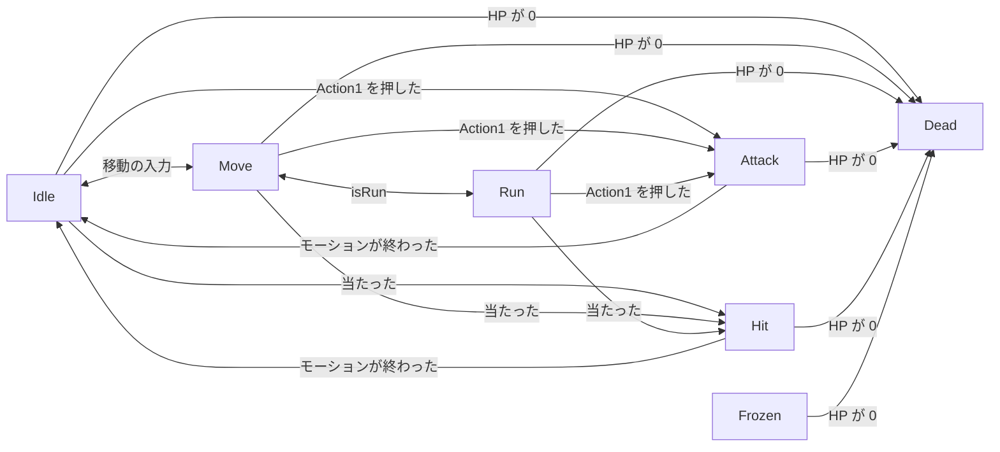
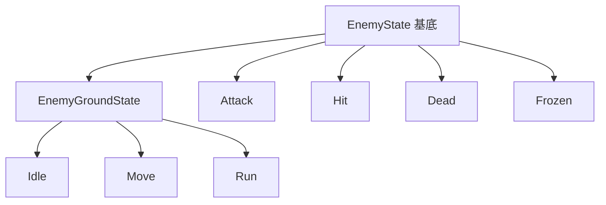

# 敵のステートの設計

作成日: 2026-11-07（2026-11-15 に、#120 で足した走る・攻撃・ひるむ・倒れるを書き足した）
対象: `Game/Source/Enemy/State/`、[Enemy.cpp](../../../Game/Source/Enemy/Enemy.cpp)
経緯: [ステートマシンの経緯](../キャラクター/ステートマシンの経緯.md)、[黒騎士のモーションの経緯](../アニメーション制作/黒騎士のモーションの経緯.md)
手順: [敵のステートの手順](敵のステートの手順.md)（何もない状態から、どのファイルに何を足すか。今は Idle・Move・Frozen の3つを作るところまで）

敵（黒騎士）の体の動かし方を、7つのステートで切り替える仕組みです。切り替えの手順は共通の [ステートマシンの設計](../キャラクター/ステートマシンの設計.md) にあります。

- **何をするかは AI、体をどう動かすかはステートが決める。** AI（[黒騎士のAI](黒騎士のAIの設計.md)）は「近づく」「走る」「何番の攻撃をする」を入力として出す。ステートはその入力で体を動かし、攻撃のモーションを流す。
- **当たった・倒れたは、Enemy とステートの間で受け渡す。** Enemy が HP を減らして印を立て、ひるむか倒れるかはステートが決める。

---

## 1. ステートと遷移



- どのステートからでも、行動できなくなったら（凍結）`Frozen` へ移る。解けたら、入力に合わせて Idle・Move・Run へ移る。
- Attack・Hit が終わったあとも、入力に合わせて Idle・Move・Run へ移る（図では Idle だけ書いた）。
- 攻撃中・ひるみ中・凍結中に当たっても、ひるまない（HP は減る）。HP が 0 になったら、どこからでも Dead へ移る。

| ステート | 動き | アニメーション |
|---|---|---|
| `Idle` | 入力どおり（移動の入力がないので、その場にいる） | Idle |
| `Move` | 入力どおりに歩く（`walkSpeed` 140） | Walk。140 ÷ 229 倍でゆっくり流し、足が滑らないようにする |
| `Run` | 入力どおりに走る（140 × 2.75 = 385） | Run（剣を右肩に乗せて走る） |
| `Attack` | 入ったときに相手の方を向き、あとは向きを変えない。`attackIndex` の攻撃を1回流す | Attack1〜3 |
| `Hit` | 止まる（重力だけ） | Hit |
| `Dead` | 止まる。倒れ終わって `vanishDelay`（2秒）たったら、消えた印を立てる | Dead |
| `Frozen` | 入力を無視し、重力で落ちるだけ | 触らない（StatusEffects が止める） |

| 攻撃 | 動き |
|---|---|
| 攻撃1 | 構えのコマ（5.5コマ目）でアニメーションを止めて 0.6秒溜め、そのあと、アニメーションの中で腰が進む分（約3.7m）だけ黒騎士ごと前へ動かす |
| 攻撃2 | その場で重い連続斬り（4.3秒） |
| 攻撃3 | 剣が体の前を通る5回の振り（12・49.5・62・78・90コマ目）で、斬撃（`SlashMagic`）を相手の胸のあたりへ飛ばす |

コマは 30fps で、クリップの先頭を 0コマ目と数えます。

---

## 2. クラス



| ファイル | 中身 |
|---|---|
| [EnemyState.h](../../../Game/Source/Enemy/State/EnemyState.h) | ステートの種類（`EnemyStateId`）・アニメーションのクリップ・調整値（`EnemyStateSettings`・`EnemyTuning`）・受け渡し（`EnemyDamageState`）・Context・基底（`using`） |
| [EnemyGroundState.cpp](../../../Game/Source/Enemy/State/EnemyGroundState.cpp) | Idle・Move・Run の共通部分（動き・遷移・アニメーションの流し方）と、当たった・倒れたの判定（`CheckDamage`） |
| [EnemyAttackState.cpp](../../../Game/Source/Enemy/State/EnemyAttackState.cpp) | 攻撃1〜3。攻撃ごとの溜め・進む距離・斬撃を出す時間を `ATTACKS` の表に持つ |
| [EnemyHitState.cpp](../../../Game/Source/Enemy/State/EnemyHitState.cpp) / [EnemyDeadState.cpp](../../../Game/Source/Enemy/State/EnemyDeadState.cpp) | ひるむ・倒れる |
| [EnemyFrozenState.cpp](../../../Game/Source/Enemy/State/EnemyFrozenState.cpp) | 凍結中 |
| [EnemyStateMachine.cpp](../../../Game/Source/Enemy/State/EnemyStateMachine.cpp) | 7つのステートの登録 |

Context（`EnemyStateContext`）には、`mover`・`model`・`statusEffects`・自分（`owner`）・陣営・調整値・`damage`・`tuning`・`previousId` を入れる。自分と陣営は、攻撃3の斬撃が自分に当たらず、敵対する相手に当たるように渡す。アニメーションのステート同士の受け渡しがないので、Player の `PlayerAnimator` のようなものは使わず、`CharacterModel` を直接触る。

---

## 3. 実装方法

**Idle・Move・Run は基底にまとめる。** 動き方はどれも `CharacterMover::Update(input)`（入力どおりに動き、向きも変える。走る速さは Mover が `isRun` で決める）。違いはアニメーションと再生の速さだけなので、派生はクリップの番号（Move は速さも）を返すだけ（ヘッダーだけで書ける）。

**行き先は移動の入力の大きさと `isRun` で決める。**

```cpp
// EnemyGroundState::SelectByInput（static。ほかのステートが終わったあとの行き先にも使う）
if (input.moveDirection.Length() < context.settings.moveThreshold) {
    return EnemyStateId::Idle;
}
if (input.isRun) {
    return EnemyStateId::Run;
}
return EnemyStateId::Move;
```

**地面のステートの遷移は、当たった → 攻撃 → 入力の順に見る。** `Action1` の押した瞬間で Attack へ移る。何番の攻撃かは `input.attackIndex`。

**当たった・倒れたは `EnemyDamageState` で受け渡す。** Enemy は `HitTarget::SetOnHit` で HP を `HIT_DAMAGE`（25）減らし、`isHitRequested` を立てる。ステートは `CheckDamage(context, ひるむか)` で見る。HP が 0 なら Dead、そうでなく当たっていてひるめるなら Hit。ひるめないときも印は下ろす（攻撃が終わったあとに遅れてひるまないように）。Dead は倒れ終わって2秒たったら `isVanished` を立て、Enemy は体を隠して当たり判定を外す。

**攻撃1の踏み込みは、モーションの腰の動きをゲームで足す。** モーションは In Place 版で、腰が前へ進む分は入っていない。その分（コマごとの距離 `ATTACK1_ROOT`、モデルの m）を、前のフレームとの差だけ黒騎士ごと前へ動かす（`rootMoveScale` = 100 × モデルの大きさ 1.4 を掛けてゲームの距離にする）。溜めのあいだはアニメーションの速さを 0 にして、時間を進めない。

**`PLAY_SPEED` で全体をゆっくりにできる。** Enemy は `deltaTime * PLAY_SPEED` でステートを動かし、ステートはアニメーションの速さにも掛ける。モーションが崩れていないかを確かめるときに下げる（今は 1）。

**Enemy 本体は組み立てるだけ。** `OnStart` で Context を作って `Init`、`UpdateAction` は消えたかを見て、`m_stateMachine.Update(m_input, deltaTime * PLAY_SPEED)` を呼ぶ。黒騎士は `SkillController` に何も登録しないので、`Action1` を押してもスキルは使わず、剣の攻撃になる。

---

## 4. 使い方（ステートを足す）

1. `EnemyStateId` に種類を足す（`Num` より前）。
2. `EnemyState` を継承したクラスを作る（`GetId`・`CheckTransition`・`Update` は必須）。
3. `EnemyStateMachine` のコンストラクタで `Register<クラス>()` する。
4. 入口を決める。地面から入るなら `EnemyGroundState::CheckTransition` に条件を足す。新しい入力が要るなら [入力の設計](../キャラクター/入力の設計.md) と AI で出す。
5. 当たったときにひるむか・倒れるかは、`CheckTransition` の最初で `EnemyGroundState::CheckDamage` を呼んで決める。

攻撃を足すときは、`EnemyAttackState.cpp` の `ATTACKS` に1行足し、クリップを [黒騎士のモーションの設計](../アニメーション制作/黒騎士のモーションの設計.md) のとおりに作る。AI に出させるなら `BlackKnightInputSource` の `AttackIndex` にも足す。

---

## 5. 調整用の数値

| 内容 | 値 | 場所 |
|---|---|---|
| 立ち止まっているとみなす移動入力 | 0.1 | `EnemyStateSettings` |
| アニメーションの切り替えの補間 | 0.2秒（Hit・Dead は 0.1秒） | `EnemyStateSettings`・各ステート |
| 攻撃1の溜め | 0.6秒 | `EnemyTuning` |
| 1回当たったときに減る HP / 最大 HP | 25 / 100（仮） | `Enemy.cpp` |
| 倒れ終わってから消えるまで | 2秒 | `Enemy.cpp` の `VANISH_DELAY` |
| 黒騎士の動き全体の速さ | 1 | `Enemy.cpp` の `PLAY_SPEED` |
| 斬撃を出す高さ・体の前へ出す距離 | 110・80 | `EnemyAttackState.cpp` |

歩く・走る速さは [Enemy.cpp](../../../Game/Source/Enemy/Enemy.cpp) の `MakeMoveSettings`（[移動の設計](../キャラクター/移動の設計.md)）。

---

## 6. 既知の課題

- **剣が当たってもダメージはない。** 攻撃3の斬撃も、当たると消えるだけ。
- **当たったときに減る HP は、魔法の種類によらず 25。** 魔法ごとの威力ができたら、そちらを使う。
- **消えた黒騎士は残っている。** 体を隠して当たり判定を外すだけで、`DeleteGO` はしない。
- `EnemyState.h` の `enEnemyAnimClip_Attack1` のコメント（「突進して突き → 回転斬り」）は、前の攻撃1のまま。
