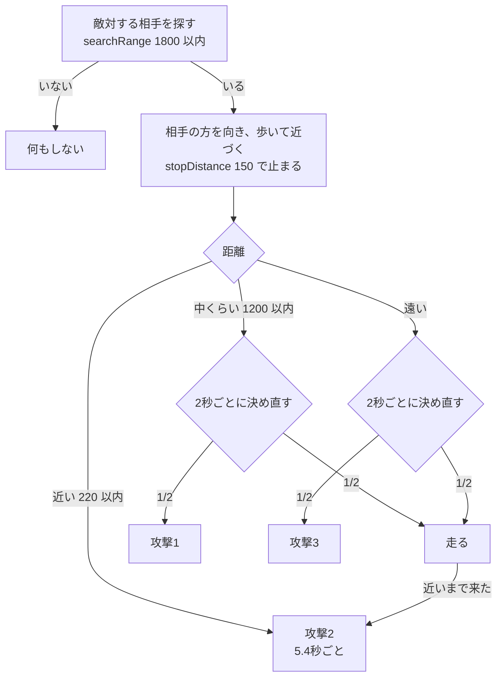

# 黒騎士のAIの設計

作成日: 2026-11-15
対象: [BlackKnightInputSource.cpp](../../../../Game/Source/Enemy/BlackKnightInputSource.cpp)、調整値は [Enemy.cpp](../../../../Game/Source/Enemy/Enemy.cpp) の `MakeAiSettings`
経緯: [黒騎士のモーションの経緯](../../アニメーション制作/黒騎士のモーション/黒騎士のモーションの経緯.md)

黒騎士の AI です。プレイヤーの操作と同じ `CharacterInput` を作る入力元で、Enemy の `GetDefaultInputSource()` がこれを返します。

- **相手との距離を「近い・中くらい・遠い」に分けて、何をするかを決める。**
- **AI は「どうしたいか」だけを決める。** 歩く・走る・剣を振るのはステート（[敵のステートの設計](../敵のステート/敵のステートの設計.md)）。攻撃は、その攻撃のボタン（攻撃1〜3 = `Action1`〜`Action3`）を1フレーム押す。どのボタンでどの攻撃をするかは、Enemy が `SkillController` に登録している（[剣の攻撃の設計](../../スキル/剣の攻撃/剣の攻撃の設計.md)）。

**用語:**

| 用語 | 何のことか |
|---|---|
| 入力元 | キャラクターに渡す入力（`CharacterInput`）を作るクラス。プレイヤーはキー・マウス、黒騎士は AI が作る |
| 陣営 | キャラクターが味方か敵かを表す分け方（[陣営と当たり判定の設計](../../キャラクター/陣営と当たり判定/陣営と当たり判定の設計.md)） |

---

## 1. 流れ



| 距離 | すること |
|---|---|
| 近い（220 以内） | 攻撃2（重い連続斬り）。`attackInterval`（5.4秒）ごと |
| 中くらい（1200 以内） | 歩きながら、2秒ごとに 1/2 で走る。残りは攻撃1（溜めて踏み込み、横に斬り抜ける） |
| 遠い（1800 以内） | 同じく、1/2 で走る。残りは攻撃3（斬撃を5つ飛ばす） |
| 走っている | 近いまで来たら歩きに戻し、すぐに攻撃2 |

---

## 2. 実装方法

**相手は陣営で探す。** `HitTargetRegistry::FindNearestHostile` で、自分と敵対する陣営のいちばん近い当たり判定を探す。Player を直接は知らない。

**高さを無視して近づく。** 相手への向きの y を 0 にして、`lookDirection` に入れる。`stopDistance` より遠ければ `moveDirection` にも入れる。

**タイマーは2つ。** 行動を決め直す `m_decideTimer`（歩いている間だけ減る）と、次に攻撃できるまでの `m_attackTimer`。相手を見つけた直後は、決め直すまで2秒、最初の攻撃まで 0.6秒待つ。攻撃したら、どちらも初めに戻す。

```cpp
// 中くらい・遠いとき
if (m_decideTimer <= 0.0f && m_attackTimer <= 0.0f) {
    if (chance(m_random) < m_settings.runChance) {
        m_isRunning = true;
    } else {
        attackButton = range == Range::Middle ? ATTACK_DASH_SLASH : ATTACK_SLASH_WAVE;   // Action1 か Action3
    }
}
```

**名前:**

| ジャンル | 名前 | 何のためのもの | 何をするためのもの | どこから来たもの |
|---|---|---|---|---|
| 変数 | `chance` | 走るかどうかを、確率で決めるため | 0〜1 の小数を、どの値も同じ確率で作る。`chance(m_random)` で1つ引く | `Update()` の中のローカル変数（型は `std::uniform_real_distribution<float>`） |
| 型 | `std::uniform_real_distribution` | 決めた範囲の乱数を作るため | `(0.0f, 1.0f)` を渡すと、その範囲の `float` の乱数を返す。`rand()` の代わり | C++ の標準ライブラリ（`<random>`。[BlackKnightInputSource.h](../../../../Game/Source/Enemy/BlackKnightInputSource.h) で読み込み） |
| メンバー変数 | `m_random` | 乱数のもとにするため | 乱数を作る `std::mt19937`。起動のたびに、`std::random_device` で違う値から始める | ゲームの [BlackKnightInputSource.h](../../../../Game/Source/Enemy/BlackKnightInputSource.h) |
| メンバー変数 | `m_isRunning` | 走って近づいている最中かを覚えるため | `true` の間は決め直さず、近いところまで来たら `false` に戻す | ゲームの [BlackKnightInputSource.h](../../../../Game/Source/Enemy/BlackKnightInputSource.h) |
| 変数 | `attackButton` | 押す攻撃のボタンを決めるため | 押すボタン。`ActionButton::Num` なら何も押さない | `Update()` の中のローカル変数（`BlackKnightInputSource.cpp`） |
| 型 | `ActionButton` | 攻撃などのボタンを番号で区別するため | `Action1`・`Action2`・`Action3` と、数を表す `Num` を持つ `enum class` | ゲームの [CharacterInput.h](../../../../Game/Source/Character/Input/CharacterInput.h) |
| 型 | `Range` | 相手との距離の分け方を表すため | `Near`（近い）・`Middle`（中くらい）・`Far`（遠い）を持つ `enum class` | ゲームの [BlackKnightInputSource.h](../../../../Game/Source/Enemy/BlackKnightInputSource.h) の `BlackKnightInputSource` クラス |
| 値 | `ATTACK_DASH_SLASH`・`ATTACK_SLASH_WAVE` | どのボタンがどの攻撃かを、名前で書くため | 攻撃1のボタン（`Action1`）・攻撃3のボタン（`Action3`）。ほかに攻撃2の `ATTACK_COMBO` がある | ゲームの [BlackKnightInputSource.h](../../../../Game/Source/Enemy/BlackKnightInputSource.h) の `BlackKnightInputSource` クラス |

**狙いはいつも出す。** `hasAim = true` にして、足元から `aimHeight`（110）の高さから相手の当たり判定の中心へ向ける。攻撃3の斬撃がこの向きへ飛ぶ。

---

## 3. 調整用の数値（`Enemy.cpp` の `MakeAiSettings`）

| 名前 | 値 | 意味 |
|---|---|---|
| `searchRange` | 1800 | この距離以内に入ると追いかける（ここまでが「遠い」） |
| `nearRange` | 220 | 「近い」。剣の長さと踏み込み |
| `midRange` | 1200 | 「中くらい」 |
| `stopDistance` | 150 | ここまで近づいたら止まる |
| `decideInterval` | 2秒 | 歩いている間、走るか攻撃するかを決め直す間隔 |
| `runChance` | 0.5 | 走る確率 |
| `attackInterval` | 5.4秒 | 攻撃したあと、次に攻撃できるまで。攻撃2（4.3秒）が終わってから 1.1秒あく |
| `firstAttackDelay` | 0.6秒 | 見つけてから最初の攻撃まで |

---

## 4. 使い方

| やりたいこと | 書き方 |
|---|---|
| 距離・間隔を変える | `Enemy.cpp` の `MakeAiSettings` |
| 攻撃の種類を足す | 攻撃のボタンの定数（`ATTACK_DASH_SLASH` など）を足し、`Update` で選ぶ条件を書く。攻撃そのものは [剣の攻撃の設計](../../スキル/剣の攻撃/剣の攻撃の設計.md) の「使い方」 |
| 黒騎士を手で動かす | `Enemy::GetDefaultInputSource()` が `PlayerInputSource` を返すようにする（[入力の設計](../../キャラクター/入力/入力の設計.md)） |

---

## 5. 決めたこと

| 決めたこと | 理由 |
|---|---|
| 汎用の `NpcInputSource` を使わず、黒騎士だけの AI にした | 距離で攻撃を選ぶ・走るかを確率で決めるなど、黒騎士だけの決まりが多い。`NpcInputSource` は残してある（[NPCのAIの設計](../../キャラクター/NPCのAI/NPCのAIの設計.md)） |
| 攻撃は1フレームだけ押す | ステートが押した瞬間で Attack へ移り、攻撃の間は入力を見ないので、押し続ける必要がない |
