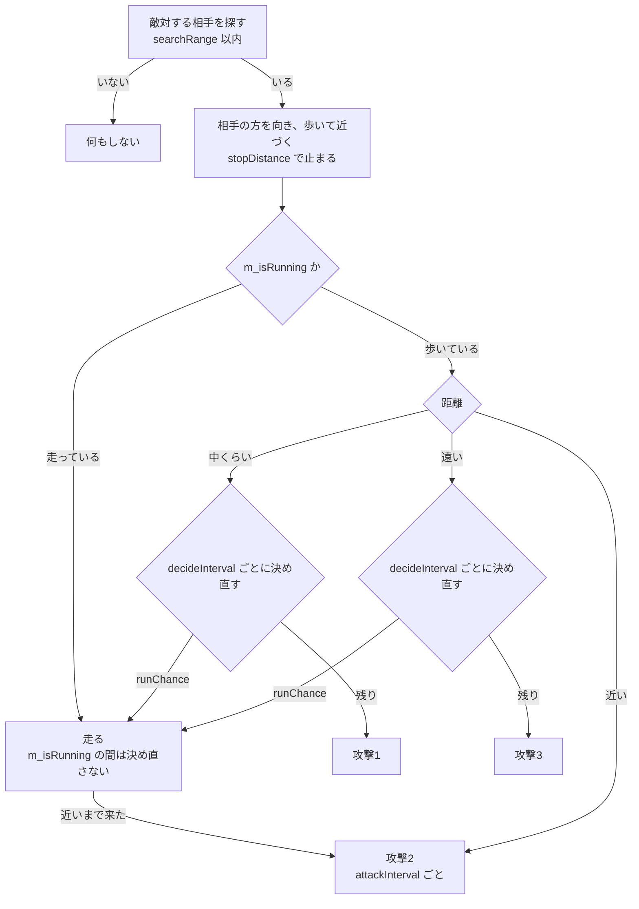

# 黒騎士のAIの設計

作成日: 2026-11-15
対象: [BlackKnightInputSource.cpp](../../../../Game/Source/Enemy/BlackKnightInputSource.cpp)、調整値は [Enemy.cpp](../../../../Game/Source/Enemy/Enemy.cpp) の `MakeAiSettings`
経緯: [黒騎士のモーションの経緯](../../アニメーション制作/黒騎士のモーション/黒騎士のモーションの経緯.md)の「2026-11-11〜11-13 既存のモーションから移し、攻撃・やられ・死ぬを足した（#120）」の 2（歩くか走るかを選ぶ AI を足した）、5（AI の距離を2倍にした）

黒騎士の AI です。プレイヤーの操作と同じ `CharacterInput` を作る入力元で、Enemy の `GetDefaultInputSource()` がこれを返します。

- **相手との距離を「近い・中くらい・遠い」に分けて、何をするかを決める。**
- **AI は「どうしたいか」だけを決める。** 歩く・走る・剣を振るのはステート（[敵のステートの設計](../敵のステート/敵のステートの設計.md)）。攻撃は、その攻撃のボタン（攻撃1〜3 = `Action1`〜`Action3`）を1フレーム押す。どのボタンでどの攻撃をするかは、Enemy が `SkillController` に登録している（[剣の攻撃の設計](../../スキル/剣の攻撃/剣の攻撃の設計.md)）。

| 用語 | 何のことか |
|---|---|
| 入力元 | キャラクターに渡す入力（`CharacterInput`）を作るクラス。プレイヤーはキー・マウス、黒騎士は AI が作る |
| 陣営 | キャラクターが味方か敵かを表す分け方（[陣営と当たり判定の設計](../../キャラクター/陣営と当たり判定/陣営と当たり判定の設計.md)） |

距離の境目の数値は「3. 調整用の数値」の1か所にある。図と表では名前（`nearRange` など）で書く。

---

## 1. 流れ

距離の分け方（黒騎士を中心に、上から見た同心円。外側ほど遠い）:

```
 ┌──────── searchRange（これより外は何もしない）────────┐
 │  遠い: 攻撃3 か走る                                  │
 │   ┌────────── midRange ──────────┐                   │
 │   │  中くらい: 攻撃1 か走る      │                   │
 │   │   ┌────── nearRange ──────┐  │                   │
 │   │   │  近い: 攻撃2          │  │                   │
 │   │   │      ( ● 黒騎士 )     │  │                   │
 │   │   │ stopDistance: これ以上近づかない              │
 │   │   └───────────────────────┘  │                   │
 │   └──────────────────────────────┘                   │
 └──────────────────────────────────────────────────────┘
```



| 距離 | すること |
|---|---|
| 近い（`nearRange` 以内） | 攻撃2（重い連続斬り）。`attackInterval` ごと |
| 中くらい（`midRange` 以内） | 歩きながら、`decideInterval` ごとに `runChance` の確率で走る。残りは攻撃1（溜めて踏み込み、横に斬り抜ける） |
| 遠い（`searchRange` 以内） | 同じく、`runChance` の確率で走る。残りは攻撃3（斬撃を5つ飛ばす） |
| 走っている | 近いまで来たら歩きに戻し、すぐに攻撃2 |

---

## 2. 実装方法

**相手は陣営で探す。** `HitTargetRegistry::FindNearestHostile` で、自分と敵対する陣営のいちばん近い当たり判定を探す。Player を直接は知らない。

**高さを無視して近づく。** 相手への向きの y を 0 にして、`lookDirection` に入れる。`stopDistance` より遠ければ `moveDirection` にも入れる。

**タイマーは2つ。** 行動を決め直す `m_decideTimer`（歩いている間だけ減る）と、次に攻撃できるまでの `m_attackTimer`。

- 相手を見つけた直後: `m_decideTimer` を `decideInterval`、`m_attackTimer` を `firstAttackDelay` にする。
- 攻撃したあと: `m_decideTimer` を `decideInterval`、`m_attackTimer` を `attackInterval` にする。

```cpp
// 中くらい・遠いとき
if (m_decideTimer <= 0.0f && m_attackTimer <= 0.0f) {
    if (chance(m_random) < m_settings.runChance) {
        m_isRunning = true;
    } else {
        attackButton = range == Range::Middle ? ATTACK_DASH_SLASH : ATTACK_SLASH_WAVE;   // Action1 か Action3
    }
}
```

| ジャンル | 名前 | 何のためのもの | 何をするためのもの | どこから来たもの |
|---|---|---|---|---|
| 関数 | `HitTargetRegistry::FindNearestHostile()` | 相手を陣営で探すため | 自分から `searchRange` 以内にある、敵対する陣営のいちばん近い当たり判定（`HitTarget`）を返す。いなければ `nullptr` | ゲームの [HitTarget.h](../../../../Game/Source/Character/Components/HitTarget.h) |
| メンバー変数 | `lookDirection` | 向きたい方向を渡すため | 相手への水平の向き（長さ 1）。ステートが体をこの向きへ回す | ゲームの [CharacterInput.h](../../../../Game/Source/Character/Input/CharacterInput.h) の `CharacterInput` |
| メンバー変数 | `moveDirection` | 動きたい方向を渡すため | 相手への水平の向き。`stopDistance` より近いときは入れない（止まる） | ゲームの [CharacterInput.h](../../../../Game/Source/Character/Input/CharacterInput.h) の `CharacterInput` |
| メンバー変数 | `m_decideTimer`・`m_attackTimer` | 決め直す間隔と、攻撃の間隔を数えるため | `m_decideTimer` は歩いている間だけ減る。`m_attackTimer` は次に攻撃できるまでの秒数 | ゲームの [BlackKnightInputSource.h](../../../../Game/Source/Enemy/BlackKnightInputSource.h) |
| 変数 | `chance` | 走るかどうかを、確率で決めるため | 0〜1 の小数を、どの値も同じ確率で作る。`chance(m_random)` で1つ引く | `Update()` の中のローカル変数（型は `std::uniform_real_distribution<float>`） |
| 型 | `std::uniform_real_distribution` | 決めた範囲の乱数を作るため | `(0.0f, 1.0f)` を渡すと、その範囲の `float` の乱数を返す。`rand()` の代わり | C++ の標準ライブラリ（`<random>`。[BlackKnightInputSource.h](../../../../Game/Source/Enemy/BlackKnightInputSource.h) で読み込み） |
| メンバー変数 | `m_random` | 乱数のもとにするため | 乱数を作る `std::mt19937`。起動のたびに、`std::random_device` で違う値から始める | ゲームの [BlackKnightInputSource.h](../../../../Game/Source/Enemy/BlackKnightInputSource.h) |
| 型 | `std::mt19937` | 質のよい乱数の列を作るため | 種（はじめの値）から、決まった順に乱数を出す。`uniform_real_distribution` に渡して使う | C++ の標準ライブラリ（`<random>`） |
| 型 | `std::random_device` | 乱数の種を、起動のたびに変えるため | OS が持つ予測できない値を返す。`m_random` の種に1回だけ使う | C++ の標準ライブラリ（`<random>`） |
| メンバー変数 | `m_isRunning` | 走って近づいている最中かを覚えるため | `true` の間は決め直さず、近いところまで来たら `false` に戻す | ゲームの [BlackKnightInputSource.h](../../../../Game/Source/Enemy/BlackKnightInputSource.h) |
| 変数 | `attackButton` | 押す攻撃のボタンを決めるため | 押すボタン。`ActionButton::Num` なら何も押さない | `Update()` の中のローカル変数（`BlackKnightInputSource.cpp`） |
| 型 | `ActionButton` | 攻撃などのボタンを番号で区別するため | `Action1`・`Action2`・`Action3` と、数を表す `Num` を持つ `enum class` | ゲームの [CharacterInput.h](../../../../Game/Source/Character/Input/CharacterInput.h) |
| 型 | `Range` | 相手との距離の分け方を表すため | `Near`（近い）・`Middle`（中くらい）・`Far`（遠い）を持つ `enum class` | ゲームの [BlackKnightInputSource.h](../../../../Game/Source/Enemy/BlackKnightInputSource.h) の `BlackKnightInputSource` クラス |
| 値 | `ATTACK_DASH_SLASH`・`ATTACK_SLASH_WAVE` | どのボタンがどの攻撃かを、名前で書くため | 攻撃1のボタン（`Action1`）・攻撃3のボタン（`Action3`）。ほかに攻撃2の `ATTACK_COMBO` がある | ゲームの [BlackKnightInputSource.h](../../../../Game/Source/Enemy/BlackKnightInputSource.h) の `BlackKnightInputSource` クラス |

**狙いはいつも出す。** `hasAim = true` にして、足元から `aimHeight` の高さから相手の当たり判定の中心へ向ける。攻撃3の斬撃がこの向きへ飛ぶ。

| ジャンル | 名前 | 何のためのもの | 何をするためのもの | どこから来たもの |
|---|---|---|---|---|
| メンバー変数 | `hasAim` | 撃つ向きを入力で決めるかを伝えるため | `true` なら、`aimOrigin` から `aimDirection` の向きへ撃つ。`false` ならキャラクターの正面 | ゲームの [CharacterInput.h](../../../../Game/Source/Character/Input/CharacterInput.h) の `CharacterInput` |
| メンバー変数 | `aimHeight` | 狙う高さを決めるため | 足元からこの高さ（110）を撃つ始点にする。斬撃を出す高さ（胸）に合わせた | ゲームの [BlackKnightInputSource.h](../../../../Game/Source/Enemy/BlackKnightInputSource.h) の `Settings` |

---

## 3. 調整用の数値（`Enemy.cpp` の `MakeAiSettings`）

| 名前 | 値 | 意味 |
|---|---|---|
| `searchRange` | 1800 | この距離以内に入ると追いかける（ここまでが「遠い」）。単位は cm |
| `nearRange` | 220 | 「近い」。剣の長さと踏み込み |
| `midRange` | 1200 | 「中くらい」 |
| `stopDistance` | 150 | ここまで近づいたら止まる |
| `decideInterval` | 2秒 | 歩いている間、走るか攻撃するかを決め直す間隔 |
| `runChance` | 0.5 | 走る確率 |
| `attackInterval` | 5.4秒 | 攻撃したあと、次に攻撃できるまで。攻撃2（4.3秒）が終わってから 1.1秒あく |
| `firstAttackDelay` | 0.6秒 | 見つけてから最初の攻撃まで |

---

## 4. 使い方

| やりたいこと | 書き方 |
|---|---|
| 距離・間隔を変える | `Enemy.cpp` の `MakeAiSettings` |
| 攻撃の種類を足す | 攻撃のボタンの定数（`ATTACK_DASH_SLASH` など）を足し、`Update` で選ぶ条件を書く。攻撃そのものは [剣の攻撃の設計](../../スキル/剣の攻撃/剣の攻撃の設計.md) の「使い方」 |
| 黒騎士を手で動かす | `Enemy::GetDefaultInputSource()` が `PlayerInputSource` を返すようにする（[入力の設計](../../キャラクター/入力/入力の設計.md)） |

---

## 5. 決めたこと

| 決めたこと | 理由 |
|---|---|
| 汎用の `NpcInputSource` を使わず、黒騎士だけの AI にした | 作った時点の `NpcInputSource` は、射程に入ったら撃つだけで、距離で攻撃を選ぶ・走るかを確率で決めるなどの決まりがなかった。2026-11-17 に `NpcInputSource` も、同じ距離の3段で押すボタンを決める形になった（[NPCのAIの設計](../../キャラクター/NPCのAI/NPCのAIの設計.md)）が、黒騎士は攻撃のボタンが決まっていて、狙う高さ（`aimHeight` 110）も違うので、そのまま残してある |
| 攻撃は1フレームだけ押す | ステートが押した瞬間で Attack へ移り、攻撃の間は入力を見ないので、押し続ける必要がない |
