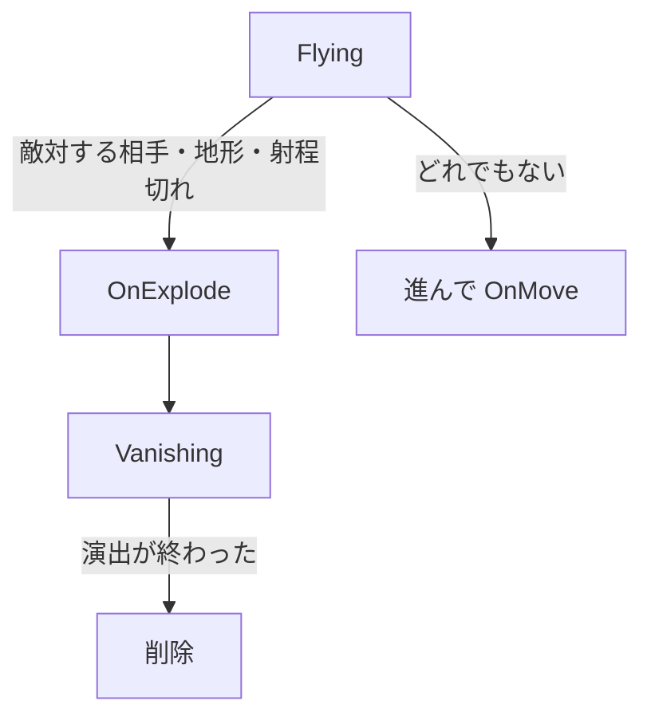

# 弾の設計

作成日: 2026-11-07（[魔法と弾の設計](魔法と弾の設計.md) から分けた）
対象: [BulletBase.h](../../../Game/Source/Magic/BulletBase.h)、[BulletBase.cpp](../../../Game/Source/Magic/BulletBase.cpp)
経緯: [魔法と弾の経緯](魔法と弾の経緯.md)
手順: [弾の手順](弾の手順.md)（何もない状態から、どのファイルに何を足すか）

魔法が撃つ弾の基底クラス `BulletBase` のページです。飛ぶ・当たる・消える、の共通の流れを持ちます。

- **流れは基底クラスに固定する。** `Start` と `Update` を `final` にし、派生は見た目と効果だけを書く。
- **1フレームに進む分を線分で調べる。** 速い弾でもすり抜けない。

---

## 1. 流れ



| 関数 | 書くこと |
|---|---|
| `OnStart()` | エフェクトやモデルの読み込み。失敗したら false を返すとすぐ削除される |
| `OnMove()` | 位置が変わったとき、見た目を合わせる |
| `OnHitTarget()` | 敵対する相手に当たったときの効果 |
| `OnExplode()` | 着弾の演出（相手・地形・射程切れのすべてで呼ばれる） |
| `IsVanishFinished()` | 着弾後の演出が終わったか |

弾の性能は `BulletSettings`（速さ、射程、半径）で決めます。生成した直後なら `SetSettings()` で変えられます（炎の弾は溜め具合で半径を変えています）。
`owner`（撃った本人）は削除済みになっていることがあるので、**比較にだけ使い、中身には触れません**。

弾は `BulletBase::OBJECT_NAME`（`"bullet"`）という名前で生成し、[Game.cpp](../../../Game/Source/Core/Game.cpp) のデストラクタで種類を問わずまとめて削除する。

---

## 2. 実装方法

```cpp
void BulletBase::UpdateFlying()
{
    const Vector3 nextPosition = m_position + m_direction * (m_settings.speed * deltaTime);

    // ① キャラクター（陣営で敵対している相手だけ。撃った本人は除く）
    if (HitTarget* hitTarget = HitTargetRegistry::FindHitOnSegment(
            m_position, nextPosition, m_settings.radius, m_faction, m_owner, hitPosition)) {
        hitTarget->NotifyHit(hitInfo);
        OnHitTarget(*hitTarget, hitPosition);
        Explode(hitPosition);
        return;
    }
    // ② 地形（物理ワールドへのレイ）
    if (physicsWorld->RayTest(m_position, nextPosition, hitPosition)) { Explode(hitPosition); return; }
    // ③ 進む。射程を超えたら空中で着弾
    m_position = nextPosition;
    m_flightDistance += moveDistance;
    if (m_flightDistance >= m_settings.range) { Explode(m_position); return; }
    OnMove();
}
```

キャラクターを地形より先に調べます。地形のレイはキャラクターのカプセルにも当たりますが、当たり判定の球の方が大きいので、狙って撃てば先にキャラクターとして当たります。

---

## 3. 使い方（新しい弾を作る）

```cpp
class ThunderBullet : public BulletBase {
public:
    ThunderBullet() : BulletBase(MakeSettings()) {}   // 速さ・射程・半径を決める
protected:
    bool OnStart() override;                           // エフェクト読み込み
    void OnMove() override;                            // 見た目を位置に合わせる
    void OnHitTarget(HitTarget& target, const Vector3& pos) override;  // 命中時の効果
    void OnExplode(const Vector3& pos) override;       // 着弾演出
    bool IsVanishFinished() const override;            // 演出が終わったか
};
```

新しいエフェクトを使うときは、[EffectId.h](../../../Game/Source/Core/EffectId.h) に番号を追加します。
