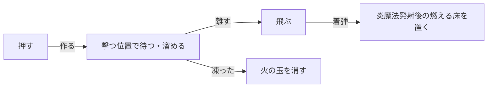

# 炎魔法の設計

作成日: 2026-11-05（2026-11-07 に炎魔法発射後の燃える床を [炎魔法発射後の燃える床の設計](../炎魔法発射後の燃える床/炎魔法発射後の燃える床の設計.md) へ分けた。2026-11-14 に炎の弾を炎魔法にまとめた）
対象: `Game/Source/Magic/FireMagic.*`
経緯: [魔法の経緯](../魔法の経緯.md)、[炎魔法のエフェクトの軽量化の経緯](../../../最適化/描画/炎魔法のエフェクトの軽量化/炎魔法のエフェクトの軽量化の経緯.md)（着弾・燃える床の粒を減らした、飛ぶ炎の煙をなくした）
手順: [炎魔法の手順](炎魔法の手順.md)（何もない状態から、どのファイルに何を足すか）

右クリック（パッドの RB2）を押して溜め、離すと撃つ魔法です。着弾すると床がしばらく燃えます（[炎魔法発射後の燃える床の設計](../炎魔法発射後の燃える床/炎魔法発射後の燃える床の設計.md)）。
Player は `ActionButton::Action2` に登録しています。共通の仕組みは [魔法の設計](../魔法の設計.md) を見てください。

- **溜め具合は 0〜1 の割合1つ。** 当たり判定・見た目・床の広さをすべてそこから決める。
- **溜めた火の玉がそのまま飛んでいく。** 押した瞬間に作った1つが撃つ位置で待ち、離すと同じものが飛ぶ。

---

## 1. 流れ



| 関数 | やっていること |
|---|---|
| `IsChargeType` | `true`。離すまで撃つ位置で待つ |
| `OnStart` | 炎魔法のエフェクトを登録し、溜め中の火の玉を出す |
| `OnCharge` | 押している秒数から溜め具合を出し、火の玉の大きさを合わせる。最大まで溜まった瞬間に一度だけ閃光、その後は脈打つ |
| `OnRelease` | 火の玉を消し、溜め具合の性能（`SetSettings`）にして、同じ大きさの炎を飛ばす |
| `OnCancel` | 火の玉を消す（飛ばない） |
| `OnMove` | 飛ぶ炎のルートだけを動かす（炎と火の粉の尾が通った場所に残る） |
| `OnHitTarget` | 直撃では何もしない。相手の足元を覚えておく（炎魔法発射後の燃える床を置く場所にする） |
| `OnExplode` | 飛ぶ炎を消し、着弾エフェクトを出し、炎魔法発射後の燃える床を置く |
| `RegisterEffects`（static） | 炎魔法のエフェクト7つ（飛ぶ炎・溜め・最大溜め・着弾・燃える床と、一人称用の溜め・最大溜め）を登録する。何度呼んでもよい |

**用語:**

| 用語 | 何のことか |
|---|---|
| エフェクトのルート | エフェクトの発生源。ルートが動くと、そこから新しく出る炎や煙の位置が動くが、すでに出たものはその場に残る |

クールダウン（`magic.json` の `fire.cooldown`。[魔法の調整値の設計](../魔法の調整値/魔法の調整値の設計.md)）は、離して飛ばしたときから数えます（`SkillController` は、スキルが手を離したとき＝離して飛ばしたときから数える）。クールダウン中に押しても、火の玉は作られません。

炎魔法発射後の燃える床を置く場所は、真下へのレイで探します。
- 相手に当たったとき: 相手の足元から（地形のレイはキャラクターのカプセルにも当たるため）
- 地形・射程切れのとき: 着弾点の少し手前から（壁にめり込まないように）
- 下に床がない（崖の外など）: 床は燃やさない

**用語:**

| 用語 | 何のことか |
|---|---|
| レイ | 始点から終点まで線を引き、最初に何に当たるかを調べること。ここでは、真下へ引いて床を探す |
| カプセル | 円柱の両端を半球にした形の当たり判定。キャラクターの移動（`CharacterController`）の判定に使う |

---

## 2. 実装方法

### 溜め具合は 0〜1 の割合にして、大きさを全部そこから決める

```cpp
void FireMagic::OnCharge(float chargeSeconds)        // 秒数は SkillBase が時刻の差で渡す
{
    m_chargeRate = min(chargeSeconds / MagicConfig::GetFire().maxChargeSeconds, 1.0f);
    ...
}

float Lerp(float rate, float a, float b) { return a + (b - a) * rate; }

settings.radius = Lerp(chargeRate, config.minRadius, config.maxRadius);            // 当たり判定 14〜45（config は MagicConfig::GetFire()）
const float scale = Lerp(chargeRate, MIN_FLY_EFFECT_SCALE, MAX_FLY_EFFECT_SCALE);   // 見た目 8〜26
Lerp(m_chargeRate, config.minGroundRadius, config.maxGroundRadius);                // 床 130〜300
```

**名前:**

| ジャンル | 名前 | 何のためのもの | 何をするためのもの | どこから来たもの |
|---|---|---|---|---|
| 引数 | `chargeSeconds` | 押している秒数を受け取るため | 溜め始めてからの秒数。`SkillBase` が、溜め始めた時刻との差で渡す | ゲームの [SkillBase.h](../../../../Game/Source/Skill/SkillBase.h) の `OnCharge()` |
| メンバー変数 | `m_chargeRate` | 溜め具合を持つため | 0（溜めなし）〜1（最大まで溜めた）の割合 | ゲームの [FireMagic.h](../../../../Game/Source/Magic/FireMagic.h) の `FireMagic` |
| 関数 | `MagicConfig::GetFire()` | 溜め時間などの調整値を取り出すため | `FireMagicConfig`（`config`）を返す。最大まで溜まる時間（`maxChargeSeconds`）は 1.2 秒 | ゲームの [MagicConfig.h](../../../../Game/Source/Magic/MagicConfig.h)（[魔法の調整値の設計](../魔法の調整値/魔法の調整値の設計.md)） |
| マクロ | `min` | 溜め具合が 1 を超えないようにするため | 2つの値の小さい方を返す。`std::` が付かないので、`std::min` ではなく Windows のマクロ | Windows の API（<Windows.h>。[k2EngineLowPreCompile.h](../../../../k2EngineLow/k2EngineLowPreCompile.h) で読み込み済み） |
| 関数 | `Lerp()` | 溜め具合に応じて、2つの値の間の値を出すため | `a + (b - a) * rate` を返す。`rate` が 0 なら `a`、1 なら `b`（線形補間） | ゲームの `FireMagic.cpp`（名前のない `namespace` の中） |
| 引数 | `rate`・`a`・`b` | `Lerp()` に、割合と、両端の値を渡すため | `rate` は 0〜1 の割合、`a` は溜めなしの値、`b` は最大まで溜めた値 | ゲームの `FireMagic.cpp` の `Lerp()` |
| 変数 | `settings` | 魔法の性能を作るため | 速さ・射程・当たり判定の半径を持つ `MagicSettings` | ゲームの `FireMagic.cpp` の `MakeSettings()` |
| 型 | `MagicSettings` | 魔法の性能をまとめるため | `speed`（速さ）・`range`（射程）・`radius`（当たり判定の半径）を持つ構造体 | ゲームの [MagicBase.h](../../../../Game/Source/Magic/MagicBase.h) |
| メンバー変数 | `minRadius`・`maxRadius` | 当たり判定の半径の両端を決めるため | 溜めなしで 14、最大まで溜めると 45（`magic.json` の `fire.minRadius`・`maxRadius`） | ゲームの `MagicConfig.h` の `FireMagicConfig` |
| 引数 | `chargeRate` | 溜め具合を渡すため | 0〜1 の割合。`MakeSettings()`・`GetFlyEffectScale()` の引数 | ゲームの `FireMagic.cpp` |
| 変数 | `scale` | 飛ぶ炎の拡大率を持つため | 溜め具合から `Lerp()` で出した値 | ゲームの `FireMagic.cpp` の `GetFlyEffectScale()` |
| 値 | `MIN_FLY_EFFECT_SCALE`・`MAX_FLY_EFFECT_SCALE` | 飛ぶ炎（と溜め中の火の玉）の大きさの両端を決めるため | 溜めなしで 8、最大まで溜めると 26 | ゲームの `FireMagic.cpp` |
| メンバー変数 | `minGroundRadius`・`maxGroundRadius` | 炎魔法発射後の燃える床の半径の両端を決めるため | 溜めなしで 130、最大まで溜めると 300（`magic.json` の `fire.minGroundRadius`・`maxGroundRadius`） | ゲームの `MagicConfig.h` の `FireMagicConfig` |

### 飛び始める瞬間に、溜め具合の性能にする

```cpp
void FireMagic::OnRelease()
{
    m_chargeEffect.StopRoot();                 // 手元の火の玉を消す（立ち上る炎と煙は残す）
    SetSettings(MakeSettings(m_chargeRate));   // 当たり判定の半径を溜め具合で決める
    m_flyEffect.Play();                        // 同じ大きさの炎を飛ばす
}
```

**名前:**

| ジャンル | 名前 | 何のためのもの | 何をするためのもの | どこから来たもの |
|---|---|---|---|---|
| 型 | `Effect` | 1つのエフェクトを、位置・回転・大きさつきで再生するため | `Init()` で番号を渡し、`Play()` で再生を始め、`Update()`（または `UpdateRoot()`）で反映する | k2EngineLow（エンジン）の [Effect.h](../../../../k2EngineLow/graphics/effect/Effect.h) |
| メンバー変数 | `m_chargeEffect`・`m_flyEffect` | 溜め中の火の玉と、飛んでいる炎のエフェクトを持つため | どちらも `Effect` | ゲームの `FireMagic.h` の `FireMagic` |
| 関数 | `StopRoot()` | 手元の火の玉だけを消すため | ルートだけを止める。新しい発生は止まり、出た炎や煙は寿命まで残る | k2EngineLow（エンジン）の [Effect.h](../../../../k2EngineLow/graphics/effect/Effect.h) の `Effect` |
| 関数 | `SetSettings()` | 飛び始める前に、魔法の性能を決め直すため | 渡した `MagicSettings` を、この魔法の性能にする | ゲームの [MagicBase.h](../../../../Game/Source/Magic/MagicBase.h) の `MagicBase` |
| 関数 | `MakeSettings()` | 溜め具合から、魔法の性能を作るため | 速さ・射程は一定で、当たり判定の半径だけを溜め具合で決めた `MagicSettings` を返す | ゲームの `FireMagic.cpp`（名前のない `namespace` の中） |
| 関数 | `Play()` | 飛ぶ炎のエフェクトを再生するため | エフェクトの再生を始める | k2EngineLow（エンジン）の [Effect.h](../../../../k2EngineLow/graphics/effect/Effect.h) の `Effect` |

作った時点では溜めなしの性能で、飛び始める瞬間に決め直します。

### 溜め中の火の玉と飛ぶ炎は、同じ大きさの関数を使う

```cpp
Vector3 scale = GetFlyEffectScale(m_chargeRate);
if (m_isFullCharged) {
    scale *= 1.0f + FULL_PULSE_DEPTH * sinf((chargeSeconds - m_fullChargeSeconds) * FULL_PULSE_SPEED);
}
m_chargeEffect.SetScale(scale);
```

**名前:**

| ジャンル | 名前 | 何のためのもの | 何をするためのもの | どこから来たもの |
|---|---|---|---|---|
| 関数 | `GetFlyEffectScale()` | 溜め中の火の玉と飛ぶ炎の大きさを、同じ関数で決めるため | 溜め具合から、拡大率（`Vector3`）を返す | ゲームの `FireMagic.cpp`（名前のない `namespace` の中） |
| メンバー変数 | `m_isFullCharged` | 最大まで溜まったかを覚えるため | 溜まり切ったら true。閃光を一度だけ出し、火の玉を脈打たせるのに使う | ゲームの `FireMagic.h` の `FireMagic` |
| 値 | `FULL_PULSE_DEPTH`・`FULL_PULSE_SPEED` | 最大まで溜まったあとの脈打ちを決めるため | 大きさが変わる割合（0.12）と、脈打つ速さ（18） | ゲームの `FireMagic.cpp` |
| 関数 | `sinf()` | 大きさを周期的に変えるため | `float` の正弦（sin）を返す。値が -1〜1 の間を行き来するので、脈打ちになる | C の標準ライブラリ（<math.h>。[k2EngineLowPreCompile.h](../../../../k2EngineLow/k2EngineLowPreCompile.h) で読み込み済み） |
| メンバー変数 | `m_fullChargeSeconds` | 脈打ちの始まりを覚えるため | 最大まで溜まったときの、押していた秒数 | ゲームの `FireMagic.h` の `FireMagic` |
| 関数 | `SetScale()` | エフェクトの大きさを決めるため | 値を覚える。再生中のエフェクトへは `UpdateRoot()` で反映される | k2EngineLow（エンジン）の [Effect.h](../../../../k2EngineLow/graphics/effect/Effect.h) の `Effect` |

同じ関数で大きさを決めるので、溜めた火の玉がそのまま飛んでいくように見えます。最大まで溜まった瞬間の秒数を覚えておき、そこからの秒数で脈打たせます。

### エフェクト7つは表にして、まとめて登録する

```cpp
constexpr EffectEntry EFFECTS[] = {
    { EffectId::FireFly,  u"Assets/effect/fire_fly.efk" },
    { EffectId::FireCharge,  u"Assets/effect/fire_charge.efk" },
    ...
};

bool FireMagic::RegisterEffects()   // static。BurningGround からも呼ぶ
{
    for (const EffectEntry& entry : EFFECTS) {
        effectEngine->ResistEffect(id, entry.path);
        if (effectEngine->LoadEffect(id) == nullptr) { return false; }
    }
    return true;
}
```

**名前:**

| ジャンル | 名前 | 何のためのもの | 何をするためのもの | どこから来たもの |
|---|---|---|---|---|
| 型 | `EffectEntry` | エフェクトの番号とファイルを、1組にして持つため | `id`（`EffectId`）と `path`（ファイルのパス）を持つ構造体 | ゲームの `FireMagic.cpp`（名前のない `namespace` の中） |
| 値 | `EFFECTS` | 炎魔法で使うエフェクトを、1か所の表にするため | `EffectEntry` の配列。ここに足せば、`RegisterEffects()` が登録する | ゲームの `FireMagic.cpp` |
| 型 | `EffectId` | エフェクトを番号で呼ぶため | `FireFly` などの名前を持つ `enum class`。`static_cast<int>` で番号にして使う | ゲームの [EffectId.h](../../../../Game/Source/Core/EffectId.h) |
| C++ の書き方 | `u"..."` | エフェクトのファイルのパスを、`char16_t` の文字列にするため | `u` を付けた文字列は、`char16_t`（16ビットの文字）の並びになる | C++ の書き方 |
| 型 | `EffectEngine` | エフェクトの登録・読み込み・再生をまとめて受け持つため | `GetInstance()` で1つだけ取り出して使う | k2EngineLow（エンジン）の [EffectEngine.h](../../../../k2EngineLow/graphics/effect/EffectEngine.h) |
| 変数 | `effectEngine` | `EffectEngine` を呼ぶために持つため | `EffectEngine::GetInstance()` で取り出したポインター | ゲームの `FireMagic.cpp` の `RegisterEffects()` |
| 関数 | `ResistEffect()` | 番号とエフェクトのファイルを結びつけて、読み込むため | その番号が登録されていなければ読み込む。登録済みなら何もしない | k2EngineLow（エンジン）の [EffectEngine.h](../../../../k2EngineLow/graphics/effect/EffectEngine.h) の `EffectEngine` |
| 関数 | `LoadEffect()` | 登録した番号のエフェクトを取り出すため | 読み込めていなければ空（`nullptr`）が返る。登録していない番号なら、プログラムを止める | k2EngineLow（エンジン）の [EffectEngine.h](../../../../k2EngineLow/graphics/effect/EffectEngine.h) の `EffectEngine` |

**用語:**

| 用語 | 何のことか |
|---|---|
| `.efk` | Effekseer のエフェクトのファイル。Effekseer のエディターで作る |

### 炎魔法発射後の燃える床を置く場所：真下へレイを飛ばす

```cpp
Vector3 rayStart = m_hasHitTarget
    ? m_hitFootPosition                                  // 相手に当たったら、相手の足元から
    : hitPosition - GetDirection() * FLOOR_RAY_BACK_OFF; // 地形なら、少し手前から（壁にめり込まない）
rayStart.y += FLOOR_RAY_LIFT;
Vector3 rayEnd = rayStart;
rayEnd.y -= FLOOR_SEARCH_DEPTH;
if (!physicsWorld->RayTest(rayStart, rayEnd, floorPosition)) {
    return;                                              // 下に床がない → 燃やさない
}
NewGO<BurningGround>(1, BurningGround::OBJECT_NAME)->Init(floorPosition, 半径, 秒数, 撃った本人, 陣営);
```

**名前:**

| ジャンル | 名前 | 何のためのもの | 何をするためのもの | どこから来たもの |
|---|---|---|---|---|
| 変数 | `rayStart`・`rayEnd` | 床を探すレイの始点と終点を持つため | 始点は、相手の足元か着弾点の少し手前。終点は、そこから真下へ `FLOOR_SEARCH_DEPTH` だけ下 | ゲームの `FireMagic.cpp` の `SpawnBurningGround()` |
| メンバー変数 | `m_hasHitTarget`・`m_hitFootPosition` | 相手に当たったかと、相手の足元を覚えるため | `OnHitTarget()` で入れる。足元は、床を探すレイの始点にする | ゲームの `FireMagic.h` の `FireMagic` |
| 関数 | `GetDirection()` | 魔法の進む向きを読むため | 正規化した向きを返す | ゲームの `SkillBase.h` の `SkillBase` |
| 値 | `FLOOR_RAY_BACK_OFF`・`FLOOR_RAY_LIFT`・`FLOOR_SEARCH_DEPTH` | 床を探すレイの位置と長さを決めるため | 壁に当たったとき手前へ戻す距離（20）、始点を上げる高さ（10）、探す深さ（400） | ゲームの `FireMagic.cpp` |
| 関数 | `RayTest()` | 床を探すため | 始点から終点へのレイを引き、当たった点を `floorPosition` に入れて、当たれば true を返す | k2EngineLow（エンジン）の [Physics.h](../../../../k2EngineLow/physics/Physics.h) の `PhysicsWorld` |
| 変数 | `floorPosition` | 床の位置を持つため | `RayTest()` が当たった点 | ゲームの `FireMagic.cpp` の `SpawnBurningGround()` |
| 型 | `BurningGround` | 炎魔法発射後の燃える床を表すため | 着弾点に残る、敵を燃やす床。炎魔法とは別のゲームオブジェクト | ゲームの [BurningGround.h](../../../../Game/Source/Magic/BurningGround.h) |
| 関数 | `Init()`（`BurningGround` のメンバー） | 作った直後に、床の位置・半径・秒数・撃った本人・陣営を渡すため | `NewGO` の直後、`Start()` より前に呼ぶ | ゲームの `BurningGround.h` の `BurningGround` |

相手に当たったときは、`OnHitTarget` で相手の足元を覚えておきます。地形のレイはキャラクターのカプセルにも当たるので、着弾点から真下を探すとカプセルの上に床ができてしまうためです。

---

## 3. 使い方（炎魔法を手本に、溜め撃ちの魔法を作る）

`MagicBase` を継承し、次の関数を書きます。

| 関数 | 書くこと |
|---|---|
| `IsChargeType` | `true` を返す |
| `OnStart` | 溜めの見た目を出す |
| `OnCharge` | 押している秒数から溜め具合を出し、見た目を合わせる |
| `OnRelease` | 溜め具合で性能を決め（`SetSettings`）、飛ぶ見た目を出す |
| `OnCancel` | 溜めの見た目を片付ける（凍結で呼ばれる） |

キャラクターの `OnStart()` で `m_skillController.Register<...>(ActionButton::Action2);` のように、使うボタンに登録します。

---

## 4. 調整用の数値

値は [magic.json](../../../../Game/Assets/data/magic.json) の `fire` の段にあります（[魔法の調整値の設計](../魔法の調整値/魔法の調整値の設計.md)）。

| 内容 | 値 | 場所（`magic.json`） |
|---|---|---|
| 飛ばしてから次に溜め始められるまで | 0.6秒 | `fire.cooldown` |
| 最大まで溜まる時間 | 1.2秒 | `fire.maxChargeSeconds` |
| 速さ / 射程 | 1300 / 2000 | `fire.speed` / `fire.range` |
| 当たり判定の半径 | 14〜45 | `fire.minRadius` / `fire.maxRadius` |
| 炎魔法発射後の燃える床の半径 | 130〜300 | `fire.minGroundRadius` / `fire.maxGroundRadius` |

エフェクトは Effekseer 用に自作したもの（`Assets/effect/fire_*.efkproj` が編集元）で、番号は [EffectId.h](../../../../Game/Source/Core/EffectId.h) の `FireFly`〜`FireGround`。

**用語:**

| 用語 | 何のことか |
|---|---|
| `.efkproj` | Effekseer のエディターのプロジェクトのファイル。エフェクトの編集元で、書き出すと `.efk` になる |
