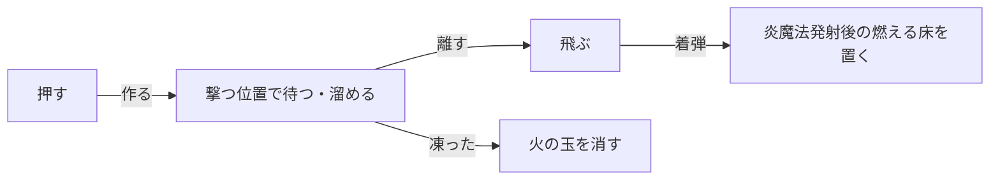

# 炎魔法の設計

作成日: 2026-11-05（2026-11-07 に炎魔法発射後の燃える床を [炎魔法発射後の燃える床の設計](炎魔法発射後の燃える床の設計.md) へ分けた。2026-11-14 に炎の弾を炎魔法にまとめた）
対象: `Game/Source/Magic/FireMagic.*`
経緯: [魔法の経緯](魔法の経緯.md)
手順: [炎魔法の手順](炎魔法の手順.md)（何もない状態から、どのファイルに何を足すか）

右クリック（パッドの RB2）を押して溜め、離すと撃つ魔法です。着弾すると床がしばらく燃えます（[炎魔法発射後の燃える床の設計](炎魔法発射後の燃える床の設計.md)）。
Player は `SkillId::FireMagic` で登録しています。共通の仕組みは [魔法の設計](魔法の設計.md) を見てください。

- **溜め具合は 0〜1 の割合1つ。** 当たり判定・見た目・床の広さをすべてそこから決める。
- **溜めた火の玉がそのまま飛んでいく。** 押した瞬間に作った1つが撃つ位置で待ち、離すと同じものが飛ぶ。

---

## 1. 流れ



| 関数 | やっていること |
|---|---|
| `IsChargeType` | `true`。離すまで撃つ位置で待つ |
| `OnStart` | 炎魔法のエフェクトを登録し、溜め中の火の玉を出す |
| `OnCharge` | 押している秒数から溜め具合を出し、火の玉の大きさを合わせる。最大まで溜まった瞬間に一度だけ閃光、その後は脈打つ |
| `OnRelease` | 火の玉を消し、溜め具合の性能（`SetSettings`）にして、同じ大きさの炎を飛ばす |
| `OnCancel` | 火の玉を消す（飛ばない） |
| `OnMove` | 飛ぶ炎のルートだけを動かす（炎と煙の尾が通った場所に残る） |
| `OnHitTarget` | 直撃では何もしない。相手の足元を覚えておく（炎魔法発射後の燃える床を置く場所にする） |
| `OnExplode` | 飛ぶ炎を消し、着弾エフェクトを出し、炎魔法発射後の燃える床を置く |
| `RegisterEffects`（static） | 炎魔法のエフェクト5つ（飛ぶ炎・溜め・最大溜め・着弾・燃える床）を登録する。何度呼んでもよい |

クールダウン（`COOLDOWN`）は、離して飛ばしたときから数えます（`SkillSet` は、スキルが手を離したとき＝離して飛ばしたときから数える）。クールダウン中に押しても、火の玉は作られません。

炎魔法発射後の燃える床を置く場所は、真下へのレイで探します。
- 相手に当たったとき: 相手の足元から（地形のレイはキャラクターのカプセルにも当たるため）
- 地形・射程切れのとき: 着弾点の少し手前から（壁にめり込まないように）
- 下に床がない（崖の外など）: 床は燃やさない

---

## 2. 実装方法

### 溜め具合は 0〜1 の割合にして、大きさを全部そこから決める

```cpp
void FireMagic::OnCharge(float chargeSeconds)        // 秒数は MagicBase が時刻の差で渡す
{
    m_chargeRate = min(chargeSeconds / MAX_CHARGE_SECONDS, 1.0f);
    ...
}

float Lerp(float rate, float a, float b) { return a + (b - a) * rate; }

settings.radius = Lerp(chargeRate, MIN_RADIUS, MAX_RADIUS);                         // 当たり判定 14〜45
const float scale = Lerp(chargeRate, MIN_FLY_EFFECT_SCALE, MAX_FLY_EFFECT_SCALE);   // 見た目 8〜26
Lerp(m_chargeRate, MIN_GROUND_RADIUS, MAX_GROUND_RADIUS);                           // 床 130〜300
```

### 飛び始める瞬間に、溜め具合の性能にする

```cpp
void FireMagic::OnRelease()
{
    m_chargeEffect.StopRoot();                 // 手元の火の玉を消す（立ち上る炎と煙は残す）
    SetSettings(MakeSettings(m_chargeRate));   // 当たり判定の半径を溜め具合で決める
    m_flyEffect.Play();                        // 同じ大きさの炎を飛ばす
}
```

作った時点では溜めなしの性能で、飛び始める瞬間に決め直します。

### 溜め中の火の玉と飛ぶ炎は、同じ大きさの関数を使う

```cpp
Vector3 scale = GetFlyEffectScale(m_chargeRate);
if (m_isFullCharged) {
    scale *= 1.0f + FULL_PULSE_DEPTH * sinf((chargeSeconds - m_fullChargeSeconds) * FULL_PULSE_SPEED);
}
m_chargeEffect.SetScale(scale);
```

同じ関数で大きさを決めるので、溜めた火の玉がそのまま飛んでいくように見えます。最大まで溜まった瞬間の秒数を覚えておき、そこからの秒数で脈打たせます。

### エフェクト5つは表にして、まとめて登録する

```cpp
constexpr EffectEntry EFFECTS[] = {
    { EffectId::FireFly,  u"Assets/effect/fire_fly.efk" },
    { EffectId::FireCharge,  u"Assets/effect/fire_charge.efk" },
    ...
};

bool FireMagic::RegisterEffects()   // static。BurningGround からも呼ぶ
{
    for (const EffectEntry& entry : EFFECTS) {
        effectEngine->ResistEffect(id, entry.path);
        if (effectEngine->LoadEffect(id) == nullptr) { return false; }
    }
    return true;
}
```

### 炎魔法発射後の燃える床を置く場所：真下へレイを飛ばす

```cpp
Vector3 rayStart = m_hasHitTarget
    ? m_hitFootPosition                                  // 相手に当たったら、相手の足元から
    : hitPosition - GetDirection() * FLOOR_RAY_BACK_OFF; // 地形なら、少し手前から（壁にめり込まない）
rayStart.y += FLOOR_RAY_LIFT;
Vector3 rayEnd = rayStart;
rayEnd.y -= FLOOR_SEARCH_DEPTH;
if (!physicsWorld->RayTest(rayStart, rayEnd, floorPosition)) {
    return;                                              // 下に床がない → 燃やさない
}
NewGO<BurningGround>(1, BurningGround::OBJECT_NAME)->Init(floorPosition, 半径, 秒数, 撃った本人, 陣営);
```

相手に当たったときは、`OnHitTarget` で相手の足元を覚えておきます。地形のレイはキャラクターのカプセルにも当たるので、着弾点から真下を探すとカプセルの上に床ができてしまうためです。

---

## 3. 使い方（炎魔法を手本に、溜め撃ちの魔法を作る）

`MagicBase` を継承し、次の関数を書きます。

| 関数 | 書くこと |
|---|---|
| `IsChargeType` | `true` を返す |
| `OnStart` | 溜めの見た目を出す |
| `OnCharge` | 押している秒数から溜め具合を出し、見た目を合わせる |
| `OnRelease` | 溜め具合で性能を決め（`SetSettings`）、飛ぶ見た目を出す |
| `OnCancel` | 溜めの見た目を片付ける（凍結で呼ばれる） |

`SkillId` に ID を足し、キャラクターの `OnStart()` で `m_skillSet.Register<...>(SkillId::...);` のように登録します。

---

## 4. 調整用の数値

| 内容 | 値 | 場所 |
|---|---|---|
| 飛ばしてから次に溜め始められるまで | 0.6秒 | `FireMagic.h` の `COOLDOWN` |
| 最大まで溜まる時間 | 1.2秒 | `FireMagic.cpp` の `MAX_CHARGE_SECONDS` |
| 速さ / 射程 | 1300 / 2000 | `FireMagic.cpp` |
| 当たり判定の半径 | 14〜45 | 同上 |
| 炎魔法発射後の燃える床の半径 | 130〜300 | 同上 |

エフェクトは Effekseer 用に自作したもの（`Assets/effect/fire_*.efkproj` が編集元）で、番号は [EffectId.h](../../../Game/Source/Core/EffectId.h) の `FireFly`〜`FireGround`。
