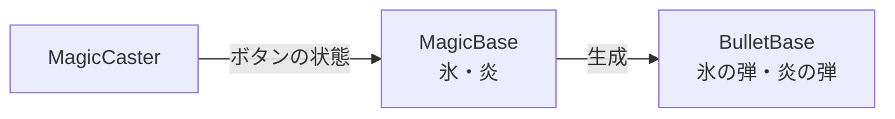

# 魔法と弾の設計

作成日: 2026-11-05（2026-11-07 に弾を [弾の設計](弾の設計.md) へ分けた）
対象: `Game/Source/Magic/MagicBase.h`、`MagicCaster.*`
経緯: [魔法と弾の経緯](魔法と弾の経緯.md)

魔法と弾の共通の仕組みのうち、魔法（どう撃つか）と、魔法を持って撃つ部品 `MagicCaster` のページです。
弾は [弾の設計](弾の設計.md)、それぞれの魔法は [氷魔法の設計](氷魔法の設計.md)・[炎魔法の設計](炎魔法の設計.md) にあります。

- **魔法 =「どう撃つか」、弾 =「飛んで当たる物」。** 長押しの魔法を足しても弾の側は変わらない。
- **撃ち方の違いは、どの関数を上書きするかで表す。**

---

## 1. 役割の分け方



| クラス | 役割 | 足すときに継承する？ |
|---|---|---|
| `MagicCaster` | 魔法を持ち、ボタンに合わせて呼ぶ | しない（キャラクターが持つ部品） |
| `MagicBase` | どう撃つか（単発・溜め撃ちなど） | する |
| `BulletBase` | 飛ぶ・当たる・消える、の共通の流れ | する |

---

## 2. MagicBase

コード: [MagicBase.h](../../../Game/Source/Magic/MagicBase.h)

| 関数 | 呼ばれるとき |
|---|---|
| `OnPress` | 発射ボタンを押した瞬間 |
| `OnHold` | 押している間、毎フレーム（押した瞬間のフレームも含む） |
| `OnRelease` | 離した瞬間 |
| `OnCancel` | 押している途中で中断されたとき（凍結した、魔法を切り替えた） |

撃ち方の違いは、どの関数を上書きするかで表します。

| 撃ち方 | 上書きする関数 | 例 |
|---|---|---|
| 単発 | `OnPress` で撃つ | [氷魔法](氷魔法の設計.md) |
| 溜め撃ち | `OnHold` で溜めて、`OnRelease` で撃つ。`OnCancel` で溜めを捨てる | [炎魔法](炎魔法の設計.md) |
| 出し続ける | `OnHold` の間ずっと出す | （まだない） |

クールダウンは `StartCooldown()` / `IsReady()` で管理します。

---

## 3. MagicCaster

コード: [MagicCaster.h](../../../Game/Source/Magic/MagicCaster.h)、[MagicCaster.cpp](../../../Game/Source/Magic/MagicCaster.cpp)

| 持たせ方 | 撃つボタン | 切り替え | Player が持っているもの |
|---|---|---|---|
| `AddMagic()`（メイン） | `fire` | `magicSwitch` で順に切り替える | 氷魔法 |
| `SetSubMagic()`（サブ） | `subFire` | 切り替えの対象にならず、いつでも撃てる | 炎魔法 |

毎フレーム、全部の魔法のクールダウンを進める → 行動できなければ押している途中の魔法を `OnCancel` → `magicSwitch` でメインを切り替える → ボタンの状態を渡す。

撃つ位置と向きの決め方:
- `hasAim` が true なら、入力の `aimOrigin` / `aimDirection`
- false なら、足元から `castHeight` の高さ、キャラクターの正面（水平）
- どちらの場合も、自分のカプセルに当たらないよう `castForward` だけ前に出す

---

## 4. 実装方法

### ボタンの状態を OnPress / OnHold / OnRelease に変える

```cpp
void MagicCaster::UpdateButton(MagicBase& magic, const ButtonState& button,
                               const MagicCastContext& context, bool& isHolding)
{
    if (button.isTrigger) {
        isHolding = true;
        magic.OnPress(context);
    }
    if (isHolding && button.isPress) {
        magic.OnHold(context);          // 押した瞬間のフレームも呼ばれる
    }
    if (isHolding && !button.isPress) {
        isHolding = false;
        magic.OnRelease(context);
    }
}
```

メインとサブで同じ関数を使い、それぞれ `m_isHolding` / `m_isSubHolding` を渡します。
「押している途中か」を自分で持っているので、凍結や切り替えのときに `isHolding` なら `OnCancel()` を呼べます。押していないときは `OnCancel()` を呼びません。

### 切り替えは剰余で端から端へ回り込む

```cpp
const int newIndex = ((index % count) + count) % count;   // -1 → 最後、count → 0
```

`%` は負の数で負を返すので、`count` を足してからもう一度 `%` をとっています。

### クールダウンは基底クラスの残り秒数

`MagicCaster` は選んでいない魔法も含めて毎フレーム `Update` を呼ぶので、切り替えている間もクールダウンは進む。

---

## 5. 使い方（新しい撃ち方の魔法を作る）

`MagicBase` を継承し、上の表のとおりに関数を上書きします。キャラクターの `Start()` で持たせます。

```cpp
m_magicCaster.AddMagic(std::make_unique<ThunderMagic>());     // メイン（Q/E で切り替え）
// または
m_magicCaster.SetSubMagic(std::make_unique<ThunderMagic>());  // サブ（右クリック）
```

メインの魔法が2つ以上になれば、Q/E キーやパッドの LB/RB で切り替えられます。

---

## 6. 調整用の数値

撃つ位置（`MagicCaster::Settings`、各キャラクターの `MakeCasterSettings`）。

| 設定 | Player | Enemy |
|---|---|---|
| `castHeight`（三人称で撃つ高さ） | 140 | 60 |
| `castForward` | 60 | 60 |
