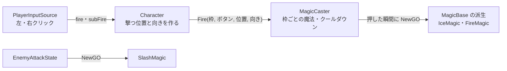
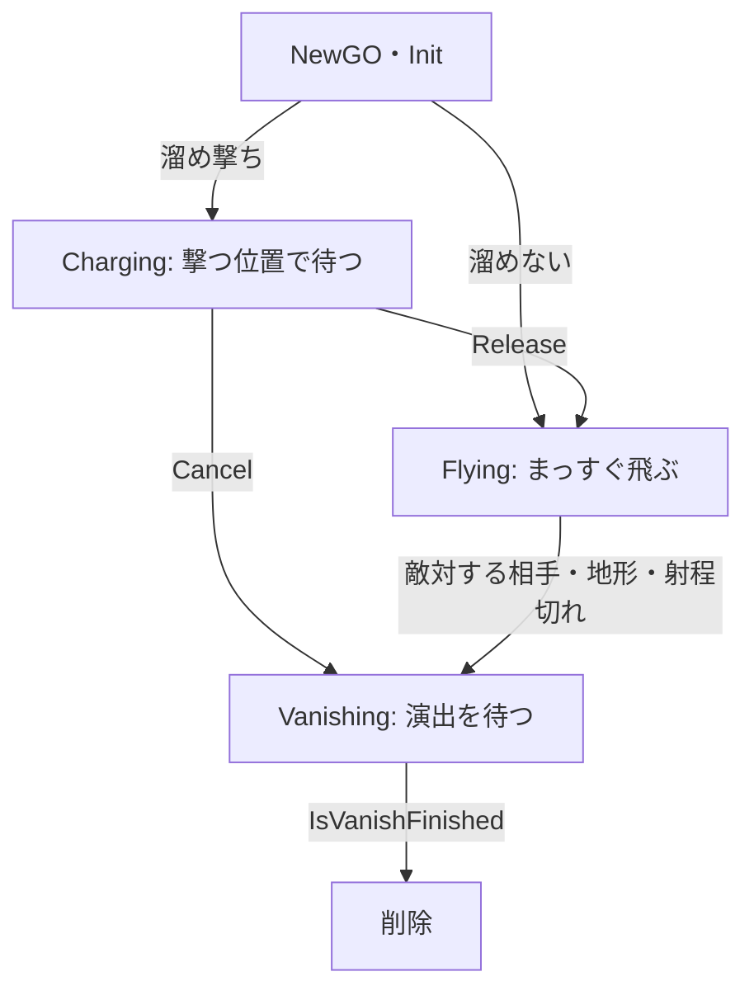

# 魔法の設計

作成日: 2026-11-14（`魔法と弾の設計.md`・`弾の設計.md` をまとめ直した）
対象: `Game/Source/Magic/MagicBase.*`、`MagicCaster.*`、`Game/Source/Core/GameClock.*`、`Character` の魔法を撃つところ
経緯: [魔法の経緯](魔法の経緯.md)
手順: [魔法の手順](魔法の手順.md)（何もない状態から、どのファイルに何を足すか）

魔法の共通の仕組みのページです。魔法の基底クラス `MagicBase` と、魔法を登録して撃つ部品 `MagicCaster` を説明します。
それぞれの魔法は [氷魔法の設計](氷魔法の設計.md)・[炎魔法の設計](炎魔法の設計.md)、着弾後の床は [炎魔法発射後の燃える床の設計](炎魔法発射後の燃える床の設計.md) にあります。

- **魔法 = 飛んでいく1発。** 撃つたびに1つ作り、飛んで、当たって、消える。「弾」というクラスは別に持たない。
- **MagicCaster は「登録」と「発射」だけ。** どのボタンで撃つか（入力）、どこから撃つか（キャラクター）は知らない。
- **時間は時刻の差で測る。** クールダウンも溜めも、「撃った時刻」「溜め始めた時刻」と `GameClock::Now()` の差で出す。

---

## 1. 全体像



| クラス | 役割 | 足すときに継承する？ |
|---|---|---|
| `MagicBase` | 飛んでいく1発。待つ・飛ぶ・当たる・消える、の流れを持つ | する |
| `MagicCaster` | 枠（スロット）ごとに魔法を登録し、ボタンに合わせて作る・溜めさせる・飛ばす | しない（キャラクターが持つ部品） |
| `GameClock` | ゲームが始まってからの秒数。Game が毎フレーム進める | しない |

Player は枠0（左クリック）に氷魔法、枠1（右クリック）に炎魔法を登録しています。黒騎士は何も登録せず、斬撃（`SlashMagic`）は攻撃のステートが直接作ります。

---

## 2. MagicBase の流れ

コード: [MagicBase.h](../../../Game/Source/Magic/MagicBase.h)、[MagicBase.cpp](../../../Game/Source/Magic/MagicBase.cpp)



派生クラスは、流れの途中で呼ばれる関数のうち、要るものだけを上書きします。

| 関数 | 呼ばれるとき | 書くこと |
|---|---|---|
| `IsChargeType()` | 作った直後 | 溜め撃ちなら `true` |
| `OnStart()` | 最初のフレーム | エフェクトやモデルの読み込み。失敗なら `false` |
| `OnCharge(秒)` | 待っている間、毎フレーム | 溜めの見た目 |
| `OnLaunch()` | 離されて飛び始める瞬間 | 溜め具合で性能を変える（`SetSettings`） |
| `OnCancel()` | 待っている途中で中断された | 溜めの見た目を片付ける |
| `OnMove()` | 位置が変わった | 見た目を合わせる |
| `OnHitTarget()` | 敵対する相手に当たった | 効果（凍らせる、など） |
| `OnExplode()` | 着弾した（相手・地形・射程切れ） | 着弾の演出 |
| `IsVanishFinished()` | 着弾後、毎フレーム | 演出が終わったか |

性能（速さ・射程・当たり判定の半径）は `MagicSettings` で決め、コンストラクタで基底クラスに渡します。

---

## 3. MagicCaster

コード: [MagicCaster.h](../../../Game/Source/Magic/MagicCaster.h)、[MagicCaster.cpp](../../../Game/Source/Magic/MagicCaster.cpp)

| 関数 | やること |
|---|---|
| `Register<T>(枠)` | 枠に「`T` を1つ作る関数」と `T::COOLDOWN` を覚える |
| `Fire(枠, ボタン, 位置, 向き)` | 毎フレーム呼ぶ。押した瞬間に作る、押している間は手元に合わせる、離したら飛ばす |
| `CancelAll()` | 溜めている魔法を、飛ばさずに消す |

撃つ位置と向きは Character が作ります（`Character::MakeCastPose`）。照準（一人称）があればその方向、なければ足元から `castHeight` の高さで正面へ。どちらも自分に当たらないよう `castForward` だけ前に出します。凍っているなど動けないときは、Character が `CancelAll()` を呼びます。

---

## 4. 実装方法

### 撃つたびに作る：枠に「作る関数」を持つ

```cpp
template <class T>
void Register(int slot)
{
    Slot& target = GetOrAddSlot(slot);
    target.create = [] { return NewGO<T>(1, MagicBase::OBJECT_NAME); };
    target.cooldown = T::COOLDOWN;
}
```

魔法の種類は型で渡し、撃つときに `create()` で1つ作ります。名前を `MagicBase::OBJECT_NAME`（`"magic"`）にそろえておき、[Game.cpp](../../../Game/Source/Core/Game.cpp) のデストラクタで種類を問わずまとめて消します。

### 溜め撃ちだけ、離すまで手元に持つ

```cpp
if (button.isTrigger && target.holding == nullptr && IsReady(target)) {
    MagicBase* magic = target.create();
    magic->Init(origin, direction, m_owner, m_faction);
    if (magic->IsChargeType()) {
        target.holding = magic;                  // 離すまで持つ。クールダウンは飛ばしたときから
    }
    else {
        target.lastFireTime = GameClock::Now();  // すぐ飛ぶので、ここから数える
        target.hasFired = true;
    }
}
if (target.holding == nullptr) { return; }
if (button.isPress) { target.holding->Hold(origin, direction); }
else { target.holding->Release(); target.holding = nullptr; /* 時刻を覚える */ }
```

押している間かどうかは入力の `ButtonState` が持っているので、`MagicCaster` は「押している途中か」を別に覚えません。持っているのは、溜めている魔法（`holding`）だけです。

### 離した・中断したは合図だけ立て、次の Update で扱う

`Release()`・`Cancel()` は合図を立てるだけで、飛ばす・消すは魔法自身の `Update()` で行います。作った直後（`Start()` より前）に離されても、エフェクトを読み込む前に飛ばしてしまうことがありません。読み込みに失敗した溜め撃ちの魔法も、`MagicCaster` が指しているうちは消えず、離されるか中断されてから消えます。

### 飛ぶ：1フレームに進む分を線分で調べる

```cpp
const Vector3 nextPosition = m_position + m_direction * moveDistance;
// ① 敵対する相手（撃った本人は除く）→ ② 地形のレイ → ③ 進んで、射程を超えたら空中で着弾
```

相手を地形より先に調べます。地形のレイはキャラクターのカプセルにも当たりますが、当たり判定の球の方が大きいので、狙って撃てば先に相手として当たります。

### 時刻：Game が先に進める

`Game` は優先度0で、キャラクター（優先度1）より先に更新されます。`Game::Update()` で `GameClock::Advance()` を呼ぶので、そのフレームのキャラクターと魔法は同じ時刻を見ます。PC の時計ではなくフレームの経過時間を足すので、一時停止を入れるときは `Advance()` を呼ばなければ、クールダウンも溜めも止まります。

---

## 5. 使い方（新しい魔法を作る）

1. `MagicBase` を継承し、`static constexpr float COOLDOWN` と、性能（`MagicSettings`）を書く。
2. 見た目と効果の関数（`OnStart`・`OnMove`・`OnHitTarget`・`OnExplode`・`IsVanishFinished`）を書く。溜め撃ちなら `IsChargeType()` で `true` を返し、`OnCharge`・`OnLaunch`・`OnCancel` も書く。
3. キャラクターの `OnStart()` で登録する。

```cpp
m_magicCaster.Register<ThunderMagic>(0);   // 枠0（fire）で撃つ
```

撃つボタンを増やすときは、`CharacterInput` にボタンを足し、`PlayerInputSource` でキーを読み、`Character::UpdateMagic()` に `Fire(2, …)` を1行足します。
ステートなどから直接撃つときは、`NewGO<T>(1, MagicBase::OBJECT_NAME)` で作って `Init()` を呼びます（黒騎士の斬撃）。

---

## 6. 調整用の数値

撃つ位置（`CharacterCastSettings`）。Player は `player.json` の `caster`、Enemy はコードの既定値。

| 設定 | Player | Enemy（黒騎士） |
|---|---|---|
| `castHeight`（三人称で撃つ高さ） | 140 | 70 |
| `castForward` | 60 | 60 |

---

## 7. 決めたこと

| 決めたこと | 理由 |
|---|---|
| 魔法と弾を1つのクラスにした | 魔法（撃ち方）と弾（飛ぶ物）に分けていたが、撃ち方の違いは「溜めるかどうか」だけで、クラスが倍になって関係が分かりにくかった |
| 溜めは魔法が手元で待つ形にした | 溜めた火の玉がそのまま飛んでいくので、溜め中と飛ぶ間の見た目を1つのクラスで合わせられる |
| 魔法の切り替え（Q・E）をやめた | 左クリックと右クリックに1つずつで足り、切り替えの対象は1つしかなかった |
| クールダウンを時刻の差にした | 選んでいない魔法も含めて毎フレーム残り秒数を減らす処理がいらない |
| 時計は Game の側に置いた | エンジンに手を入れずに済む |

以前の形とその経緯は [魔法の経緯](魔法の経緯.md) にあります。

---

## 8. 関連するページ

- [入力の設計](../キャラクター/入力の設計.md)（`fire`・`subFire`）
- [陣営と当たり判定の設計](../キャラクター/陣営と当たり判定の設計.md)（当たる相手の探し方）
- [状態異常の設計](../キャラクター/状態異常の設計.md)（凍ったら溜めを捨てる）
