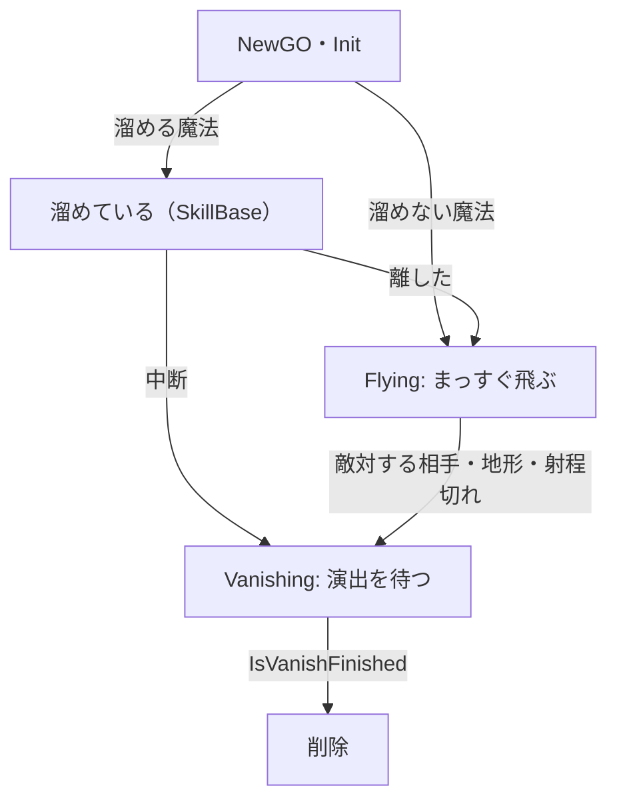

# 魔法の設計

作成日: 2026-11-14（`魔法と弾の設計.md`・`弾の設計.md` をまとめ直した。同じ日に、入力と溜めの扱いを [スキルの設計](../スキル/スキルの設計.md) へ移した）
対象: `Game/Source/Magic/MagicBase.*`
経緯: [魔法の経緯](魔法の経緯.md)
手順: [魔法の手順](魔法の手順.md)（何もない状態から、どのファイルに何を足すか）

飛んでいく魔法の共通の仕組み、`MagicBase` のページです。`MagicBase` はスキルの基底クラス `SkillBase` の派生で、指示の受け取り・溜め・クールダウン・登録は [スキルの設計](../スキル/スキルの設計.md) にあります。
魔法の強さ（速さ・射程・間隔など）は `magic.json` にあります（[魔法の調整値の設計](魔法の調整値/魔法の調整値の設計.md)）。
それぞれの魔法は [氷魔法の設計](氷魔法/氷魔法の設計.md)・[炎魔法の設計](炎魔法/炎魔法の設計.md)、着弾後の床は [炎魔法発射後の燃える床の設計](炎魔法発射後の燃える床/炎魔法発射後の燃える床の設計.md) にあります。

- **魔法 = 飛んでいく1発。** 撃つたびに1つ作り、飛んで、当たって、消える。「弾」というクラスは別に持たない。
- **MagicBase が持つのは「飛ぶ・当たる・消える」だけ。** 押している間・離した・中断は `SkillBase` が扱う。

---

## 1. 全体像

```
SkillBase（指示の受け取り・溜め・クールダウン）
└─ MagicBase（飛ぶ・当たる・消える）
    ├─ IceMagic   … 押してすぐ飛ぶ。当たったら凍らせる
    ├─ FireMagic  … 溜めて、離したら飛ぶ。着弾したら床を燃やす
    └─ SlashMagic … 黒騎士の斬撃。攻撃3（SlashWaveAttack）が直接 NewGO する
```

Player は `ActionButton::Action1` に氷魔法、`Action2` に炎魔法を登録しています（[スキルの設計](../スキル/スキルの設計.md)）。

---

## 2. MagicBase の流れ

コード: [MagicBase.h](../../../Game/Source/Magic/MagicBase.h)、[MagicBase.cpp](../../../Game/Source/Magic/MagicBase.cpp)



溜めている間と、離した・中断した瞬間は `SkillBase` が扱い、`OnCharge`・`OnRelease`・`OnCancel` を呼びます。`MagicBase` は離されたあと（溜めない魔法は作った直後）から飛び始めます。

派生クラスは、要るものだけを上書きします。

| 関数 | 呼ばれるとき | 書くこと |
|---|---|---|
| `OnStart()` | 最初のフレーム | エフェクトやモデルの読み込み。失敗なら `false` |
| `OnCharge(秒)`・`OnRelease()`・`OnCancel()` | 溜めている間・離した・中断（`SkillBase` から） | 溜めの見た目、飛び始めの準備（溜め具合で `SetSettings`）、片付け |
| `OnMove()` | 位置が変わった | 見た目を合わせる |
| `OnHitTarget()` | 敵対する相手に当たった | 効果（凍らせる、など） |
| `OnExplode()` | 着弾した（相手・地形・射程切れ） | 着弾の演出 |
| `IsVanishFinished()` | 着弾後、毎フレーム | 演出が終わったか |

性能（速さ・射程・当たり判定の半径）は `MagicSettings` で決め、コンストラクタで基底クラスに渡します。

---

## 3. 実装方法

### 飛ぶ：1フレームに進む分を線分で調べる

```cpp
const Vector3 nextPosition = m_position + m_direction * moveDistance;
// ① 敵対する相手（撃った本人は除く）→ ② 地形のレイ → ③ 進んで、射程を超えたら空中で着弾
```

**名前:**

| ジャンル | 名前 | 何のためのもの | 何をするためのもの | どこから来たもの |
|---|---|---|---|---|
| 変数 | `nextPosition` | 1フレーム後の位置を、動かす前に調べるため | 今の位置から、向きに `moveDistance` だけ進んだ位置 | ゲームの MagicBase の飛ぶ処理（[MagicBase.cpp](../../../Game/Source/Magic/MagicBase.cpp) の `OnSkillUpdate()`） |
| メンバー変数 | `m_position`・`m_direction` | 魔法の今の位置と向き（正規化済み）を持つため | 位置と、まっすぐ飛ぶ向き。`MagicBase.cpp` では `GetPosition()`・`GetDirection()` で読む | ゲームの [SkillBase.h](../../../Game/Source/Skill/SkillBase.h) の `SkillBase`（private） |
| 変数 | `moveDistance` | 1フレームに進む距離を持つため | 速さ（`MagicSettings::speed`）に、1フレームの経過時間を掛けた値 | ゲームの `MagicBase.cpp` の `OnSkillUpdate()` |

1フレームに進む分を線分にして調べるので、速く飛んでもすり抜けません。相手を地形より先に調べます。地形のレイはキャラクターのカプセルにも当たりますが、当たり判定の球の方が大きいので、狙って撃てば先に相手として当たります。

**用語:**

| 用語 | 何のことか |
|---|---|
| レイ | 始点から終点まで線を引き、最初に何に当たるかを調べること。ここでは、魔法の1フレームの通り道を地形に当てて調べる |
| カプセル | 円柱の両端を半球にした形の当たり判定。キャラクターの移動（`CharacterController`）の判定に使う |

### 当たったら相手に知らせ、効果は派生クラスに任せる

```cpp
hitTarget->NotifyHit(hitInfo);          // 誰がどこから当てたか（ひるむ・HP を減らす、は相手が決める）
OnHitTarget(*hitTarget, hitPosition);   // 凍らせる、など
Explode(hitPosition);                   // 着弾の演出 → 演出が終わるのを待って消える
```

**名前:**

| ジャンル | 名前 | 何のためのもの | 何をするためのもの | どこから来たもの |
|---|---|---|---|---|
| 変数 | `hitTarget` | 線分の上で最初に当たった相手を持つため | 当たった `HitTarget` へのポインター。当たらなければ `nullptr` | ゲームの `MagicBase.cpp` の `OnSkillUpdate()`（相手は `HitTargetRegistry::FindHitOnSegment()` で探す） |
| 型 | `HitTarget` | 魔法などに当ててもらうための当たり判定を表すため | キャラクターがメンバーとして持つ。足元の位置・半径・陣営・状態異常（`StatusEffects`）を持ち、当たったことを持ち主へ知らせる | ゲームの [HitTarget.h](../../../Game/Source/Character/Components/HitTarget.h) |
| 関数 | `NotifyHit()` | 当たったことを、相手に知らせるため | 相手が持つ「当たったときの処理」（ひるむ・HP を減らす、など）を呼ぶ | ゲームの `HitTarget.h` の `HitTarget` |
| 変数 | `hitInfo` | 誰がどこから当てたかを、相手に渡すため | 撃った本人（`attacker`）・その陣営・当たった位置・進む向きを入れた `HitInfo` | ゲームの `MagicBase.cpp` の `OnSkillUpdate()`（型 `HitInfo` は `HitTarget.h`） |
| 変数 | `hitPosition` | 当たった位置を持つため | 線分の上で当たった点の座標 | ゲームの `MagicBase.cpp` の `OnSkillUpdate()` |
| 関数 | `Explode()` | 着弾の流れをまとめるため | 位置を着弾点に合わせ、`OnExplode()` を呼び、`End()` で使い終わりにする | ゲームの [MagicBase.cpp](../../../Game/Source/Magic/MagicBase.cpp) の `MagicBase`（private） |

### 名前をそろえて、ゲームの終わりにまとめて消す

どの魔法も `SkillBase::OBJECT_NAME`（`"skill"`）で作ります。[Game.cpp](../../../Game/Source/Core/Game.cpp) のデストラクタで、その名前のものを種類を問わずまとめて消します。

---

## 4. 使い方（新しい魔法を作る）

1. `MagicBase` を継承する。性能（`MagicSettings`）と連射間隔は `magic.json` に足し、コンストラクターは `MagicBase(MagicConfig::GetXxx().settings)` を呼ぶ（[魔法の調整値の設計](魔法の調整値/魔法の調整値の設計.md)）。
2. 見た目と効果の関数（`OnStart`・`OnMove`・`OnHitTarget`・`OnExplode`・`IsVanishFinished`）を書く。溜める魔法なら `IsChargeType()` で `true` を返し、`OnCharge`・`OnRelease`・`OnCancel` も書く。
3. キャラクターの `OnStart()` で、使うボタンに登録する。

```cpp
m_skillController.Register<ThunderMagic>(ActionButton::Action1, MagicConfig::GetThunder().cooldown);
```

**名前:**

| ジャンル | 名前 | 何のためのもの | 何をするためのもの | どこから来たもの |
|---|---|---|---|---|
| メンバー変数 | `m_skillController` | キャラクターが使うスキルを持つため | `SkillController`。登録と、毎フレームの `Update()` に使う | ゲームの [Character.h](../../../Game/Source/Character/Character.h) の `Character` |
| 関数 | `Register<T>()` | ボタンとスキルを結びつけるため | そのボタンが押されたら `T` を作るように登録する | ゲームの [SkillController.h](../../../Game/Source/Skill/SkillController.h) の `SkillController` |
| 型 | `ThunderMagic` | 新しく作る魔法の例として置いた名前 | 雷の魔法の例 | ソースにはない（説明のための名前） |
| 値 | `ActionButton::Action1` | スキルを使うボタンを選ぶため | 入力のボタンの1つ目 | ゲームの [CharacterInput.h](../../../Game/Source/Character/Input/CharacterInput.h) |

4. 入力元に、そのボタン（`ActionButton::Action1` など）を押させる（Player なら `PlayerInputSource` でキーを割り当てる）。

攻撃などから直接撃つときは、`NewGO<T>(T::PRIORITY, SkillBase::OBJECT_NAME)` で作って `Init()` を呼びます（黒騎士の攻撃3の斬撃。[剣の攻撃の設計](../スキル/剣の攻撃/剣の攻撃の設計.md)）。

---

## 5. 調整用の数値

魔法の強さ（間隔・速さ・射程・半径・凍らせる秒数・溜める秒数・燃える床の広さ）は `magic.json`（[魔法の調整値の設計](魔法の調整値/魔法の調整値の設計.md)）。

撃つ位置（`CharacterCastSettings`）。Player は `player.json` の `caster`、Enemy はコードの既定値。

| 設定 | Player | Enemy（黒騎士） |
|---|---|---|
| `castHeight`（三人称で撃つ高さ） | 140 | 70 |
| `castForward` | 60 | 60 |

---

## 6. 決めたこと

| 決めたこと | 理由 |
|---|---|
| 魔法と弾を1つのクラスにした | 魔法（撃ち方）と弾（飛ぶ物）に分けていたが、撃ち方の違いは「溜めるかどうか」だけで、クラスが倍になって関係が分かりにくかった |
| 溜めは魔法が手元で待つ形にした | 溜めた火の玉がそのまま飛んでいくので、溜め中と飛ぶ間の見た目を1つのクラスで合わせられる |
| 入力・溜め・クールダウンを `SkillBase` に移した | 剣の攻撃など、魔法でないスキルと同じ決まりで扱うため（[スキルの設計](../スキル/スキルの設計.md)） |

以前の形とその経緯は [魔法の経緯](魔法の経緯.md) にあります。

---

## 7. 関連するページ

- [スキルの設計](../スキル/スキルの設計.md)（`SkillBase`・`SkillController`・`ActionButton`）
- [陣営と当たり判定の設計](../キャラクター/陣営と当たり判定/陣営と当たり判定の設計.md)（当たる相手の探し方）
- [状態異常の設計](../キャラクター/状態異常/状態異常の設計.md)（凍ったら溜めを捨てる）
