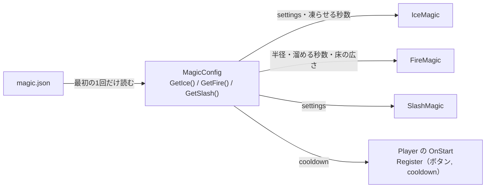

# 魔法の調整値の設計

作成日: 2026-11-17
対象: [magic.json](../../../../Game/Assets/data/magic.json)、[MagicConfig.h](../../../../Game/Source/Magic/MagicConfig.h)、[MagicConfig.cpp](../../../../Game/Source/Magic/MagicConfig.cpp)
経緯: [魔法の調整値の経緯](魔法の調整値の経緯.md)
手順: [魔法の調整値の手順](魔法の調整値の手順.md)（`magic.json` と `MagicConfig` がない状態から、どのファイルに何を足すか）

氷魔法・炎魔法・黒騎士の斬撃の強さ（間隔・速さ・射程・半径・凍らせる秒数・溜める秒数・燃える床の広さ）を `magic.json` に書き、Player も敵も同じ値で魔法を作るためのページです。

- **魔法の強さは `magic.json` の1か所だけに書く。** 値を変えても、ビルドは要らない（起動し直す）。
- **JSON のキー名を知っているのは `MagicConfig.cpp` だけ。** 魔法は `MagicConfig::GetIce()` などで、型のついた構造体を受け取る。
- **見た目と作りの値はコードに残す。** エフェクトの拡大率、床を探すレイの長さなど。
- **Player も敵も同じ値を使う。** 魔法は `NewGO` で引数なしに作るので、作るときに値を渡せない。

**用語:**

| 用語 | 何のことか |
|---|---|
| クールダウン（間隔） | 魔法を使ってから、次に使えるまでの秒数。`SkillController` が数える |
| `MagicSettings` | 魔法の速さ（`speed`）・射程（`range`）・当たり判定の半径（`radius`）。`MagicBase` が作るときに受け取る |

---

## 1. 全体像



| 値 | 使う所 |
|---|---|
| `ice.cooldown`・`fire.cooldown` | `Player.cpp` が `SkillController::Register` に渡す |
| `speed`・`range`・`radius`（炎は `minRadius`〜`maxRadius`） | 魔法が `MagicBase` に渡す `MagicSettings` |
| `ice.freezeSeconds` | `IceMagic` が、当たった相手を凍らせる |
| `fire.maxChargeSeconds` | `FireMagic` が、溜め具合（0〜1）を求める |
| `minGroundRadius`〜`maxGroundRadius`・`groundBurnSeconds` | `FireMagic` が、着弾で作る炎魔法発射後の燃える床（`BurningGround`）に渡す |

---

## 2. 実装方法

### 値は魔法ごとの構造体にする

`MagicConfig.h` に `IceMagicConfig`・`FireMagicConfig`・`SlashMagicConfig` を置く。速さ・射程・半径は、`MagicBase` が受け取る `MagicSettings` のまま持たせるので、そのまま渡せる。

```cpp
IceMagic::IceMagic()
	: MagicBase(MagicConfig::GetIce().settings)
{
}
```

`MagicSettings` は [MagicBase.h](../../../../Game/Source/Magic/MagicBase.h) にある型で、魔法を作るときに `MagicBase` へ渡す。炎魔法は溜め具合で半径が変わるので、値を1つずつ持つ（`minRadius`・`maxRadius`）。

### 1回だけ読み、キーがなければ既定値を使う

`magic.json` を読むのは、最初に呼ばれたときの1回だけ。`GetJson()` も `GetIce()`・`GetFire()`・`GetSlash()` も、関数の中の `static` 変数に結果を取っておく。敵が何体いても、読み込みは1回。

```cpp
float Read(const Json& section, const char* sectionName, const char* key, float defaultValue)
{
	auto it = section.find(key);
	if (it == section.end() || !it->is_number()) {
		Log(std::string(JSON_PATH) + " の " + sectionName + "." + key + " がない（または数でない）ので、既定値を使います。");
		return defaultValue;
	}
	return it->get<float>();
}
```

ファイルがない・書き方が壊れている・キーがない・数でない、のどれでも落ちず、既定値で動く（既定値は `magic.json` を作ったときと同じ値）。出力ウィンドウに出るので、キー名の書き間違いに気づける。読み方は [プレイヤーの調整値の設計](../../プレイヤー/プレイヤーの調整値/プレイヤーの調整値の設計.md) の `PlayerConfig.cpp` と同じ。

名前:

| ジャンル | 名前 | 何のためのもの | 何をするためのもの | どこから来たもの |
|---|---|---|---|---|
| 関数 | `Read` | 段の中の1つの値を読むため | キーで探し、数なら `float` で返す。なければ既定値 | ゲームの [MagicConfig.cpp](../../../../Game/Source/Magic/MagicConfig.cpp)（名前のない `namespace` の中） |
| 関数 | `is_number()` | 値が数かを調べるため | 数なら `true` | 外部ライブラリ（nlohmann/json） |
| 関数 | `OutputDebugStringA` を使う `Log` | 既定値を使ったことを知らせるため | Visual Studio の出力ウィンドウに出す | ゲームの `MagicConfig.cpp`（中で Windows の API を呼ぶ） |

### クールダウンは登録のときに渡す

以前は、スキルのクラスに `static constexpr float COOLDOWN` を書き、`SkillController::Register<T>(button)` が読んでいた。`magic.json` から読んだ値は定数にできないので、間隔を引数で受け取る形を足した。

```cpp
m_skillController.Register<IceMagic>(ActionButton::Action1, MagicConfig::GetIce().cooldown);
m_skillController.Register<FireMagic>(ActionButton::Action2, MagicConfig::GetFire().cooldown);
```

引数1つの `Register<T>(button)` は残してある。`COOLDOWN` を持つ剣の攻撃（黒騎士の攻撃1〜3）は、今までどおりこちらで登録する（[スキルの設計](../../スキル/スキルの設計.md)）。

---

## 3. 使い方

### 値を変える

`magic.json` の数値を書き換えて、ゲームを起動し直す。キーを消すと、`MagicConfig.cpp` の既定値になり、出力ウィンドウに出る。

### 新しい魔法の値を足す

1. `MagicConfig.h` に構造体（`XxxMagicConfig`）と `GetXxx()` を足す。
2. `MagicConfig.cpp` に `LoadXxx()` と `GetXxx()` を足す（既定値は `magic.json` と同じにする）。
3. `magic.json` に段を足す。
4. 魔法の `.cpp` で `MagicConfig::GetXxx()` を使う。連射間隔があるなら、登録のときに `Register<T>(button, 間隔)` で渡す。

### 敵だけ強さを変える（今はしていない）

魔法を `NewGO` で作るので、作るときに値を渡せない。敵だけ変えたくなったら、魔法に値を渡す口を足すか、`magic.json` に敵用の段を足して、魔法が持ち主の陣営で段を選ぶ形にする（案。作っていない）。

---

## 4. 調整用の数値（`magic.json`）

| 内容 | 値 | キー |
|---|---|---|
| 氷魔法の連射間隔 | 0.35秒 | `ice.cooldown` |
| 氷の弾の速さ / 射程 / 半径 | 1500 / 2000 / 10 | `ice.speed` / `ice.range` / `ice.radius` |
| 凍らせる秒数 | 2.5秒 | `ice.freezeSeconds` |
| 炎魔法を撃ってから次に溜め始められるまで | 0.6秒 | `fire.cooldown` |
| 最大まで溜まる秒数 | 1.2秒 | `fire.maxChargeSeconds` |
| 炎の弾の速さ / 射程 | 1300 / 2000 | `fire.speed` / `fire.range` |
| 炎の弾の半径（溜め具合で補間） | 14〜45 | `fire.minRadius` / `fire.maxRadius` |
| 燃える床の半径（溜め具合で補間） | 130〜300 | `fire.minGroundRadius` / `fire.maxGroundRadius` |
| 床が燃えている秒数 | 4秒 | `fire.groundBurnSeconds` |
| 黒騎士の斬撃の速さ / 射程 / 半径 | 1100 / 1500 / 45 | `slash.speed` / `slash.range` / `slash.radius` |

---

## 5. 決めたこと

| 決めたこと | 理由 |
|---|---|
| Player と敵で同じ値にした | 魔法を `NewGO` で引数なしに作るので、作るときに値を渡せない。氷・炎を撃つ敵はまだいない |
| 魔法のクラスから `COOLDOWN` を消し、登録のときに渡す | `magic.json` の値は定数にできない。値の置き場所を `magic.json` の1か所にするため |
| 引数1つの `Register<T>(button)` を残した | 剣の攻撃は、攻撃ごとの間隔を `COOLDOWN` で持っていて、`magic.json` の対象ではない |
| 見た目と作りの値は、コードに残した | エフェクトの拡大率や床を探すレイの長さは、強さではなく見た目の合わせ込みなので、`magic.json` に出すと調整の意味がぼやける |
| 黒騎士の斬撃も `magic.json` に入れた | `SlashMagic` も `MagicBase` で、速さ・射程・半径が強さの値だから |

---

## 6. 既知の課題

- **燃える床に入った相手が燃える秒数（1.5秒）・燃え広がる秒数（0.4秒）は、まだ `BurningGround.cpp` にある。** 床の作りに近い値なので、今回は移していない。
- **値を変えるには、ゲームを起動し直す。** ゲーム中に読み直す仕組みはない。

---

## 7. 関連するページ

- [魔法の設計](../魔法の設計.md)・[氷魔法の設計](../氷魔法/氷魔法の設計.md)・[炎魔法の設計](../炎魔法/炎魔法の設計.md)・[炎魔法発射後の燃える床の設計](../炎魔法発射後の燃える床/炎魔法発射後の燃える床の設計.md)
- [スキルの設計](../../スキル/スキルの設計.md)（`Register` の引数2つの形）
- [NPCのAIの設計](../../キャラクター/NPCのAI/NPCのAIの設計.md)（魔法を撃つ敵の AI。同じ変更で3段の形に作り直した）
- [JSON読み込みの設計](../../システム/JSON読み込み/JSON読み込みの設計.md)・[プレイヤーの調整値の設計](../../プレイヤー/プレイヤーの調整値/プレイヤーの調整値の設計.md)（同じ読み方）
