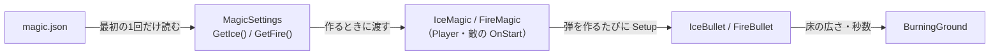

# 魔法の調整値の設計

作成日: 2026-11-13
対象: [magic.json](../../../Game/Assets/data/magic.json)、[MagicSettings.h](../../../Game/Source/Magic/MagicSettings.h)、[MagicSettings.cpp](../../../Game/Source/Magic/MagicSettings.cpp)
経緯: [魔法と弾の経緯](魔法と弾の経緯.md)
手順: [魔法の調整値の手順](魔法の調整値の手順.md)（氷魔法・炎魔法の定数を、どのファイルに移すか）

氷魔法・炎魔法の強さ（間隔・弾の速さ・射程・半径・凍らせる秒数・燃える床の広さ）を `magic.json` に書き、Player も敵も同じ値で魔法を作るためのページです。

- **魔法の強さは `magic.json` の1か所だけに書く。** Player と敵は、同じ値を受け取って魔法を作る。
- **JSON を知っているのは `MagicSettings.cpp` だけ。** 魔法と弾は構造体で値を受け取る。
- **見た目と作りの値はコードに残す。** エフェクトの拡大率、床を探すレイの長さなど。

---

## 1. 全体像



| 値 | 使う所 |
|---|---|
| `cooldown`・`maxChargeSeconds` | 魔法（`IceMagic`・`FireMagic`） |
| `speed`・`range`・`radius`（炎は `minRadius`〜`maxRadius`） | 弾の共通の設定（`BulletSettings`） |
| `freezeSeconds` | 氷の弾が当たった相手を凍らせる |
| `minGroundRadius`〜`maxGroundRadius`・`groundBurnSeconds` | 炎の弾が着弾したときの燃える床 |

---

## 2. 実装方法

### 値は構造体で持ち、既定値は構造体に書く

`IceMagicSettings`・`FireMagicSettings` のメンバーに、`magic.json` を作ったときと同じ値を既定値として書いてある。読むときは既定値の入った構造体を作り、JSON にある値だけを上書きする。

```cpp
void Read(const Json& section, const char* sectionName, const char* key, float& value)
{
    auto it = section.find(key);
    if (it == section.end() || !it->is_number()) {
        Log(...);   // 出力ウィンドウに「既定値を使います」と出す
        return;     // value は既定値のまま
    }
    value = it->get<float>();
}
```

ファイルがない・書き方が壊れている・キーがない、のどれでも落ちずに既定値で動く（[JSON読み込みの設計](../システム/JSON読み込みの設計.md)）。

### 1回だけ読む

`GetJson()`・`GetIce()`・`GetFire()` は、関数の中の `static` 変数に結果を取っておく。敵が何体いても、ファイルを読むのは最初の1回だけ。値を変えたらゲームを起動し直す。

### 弾へは Setup で渡す

弾は `NewGO` で作るのでコンストラクターに引数を渡せない。作った直後、`Init` より前に `Setup` を呼ぶ。

```cpp
IceBullet* bullet = NewGO<IceBullet>(1, BulletBase::OBJECT_NAME);
bullet->Setup(m_settings);                    // 速さ・射程・半径を SetSettings、凍らせる秒数を取っておく
bullet->Init(context.origin, context.direction, context.caster, context.faction);
```

炎の弾は `Setup(m_settings, GetChargeRate())` で溜め具合も一緒に受け取り、半径と燃える床の広さを min〜max の間で補間する。

---

## 3. 使い方

### 魔法を持たせる

```cpp
// Player や敵の OnStart
m_magicCaster.AddMagic(std::make_unique<IceMagic>(MagicSettings::GetIce()));
m_magicCaster.SetSubMagic(std::make_unique<FireMagic>(MagicSettings::GetFire()));
```

敵に撃たせるときは、AI の設定も要る（[NPCのAIの設計](../キャラクター/NPCのAIの設計.md)）。

### 敵だけ強さを変える

`magic.json` に段を足すのではなく、受け取った値をコピーして書き換えて渡す（今はしていない）。

```cpp
IceMagicSettings settings = MagicSettings::GetIce();
settings.cooldown = 3.0f;
m_magicCaster.AddMagic(std::make_unique<IceMagic>(settings));
```

### 新しい魔法の値を足す

1. `MagicSettings.h` に構造体と `GetXxx()` を足す。
2. `MagicSettings.cpp` に `LoadXxx()` と `GetXxx()` を足す。
3. `magic.json` に段を足す。

---

## 4. 調整用の数値（`magic.json`）

| 内容 | 値 | キー |
|---|---|---|
| 氷魔法の連射間隔 | 0.35秒 | `ice.cooldown` |
| 氷の弾の速さ / 射程 / 半径 | 1500 / 2000 / 10 | `ice.speed` / `ice.range` / `ice.radius` |
| 凍らせる秒数 | 2.5秒 | `ice.freezeSeconds` |
| 炎魔法を撃ってから次に溜め始められるまで | 0.6秒 | `fire.cooldown` |
| 最大まで溜まる秒数 | 1.2秒 | `fire.maxChargeSeconds` |
| 炎の弾の速さ / 射程 | 1300 / 2000 | `fire.speed` / `fire.range` |
| 炎の弾の半径（溜め具合で補間） | 14〜45 | `fire.minRadius` / `fire.maxRadius` |
| 燃える床の半径（溜め具合で補間） | 130〜300 | `fire.minGroundRadius` / `fire.maxGroundRadius` |
| 床が燃えている秒数 | 4秒 | `fire.groundBurnSeconds` |

---

## 5. 決めたこと

- **Player と敵で同じ値にする**（2026-11-13）。違う値が要るときは、3章のとおり作る側で書き換える。
- **燃える床に入った相手が燃える秒数（1.5秒）・燃え広がる秒数（0.4秒）は、まだ `BurningGround.cpp` にある。** 燃える床の作りに近い値なので、今回は移していない。

---

## 6. 関連するページ

- [魔法と弾の設計](魔法と弾の設計.md)・[氷魔法の設計](氷魔法の設計.md)・[炎魔法の設計](炎魔法の設計.md)・[燃える床の設計](燃える床の設計.md)
- [JSON読み込みの設計](../システム/JSON読み込みの設計.md)・[プレイヤーの調整値の設計](../プレイヤー/プレイヤーの調整値の設計.md)（同じ読み方）
