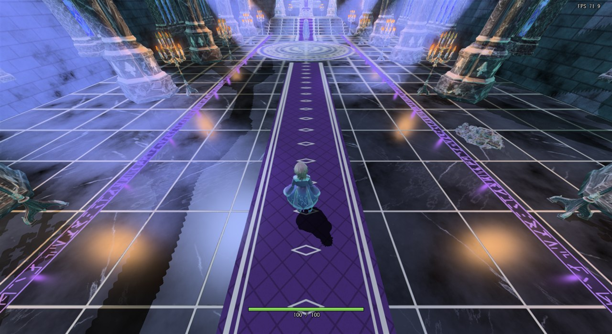
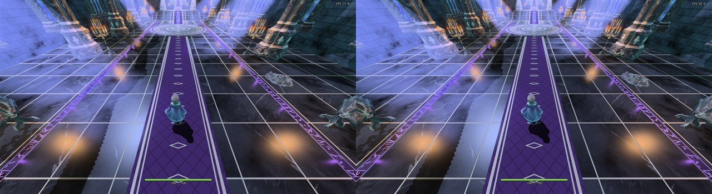
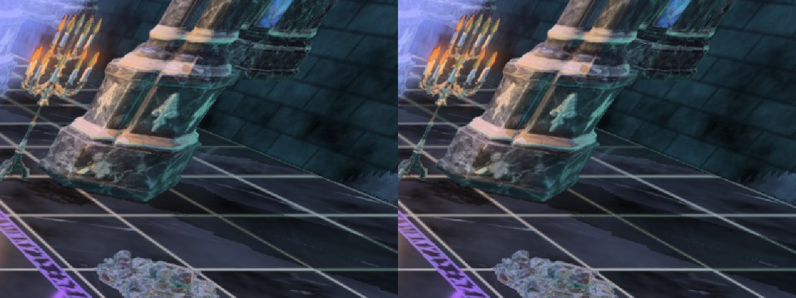

# ボス戦の広間のテクスチャの経緯

作成日: 2026-11-15
対象: ボス戦の広間（`BossStage`）のテクスチャ。作っているのは [make_boss_stage.py](../../../../tools/BossStage/make_boss_stage.py)・[make_floor_texture.py](../../../../tools/BossStage/make_floor_texture.py)・[make_wall_texture.py](../../../../tools/BossStage/make_wall_texture.py)
設計: [ボス戦の広間の設計](../../../ゲーム/ステージ/ボス戦の広間/ボス戦の広間の設計.md)。テクスチャを DDS に変える仕組みは [モデル読み込みの設計](../../../エンジン/モデル読み込み/モデル読み込みの設計.md) の2章。

---

## 2026-11-15 テクスチャを 2048 から 1024（小物は 512）に縮めた

### 1. 現状の問題

起動に時間がかかる。調べると、ボス戦の広間のテクスチャ（DDS）は合わせて **163MB** あった。どれも起動のときに読み込む。

- 玉座・扉・柱・窓・アーチ・像・旗・床・壁は 1辺 2048（1枚 5.6MB）。
- 燭台・がれき・壁の灯りは 1辺 1024（1枚 1.4MB）。
- 部品ごとに albedo・normal・spec の3枚がある。

**用語:**

| 用語 | 何のことか |
|---|---|
| DDS | DirectX のテクスチャのファイル（`.dds`）。圧縮して小さくでき、GPU がそのまま読める。PNG のテクスチャは、起動したときに DDS に変換される |
| albedo・normal・spec | 部品のテクスチャの3種類。albedo は色、normal は表面のでこぼこを表す法線の画像、spec は金属度と滑らかさ（つや）の画像 |



カメラから見える大きさに比べて、解像度が高すぎる。半分にしても画面はほとんど変わらないと考えた。

### 2. ソースコードの問題箇所

部品のテクスチャの大きさは、[make_boss_stage.py](../../../../tools/BossStage/make_boss_stage.py) の `PARTS` の3つ目の数で決めている。Meshy の画像をこの大きさにしてから PNG に書き出す。

**用語:**

| 用語 | 何のことか |
|---|---|
| Meshy | 文章や画像から3Dモデルとテクスチャを作る外部のサービス。広間の部品（柱・玉座・燭台など）をここで作った |
| PNG | 画像のファイル形式（`.png`）。ここでは、Blender から書き出す途中のテクスチャのこと |

```python
PARTS = {
    "Throne":      (5.0, "height", 2048, 1.0),
    ...
    "Candelabrum": (3.0, "height", 1024, 0.27),
    ...
}
```

**名前:**

| ジャンル | 名前 | 何のためのもの | 何をするためのもの | どこから来たもの |
|---|---|---|---|---|
| 値 | `5.0`（`PARTS` の組の1つ目） | 部品の大きさをそろえるため | 部品を、この長さ（ゲームの単位でなく、メートル）にそろえて置く。`"Throne": (5.0, ...)` なら、玉座は 5m | このプロジェクトの Blender のスクリプト [make_boss_stage.py](../../../../tools/BossStage/make_boss_stage.py) |
| 値 | `"height"`（`PARTS` の組の2つ目） | 大きさを、高さと幅のどちらに合わせるか決めるため | `"height"` なら高さを、`"width"` なら幅を、1つ目の数にそろえる | このプロジェクトの Blender のスクリプト [make_boss_stage.py](../../../../tools/BossStage/make_boss_stage.py) |
| 値 | `1.0`（`PARTS` の組の4つ目） | 部品の三角形を減らす割合を決めるため | 1.0 なら減らさない。0.5 なら半分に減らす（Blender の Decimate） | このプロジェクトの Blender のスクリプト [make_boss_stage.py](../../../../tools/BossStage/make_boss_stage.py) |

床と壁は、`make_floor_texture.py`・`make_wall_texture.py` の `SIZE = 2048` の大きさで模様を作り、その大きさのまま書き出していた。

### 3. 直し方

- 部品: `PARTS` の大きさを、2048 のものは 1024、1024 のものは 512 にする。
- 床と壁: 模様は今までどおり 2048 で作り、保存するときに 1024 に縮める（`OUT_SIZE`）。
  - `SIZE` を直接 1024 にしないのは、目地の幅（`GOLD_WIDTH`・`MORTAR_WIDTH`）や乱数の模様がピクセルで決まっていて、模様が変わってしまうため。
- 紋章・絨毯・紫の帯・炎は、もともと小さい（1024 以下）ので変えない。

### 4. ソースコードの直し

```diff
 PARTS = {
-    "Throne":      (5.0, "height", 2048, 1.0),
+    "Throne":      (5.0, "height", 1024, 1.0),
     （玉座・扉・柱・窓・アーチ・像・旗も 2048 → 1024）
-    "Candelabrum": (3.0, "height", 1024, 0.27),
+    "Candelabrum": (3.0, "height",  512, 0.27),
     （燭台・がれき・壁の灯りも 1024 → 512）
 }
```

```diff
 SIZE = 2048                 # 模様を作るときの1辺（ピクセル）
+OUT_SIZE = 1024             # 書き出すテクスチャの1辺。模様は SIZE で作り、保存するときに縮める

 def save(name, rgb_or_rgba, colorspace, outdir, size=None):
     ...
     img.pixels.foreach_set(arr[::-1].astype(np.float32).ravel())   # Blender は下の行から
+    if size and (wid, hgt) != (size, size):
+        img.scale(size, size)
     ...
-save("BossFloor_albedo", albedo, "sRGB", outdir)
+save("BossFloor_albedo", albedo, "sRGB", outdir, OUT_SIZE)
```

**名前:**

| ジャンル | 名前 | 何のためのもの | 何をするためのもの | どこから来たもの |
|---|---|---|---|---|
| 関数 | `save()` | 作った模様を、テクスチャの PNG として書き出すため | 色の画像（配列）を Blender の画像にして、PNG で保存する。`size` を渡すと、その大きさに縮めて保存する | このプロジェクトの Blender のスクリプト [make_floor_texture.py](../../../../tools/BossStage/make_floor_texture.py)（`make_wall_texture.py` にも同じものがある） |
| 引数 | `rgb_or_rgba` | 保存する画像の中身を渡すため | ピクセルの色の配列（NumPy）。3つ組（RGB）でも4つ組（RGBA）でもよい | このプロジェクトの Blender のスクリプト `make_floor_texture.py` の `save()` |
| 引数 | `colorspace` | 色の扱い方を、画像ごとに決めるため | `"sRGB"` は色の画像、`"Non-Color"` は法線や spec のように、色ではなく数値を入れた画像 | このプロジェクトの Blender のスクリプト `make_floor_texture.py` の `save()` |
| 引数 | `outdir` | 書き出す先のフォルダを渡すため | PNG を置くフォルダ。スクリプトを動かすときの `--` のあとに渡す | このプロジェクトの Blender のスクリプト `make_floor_texture.py` の `save()` |
| 引数 | `size` | 保存するときの1辺を決めるため | 渡すと、その1辺（正方形）に縮める。`None` のときは縮めない | このプロジェクトの Blender のスクリプト `make_floor_texture.py` の `save()` |
| 変数 | `wid`・`hgt` | 今の画像の幅と高さを覚えるため | 配列の形から取り出した、画像の幅と高さ（ピクセル） | このプロジェクトの Blender のスクリプト `make_floor_texture.py` の `save()` |
| 変数 | `img` | 保存する Blender の画像を持つため | `bpy.data.images.new()` で作った画像 | 外部ライブラリ（Blender の bpy） |
| 関数 | `foreach_set()` | 配列の中身を、画像のピクセルに一度に入れるため | 画像の `pixels` に、平らにした数値の列をまとめて書き込む | 外部ライブラリ（Blender の bpy） |
| 関数 | `astype()`・`ravel()` | Blender が受け取る形にそろえるため | `astype(np.float32)` は数の型を 32ビットの小数にし、`ravel()` は配列を1列に並べ直す | 外部ライブラリ（NumPy） |
| 関数 | `img.scale()` | 画像を指定の大きさに縮めるため | 画像の大きさを、渡した幅・高さに変える（模様は SIZE で作ったまま、保存の直前に縮める） | 外部ライブラリ（Blender の bpy） |

**用語:**

| 用語 | 何のことか |
|---|---|
| Blender | 3Dモデルを作るソフト。このプロジェクトでは、ウィンドウを出さずに Python のスクリプトで動かして、広間を作る |

（`make_wall_texture.py` も同じ。）

これで DDS は合わせて **46MB** になった。

縮める前（左）と縮めた後（右）。窓が出てから3秒後の画面。



右の柱の根元・燭台・がれきの所を拡大したもの（左が縮める前）。細かい石の筋が少しぼけるが、ふつうの大きさの画面では見分けにくい。



### 5. どう確かめたか

- PNG の作り直し:
  - 部品は、`make_boss_stage.py` の最後の `build()` だけを呼ばずに読み込み、`part_textures()` を全部の部品について呼んだ。広間の FBX は書き出していないので、モデル（BossHall.fbx・BossHall.tkm）は変わっていない。
  - 床と壁は、2つのスクリプトをそのまま動かした。
- DDS は、エンジンが起動時に使うのと同じ `texconv.exe -vflip -f BC7_UNORM -srgb -y` で作った。PNG より新しくなるので、起動しても作り直されない。
- 作業用フォルダ（git worktree）で Game.sln を Debug x64 でビルドし、縮める前と後のテクスチャで1回ずつ起動して、窓が出てから3秒後の画面を撮って比べた（上の画像）。
  - 撮り方: ゲームを最小化・非アクティブで起動し、窓を透明（不透明度 1/255）・クリックを素通り・いちばん奥にしてから、アクティブにしないで元の大きさに戻し、`PrintWindow` で窓だけを撮る。撮ったらすぐに終了させた。

**用語:**

| 用語 | 何のことか |
|---|---|
| FBX | 3Dモデルを交換するためのファイル形式（`.fbx`）。広間は Blender から FBX で書き出し、エンジンが tkm に変換して読む |
| tkm | k2Engine のモデルのファイル（`.tkm`）。頂点・面・マテリアルが入っている |
| texconv.exe | Microsoft が配っている、画像を DDS に変換するコマンド。エンジンが起動時に呼ぶ。`-vflip` は上下を逆さにし、`-f BC7_UNORM` は BC7 という形式で圧縮し、`-srgb` は色を sRGB として扱い、`-y` は同じ名前のファイルを上書きする |
| BC7 | DDS の圧縮の形式の1つ。画質が高く、1ピクセルが 1バイトになる |
| git worktree | 同じリポジトリを、別のフォルダに別のブランチで取り出す Git の機能。作業中のフォルダを触らずに、ビルドや確認ができる |
| `PrintWindow` | Windows の API（`<windows.h>`）。ほかの窓の上に重ならなくても、その窓の中身だけを画像として取り出す |

### 起動の時間（わかったこと）

起動してから窓が出るまでの時間は、**縮める前 29.2秒、縮めた後 31.5秒**で、ほとんど変わらなかった（1回ずつしか測っていないので、差は誤差の範囲）。

起動が遅い一番の原因は、テクスチャではなく別の所にある。候補は、広間のモデル `BossHall.tkm`（63MB。プレイヤーの約30倍）の読み込みと、そのときの BSP 作りと法線のスムージング（[法線スムージングとBSPの設計](../../../エンジン/法線スムージングとBSP/法線スムージングとBSPの設計.md)）。まだ測っていないので、次に、項目ごとに時間を測る。

**用語:**

| 用語 | 何のことか |
|---|---|
| BSP | Binary Space Partitioning（二分空間分割）。空間を平面で2つに分けることを繰り返して木にし、点を速く探せるようにする方法 |
| 法線のスムージング | 頂点の法線（面が向いている方向）を、同じ座標の頂点どうしで平均して、陰影を滑らかにすること |
