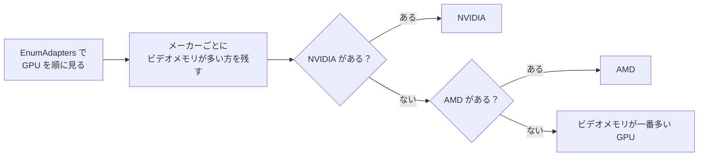

# GPUの選び方の設計

作成日: 2026-11-08
対象: [GraphicsEngine.cpp](../../../../k2EngineLow/graphics/GraphicsEngine.cpp) の `GraphicsEngine::CreateD3DDevice()`
経緯: [GPUの選び方の経緯](GPUの選び方の経緯.md)
手順: [GPUの選び方の手順](GPUの選び方の手順.md)（どのファイルに何を足し、何を書き換えたか）

PC に GPU が複数あるとき、どれで描くかを決める仕組みです。ゲームが急に重くなったとき、ノート PC や CPU 内蔵の GPU がある PC で動かすときに読んでください。

- **メーカーの順に選ぶ。** NVIDIA → AMD → それ以外（専用のビデオメモリが一番多いもの）。
- **同じメーカーが複数あるときは、専用のビデオメモリが多い方を選ぶ。** CPU 内蔵の GPU（専用のビデオメモリがほぼない）より、専用の GPU を使う。

**用語:**

| 用語 | 何のことか |
|---|---|
| ビデオメモリ | GPU が絵や頂点を入れておくメモリ。専用の GPU は専用のメモリを持つ。CPU 内蔵の GPU は、パソコンのメモリを借りるので、専用のぶんがほぼ 0 になる |
| CPU 内蔵の GPU | CPU のチップの中に入っている GPU。専用の GPU より遅い |

---

## 1. 流れ



**用語:**

| 用語 | 何のことか |
|---|---|
| DXGI | Windows で、GPU の一覧や画面への表示を扱う仕組み（DirectX Graphics Infrastructure） |
| アダプター | DXGI で GPU 1つを表すもの。名前やビデオメモリの量を調べられる |
| `EnumAdapters()` | アダプターを 0 番から順に1つずつ取り出す関数。取り出せる分がなくなると `DXGI_ERROR_NOT_FOUND` を返す |

| 見るもの | 使い方 |
|---|---|
| `DXGI_ADAPTER_DESC::Description` | 名前に `NVIDIA`・`AMD`・`Intel` が入っているかで、メーカーを分ける |
| `DXGI_ADAPTER_DESC::DedicatedVideoMemory` | 同じメーカーの中で比べる。CPU 内蔵の GPU はここがほぼ 0 |

**用語:**

| 用語 | 何のことか |
|---|---|
| `DXGI_ADAPTER_DESC` | アダプターの説明を入れる構造体。名前（`Description`）と専用のビデオメモリの量（`DedicatedVideoMemory`）などが入っている |

レイトレーシングはエンジンから外したので、GPU の種類でできることは変わらない（[レイトレーシングの削除の経緯](../../../エンジン/レイトレーシングの削除/レイトレーシングの削除の経緯.md)）。

**用語:**

| 用語 | 何のことか |
|---|---|
| レイトレーシング | 光の線（レイ）を1本ずつ追って、反射や影を計算する描き方。対応した GPU でないと速く動かない |

---

## 2. 実装方法

メーカーごとに、選んだ GPU のビデオメモリを `venderVideoMemory` に覚えておき、それより多いときだけ置き換える。

```cpp
auto isBetter = [&](int vender) {
    if (adapterVender[vender] == nullptr) {
        return true;
    }
    return desc.DedicatedVideoMemory > venderVideoMemory[vender];
};
```

**名前:**

| ジャンル | 名前 | 何のためのもの | 何をするためのもの | どこから来たもの |
|---|---|---|---|---|
| 変数 | `isBetter` | 今見ている GPU に置き換えてよいかを調べるため | メーカーの番号を渡すと、そのメーカーの GPU をまだ選んでいないか、今見ている GPU の方がビデオメモリが多ければ true を返すラムダ式 | k2EngineLow（エンジン）の [GraphicsEngine.cpp](../../../../k2EngineLow/graphics/GraphicsEngine.cpp) の `CreateD3DDevice()` |
| 引数 | `vender` | どのメーカーかを渡すため | メーカーの番号（`GPU_VenderNvidia`・`GPU_VenderAMD`・`GPU_VenderIntel`） | k2EngineLow（エンジン）の [GraphicsEngine.cpp](../../../../k2EngineLow/graphics/GraphicsEngine.cpp) の `CreateD3DDevice()` の `isBetter` |
| 変数 | `adapterVender` | メーカーごとに、選んだ GPU を覚えるため | メーカーの番号で引く、アダプター（`IDXGIAdapter*`）の配列。まだ選んでいないメーカーは `nullptr` | k2EngineLow（エンジン）の [GraphicsEngine.cpp](../../../../k2EngineLow/graphics/GraphicsEngine.cpp) の `CreateD3DDevice()` |
| 変数 | `desc` | 今見ている GPU の名前とビデオメモリを読むため | `EnumAdapters()` で取り出した GPU の `DXGI_ADAPTER_DESC` | k2EngineLow（エンジン）の [GraphicsEngine.cpp](../../../../k2EngineLow/graphics/GraphicsEngine.cpp) の `CreateD3DDevice()`（型は Windows の API の <dxgi.h>。[k2EngineLowPreCompile.h](../../../../k2EngineLow/k2EngineLowPreCompile.h) で読み込み済み） |
| 変数 | `venderVideoMemory` | 選んだ GPU のビデオメモリの量を覚えるため | メーカーの番号で引く、選んだ GPU の専用のビデオメモリの大きさの配列 | k2EngineLow（エンジン）の [GraphicsEngine.cpp](../../../../k2EngineLow/graphics/GraphicsEngine.cpp) の `CreateD3DDevice()` |

---

## 3. 確かめ方

選ばれた GPU は、タスクマネージャーの「パフォーマンス」で、ゲームを動かしている間に使用率が上がる方を見るとわかる。NVIDIA の GPU なら、`nvidia-smi` の一覧に `Game.exe` が出るかでもわかる。

**用語:**

| 用語 | 何のことか |
|---|---|
| `nvidia-smi` | NVIDIA の GPU の使用状況を、コマンドで見る道具。GPU を使っているプログラムの一覧が出る |

| PC | ある GPU | 選ばれた GPU | FPS（Release、立っているだけ） |
|---|---|---|---|
| デスクトップ（2026-11-08、直す前） | AMD Radeon(TM) Graphics（CPU 内蔵）、AMD Radeon RX 9070 XT | AMD Radeon(TM) Graphics（CPU 内蔵） | 約 31 |
| デスクトップ（2026-11-08、直したあと） | 同上 | AMD Radeon RX 9070 XT | 約 470〜490 |
| ノート PC（2026-11-09） | NVIDIA GeForce RTX 4060 Laptop GPU、Intel(R) UHD Graphics（CPU 内蔵） | NVIDIA GeForce RTX 4060 Laptop GPU | 約 264 |

---

## 4. 決めたこと

| 決めたこと | 理由 |
|---|---|
| メーカーの順（NVIDIA → AMD）は変えない | もとのエンジンの決まり（もとは NVIDIA のときだけレイトレーシングを使えるようにしていたため。レイトレーシングは外した） |
| 同じメーカーの中ではビデオメモリで比べる | 名前に「AMD」が入るものを見つけるたびに置き換えていたので、後から見つかった CPU 内蔵の GPU が選ばれていた |
| `IDXGIFactory6::EnumAdapterByGpuPreference`（高性能を優先）は使わない | 今の `IDXGIFactory4` のままで直せる。メーカーの順の決まりとも合わせやすい |

**用語:**

| 用語 | 何のことか |
|---|---|
| `IDXGIFactory4`・`IDXGIFactory6` | アダプターの一覧を取るための DXGI の部品。数字が大きいほど新しく、機能が多い |
| `EnumAdapterByGpuPreference()` | `IDXGIFactory6` の関数。「高性能」などの希望を渡すと、その順にアダプターを並べて取り出してくれる |
