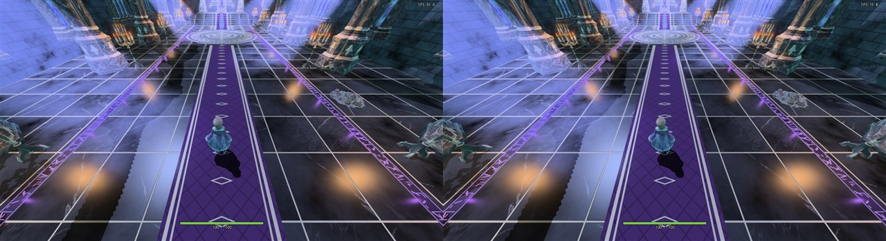

# 最適化の方法の経緯

作成日: 2026-11-15
対象: OptimizeDoc ブランチ
設計: [最適化の方法の設計](最適化の方法の設計.md)

最適化の方法の一覧を作ったときと、FPS が下がった原因を調べたときの記録です。日付ごとに書き足します。

---

## 2026-11-15: FPS が 100 を切った原因を調べた

### 何が起きていたか

「以前は 300 は出ていたのに、100 を切っている」とのことだった。コードは変えずに、どこで重くなっているかを測って特定した。

### 何をしたか

1. **ほかのゲームが動いていた。** ほかの作業用フォルダ（Action-fpcharge）の Debug の `Game.exe` が動いていて、GPU の 3D の処理の約 53〜66% を使っていた。止めてから測った。
2. **今の main を Release で測った。** 約 168 FPS。ほかのゲームが動いていたときは約 80 だった。
3. **広間を読まないようにして測った。** 作業用フォルダで `Game.cpp` の `USE_BOSS_STAGE` を `false` にし、Release でビルドした。約 410 FPS。魔法・一人称の腕など #132〜#137 のコードは原因ではなく、ボス戦の広間（#122）が重いとわかった。
4. **広間の中身を1つずつ外して測った。** 作業用フォルダの `BossStage.cpp` に、環境変数で入り切りする測るためだけのコードを入れた（main には入れていない。作業用フォルダは消した）。

| 外したもの | FPS |
|---|---|
| なし | 約 168 |
| 点の光（約 90 個） | 約 170 |
| 光の筋（ボリュームスポットライト 5 本） | 約 177 |
| 広間の影（`SetShadowCasterFlag(false)`） | 約 183 |
| 天井と炎のモデル（`BossHallNoShadow`） | 約 163 |
| **広間のモデル（`BossHall`）を描かない** | **約 380** |
| 上の全部 | 約 435 |

**用語:**

| 用語 | 何のことか |
|---|---|
| Release | ビルドの種類の1つ。最適化があり、デバッグ用の確認が入らないので、Debug より速い。FPS を測るときに使う |
| 点の光 | 1点から全方向に広がる光（ポイントライト） |
| ボリュームスポットライト | スポットライトの光が通る所に、光の筋のモデルを重ねて描き、光の筋を見せるもの |

**名前:**

| ジャンル | 名前 | 何のためのもの | 何をするためのもの | どこから来たもの |
|---|---|---|---|---|
| 変数 | `USE_BOSS_STAGE` | ボス戦の広間を読むか、草原を読むかを切り替えるため | `true` なら広間を読む（`constexpr bool`） | ゲームの [Game.cpp](../../../Game/Source/Core/Game.cpp)（今はない。草原のステージと一緒に 2026-11-15 のコミット `6043a8b3` で消した） |
| 関数 | `SetShadowCasterFlag()` | モデルが影を落とすかを切り替えるため | `false` を渡すと、そのモデルは影の画像に描かれない | k2Engine（エンジン）の [ModelRender.h](../../../k2Engine/graphics/ModelRender.h) |
| 値 | `BossHall`・`BossHallNoShadow` | 広間のモデルと、天井と炎のモデルを見分けるため | `BossHall.fbx`（広間の本体）と、`BossHallNoShadow.fbx`（影を落とさない天井と炎）のファイル名 | ゲームの [BossStage.cpp](../../../Game/Source/Objects/BossStage.cpp)（`HALL_MODEL_PATH`・`NO_SHADOW_MODEL_PATH`） |

5. **`BossHall.tkm` の中身を数えた。** tkm の形式どおりに読み、部品ごとの三角形を数えた。

| | 部品（描く回数） | 頂点 | 三角形 |
|---|---|---|---|
| `BossHall.tkm` | 84 | 約 100 万 | 約 62 万 |
| `BossHallNoShadow.tkm` | 14 | 約 1.1 万 | 約 6 千 |

**用語:**

| 用語 | 何のことか |
|---|---|
| tkm | k2Engine のモデルのファイル（`.tkm`）。頂点・面・マテリアルが入っている |
| 部品 | モデルの中の、1回の描画命令で描くひとまとまり。部品が多いと、描く回数が増える |

三角形の多い部品は、玉座 約 2.9 万、石像 約 2.2 万 × 2、扉 約 1.7 万、柱 約 1 万 × 10 本。

### 測り方

- Release ビルド、1920×1080 の窓。ゲームを最小化・非アクティブで起動し、窓を透明・クリックを素通り・いちばん奥にしてから、アクティブにしないで元の大きさに戻し、`PrintWindow` で窓だけを撮った。撮ったらすぐに終了させた。
- 広間は読み込みに時間がかかるので、起動から 60〜90 秒の間に何回か撮り、右上の FPS を読んだ。`PrintWindow` が灰色の画面を返すことがあり、そのときは撮り直した。

**名前:**

| ジャンル | 名前 | 何のためのもの | 何をするためのもの | どこから来たもの |
|---|---|---|---|---|
| 関数 | `PrintWindow()` | 窓を前に出さずに、その窓の絵だけを撮るため | 指定した窓の中身を、画像として写し取る | Windows の API（<windows.h>） |

### わかったこと

- FPS が下がったのは、ボス戦の広間を読むようにした #122 から。広間を描くのに 1フレーム約 3.4ms かかっている（168 → 380 FPS の差）。
- 重いのは光や影ではなく、広間のモデルそのもの。84 個の部品が1つのモデルにまとまっているので、視錐台・LOD が効かず、画面の外や遠くの部品も毎フレーム全部描いている。

**用語:**

| 用語 | 何のことか |
|---|---|
| 視錐台 | カメラに映る範囲の形（四角錐の先を切った形）。この外にある物は、画面に出ない。外の物を描かないようにすることを、視錐台カリングという |
| LOD | Level of Detail。遠くの物ほど、三角形の少ないモデルに差し替えること |
- これをもとに、[最適化の方法の設計](最適化の方法の設計.md) の表に L1〜L3 の効果と、B6（まとまったモデルを部品に分ける）を足した。

## 2026-11-15: 最適化の方法の一覧を作った

「モデルの軽量化は最適化の一部なので、そのページとは別に最適化の方法を一覧にしたページがほしい」とのことだった。

- 前に付けた A1〜D2 の記号をそのまま使い（A4・B2 は外した）、ほかのページにある最適化（GPU の選び方、起動の速さ、テクスチャを縮めたこと）と、上で測った光と影に記号を足した（A6・B6・C3・C4・E1・L1〜L3・S1〜S3）。
- 「した？」と「効果」は、各ページの経緯にある値を写した。

## 2026-11-15: 広間が重かったので三角形を減らし、FPS がどれだけ上がったかを測った

### 1. 現状の問題

上の「FPS が 100 を切った原因を調べた」のとおり、ボス戦の広間は約 168 FPS で、広間のモデル `BossHall` を描かないと約 380 FPS だった。重いのは広間のモデルそのもので、三角形が約 62 万あった。

### 2. ソースコードの問題箇所

広間は [make_boss_stage.py](../../../tools/BossStage/make_boss_stage.py) が Blender で組み立てて書き出している。部品の三角形を減らす割合（`PARTS` の4つ目の数）が、柱・窓・燭台などの遠くからしか見ない部品でも大きいままだった。くわしくは [ボス戦の広間の軽量化の経緯](../ステージ/ボス戦の広間の軽量化/ボス戦の広間の軽量化の経緯.md) の「2. ソースコードの問題箇所」。

**用語:**

| 用語 | 何のことか |
|---|---|
| Blender | 3D モデルを作る・直すためのソフト。広間は、Blender の中で部品を組み立てて書き出している |

**名前:**

| ジャンル | 名前 | 何のためのもの | 何をするためのもの | どこから来たもの |
|---|---|---|---|---|
| 変数 | `PARTS` | 部品ごとに、大きさ・向き・テクスチャの大きさ・三角形を減らす割合を決めるため | 部品の名前をキーにした辞書（Python の `dict`）。値は `(目標の大きさ, 合わせる向き, テクスチャの1辺, 三角形を減らす割合)` | ゲームの [make_boss_stage.py](../../../tools/BossStage/make_boss_stage.py) |

### 3. 直し方

広間全体の三角形を、およそ半分にする（最適化の方法の A1）。遠くからしか見ない柱・窓・燭台は大きく減らし、玉座・アーチ・像は半分くらいにする。石のでこぼこが消えるがれきは減らさない。

### 4. ソースコードの直し

#140 で `make_boss_stage.py` の割合を変えて広間を作り直した（diff と、減らす前と後の拡大の比較は [ボス戦の広間の軽量化の経緯](../ステージ/ボス戦の広間の軽量化/ボス戦の広間の軽量化の経緯.md) の「4. ソースコードの直し」）。#140 は起動の時間を縮めるためにしたもので、FPS は測っていなかったので、ここで測った。

| | 減らす前 | 減らした後 |
|---|---|---|
| BossHall の三角形 | 616,448 | 337,695 |
| BossHall の頂点 | 997,185 | 573,594 |
| FPS（3回の平均） | **約 164** | **約 238** |
| 1フレーム | 6.10ms | 4.21ms（−1.89ms） |

| 回 | 減らす前 | 減らした後 |
|---|---|---|
| 1回目 | 169.0 | 236.6 |
| 2回目 | 168.1 | 241.0 |
| 3回目 | 155.0 | 235.3 |

減らす前（左）と減らした後（右）。見た目はほとんど変わらない。

### 5. どう確かめたか

- 今の main（#151）を作業用フォルダに出し、#140 の前と後の `BossHall.fbx`・`BossHall.tkm` を入れ替えて、同じ exe で「後・前・後・前・後・前」の順に6回起動した。入れ替えるたびに法線のキャッシュ（`BossHall.tkmcache`）を消した。
- 作業用フォルダだけ、次の変更を入れた（main には入れていない。作業用フォルダは消した）。
  - 入力を読まない（`GamePad::Update` でパッドとキーボードを読まない、`PlayerInputSource::IsKeyPressed` はいつも false）。最初はこれを入れずに測ったが、ゲームがほかのアプリを使っているときのキー・コントローラーの入力を読んでいて、プレイヤーが動き、魔法を撃ち、一人称に切り替わって、FPS が 113〜178 とばらついた。
  - 敵を遠くに置く。
  - `DebugHud` が 0.5 秒ごとの FPS を `fps_log.txt` に書き足す。窓を撮って読む方法は、減らした後（FPS が高い方）がほとんど灰色の画面になって読めなかった。
- 起動から 70 秒ほど動かし、最後の 60 個（約 30 秒）の平均を取った。

**用語:**

| 用語 | 何のことか |
|---|---|
| `.tkmcache` | このプロジェクトで足した、計算し直した法線などを保存しておくファイル。`.tkm` の隣に作る（[法線のキャッシュの設計](../起動/法線のキャッシュ/法線のキャッシュの設計.md)） |

**名前:**

| ジャンル | 名前 | 何のためのもの | 何をするためのもの | どこから来たもの |
|---|---|---|---|---|
| 関数 | `GamePad::Update()` | パッドとキーボードの入力を読むため | その時点の入力を読んで、`g_pad` から取れるようにする | k2EngineLow（エンジン）の [GamePad.h](../../../k2EngineLow/HID/GamePad.h) |
| 関数 | `PlayerInputSource::IsKeyPressed()` | キーが押されているかを調べるため | 仮想キーコードを渡すと、押されていれば true を返す | ゲームの [PlayerInputSource.h](../../../Game/Source/Character/Input/PlayerInputSource.h) |
| 型 | `DebugHud` | FPS を画面に出すため | 0.5 秒ごとの FPS の平均を、右上に出す（[FPSの表示の設計](../../ゲーム/UI/FPSの表示/FPSの表示の設計.md)） | ゲームの [DebugHud.h](../../../Game/Source/UI/Hud/DebugHud.h) |
