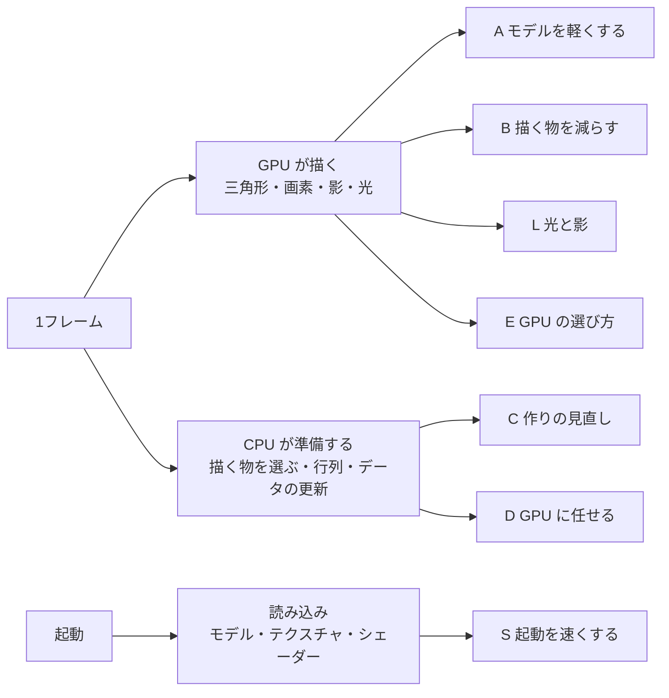

# 最適化の方法の設計

作成日: 2026-11-15
対象: ゲーム全体（描画・CPU の処理・起動）。それぞれの方法のコードは、各ページの「対象」にある
経緯: [最適化の方法の経緯](最適化の方法の経緯.md)

ゲームを軽くする方法を、種類ごとに一覧にしたページです。どの方法の仕組みがもうあるか、どれだけ効いたか、まだ試していない方法は何かを並べます。方法ごとの作りは、表のリンク先のページにあります。

- **推測で直さず、先に測る。** 何かを外して FPS を比べ、どこが重いかを決めてから方法を選ぶ（4. 使い方）。
- **1つの方法に1つの記号を付ける。** 種類の頭文字と番号で呼び、番号は付け直さない。新しい方法は続きの番号を付ける。
- 方法を足した・試したら、このページの表の「仕組み」と「効果」を直す。

**用語:**（GPU インスタンシング・BSP・DDS は[用語集](../../用語集.md#描画)にあります）

| 用語 | 何のことか |
|---|---|
| 簡略化 | 見た目をなるべく変えずに、三角形の数を減らすこと |
| LOD | Level of Detail。遠くの物ほど、三角形の少ないモデルに差し替えること |
| 頂点を速く読める順に並べる（A3） | 三角形が使う頂点の並びを、GPU が最近読んだ頂点を使い回しやすい順にすること。同じ頂点を何度も読み直すのが減る |
| ビルボード | 常にカメラの方を向く、1枚の板に絵を貼ったもの。遠くの物を、これ1枚で代わりに描く |
| 視錐台 | カメラに映る範囲の形（四角錐の先を切った形）。この外にある物は、画面に出ない |
| 部品 | モデルの中の、1回の描画命令で描くひとまとまり。部品が多いと、描く回数が増える |
| 専用の GPU・CPU 内蔵の GPU | 専用の GPU は、専用のビデオメモリを持つ速い GPU。CPU 内蔵の GPU は、CPU のチップの中に入っていて、専用のビデオメモリがほぼない遅い GPU |
| 点の光 | 1点から全方向に広がる光（ポイントライト）。エンジンでは `MAX_POINT_LIGHT`（256）個まで置ける。ボス戦の広間では 89 個 |
| ボリュームスポットライト | スポットライトの光が通る所に、光の筋のモデル（`VolumeSpotLight.tkm`）を重ねて描き、光の筋を見せるもの |
| 影を落とす物 | 影の元になる物。影の画像（シャドウマップ。光から見た奥行きの画像）を作るとき、その物も描くので、減らすと描く数が減る |
| シェーダーのコンパイル | シェーダーのソースを、GPU が実行できる形に変えること。今は起動のたびにしている |
| D3D12 のデバッグレイヤー | DirectX 12 の使い方のまちがいを調べて知らせる機能。動かしている間は、遅くなる |

---

## 1. 全体像

1フレームの重さは、大きく次の4つに分かれます。どれが重いかで、効く方法が変わります。

| 記号 | 種類 | 何を減らすか |
|---|---|---|
| A | モデルを軽くする | 1つのモデルの三角形・頂点・テクスチャ |
| B | 描く物を減らす | そのフレームで描くモデルの数 |
| C | 作りの見直し | CPU が毎フレームする計算 |
| D | GPU に任せる | CPU が描く物を選ぶ・命令を出す手間 |
| E | GPU の選び方 | 遅い GPU で描いてしまうこと |
| L | 光と影 | 光の数・影を描く回数・画面全体の効果 |
| S | 起動を速くする | 起動のときの読み込みと計算 |

## 2. 方法の一覧

記号は A・B・C・D・E・L・S ごとに表にしています。番号が飛んでいるところ（A4・B2）は欠番です（5章）。

「仕組み」の欄は次のどれかです。**ある**は、main にコードがある。**消した**は、一度作ったが使わなくなって消した（コードは git の履歴にある）。**まだ**は、作っていない。効果は、この PC（RX 9070 XT）・Release・ボス戦の広間で測った値です。

### A モデルを軽くする

| 記号 | 方法 | 仕組み | 効果 | ページ |
|---|---|---|---|---|
| A1 | 三角形を減らす（簡略化） | 消した（草原と一緒に） | 広間は Blender で減らした。BossHall の三角形 約 62 万 → 約 34 万で、約 164 → 約 238 FPS（1フレーム 6.10 → 4.21ms） | [ボス戦の広間の軽量化の経緯](../ステージ/ボス戦の広間の軽量化/ボス戦の広間の軽量化の経緯.md) |
| A2 | 距離で細かさを変える（LOD） | 消した（草原と一緒に） | ― | ― |
| A3 | 頂点を GPU が速く読める順に並べる | 消した（草原と一緒に） | ― | ― |
| A5 | 遠くの物を板（ビルボード）にする | まだ | ― | ― |
| A6 | テクスチャを縮める | ある | 広間の [DDS](../../用語集.md#描画) 163MB → 46MB。起動の時間はほぼ変わらず | [ボス戦の広間のテクスチャの経緯](../ステージ/ボス戦の広間のテクスチャ/ボス戦の広間のテクスチャの経緯.md) |

### B 描く物を減らす

| 記号 | 方法 | 仕組み | 効果 | ページ |
|---|---|---|---|---|
| B1 | 画面に入らない物を描かない（視錐台） | 消した（草原と一緒に） | ― | ― |
| B3 | 影に描く物を近くに絞る | まだ | ― | ― |
| B4 | 画面で小さく見える物を描かない | 消した（草原と一緒に） | ― | ― |
| B5 | 壁や柱に隠れた物を描かない | まだ | ― | ― |
| B6 | 1つにまとまったモデルを部品に分け、B1・A2 を効かせる | まだ | ― | ― |

### C 作りの見直し（CPU）

| 記号 | 方法 | 仕組み | 効果 | ページ |
|---|---|---|---|---|
| C1 | 地面をマスに分け、遠い・画面の外のマスを中を見ずに飛ばす | 消した（草原と一緒に） | ― | ― |
| C2 | 動かない物の行列を最初に1回だけ計算する | ある | 広間ではまだ使っていない | [インスタンス描画の設計](../描画/インスタンス描画/インスタンス描画の設計.md) |
| C3 | [幾何学データ](../../用語集.md#描画)の更新を、影を落とす・描いた番号だけにする | ある | 同上 | 同上 |
| C4 | 同じモデルをまとめて1回で描く（[GPU インスタンシング](../../用語集.md#描画)） | ある | 同上 | 同上 |

### D GPU に任せる

| 記号 | 方法 | 仕組み | 効果 | ページ |
|---|---|---|---|---|
| D1 | 描く物を GPU で選ぶ | まだ | ― | ― |
| D2 | 種類の違う物も GPU でまとめて描く | まだ | ― | ― |

### E GPU の選び方

| 記号 | 方法 | 仕組み | 効果 | ページ |
|---|---|---|---|---|
| E1 | GPU が複数あるとき、専用の GPU で描く | ある | 約 30 → 約 470〜490 FPS | [GPUの選び方の設計](../描画/GPUの選び方/GPUの選び方の設計.md) |

### L 光と影

| 記号 | 方法 | 仕組み | 効果 | ページ |
|---|---|---|---|---|
| L1 | 点の光の数を減らす | まだ | 広間の約 90 個を全部消しても +2 FPS（168 → 170） | [最適化の方法の経緯](最適化の方法の経緯.md) |
| L2 | 光の筋（ボリュームスポットライト）を減らす | まだ | 広間の 5 本を全部消して +9 FPS（168 → 177） | 同上 |
| L3 | 影を落とす物を減らす | まだ | 広間の影を全部消して +15 FPS（168 → 183） | 同上 |

### S 起動を速くする

| 記号 | 方法 | 仕組み | 効果 | ページ |
|---|---|---|---|---|
| S1 | [BSP](../../用語集.md#描画) の探索の空のループ・コピーをなくす | ある | Debug の起動が約 6 秒に | [法線スムージングとBSPの設計](../../エンジン/法線スムージングとBSP/法線スムージングとBSPの設計.md) |
| S2 | FBX から変換するとき、重なった頂点をまとめる | ある | S1 と合わせて | [起動時のモデルロード高速化の経緯](../起動/起動時のモデルロード高速化/起動時のモデルロード高速化の経緯.md) |
| S3 | シェーダーを起動のたびにコンパイルしない | まだ | ― | 同上（残っている起動コスト） |

## 3. 方法ごとのコードの置き場所

このページは一覧なので、README の「実装方法」の章にあたるものは、方法ごとのページに分かれています。次の表で、コードの場所とくわしい書き方のページを示します。

| 記号 | どこに書いたか | どう書いたか（くわしくは） |
|---|---|---|
| C2・C3・C4 | [ModelRender.cpp](../../../k2Engine/graphics/ModelRender.cpp) | `UpdateInstancingData(番号, 行列)` で計算済みの行列を渡す。`IsGeometryDataActive(番号)` で要らない番号の更新を飛ばす（[インスタンス描画の設計](../描画/インスタンス描画/インスタンス描画の設計.md)） |
| E1 | [GraphicsEngine.cpp](../../../k2EngineLow/graphics/GraphicsEngine.cpp) | 同じメーカーの GPU が複数あれば、ビデオメモリが多い方を選ぶ（[GPUの選び方の設計](../描画/GPUの選び方/GPUの選び方の設計.md)） |
| S1・S2 | [BSP.cpp](../../../k2EngineLow/geometry/BSP.cpp)・FBX のインポーター | 探索の空のループを消し、引数を参照にする。重なった頂点を1つにする（[法線スムージングとBSPの設計](../../エンジン/法線スムージングとBSP/法線スムージングとBSPの設計.md)・[起動時のモデルロード高速化の経緯](../起動/起動時のモデルロード高速化/起動時のモデルロード高速化の経緯.md)） |

**名前:**

| ジャンル | 名前 | 何のためのもの | 何をするためのもの | どこから来たもの |
|---|---|---|---|---|
| 関数 | `UpdateInstancingData()` | 描く物の位置を、インスタンスごとに渡すため | 番号と、計算済みのワールド行列（`Matrix`）を受け取る。位置・回転・拡大で渡す書き方もある | k2Engine（エンジン）の [ModelRender.h](../../../k2Engine/graphics/ModelRender.h) |
| 関数 | `IsGeometryDataActive()` | 幾何学データの更新が要る番号かを調べるため | GPU インスタンシングで影を落とさない物や、このフレームに渡していない番号なら false を返す | k2Engine（エンジン）の [ModelRender.h](../../../k2Engine/graphics/ModelRender.h) |

## 4. 使い方

FPS が下がったとき、または軽くしたいときの進め方です。

1. **ほかのゲームを止める。** ほかの作業用フォルダの `Game.exe` が動いていると、GPU を取られて FPS が半分ほどになる。
2. **Release で、同じ画面になるようにして測る。** Debug は最適化がなく、D3D12 のデバッグレイヤーも動くので、遅く出る。測る版（作業用フォルダだけ）では次のようにする。
   - 入力を読まないようにする。ゲームはほかのアプリを使っているときもキーとコントローラーを読むので、そのままだとプレイヤーが動き、魔法を撃ち、画面が毎回変わる。
   - 敵を遠くに置く。敵の攻撃でカメラの向きが変わるため。
   - FPS をファイルに書き出し、読み込みが終わったあとの約 30 秒の平均を取る。窓を撮って右上の FPS を読む方法は、FPS が高いと灰色の画面しか撮れないことが多い。
   - 比べるものを交互に何回か起動する（前・後・前・後…）。

3. **1つずつ外して比べる。** モデル・光・影などを1つずつ描かないようにして FPS を比べ、上がり幅がいちばん大きい物を探す。
4. **重い物の中身を見る。** モデルなら、三角形の数・部品の数・画面の外の物も描いているか。
5. **1. 全体像で種類を決め、2. の表から方法を選ぶ。** 方法を使ったら、表の「仕組み」と「効果」を直し、測った結果を経緯に書く。

## 5. 決めたこと

- 記号の番号は付け直さない。ほかのページの経緯にその記号で書いてあるため。使わなくなった方法を消したところ（A4・B2）は、番号を空けたままにする。
- 効果は FPS だけでなく、できるだけ 1フレームの時間（ms）でも書く。FPS が高いときは、同じ 1ms でも FPS の差が大きく見えるため。

## 6. 既知の課題

- **ボス戦の広間は、画面の外や遠くの部品も全部描いている。** 三角形を約 62 万から約 34 万に減らして（A1）、約 164 → 約 238 FPS になった（[最適化の方法の経緯](最適化の方法の経緯.md)）。ただ、広間のモデル（`BossHall.tkm`）は今も 84 個の部品が1つにまとまっていて、毎フレーム全部を描いている。次は B6（部品に分けて視錐台・LOD を効かせる）が候補。
- エフェクトを出すと重くなる（[やりたいこと](../../やりたいこと.md) の 12）。どの段階で重いかはまだ測っていない。

## 7. 関連するページ

- [インスタンス描画の設計](../描画/インスタンス描画/インスタンス描画の設計.md): C2〜C4
- [GPUの選び方の設計](../描画/GPUの選び方/GPUの選び方の設計.md): E1
- [フレームレートの設計](../描画/フレームレート/フレームレートの設計.md): FPS の上限（今は無制限）
- [FPSの表示の設計](../../ゲーム/UI/FPSの表示/FPSの表示の設計.md): 右上の FPS の数え方
