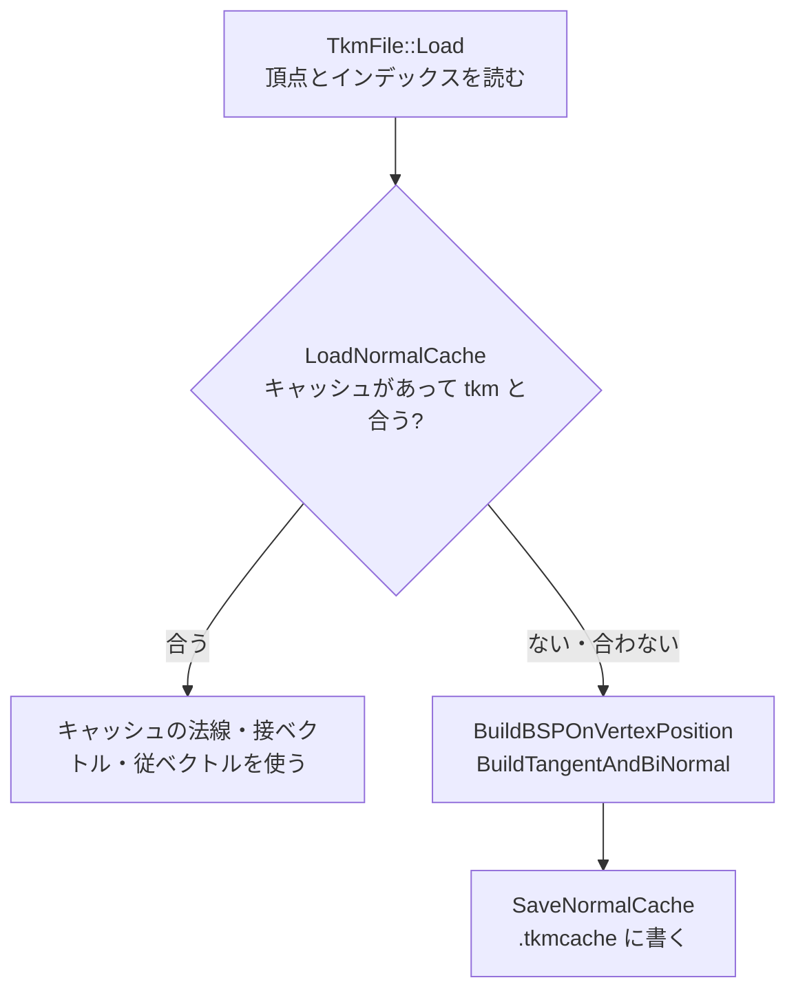

# 法線のキャッシュの設計

作成日: 2026-11-15
対象: [TkmFile.cpp](../../../../k2EngineLow/tkFile/TkmFile.cpp) の `LoadNormalCache()`・`SaveNormalCache()`
経緯: [起動時のモデルロード高速化の経緯](../起動時のモデルロード高速化/起動時のモデルロード高速化の経緯.md)
手順: [法線のキャッシュの手順](法線のキャッシュの手順.md)

tkm を読み込むときに計算する法線・接ベクトル・従ベクトルを、tkm の隣のファイル（`.tkmcache`）に書いておき、次の起動からはそれを読んで計算を省く仕組みのページです。法線の計算そのものは [法線スムージングとBSPの設計](../../../エンジン/法線スムージングとBSP/法線スムージングとBSPの設計.md) にあります。

- **計算は、その tkm で初めて読み込むときの1回だけにする。** 2回目からはキャッシュを読む。
- **tkm が変わったら、キャッシュは使わずに計算し直す。** tkm の大きさと更新日時で見分ける。
- **キャッシュは git に入れない。** どの PC でも、最初の起動で作られる。

---

## 1. 全体像



ボス戦の広間（頂点 99万個）では、BSP 作りと法線のスムージングに Debug ビルドで約7秒かかっていました。キャッシュを読むのは 0.02秒です。

---

## 2. キャッシュのファイル

`xxx.tkm` の隣に `xxx.tkmcache` を作ります。中身は、ヘッダーのあとに、全メッシュの全頂点の値を tkm と同じ順に並べたものです。

| 場所 | 中身 |
|---|---|
| ヘッダー | `"TKMC"`、版、作ったときの tkm の大きさ、tkm の更新日時、頂点の数 |
| 頂点ごと（float 9個） | 法線の xyz、接ベクトルの xyz、従ベクトルの xyz |

次の全部が合うときだけ使います。1つでも合わなければ、計算し直してキャッシュを書き直します。

- 先頭が `"TKMC"` で、版が `NORMAL_CACHE_VERSION` と同じ
- tkm の大きさと更新日時が、キャッシュを作ったときと同じ
- 頂点の数が、今読んだ tkm と同じ
- 頂点の値を最後まで読める（途中で切れていない）

---

## 3. 実装方法

### 読み込みの流れ：計算の前にキャッシュを試す

```cpp
// TkmFile::Load() の、頂点とインデックスを読み終えたあと
if (!LoadNormalCache(filePath)) {
    BuildBSPOnVertexPosition();   // 全頂点の座標で BSP を作る
    BuildTangentAndBiNormal();    // 法線のスムージングと、接ベクトル・従ベクトル
    SaveNormalCache(filePath);
}
```

BSP は法線のスムージングにしか使わないので、キャッシュを使うときは作りません。そのため、頂点を読むループの中で BSP に点を足していた所を、`BuildBSPOnVertexPosition()` に分けました。

### tkm を見分ける：大きさと更新日時

```cpp
WIN32_FILE_ATTRIBUTE_DATA data;
GetFileAttributesExA(tkmFilePath, GetFileExInfoStandard, &data);
fileSize  = (uint64_t(data.nFileSizeHigh) << 32) | data.nFileSizeLow;
writeTime = (uint64_t(data.ftLastWriteTime.dwHighDateTime) << 32) | data.ftLastWriteTime.dwLowDateTime;
```

中身のハッシュは取りません。ボス戦の広間の tkm は 36MB あり、毎回ハッシュを取ると、それだけで時間がかかるためです。

### 書き方：1回でまとめて読み書きする

頂点の値は `std::vector<float>` に並べて、`fread`・`fwrite` を1回ずつ呼びます。ヘッダーを先に書くので、途中で書けなくなったファイルは、頂点の値が足りずに読めない（使われない）だけです。書けなくてもエラーにはせず、次の起動でまた計算します。

---

## 4. 使い方

### 法線・接ベクトル・従ベクトルの計算の仕方を変えたとき

[TkmFile.cpp](../../../../k2EngineLow/tkFile/TkmFile.cpp) の `NORMAL_CACHE_VERSION` を1つ上げてください。上げないと、tkm が変わっていない限り、古いキャッシュ（前の計算の結果）が使われ続けます。

### キャッシュを消したいとき

`.tkmcache` は消してかまいません。次の起動で作り直されます。

---

## 5. 決めたこと

| 決めたこと | 理由 |
|---|---|
| tkm の中に書かず、別のファイルにする | tkm の形式を変えると、tkm を作る道具（3dsMax・FBX インポーター）と読むところを全部直すことになる |
| git に入れない（`.gitignore` に `*.tkmcache`） | 大きい（ボス戦の広間で 36MB）。`git pull` や checkout で tkm の更新日時が変わると、どうせ作り直しになる |
| 法線だけでなく、接ベクトル・従ベクトルも入れる | どれも法線のスムージングのあとに計算するので、法線だけ入れても計算は省けない |

---

## 6. 既知の課題

- **tkm を変えた（`git pull` した）あとの最初の起動は速くならない。** そのときに計算して、キャッシュを作り直す。
- 計算し直した値とキャッシュの値は、ビット単位で同じになることを確かめてある（[起動時のモデルロード高速化の経緯](../起動時のモデルロード高速化/起動時のモデルロード高速化の経緯.md)）。

---

## 7. 関連するページ

- [法線スムージングとBSPの設計](../../../エンジン/法線スムージングとBSP/法線スムージングとBSPの設計.md): キャッシュに入れる値の計算の仕方
- [モデル読み込みの設計](../../../エンジン/モデル読み込み/モデル読み込みの設計.md): tkm を読み込むまでの流れと tkm バンク
