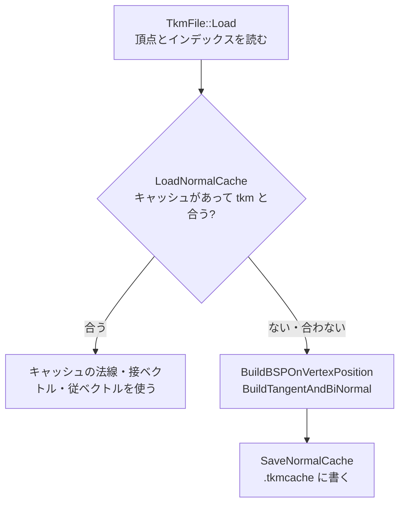

# 法線のキャッシュの設計

作成日: 2026-11-15
対象: [TkmFile.cpp](../../../../k2EngineLow/tkFile/TkmFile.cpp) の `LoadNormalCache()`・`SaveNormalCache()`
経緯: [起動時のモデルロード高速化の経緯](../起動時のモデルロード高速化/起動時のモデルロード高速化の経緯.md)
手順: [法線のキャッシュの手順](法線のキャッシュの手順.md)

tkm を読み込むときに計算する法線・接ベクトル・従ベクトルを、tkm の隣のファイル（`.tkmcache`）に書いておき、次の起動からはそれを読んで計算を省く仕組みのページです。法線の計算そのものは [法線スムージングとBSPの設計](../../../エンジン/法線スムージングとBSP/法線スムージングとBSPの設計.md) にあります。

- **計算は、その tkm で初めて読み込むときの1回だけにする。** 2回目からはキャッシュを読む。
- **tkm が変わったら、キャッシュは使わずに計算し直す。** tkm の大きさと更新日時で見分ける。
- **キャッシュは git に入れない。** どの PC でも、最初の起動で作られる。

**用語:**

| 用語 | 何のことか |
|---|---|
| 法線 | 面や頂点が向いている方向（長さ 1 の `Vector3`）。光の当たり方の計算に使う |
| 接ベクトル・従ベクトル | 法線に直角で、お互いにも直角な2つの向き。テクスチャの縦と横の向きを表し、ノーマルマップの計算に使う |
| `.tkmcache` | このプロジェクトで足した、計算し直した法線などを保存しておくファイル。`.tkm` の隣に作る |
| キャッシュ | 一度計算した結果を取っておき、次からは計算せずに使い回すこと |

---

## 1. 全体像



ボス戦の広間（頂点 99万個）では、BSP 作りと法線のスムージングに Debug ビルドで約7秒かかっていました。キャッシュを読むのは 0.02秒です。

**用語:**

| 用語 | 何のことか |
|---|---|
| BSP | 空間を平面で2つに分けることを繰り返して作る木。同じ座標の頂点を、全部調べずに探せる（[法線スムージングとBSPの設計](../../../エンジン/法線スムージングとBSP/法線スムージングとBSPの設計.md)） |
| Debug | ビルドの種類の1つ。最適化がなく、確認用のコードが入るので遅い |

---

## 2. キャッシュのファイル

`xxx.tkm` の隣に `xxx.tkmcache` を作ります。中身は、ヘッダーのあとに、全メッシュの全頂点の値を tkm と同じ順に並べたものです。

| 場所 | 中身 |
|---|---|
| ヘッダー | `"TKMC"`、版、作ったときの tkm の大きさ、tkm の更新日時、頂点の数 |
| 頂点ごと（float 9個） | 法線の xyz、接ベクトルの xyz、従ベクトルの xyz |

次の全部が合うときだけ使います。1つでも合わなければ、計算し直してキャッシュを書き直します。

- 先頭が `"TKMC"` で、版が `NORMAL_CACHE_VERSION` と同じ
- tkm の大きさと更新日時が、キャッシュを作ったときと同じ
- 頂点の数が、今読んだ tkm と同じ
- 頂点の値を最後まで読める（途中で切れていない）

**名前:**

| ジャンル | 名前 | 何のためのもの | 何をするためのもの | どこから来たもの |
|---|---|---|---|---|
| 値 | `"TKMC"` | キャッシュのファイルだと見分けるため | ファイルの先頭に入れる4文字の目印 | k2EngineLow（エンジン）の [TkmFile.cpp](../../../../k2EngineLow/tkFile/TkmFile.cpp) の `SNormalCacheHeader` の `magic` |
| 変数 | `NORMAL_CACHE_VERSION` | 計算の仕方を変えたときに、古いキャッシュを使わないようにするため | キャッシュの形式の版の番号（`uint32_t`、今は 1）。ヘッダーの版と同じときだけ使う | k2EngineLow（エンジン）の [TkmFile.cpp](../../../../k2EngineLow/tkFile/TkmFile.cpp) |

---

## 3. 実装方法

### 読み込みの流れ：計算の前にキャッシュを試す

```cpp
// TkmFile::Load() の、頂点とインデックスを読み終えたあと
if (!LoadNormalCache(filePath)) {
    BuildBSPOnVertexPosition();   // 全頂点の座標で BSP を作る
    BuildTangentAndBiNormal();    // 法線のスムージングと、接ベクトル・従ベクトル
    SaveNormalCache(filePath);
}
```

**名前:**

| ジャンル | 名前 | 何のためのもの | 何をするためのもの | どこから来たもの |
|---|---|---|---|---|
| 関数 | `LoadNormalCache()` | 前に計算した法線などを、キャッシュから読むため | キャッシュがあり、tkm と合っていて、全部読めたら読んで true を返す。そうでなければ false | k2EngineLow（エンジン）の [TkmFile.h](../../../../k2EngineLow/tkFile/TkmFile.h) の `TkmFile` クラス |
| 関数 | `BuildBSPOnVertexPosition()` | 全頂点の座標で BSP を作るため | 全頂点の座標を BSP の点として足し、木を作る。キャッシュを使うときは呼ばない | k2EngineLow（エンジン）の [TkmFile.h](../../../../k2EngineLow/tkFile/TkmFile.h) の `TkmFile` クラス |
| 関数 | `BuildTangentAndBiNormal()` | 法線をなめらかにし、接ベクトル・従ベクトルを求めるため | 同じ座標の頂点どうしで法線を平均して書き戻し、接ベクトルと従ベクトルを計算する | k2EngineLow（エンジン）の [TkmFile.h](../../../../k2EngineLow/tkFile/TkmFile.h) の `TkmFile` クラス |
| 関数 | `SaveNormalCache()` | 計算した法線などを、次の起動で使えるようにするため | 法線・接ベクトル・従ベクトルを `.tkmcache` に書く | k2EngineLow（エンジン）の [TkmFile.h](../../../../k2EngineLow/tkFile/TkmFile.h) の `TkmFile` クラス |
| 変数 | `filePath` | 読む tkm のパスを渡すため | tkm のファイルのパス。キャッシュは、これの隣の `.tkmcache` | k2EngineLow（エンジン）の [TkmFile.cpp](../../../../k2EngineLow/tkFile/TkmFile.cpp)（`TkmFile::Load()` の引数） |

BSP は法線のスムージングにしか使わないので、キャッシュを使うときは作りません。そのため、頂点を読むループの中で BSP に点を足していた所を、`BuildBSPOnVertexPosition()` に分けました。

### tkm を見分ける：大きさと更新日時

```cpp
WIN32_FILE_ATTRIBUTE_DATA data;
GetFileAttributesExA(tkmFilePath, GetFileExInfoStandard, &data);
fileSize  = (uint64_t(data.nFileSizeHigh) << 32) | data.nFileSizeLow;
writeTime = (uint64_t(data.ftLastWriteTime.dwHighDateTime) << 32) | data.ftLastWriteTime.dwLowDateTime;
```

**名前:**

| ジャンル | 名前 | 何のためのもの | 何をするためのもの | どこから来たもの |
|---|---|---|---|---|
| 関数 | `GetTkmFileStamp()` | tkm が変わったかを見分けるための値を取るため | tkm の大きさと更新日時を、引数で渡した変数に入れる。取れなければ false | k2EngineLow（エンジン）の [TkmFile.cpp](../../../../k2EngineLow/tkFile/TkmFile.cpp)（名前のない `namespace` の中） |
| 型 | `WIN32_FILE_ATTRIBUTE_DATA` | ファイルの大きさや更新日時を受け取るため | ファイルの情報を入れる構造体 | Windows の API（<windows.h>） |
| 変数 | `data` | ファイルの情報を受け取るため | `GetFileAttributesExA()` が書き込む `WIN32_FILE_ATTRIBUTE_DATA` | k2EngineLow（エンジン）の [TkmFile.cpp](../../../../k2EngineLow/tkFile/TkmFile.cpp) の `GetTkmFileStamp()` |
| 関数 | `GetFileAttributesExA()` | ファイルを開かずに、大きさと更新日時を調べるため | パスを渡すと、ファイルの情報を `data` に入れる。成功すると true を返す | Windows の API（<windows.h>） |
| 引数 | `tkmFilePath` | 調べる tkm を指定するため | tkm のファイルのパス（文字列） | k2EngineLow（エンジン）の [TkmFile.cpp](../../../../k2EngineLow/tkFile/TkmFile.cpp)（`GetTkmFileStamp()` の引数） |
| 値 | `GetFileExInfoStandard` | 取る情報の種類を指定するため | 大きさ・更新日時などの標準の情報を取る指定 | Windows の API（<windows.h>） |
| 引数 | `fileSize`・`writeTime` | 見分けるための値を、呼んだ側へ返すため | 参照で受け取り、tkm の大きさと更新日時を入れる（`uint64_t&`） | k2EngineLow（エンジン）の [TkmFile.cpp](../../../../k2EngineLow/tkFile/TkmFile.cpp)（`GetTkmFileStamp()` の引数） |
| 型 | `uint64_t` | 32ビットを2つ合わせた値を持つため | 符号なしの 64ビットの整数 | C++ の標準ライブラリ（<cstdint>） |
| メンバー変数 | `nFileSizeHigh`・`nFileSizeLow` | 大きさを2つの値に分けて受け取るため | ファイルの大きさの上位32ビットと下位32ビット | Windows の API（<windows.h>）の `WIN32_FILE_ATTRIBUTE_DATA` |
| メンバー変数 | `ftLastWriteTime` | 更新日時を受け取るため | 最後に書いた日時（`FILETIME`）。`dwHighDateTime`（上位32ビット）と `dwLowDateTime`（下位32ビット）を持つ | Windows の API（<windows.h>）の `WIN32_FILE_ATTRIBUTE_DATA` |
| C++ の書き方 | `(上位 << 32) \| 下位` | 2つの32ビットを、1つの64ビットにするため | 上位を左に32ビットずらしてから、下位と OR（`\|`）で合わせる | C++ の書き方 |

中身のハッシュは取りません。ボス戦の広間の tkm は 36MB あり、毎回ハッシュを取ると、それだけで時間がかかるためです。

**用語:**

| 用語 | 何のことか |
|---|---|
| ハッシュ | ファイルの中身全部から計算する、短い数。中身が1つでも変わると、別の数になるので、変わったかの確認に使える |

### 書き方：1回でまとめて読み書きする

頂点の値は `std::vector<float>` に並べて、`fread`・`fwrite` を1回ずつ呼びます。ヘッダーを先に書くので、途中で書けなくなったファイルは、頂点の値が足りずに読めない（使われない）だけです。書けなくてもエラーにはせず、次の起動でまた計算します。

**名前:**

| ジャンル | 名前 | 何のためのもの | 何をするためのもの | どこから来たもの |
|---|---|---|---|---|
| 関数 | `fread()` | ファイルから、まとめて読むため | 指定した大きさの塊を、指定した個数だけ、ファイルから読み込む。読めた個数を返す | C の標準ライブラリ（<stdio.h>。[k2EngineLowPreCompile.h](../../../../k2EngineLow/k2EngineLowPreCompile.h) で読み込み済み） |
| 関数 | `fwrite()` | ファイルへ、まとめて書くため | 指定した大きさの塊を、指定した個数だけ、ファイルに書き込む | C の標準ライブラリ（<stdio.h>。[k2EngineLowPreCompile.h](../../../../k2EngineLow/k2EngineLowPreCompile.h) で読み込み済み） |

---

## 4. 使い方

### 法線・接ベクトル・従ベクトルの計算の仕方を変えたとき

[TkmFile.cpp](../../../../k2EngineLow/tkFile/TkmFile.cpp) の `NORMAL_CACHE_VERSION` を1つ上げてください。上げないと、tkm が変わっていない限り、古いキャッシュ（前の計算の結果）が使われ続けます。

### キャッシュを消したいとき

`.tkmcache` は消してかまいません。次の起動で作り直されます。

---

## 5. 決めたこと

| 決めたこと | 理由 |
|---|---|
| tkm の中に書かず、別のファイルにする | tkm の形式を変えると、tkm を作る道具（3dsMax・FBX インポーター）と読むところを全部直すことになる |
| git に入れない（`.gitignore` に `*.tkmcache`） | 大きい（ボス戦の広間で 36MB）。`git pull` や checkout で tkm の更新日時が変わると、どうせ作り直しになる |
| 法線だけでなく、接ベクトル・従ベクトルも入れる | どれも法線のスムージングのあとに計算するので、法線だけ入れても計算は省けない |

**用語:**

| 用語 | 何のことか |
|---|---|
| FBX インポーター | FBX（3D モデルのファイルの形式）を読んで、tkm に変換する部品。ここでは `FbxRuntimeImporter` |
| `.gitignore` | git に入れないファイルを書いておくファイル。`*.tkmcache` と書くと、`.tkmcache` が全部入らなくなる |

---

## 6. 既知の課題

- **tkm を変えた（`git pull` した）あとの最初の起動は速くならない。** そのときに計算して、キャッシュを作り直す。
- 計算し直した値とキャッシュの値は、ビット単位で同じになることを確かめてある（[起動時のモデルロード高速化の経緯](../起動時のモデルロード高速化/起動時のモデルロード高速化の経緯.md)）。

---

## 7. 関連するページ

- [法線スムージングとBSPの設計](../../../エンジン/法線スムージングとBSP/法線スムージングとBSPの設計.md): キャッシュに入れる値の計算の仕方
- [モデル読み込みの設計](../../../エンジン/モデル読み込み/モデル読み込みの設計.md): tkm を読み込むまでの流れと tkm バンク
