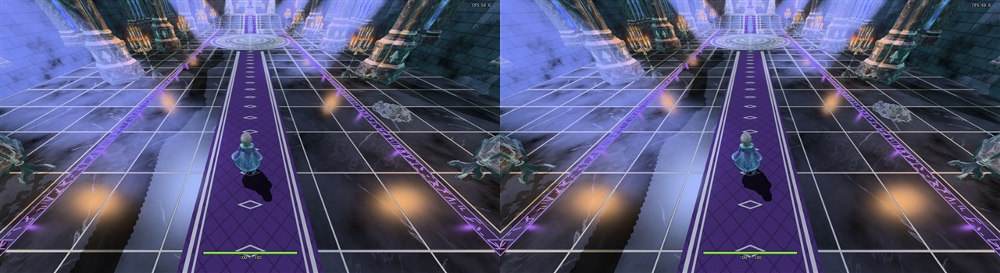
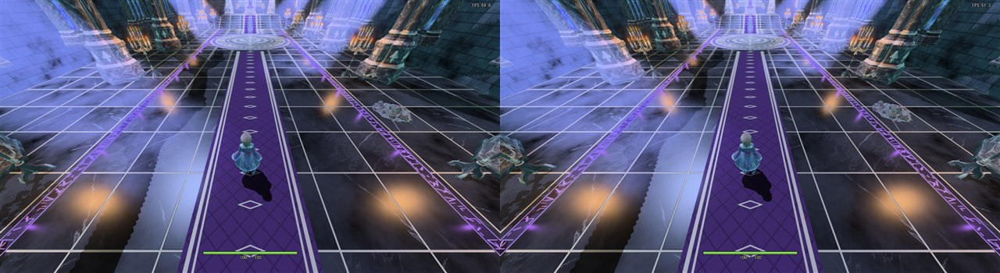

# 起動時のモデルロード高速化の経緯

設計: [モデル読み込みの設計](../../../エンジン/モデル読み込み/モデル読み込みの設計.md)、[法線スムージングとBSPの設計](../../../エンジン/法線スムージングとBSP/法線スムージングとBSPの設計.md)
作成日: 2026-11-05（2026-11-06 に設計の6章から移動）
関連コミット: `31fbca03 <Loading>起動時のモデルロードを高速化(BSP探索の空ループ削除・FBX変換時の重複頂点統合)`

Debug ビルドで起動が非常に遅かったので、原因を調べて直したときの記録です。今の仕組みは設計書を見てください。

---

## 原因

1. **BSP の探索に空ループがあった。**
   `WalkTree()` の中に、ノードが持つ全頂点を回す、中身の無いループがありました。各 `SNode` は、このためだけに担当する全頂点のコピー（`leafArray`）を持っていました。
   Release ビルドではコンパイラが消しますが、Debug ビルドではそのまま実行されます。1回の探索が O(N)、スムージング全体が O(N²) になっていました。
   このコードはプロジェクトの最初のコミット（`b5a75a7b`）から、取り込んだエンジンに含まれていたものです。デバッグ用の名残と思われます。
2. **FBX インポーターが頂点をまとめていなかった。**
   SK_Player の頂点数が 124,521 個に膨らんでいました。N² で効くので、元の数千頂点のモデル（unityChan: 7,734 頂点）とは桁違いに遅くなっていました。

## 対応

- 空ループと `SNode::leafArray` を削除し、`WalkTree()` の引数を const 参照にした（設計書 6.4・7章）。
- FBX インポーターで頂点をまとめるようにし、SK_Player.tkm を作り直した（設計書 3章・6.1）。

## 結果

Debug ビルドで起動して、約6秒でゲーム画面が出ることを確認しました（3秒時点では白い画面、6秒時点で 60FPS で動作）。修正前の時間は測っていません。

## 残っている起動コスト

最初の数秒（白い画面の間）は、主に**シェーダーの実行時コンパイル**だと考えています。
`Shader::Load()` は起動のたびに `D3DCompileFromFile` でコンパイルしています。`K2_DEBUG` が定義されていると最適化なし（`D3DCOMPILE_SKIP_OPTIMIZATION`）になります（[Shader.cpp](../../../../k2EngineLow/graphics/Shader.cpp)）。
さらに速くしたいときは、コンパイル結果をキャッシュする方法が候補になります。

---

## 2026-11-08 BSP の手順書を書いた

BSP の探索を速くした変更（#19 の BSP の部分）を、[法線スムージングとBSPの手順](../../../エンジン/法線スムージングとBSP/法線スムージングとBSPの手順.md) にした。#19 の `BSP.cpp` の2つ目の塊には、空のループを消す所と、引数を参照にする所が入っているので、手順1と手順3に分けた。

どう確かめたか: 作業用フォルダーで手順書の diff を逆に当てると、`BSP.h`・`BSP.cpp` は #19 の前のコミットと同じになった。そこから手順1〜3を1つずつ当て、そのたびに Game.sln を Debug x64 でビルドして、すべて通った。最後は main と差がなくなった。起動の時間は測っていない。

---

## 2026-11-15 起動の内訳を測り、同じ tkm を2回読み込んでいたのを直した

### 1. 現状の問題

ボス戦の広間ができてから、Debug ビルドで起動して窓が出るまで **約29秒**かかるようになった。テクスチャを縮めても変わらなかった（[ボス戦の広間のテクスチャの経緯](../../ステージ/ボス戦の広間のテクスチャ/ボス戦の広間のテクスチャの経緯.md)）。

どこに時間がかかっているかを、プロセスが始まってからの秒でログに出して測った（測るためのコードは作業用フォルダだけに入れ、main には入れていない）。

| 段階 | かかった時間 |
|---|---|
| `wWinMain` に入るまで（exe と DLL の読み込み） | 1.2秒 |
| エンジンの初期化（うちシェーダーのコンパイル約1.5秒） | 3.2秒 |
| **BossHall.tkm の1回目**（読み込み 0.5秒・BSP 2.9秒・法線と接ベクトル 4.1秒） | **7.5秒** |
| **BossHall.tkm の2回目**（中身は1回目と同じ） | **7.8秒** |
| BossHall の GPU 用バッファ作りなど | 約3.4秒 |
| プレイヤー・黒騎士・空などのモデルとアニメーション | 約6秒 |

BossHall.tkm の頂点は 997,185個で、プレイヤー（28,493個）の35倍ある。そのうえ、**どのモデルも tkm を2回読み込んでいた。**

### 2. ソースコードの問題箇所

`ModelRender::Init()` は、同じ tkm を2か所で読み込む。

- `Model::Init()`（[Model.cpp](../../../../k2EngineLow/graphics/Model.cpp)）: tkm バンクを通すので、2回目からは使い回す。
- `ComputeAnimationVertexBuffer::Init()`（[ComputeAnimationVertexBuffer.cpp](../../../../k2EngineLow/graphics/ComputeAnimationVertexBuffer.cpp)）: tkm バンクを通さず、自分のメンバーに読み込んでいた。

```cpp
// ComputeAnimationVertexBuffer::Init()
// tkmファイルをロード。
m_tkmFile.Load(tkmFilePath, false, false, false);   // ← tkm バンクを通らない
```

tkm を読み込むたびに BSP 作りと法線のスムージングをする（[法線スムージングとBSPの設計](../../../エンジン/法線スムージングとBSP/法線スムージングとBSPの設計.md)）ので、大きなモデルほど2回目がむだになる。

### 3. 直し方

`ComputeAnimationVertexBuffer` も、`Model` と同じく tkm バンクから tkm を取る。なければ読み込んでバンクに入れる。

- 先に呼ばれるのは `ComputeAnimationVertexBuffer` なので、ここで読むときもテクスチャまで読む（`Model::Init()` と同じ読み込み方）。あとで `Model` がそれを使う。
- メンバーは tkm そのものではなく、バンクの tkm を指すポインタにする。tkm はバンクが持ち続ける。

### 4. ソースコードの直し

```diff
-		TkmFile m_tkmFile;									// tkmファイル。
+		TkmFile* m_tkmFile = nullptr;						// tkmファイル（Model と同じく tkm バンクのものを使う）。
```

```diff
-		// tkmファイルをロード。
-		m_tkmFile.Load(tkmFilePath, false, false, false);
-		m_numMesh = m_tkmFile.GetNumMesh();
+		// tkmファイルは、Model と同じく tkm バンクから使う。
+		// ここで別に読み込むと、同じファイルの法線の計算などを2回することになり、起動が遅くなる。
+		m_tkmFile = g_engine->GetTkmFileFromBank(tkmFilePath);
+		if (m_tkmFile == nullptr) {
+			// 未登録。あとで Model が使うので、テクスチャも読み込んでおく（Model::Init と同じ読み込み方）。
+			m_tkmFile = new TkmFile;
+			m_tkmFile->Load(tkmFilePath, false);
+			g_engine->RegistTkmFileToBank(tkmFilePath, m_tkmFile);
+		}
+		m_numMesh = m_tkmFile->GetNumMesh();
 ...
-		m_tkmFile.QueryMeshParts([&](const TkmFile::SMesh& mesh) {
+		m_tkmFile->QueryMeshParts([&](const TkmFile::SMesh& mesh) {
```

直したあとは、BossHall.tkm の読み込みは1回だけになり、**窓が出るまで約29秒 → 約19秒**になった（3回測って 17.2・18.9・18.6秒）。

直す前（左）と直した後（右）。窓が出てから3秒後の画面。見た目は変わらない。



### 5. どう確かめたか

- 作業用フォルダ（git worktree）で Game.sln を Debug x64 でビルドし、通った。
- 時間は、測るためのログを入れた別の作業用フォルダで、この直しだけを入れて測った。ログでは、どの tkm も読み込みが1回だけになっていた。
- 画面は、ゲームを最小化・非アクティブで起動し、窓を透明（不透明度 1/255）・クリックを素通り・いちばん奥にしてから、アクティブにしないで元の大きさに戻し、`PrintWindow` で窓だけを撮った。撮ったらすぐに終了させた。
- 測っている間に、ゲームが終了コード -1 で終わることが何回かあった。これは、同じ時間に別の作業用フォルダでフレームレートを測っていた作業が、ほかの Game.exe を止めていたためだった（`Stop-Process` で止めると -1 になる）。ゲームが落ちたのではない。
- 手順書は [モデル読み込みの手順](../../../エンジン/モデル読み込み/モデル読み込みの手順.md) の手順10に書いた。手順のコードは、このブランチの直しと1文字ずつ同じであることを確かめた。

---

## 2026-11-15 法線の計算結果をキャッシュに書き、2回目の起動から使い回すようにした

### 1. 現状の問題

同じ tkm を2回読み込むのを直しても（上の項）、窓が出るまで約19秒かかった。そのうち約7秒は、BossHall.tkm（頂点 997,185個）の BSP 作り（約2.9秒）と、法線のスムージング・接ベクトル・従ベクトルの計算（約4.1秒）だった。

この計算は、tkm が同じなら毎回同じ結果になる。それを、起動のたびにやり直していた。

### 2. ソースコードの問題箇所

`TkmFile::Load()`（[TkmFile.cpp](../../../../k2EngineLow/tkFile/TkmFile.cpp)）は、tkm に入っている法線を捨て、読み込むたびに計算し直している。

```cpp
// 頂点データのBSPツリーを構築する。
m_bpsOnVertexPosition.Build();

// 接ベクトルと従ベクトルを構築する。
BuildTangentAndBiNormal();
```

BSP に点を足すのは、頂点を読むループの中（`m_bpsOnVertexPosition.AddLeaf(vertex.pos, &vertex.normal);`）だった。

### 3. 直し方

計算した法線・接ベクトル・従ベクトルを、tkm の隣の `xxx.tkmcache` に書いておく。次に読み込むとき、キャッシュがその tkm から作ったもの（大きさと更新日時が同じ）なら、計算せずにキャッシュを読む。仕組みは [法線のキャッシュの設計](../法線のキャッシュ/法線のキャッシュの設計.md) にある。

- キャッシュを使うときは BSP も要らないので、BSP に点を足す所を、ループの中から `BuildBSPOnVertexPosition()` に移した。
- tkm の形式は変えない（tkm を作る道具と読む所を全部直すことになるため）。
- キャッシュは git に入れない（`.gitignore` に `*.tkmcache`）。

### 4. ソースコードの直し

```diff
-		// 頂点データのBSPツリーを構築する。
-		m_bpsOnVertexPosition.Build();
-
-		// 接ベクトルと従ベクトルを構築する。
-		BuildTangentAndBiNormal();
+		// 法線・接ベクトル・従ベクトルは、前に計算したキャッシュがあればそれを使う。
+		// BSP ツリー作りと法線のスムージングは、頂点が多いと Debug ビルドで数秒かかるため。
+		if (!LoadNormalCache(filePath)) {
+			// 頂点データのBSPツリーを構築する。
+			BuildBSPOnVertexPosition();
+
+			// 接ベクトルと従ベクトルを構築する。
+			BuildTangentAndBiNormal();
+
+			SaveNormalCache(filePath);
+		}
```

`LoadNormalCache()`・`SaveNormalCache()`・`BuildBSPOnVertexPosition()` は、[法線のキャッシュの手順](../法線のキャッシュ/法線のキャッシュの手順.md) に全部ある。

| | 窓が出るまで |
|---|---|
| 直す前（同じ tkm の2回読み込みだけ直したもの） | 約19秒 |
| 直した後の1回目（キャッシュを作る） | 約19秒 |
| **直した後の2回目から（キャッシュを使う）** | **約10秒** |

キャッシュを読むのにかかったのは、BossHall.tkm で 0.022秒だった。

キャッシュを使う前（左）と使った後（右）。窓が出てから3秒後の画面。見た目は変わらない。



### 5. どう確かめたか

- 作業用フォルダ（git worktree）で Game.sln を Debug x64 でビルドし、通った。
- 測るためのログを入れた作業用フォルダで、キャッシュを読んだあとに、わざと計算し直して、キャッシュの値と1頂点ずつビット単位で比べた。起動で読み込む8個の tkm（BossHall・BossHallNoShadow・BossHallCollision・VolumeSpotLight・sky・SK_Player・BlackKnight・SK_PlayerFp）の全部で、違う頂点は0個だった。
- 手順書は、同じ tkm の2回読み込みを直したあとの状態から、手順どおりに別の作業用フォルダへ組み込み、手順ごとにビルドが通ることと、最後にこのブランチのコードと同じになることを確かめた。
- 画面の撮り方は、上の項と同じ。
